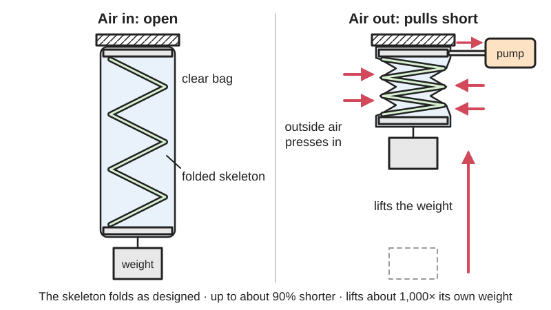

<figure class="eoc-pic eoc-pic-main"><picture><source media="(prefers-reduced-motion: reduce)" srcset="../media/drawn/vacuum-driven-artificial-muscle.svg"></picture><figcaption><strong>Animation.</strong> Diagram drawn for the encyclopaedia from the research notes. ⚑ Needs confirming: a drawing can simplify or get details wrong; a real photo or a better diagram is welcome.</figcaption></figure>

An [actuator](../glossary.md#actuator) made of a compressible skeleton (a folded plastic sheet, a spring, foam or a printed shape) sealed in a flexible skin; removing the air (or liquid) from inside makes the skin pull tight on the skeleton, which folds along its designed pattern to contract by up to about 90%, bend or twist, lifting up to about 1,000 times its own weight.

**In plain words:** A folded or springy inner frame sealed inside a thin airtight bag: when you suck the air out, the outside air squashes the bag onto the frame, and the frame folds up along the path its shape allows, so the whole thing shortens, bends or twists with surprising force, then springs back when air is let in again. **Proper term:** Vacuum-driven artificial muscle (fluid-driven origami-inspired artificial muscle, FOAM).

**Also called:** FOAM, fluid-driven origami-inspired artificial muscle (Li et al. 2017); origami vacuum muscle, origami artificial muscle, origami-inspired artificial muscle (Wyss Institute); vacuum-powered artificial muscle; V-PAM, vacuum-powered pneumatic artificial muscle (Joe et al. 2022, IntechOpen review); negative-pressure actuator, vacuum actuator, vacuum bellows (Joe et al. 2022); skeleton-and-skin actuator ('compressible skeleton, flexible skin and fluid medium') (Li et al. 2017); magic-ball gripper, origami vacuum gripper (MIT News 2019); SOVA and LSOVA, 3D-printable (linear) soft vacuum actuators (Tawk et al. 2018; Joe et al. 2022); LPVAc (low-profile vacuum actuator: a spring inside a polyethylene film pouch) and the related ThinVAc (thin-walled vacuum actuator) (Joe et al. 2022); VAMP, vacuum-actuated muscle-inspired pneumatic structure: a related type made from a buckling rubber honeycomb rather than a skeleton in a bag (ScienceDaily 2016).

## How it works

At rest, the air pressure inside and outside the bag is equal and the skeleton holds its open shape. When fluid is sucked out, the outside pressure presses the skin inwards into the gaps of the skeleton, and the stretched skin pulls on the skeleton like a tensioned membrane (Li et al. 2017). The skeleton can only collapse in the way its folds or voids allow, so a zigzag folds up straight, an asymmetric pattern bends, and a twisted pattern rotates: 'designing how the skeleton folds defines how the whole structure moves' (Wyss Institute). When air is let back in, the springiness of the skeleton opens it out again (Li et al. 2017).

## Parts

A small assembly that acts as one unit: a skeleton (accordion-folded card or plastic sheet, an origami pattern, a metal coil spring, packing foam or a 3D-printed shape), an airtight skin (a plastic film or coated-fabric bag, or a rubber balloon), a tube or connector, and a vacuum source with a valve to let air back in (Li et al. 2017; Wyss Institute; MIT News 2019). The simplest home version is folded cardstock in a sandwich bag with a drinking straw sealed in with hot glue (softrobotics.io).

## Everyday examples

- An accordion-folded strip of card in a sandwich bag that pulls up a small weight when you suck on a straw (softrobotics.io)
- The origami 'magic ball' gripper that closes around soup cans, wine glasses or a broccoli floret like a Venus flytrap (MIT News 2019)
- Vacuum-packed foods or space-saver storage bags, where removing the air pulls the bag tight around what is inside ⚑ [uncertain] (everyday analogy, not from a source)

## When to use it

Use it when you need a strong, light, cheap pulling or gripping motion and a soft, safe actuator: grippers for fragile or oddly shaped objects (MIT News 2019), robot arms and soft robots, wearable assist devices and exoskeletons, which benefit because vacuum muscles don't swell and have a low risk of rupture (Wyss Institute; Joe et al. 2022), underwater devices driven by the surrounding water (Li et al. 2017), and quick experiments, since one can be made in minutes for under a dollar (Wyss Institute; softrobotics.io).

## When not to use it

Not when you need to push: it only pulls, so use a bellows or inflatable actuator or an air cylinder. Not when you need more force for a given size than about one atmosphere of pressure difference can give: positive-pressure muscles such as the McKibben muscle run above 100 kPa (Li et al. 2017), and hydraulics go higher. Not for precise positioning (use a servo, stepper or lead screw). Not for holding a load for long without power (use a latch or brake). The magic-ball gripper struggles with flat objects such as a book (MIT News 2019).

## Details

- **What it does (jobs):**
  - hold or release using power: it pulls or grips while the vacuum is on and lets go when air is let back in (Li et al. 2017; MIT News 2019)
  - change the kind of motion: a change in air pressure becomes a straight pull, a bend or a twist, set by the skeleton's fold pattern (Li et al. 2017)
- **Movement:** multiple: contracts in a straight line (by over 90% of its length in the best designs), bends or twists, depending on the skeleton (Li et al. 2017)
- **Directions it can move (degrees of freedom):** 1 per sealed chamber: each chamber follows the single path its skeleton allows; several chambers or muscles combined give multi-axis motion (Li et al. 2017)
- **Special behaviour:**
  - motion conversion: suction becomes contraction, bending or twisting, programmed by the fold pattern (Li et al. 2017; Wyss Institute)
  - [fail-safe](../glossary.md#fail-safe--fail-secure) or breakaway (in the sense of failing gently): vacuum muscles have 'a lower risk of rupture, failure, and damage' and don't swell while working (Wyss Institute); the related buckling VAMPs still worked with a 2 mm hole and fail safely (ScienceDaily 2016). Note the flip side: losing vacuum makes it go slack and drop its load
  - none of the locking behaviours: it holds only while suction is applied
- **How it holds:**
  - suction or air pressure: the outside air presses the skin onto the skeleton and the skin tension drives the motion (Li et al. 2017; Wikipedia 'Suction cup' for the outside-pressure principle)
  - powered hold: it keeps pulling only while the vacuum is kept
- **Input and output:** Negative pressure (vacuum) -> pulling force and contraction, bending or twisting. Contraction up to over 90% of length; actuation stress about 600 kPa (about six times mammalian skeletal muscle); peak power density over 2 kW/kg; efficiency about 23% driven by air and 59% driven by water; open-loop bandwidth about 1.1 Hz with a 0.5 kg load (Li et al. 2017). 3D-printed TPU vacuum actuators reached 5.54 Hz (Tawk et al. 2018). Back-drivable: yes; it only pulls, and when the vacuum is released the skeleton's springiness and any hanging load stretch it back out (Li et al. 2017).
- **Power:** powered (needs a vacuum pump or other vacuum source, or a water pump for the liquid-driven version; Li et al. 2017). The home version is worked by sucking air out through a straw (softrobotics.io). If the vacuum is lost or the skin is punctured, it relaxes and releases (its force comes only from the pressure difference; Li et al. 2017)
- **Load:** heavy for its weight, but pull only: a 2.6 g muscle lifted 3 kg in 0.2 s at -80 kPa; nylon-skinned zigzag muscles gave a blocked force of about 428 N at -90 kPa; a large nylon-plate muscle lifted a 22 kg car wheel 20 cm (Li et al. 2017); the magic-ball gripper lifts about 100 times its weight, including bottles over 4 lb (1.8 kg) (MIT News 2019). It cannot push, and the home cardstock version lifts under 100 g (softrobotics.io)
- **Play and precision:** noticeable: it is soft, and its length depends on the load and vacuum level; it is not a precise positioner (open-loop bandwidth about 1.1 Hz; model errors of about 7% in force and 11% in contraction; Li et al. 2017). The magic-ball gripper copes with objects of many shapes, grasping objects about 70% of its own diameter (MIT News 2019)
- **Taking it apart:** removable: it connects with a single air tube and is mounted at its two ends; the muscle itself is a sealed unit (permanent) once the skin is closed
- **How often it can be reused:** many times: 3D-printed TPU soft vacuum actuators lasted 123,000 cycles (Tawk et al. 2018); lifetime of film-bag muscles: ⚑ [uncertain] (no cycle test found)
- **Sealing:** airtight or pressure: the skin is sealed round the skeleton by heat-pressing, gluing, welding, zippering or sewing (Li et al. 2017), or with tape and a ring of hot glue round the straw in the home version (softrobotics.io)
- **Adjustable:** yes: force and [stroke](../glossary.md#stroke) rise with the vacuum level (skin tension is proportional to the pressure difference; Li et al. 2017), so a vacuum [regulator](../glossary.md#regulator) or partial vacuum sets how hard it pulls; the motion pattern is fixed by the skeleton
- **Access needed:** not applicable (it is mounted by its two ends and needs one air tube)
- **Materials:** Skeletons: polyester sheet (laser-cut and folded), PEEK, nylon plates, stainless-steel sheet or compression springs, silicone rubber, packing foam, 3D-printed nylon, TPU or water-soluble PVA, even cardstock, cardboard, paper or aluminium foil (Li et al. 2017; Wyss Institute; softrobotics.io). Skins: PVC film, polyester film, TPU film, TPU-coated nylon fabric, PVA film, rubber balloons, plastic sandwich bags (Li et al. 2017; MIT News 2019; softrobotics.io). Fully printed versions: TPU filament, e.g. NinjaFlex (Joe et al. 2022)
- **Heat, cold, water and wear:** Works in air or water, and a water-driven version works underwater (Li et al. 2017). PVA versions dissolve in hot water (about 70 C within 5 minutes; Li et al. 2017). The available pressure difference is limited to the surrounding air pressure (Wikipedia 'Suction cup'). Temperature, sunlight (UV) and long-term [creep](../glossary.md#creep) limits of the film skins and printed skeletons: ⚑ [uncertain] (not found in a source); seams and thin films can leak or puncture over time.

## Making it

- **Ways to make or get it:**
  - laser cut: thin polyester sheet skeletons, then folded by hand (Li et al. 2017)
  - 3D print (FDM): skeletons in nylon, TPU or PVA (Li et al. 2017), or a complete TPU vacuum actuator printed in one piece (Tawk et al. 2018; Joe et al. 2022)
  - hand folding and heat sealing: origami skeleton in a heat-sealed film bag (Li et al. 2017; softrobotics.io)
  - sheet metal or forming: stainless-steel sheet skeletons (Li et al. 2017)
  - off-the-shelf part: a compression spring used as the skeleton (Li et al. 2017; Joe et al. 2022)
- **Printing it in one piece (print in place):** partly: whole bellows-type TPU vacuum actuators print in one piece (Tawk et al. 2018; Joe et al. 2022), but the classic skeleton-in-a-bag muscle needs the skin sealed around the printed skeleton afterwards (Li et al. 2017)
- **Tools:** Home version: scissors, tape and a hot-glue gun; the bag edges can also be heat-sealed with a heat sealer, soldering iron or the glue gun (softrobotics.io). Lab version: a laser cutter or knife to cut and fold the skeleton sheet, a 3D printer for printed skeletons, and an impulse heat sealer for the film skin (Li et al. 2017)
- **Difficulty:** easy: a basic muscle takes about 20 minutes from household materials (softrobotics.io), and the lab versions were built in about 10 minutes from materials costing under US$1 (Wyss Institute); a strong, reliable one needs a good airtight seal and a vacuum pump with a release valve

### 3D printing tips

1) Print the skeleton, then bag it: printed nylon and TPU skeletons were used in the original work, and a 3D-printed PVA skeleton in a PVA film skin even dissolves in hot water (about 70 C) within 5 minutes, so avoid PVA unless you want that (Li et al. 2017). 2) Make the skeleton springy at the folds and stiff in the panels: the hinges must be compliant to fold, and the skeleton's own elasticity is what brings it back after each stroke (Li et al. 2017). 3) Don't make the walls too thin: a skeleton with 1 mm walls buckled at -70 kPa and lost 20% of its force and 50% of its stroke compared with a 3 mm one (Li et al. 2017). 4) Leave air channels through the skeleton so the skin can't seal off pockets of air and jam (Li et al. 2017). 5) Use a thin skin that doesn't stretch much: stretching skin wastes stroke and force (Li et al. 2017). 6) For a fully printed TPU vacuum bellows, airtightness depends on the first layer and bed temperature, sensible (not extreme) retraction, extrusion temperature, speed and cooling (Joe et al. 2022); rigid rings inside the bellows stop it collapsing sideways (a printed origami muscle with inner rings contracted 62% with a 3 kgf load; Joe et al. 2022). 7) Round off sharp corners on printed skeletons so they don't puncture a thin film skin ⚑ [uncertain] (common-sense advice, not tested in a source).

### Buying one (off-the-shelf parts)

Miniature diaphragm vacuum pump or hand vacuum pump; [venturi](../glossary.md#venturi) vacuum generator (on compressed air); 3/2-way valve or [solenoid](../glossary.md#solenoid) valve to vent the muscle; vacuum regulator and gauge; impulse heat sealer; heat-sealable films (PVC, TPU film, polyester) and TPU-coated nylon fabric; compression springs as skeletons; thin polyester (PET) or polypropylene sheet for folded skeletons; silicone or polyurethane air tube and barbed connectors; drinking straws and zip bags for demos (Li et al. 2017; softrobotics.io; Joe et al. 2022)

## Rules of thumb

- The pull comes from skin tension, estimated as T = pressure difference x radius of curvature of the skin x width of the gap (Laplace's law) (Li et al. 2017)
- The pressure difference can never be more than the outside air pressure (about 100 kPa at sea level), because the force on a sealed area is area times outside pressure at best (Wikipedia 'Suction cup': F = A x P, with P 'typically atmospheric pressure'); the FOAM tests used -70 to -90 kPa (Li et al. 2017)
- Skeleton shape sets the motion: a symmetrical zigzag gives up to 90% straight contraction, a Miura-ori sheet 92% surface contraction, a waterbomb pattern turns a sphere into a cylinder (91%), and an asymmetric arrangement bends or twists (Li et al. 2017)
- Strength: about 600 kPa actuation stress, about six times mammalian muscle; a 2.6 g, 10 cm muscle lifted 3 kg within 0.2 s at -80 kPa (Li et al. 2017)
- Keep skeleton walls thick enough not to buckle: 1 mm walls buckled at -70 kPa, 3 mm did not (Li et al. 2017)
- Driven by water instead of air, it is far more efficient (about 59% versus 23%) (Li et al. 2017)
- If you drive it with positive pressure instead, the skin must be fixed to the skeleton at specific points to pull it (Li et al. 2017)
- Home cardstock-in-a-bag version: about 2 inches (5 cm) of travel and under 100 g of lift; a wider tube makes it move faster (softrobotics.io)
- 3D-printed TPU soft vacuum actuators: about 16 N output force, 5.54 Hz and 123,000 cycles (Tawk et al. 2018)

## Common failures

1) Leaks at the seams or around the tube, so it never pulls hard: seal edges fully and put a ring of glue round the tube (softrobotics.io; Li et al. 2017). 2) A punctured or stretched skin: use a tough, non-stretchy film (Li et al. 2017). 3) Skeleton buckles instead of folding, losing force and stroke: thicken walls or panels (Li et al. 2017). 4) Air pockets trapped by the skin so it stops part-way: add channels through the skeleton (Li et al. 2017). 5) It doesn't spring back after the vacuum is released: the skeleton isn't elastic enough (Li et al. 2017). 6) A gripper that can't pick up flat things (MIT News 2019).

## Safety

1) Vacuum is one of the safer ways to power a soft actuator: it doesn't expand and has a lower risk of rupture than inflated muscles (Wyss Institute; Li et al. 2017). 2) It is still strong and fast (a 2.6 g muscle lifted 3 kg in 0.2 s; Li et al. 2017), so keep fingers out of closing grippers and folding skeletons. 3) If the vacuum is lost or the skin is punctured, it goes slack and drops anything it is lifting, so don't hold loads over people with it. 4) Heat sealers, soldering irons and hot-glue guns used to seal the bag are hot (softrobotics.io suggests all three). 5) For water-driven versions, keep pumps and wiring away from leaks.

## Related

- Pneumatic artificial muscle (McKibben muscle): shortens when inflated, using a braided sleeve and positive pressure; vacuum muscles are safer but limited to about one atmosphere of pressure difference
- Soft pneumatic bending actuator: bends when inflated rather than when air is removed
- Bellows and inflatable actuators: push or lift by inflating; the same bellows can also contract under vacuum
- Granular jamming gripper: also uses vacuum, but to make a soft bag go stiff, not to move it
- Vacuum (suction) gripper and suction cup: hold by suction on a surface rather than by moving
- Origami mechanisms (waterbomb, Kresling, Miura-ori): the fold patterns used as skeletons
- VAMP (buckling rubber vacuum actuator): a rubber honeycomb that collapses under vacuum, with no separate skeleton (ScienceDaily 2016)
- Twisted-and-coiled polymer muscle and shape-memory-alloy wire: muscles driven by heat or electricity instead of vacuum
- Venturi vacuum generator and diaphragm pump: ways to make the vacuum

## Make it yourself

- [Making Origami Soft Robots from Low Cost Household Materials (softrobotics.io, FlowIO Platform by Ali Shtarbanov)](https://www.softrobotics.io/post/making-simple-origami-soft-robots-from-low-cost-household-materials): 20-minute tutorial for a vacuum origami muscle from cardstock, a sandwich bag, a straw, tape and hot glue, with ideas for other fold patterns, multi-chamber muscles and grippers *(licence: CC BY-NC-SA 4.0)*
- [Fluid-driven origami-inspired artificial muscles (Li et al., PNAS 2017)](https://pmc.ncbi.nlm.nih.gov/articles/PMC5740677/): Open-access paper giving the three-step build (make a skeleton, prepare the skin, seal it) and the materials used for each example muscle *(licence: CC BY-NC-ND 4.0)*

## Pictures, videos and models

- [Origami Inspired Artificial Muscles (Wyss Institute, YouTube)](https://www.youtube.com/watch?v=_tKI8BUHFLo): Video of origami vacuum muscles contracting, twisting, gripping and lifting heavy loads *(licence: link only (standard YouTube licence))*
- [Artificial muscles give soft robots superpowers (Wyss Institute news, 2017)](https://wyss.harvard.edu/news/artificial-muscles-give-soft-robots-superpowers/): Photos and video of FOAMs made from springs, folded plastic and foam, lifting up to 1,000 times their own weight *(licence: link only)*
- [Robot hand is soft and strong (MIT News, 2019)](https://news.mit.edu/2019/new-robot-hand-gripper-soft-and-strong-0315): Photos and video of the vacuum-driven origami 'magic ball' gripper closing around many different objects *(licence: link only)*
- [Fluid-driven origami-inspired artificial muscles (Li, Vogt, Rus and Wood, PNAS 2017; open-access copy on PubMed Central)](https://pmc.ncbi.nlm.nih.gov/articles/PMC5740677/): Figures of the skeleton-skin-fluid principle, zigzag, Miura-ori and waterbomb skeletons, and muscles in many materials lifting loads *(licence: CC BY-NC-ND 4.0)*
- [A Review on Vacuum-Powered Fluidic Actuators in Soft Robotics (Joe, Bernabei and Beccai, IntechOpen 2022)](https://www.intechopen.com/chapters/81562): Illustrated overview of vacuum actuator types: bellows, origami skeletons, springs in pouches, buckling designs and 3D-printed TPU actuators *(licence: CC BY 3.0 (some figures reproduced with permission from other publishers))*

## Needs confirming

⚑ marks something nobody has confirmed yet: a fact the research could not confirm from a source, a finder value that is a best guess, or an open point from the research notes. Corrections are welcome (see `research/needs-confirming.md`).

- ⚑ 4 sentences on this page marked [uncertain].
- ⚑ Finder value `power_source` = compressed air, liquid, suction (best guess): `power` names several power sources, and not all may apply
- ⚑ Finder value `power_loss` = not applicable (best guess): uses power, but `power` does not say what happens when it is lost
- ⚑ Finder value `powered_does` = move or push something (best guess): set by Claude from the entry's name and power text (R33), for "What should it do?" under "Hold or let go using power"
- ⚑ Research note: *Vacuum-driven artificial muscle*: two `safety_notes` points (keep fingers clear; it drops its load if the vacuum is lost) are the agent's reasoning from the mechanism, not from a source, and are not marked. The entry has only 12 sources.

## Sources

- <https://pmc.ncbi.nlm.nih.gov/articles/PMC5740677/>
- <https://www.ebi.ac.uk/europepmc/webservices/rest/PMC5740677/fullTextXML>
- <https://api.semanticscholar.org/graph/v1/paper/DOI:10.1073/pnas.1713450114>
- <https://wyss.harvard.edu/news/artificial-muscles-give-soft-robots-superpowers/>
- <https://wyss.harvard.edu/technology/foams-soft-robotic-artificial-muscles/>
- <https://www.youtube.com/watch?v=_tKI8BUHFLo>
- <https://news.mit.edu/2019/new-robot-hand-gripper-soft-and-strong-0315>
- <https://www.sciencedaily.com/releases/2016/06/160601132314.htm>
- <https://www.intechopen.com/chapters/81562>
- <https://api.semanticscholar.org/graph/v1/paper/DOI:10.1089/soro.2018.0021>
- <https://www.softrobotics.io/post/making-simple-origami-soft-robots-from-low-cost-household-materials>
- <https://en.wikipedia.org/wiki/Suction_cup>
