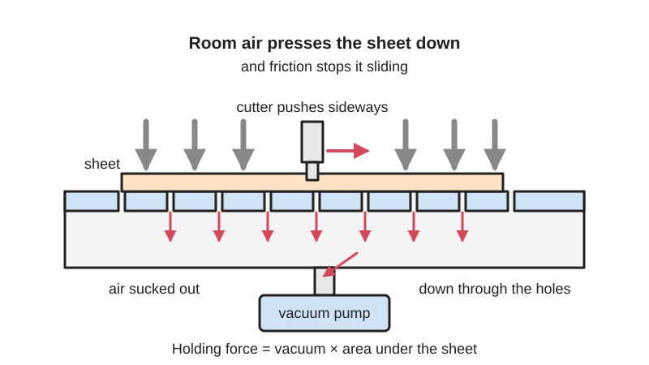
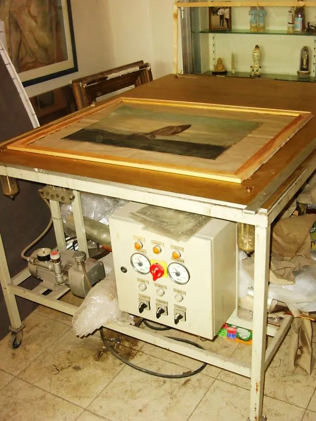
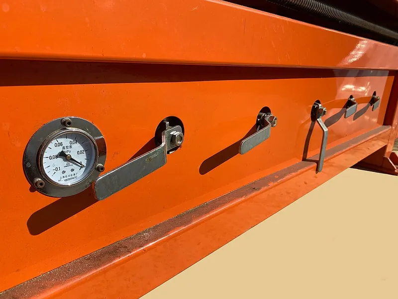

<figure class="eoc-pic eoc-pic-main"><figcaption>Diagram drawn for the encyclopaedia from the research notes. ⚑ Needs confirming: a drawing can simplify or get details wrong; a real photo or a better diagram is welcome.</figcaption></figure>
<figure class="eoc-pic"><figcaption><strong>Photo.</strong> <a href="https://commons.wikimedia.org/wiki/File:Vacu%C3%BCmtafel.jpg">Vacuümtafel</a> by Paul Hermans at Dutch Wikipedia, <a href="http://creativecommons.org/licenses/by-sa/3.0/">CC BY-SA 3.0</a>, from Wikimedia Commons.</figcaption></figure>
<figure class="eoc-pic"><figcaption><strong>How it works.</strong> <a href="https://commons.wikimedia.org/wiki/File:Manual_vacuum_table_valve_control.jpg">Manual vacuum table valve control</a> by Jaecnc, <a href="https://creativecommons.org/licenses/by-sa/4.0">CC BY-SA 4.0</a>, from Wikimedia Commons.</figcaption></figure>

A perforated or grooved plate over a sealed chamber that a vacuum source keeps below room pressure, so the air above presses any flat sheet laid on it down onto the plate and friction stops it sliding while it is milled, laser-cut, drilled or printed on.

**In plain words:** A flat, airtight box whose top is full of small holes or grooves: lay a sheet on top, switch on a vacuum pump or shop vacuum, and the air pressure in the room presses the sheet flat and holds it still while you cut it, with no clamps, screws or tape in the way. **Proper term:** Vacuum table (vacuum hold-down table, vacuum workholding).

**Also called:** vacuum hold-down, vacuum hold-down system, universal vacuum table (Make:; CNC Cookbook); vacuum workholding, vacuum workholding table (Printables 1362329); vacuum bed, CNC vacuum bed (CanCam); vacuum chuck, vacuum fixture, vacuum plate, vacuum tombstone (CNC Cookbook 'Vacuum Chucks, Fixtures and Clamping'); vacuum pods or vacuum clamps (moveable pads on a pipe, Mekanika); grid table (holes or criss-cross grooves) and plenum table (Mekanika; CNC Cookbook); plenum (the grooved bottom layer) and bleeder board, spoilboard or spoil board (the porous MDF top layer) (Mekanika; CNC Cookbook; CanCam); vacuum fixture table, PCB vacuum table, sinterplate (sintered porous plate, e.g. LPKF (brand)) (Printables 1513539, 668832; Hackaday 2019 comments); vacuum stencil jig for solder paste (Printables 451126); table a depression (French), vacuumtafel (Dutch) (Printables 370205; Wikimedia Commons file name); Airweights (brand) vacuum workholding system (named in Printables 1362329); magnetic clamping table or magnetic chuck: the steel-only equivalent (Wikipedia 'Vacuum table').

## How it works

The pump pulls air out of the chamber under the plate, so the pressure underneath the workpiece drops below the room's air pressure; the higher pressure on top then pushes the sheet down with a force equal to the pressure difference times the area the vacuum acts on (Wikipedia 'Vacuum table'; Mekanika). That downward push also raises the friction between sheet and table, which is what stops the cutter dragging the part sideways (Wikipedia; Mekanika). Any leak, from a gap at the edge, a porous sheet or a cut that goes right through, lets air in and lowers the hold, so tables use gaskets, zones with valves, or a pump with enough air flow to keep up with the leaks (CNC Cookbook). With a porous MDF bleeder board on top, the vacuum spreads under the whole sheet instead of only under the grooves, giving more hold but more leakage (Mekanika; CNC Cookbook).

## Parts

A small assembly that acts as one unit: a sealed base or plenum with grooves or a hole grid, an optional porous MDF bleeder board on top, a gasket cord or foam strip around the work area, a hose or PVC pipe network with ball valves for zones, a vacuum gauge, an inlet filter, and a vacuum source (shop vacuum, vacuum motor, side-channel blower, rotary-vane pump or compressed-air [venturi](../glossary.md#venturi)) (Mekanika; Make:; CNC Cookbook).

## Everyday examples

- The MDF 'spoilboard' bed on many CNC routers in maker spaces and sign shops, which is a vacuum table (CanCam; Make:)
- Vacuum chucks used to hold wooden bowls on a lathe (CNC Cookbook 'Vacuum Chucks')
- Laser-cutter honeycomb beds with a dust collector or shop vacuum underneath, used to hold paper, fabric and film flat (Avid CNC forum; Hackaday 2016)
- Solder-paste stencil jigs and PCB milling plates (Printables 451126; Hackaday 2019)

## When to use it

Use a vacuum table when you cut or engrave flat sheets and want the whole top surface and all edges free for the tool: plywood, MDF, plastics, aluminium sheet, composites and foam board on a CNC router (Mekanika), thin copper-clad boards for PCB milling, which it pulls completely flat (Hackaday 2019), and thin, curly or warped material on a laser cutter, such as paper, fabric and film (Hackaday 2016; Avid CNC forum). It saves time on repeated jobs because there is nothing to screw or clamp (Mekanika; Hackaday 2024), avoids wasting stock around clamps and screws (Mekanika), and does not mark the surface, which is why bowl turners use vacuum chucks (CNC Cookbook 'Vacuum Chucks'). Unlike a magnetic chuck it holds non-ferrous materials (Wikipedia).

## When not to use it

Avoid it for small parts with little area, which have little hold-down and pop off (CNC Cookbook; Mekanika): use double-sided tape, tape and superglue, screws or tabs instead (hackaday.io 166349). Avoid it for porous, rough, warped-in-two-directions or irregular workpieces that leak (Mekanika; CNC Cookbook): use toggle clamps, a vise or screws. Heavy cuts in metal on a light table, and tall parts with a small base, can overcome the hold (CNC Cookbook 'Vacuum Chucks'): use a vise or mechanical clamps. Steel parts can be held more simply with a magnetic chuck (Wikipedia). If you only use the machine occasionally, a full table may not be worth the cost (Mekanika).

## Details

- **What it does (jobs):**
  - join and hold: holds a flat sheet or plate still on a machine bed for cutting, engraving, drilling or printing, with nothing on top in the tool's way (Wikipedia; Mekanika)
  - hold or release using power: it holds only while the vacuum source runs, and lets go when the vacuum is switched off or vented (CNC Cookbook 'Vacuum Chucks')
- **Movement:** none: it holds the workpiece still against the table
- **Directions it can move (degrees of freedom):** 0 while the vacuum is on: the sheet is pressed down so it can't lift, and friction (plus optional dowel pins or stops) keeps it from sliding or turning (Mekanika; CNC Cookbook). With the vacuum off the sheet is free to lift off
- **Special behaviour:**
  - quick-release: switch off or vent the vacuum (a ball valve on the line does it without stopping the pump) and the part lifts straight off; loading needs no tools (CNC Cookbook 'Vacuum Chucks'; Mekanika)
- **How it holds:**
  - suction or air pressure: the room's air pressure pushes the sheet onto the low-pressure plate (Wikipedia 'Vacuum table')
  - friction or clamping ([force-fit](../glossary.md#form-fit--force-fit--material-bond)): sideways grip comes only from friction between sheet and table, which the air pressure increases; Mekanika uses a friction coefficient of 0.40 for wood on wood (Mekanika; Wikipedia)
  - powered hold: the hold lasts only while the vacuum source keeps the chamber evacuated (CNC Cookbook)
- **Input and output:** not applicable
- **Power:** powered: needs a running vacuum source, such as a shop vacuum or vacuum motor, a side-channel (regenerative) blower, a rotary-vane pump or a compressed-air venturi generator (CNC Cookbook; Mekanika; Printables 370205). If power fails the vacuum leaks away and the part is released, or pops off under the cutter (CNC Cookbook). A vacuum tank on the line gives 'a little extra capacity' (CNC Cookbook 'Vacuum Chucks'); a [check valve](../glossary.md#check-valve) to hold vacuum briefly after a pump stops is common practice ⚑ [uncertain]
- **Load:** Pull-off force = vacuum x area: at most about 10 N per square cm (14.7 psi) at sea level with a perfect vacuum, so a 10 in x 10 in part could in theory be held with almost 1,500 lb (CNC Cookbook). Real tables reach less: a shop vacuum about 2-2.5 psi, a regenerative blower about 4-5 psi (8-10 inHg), rotary-vane and liquid-ring pumps nearer full vacuum (CNC Cookbook). Mekanika's side-channel blower at 250 mbar under a 50 x 50 cm board gives 625 kg in theory, about 300 kg allowing for 50% effective groove area, and about 120 kg of sideways friction. So it is heavy for large sheets, light for small parts; strongest against straight lifting, weaker sideways (friction only) and weakest against levering or peeling, e.g. tall parts or a cutter grabbing an edge (CNC Cookbook 'Vacuum Chucks')
- **Play and precision:** No play while held, and the sheet is pulled flat against the table, which is why it suits thin PCBs and warped sheets (Hackaday 2019; Hackaday 2016). It does not locate the part by itself: for repeatable or two-sided work, add dowel pins in matching holes or work stops (CNC Cookbook; Make:; Hackaday 2019, raised pegs for double-sided PCBs). Flatness of the table limits [accuracy](../glossary.md#repeatability--accuracy), so the bleeder board is resurfaced on the machine (CNC Cookbook; Mekanika). The sheet can still slide if cutting forces beat friction
- **Taking it apart:** tool-free quick release for the workpiece (vent the vacuum and lift it off). The table itself is bolted or screwed to the machine bed and can be removed (Printables 1362329 uses M4 threaded inserts in the spoilboard; hackaday.io 166349)
- **How often it can be reused:** effectively unlimited: the table is reused for every job; only the sacrificial bleeder board is resurfaced from time to time and replaced when too thin (CNC Cookbook; Make:)
- **Sealing:** airtight or pressure (vacuum): a gasket cord or closed-cell foam strip around the work area, sealer on MDF faces and edges, and the workpiece itself acting as the lid; unused holes are covered with paper, card or rubber mats (Mekanika; Make:; CNC Cookbook; Hackaday 2016; hackaday.io 166349)
- **Adjustable:** yes: the vacuum area is changed with valved zones, gasket cord pressed into grooves, or paper or plywood blanking sheets, and the vacuum level is watched on a gauge (Mekanika; Make:; CNC Cookbook). A relief valve lets a minimum air flow through a side-channel blower (Mekanika)
- **Access needed:** one side only (blind): the part is simply laid on top, leaving the top and edges free for the tool (Wikipedia)
- **Materials:** Table: MDF plenum sealed with polyurethane, epoxy or thinned wood glue; HDPE, ABS, PVC, PLA or nylon boards; machined aluminium; 3D-printed PLA or PETG tiles; porous bleeder of 'Ultralite' MDF (about 40% lighter and more porous than normal MDF); laminate (Formica) skin to avoid scratching delicate parts (Make:; Mekanika; CNC Cookbook; Wikipedia; Printables 1513539). Workpieces it holds well: plywood, MDF, hardwood, acrylic, polycarbonate, PVC, aluminium, brass, steel, carbon fibre, glass fibre and dense foam board, i.e. flat, smooth, non-porous sheets (Mekanika). Poor: porous or very rough sheets, foam board and MDF workpieces that leak, warped or irregular shapes, and tiny parts (Mekanika; CNC Cookbook)
- **Heat, cold, water and wear:** Hold depends on air pressure: it is lower at high altitude and changes slightly with the weather (Mekanika). Hot substrates need a table built with high-temperature epoxy (Wikipedia 'Vacuum table'). Liquid coolant must be kept out of the pump with a separator, and an oil-filled pump will inhale coolant that leaks past the seal (CNC Cookbook 'Vacuum Chucks'). Dust and chips spoil the seal and act like ball bearings under the part, and chips can jam a side-channel blower's impeller (CNC Cookbook; Mekanika). Side-channel blowers overheat and can seize if starved of air flow (Mekanika). MDF tables swell and lose flatness when wet ⚑ [uncertain]. On a laser cutter, a wooden table and the strong air flow are a fire risk (Hackaday 2016 comments; Avid CNC forum).

## Making it

- **Ways to make or get it:**
  - CNC: machined MDF, plastic or aluminium plenum with grooves or a hole grid, faced flat on the machine itself (Mekanika; hackaday.io 166349; Hackaday 2024)
  - laser cut: MDF box with a slotted top for a laser cutter (Hackaday 2016)
  - woodwork: MDF base, plenum and bleeder board glued and sealed, PVC plumbing (Make:)
  - 3D print (FDM): modular tiles or small fixture tables for desktop CNCs and PCB milling (Printables 1362329, 1513539)
  - off-the-shelf part: commercial vacuum tables, chucks, pods and pumps (Mekanika; CNC Cookbook)
- **Printing it in one piece (print in place):** no: printed tables are flat tiles or plates that are glued together and fitted with a gasket and a hose fitting (Printables 1362329, 1513539)
- **Tools:** none to load or unload a part. To build or service one: a CNC router or table saw for the plenum, sealer (polyurethane, epoxy or thinned wood glue) for MDF, gasket cord or foam strip, PVC pipe and glue or push-in fittings, ball valves and a vacuum gauge (Make:; Mekanika; CNC Cookbook)
- **Difficulty:** easy to moderate: a laser-cut or CNC-cut MDF box with slots and a shop vacuum works for laser cutting and light routing (Hackaday 2016; CNC Cookbook), and printable tiles exist (Printables 1362329); a flat, well-sealed, zoned table with a proper pump for metal cutting is moderate to hard (hackaday.io 166349)

### 3D printing tips

1) Print walls thick and solid enough to be airtight: one PCB fixture table recommends PLA or PETG, 4-5 [perimeters](../glossary.md#perimeters) ('important for vacuum sealing'), at least 6 top and bottom layers, 0.2-0.28 mm layers, no supports (Printables 1513539). 2) Seal joints and pores: a modular design glues tiles together with generous thick CA (superglue), which also seals the gaps between them, and glues the threaded air adapter on with visible squeeze-out (Printables 1362329). 3) Add a gasket: foam tape or rubber cord round the perimeter (Printables 1513539), or 1/4 in x 1/8 in closed-cell foam weather strip pressed into a grid of grooves to make temporary zones (Printables 1362329). 4) Use a hose fitting you can thread: 1/4 in NPT quick-connect fittings and 1/4 in hose for a small pump (Printables 1362329), or a 1 in duct for a shop vacuum (Printables 1513539). 5) Add alignment: printed tiles can take 3 mm steel dowels or printed pins for fixture plates (Printables 1362329). 6) Keep it light duty: printed tables are meant for PCB milling, engraving and light cuts, and a crash into a printed table is cheap (Printables 1513539, 1362329). 7) Put a sacrificial spoilboard (MDF, acrylic or FR4) on top if the tool may cut through (Printables 1513539). 8) Printed plastic softens with heat, so keep it away from hot substrates and laser beams ⚑ [uncertain]

### Buying one (off-the-shelf parts)

Vacuum sources: shop vacuum or wet-dry vacuum, vacuum motors (as used in central vacuum systems), side-channel (regenerative) blowers, rotary-vane vacuum pumps, liquid-ring pumps, compressed-air venturi vacuum generators (e.g. PIAB (brand); ZU05S type), converted compressors (CNC Cookbook; Mekanika; Printables 370205). Table parts: aluminium vacuum plates and grid tables, vacuum pods, round vacuum chucks, sinterplates, Ultralite MDF bleeder board, neoprene or closed-cell foam gasket cord, rubber hole mats, ball valves or gate valves for zones, vacuum gauges, inlet filters, relief valves, liquid separators or coolant traps, VacuCard (brand) paper backing sheets (Make:; Mekanika; CNC Cookbook; hackaday.io 166349)

## Rules of thumb

- Hold-down force = pressure difference x area that sees the vacuum; with a non-porous plate only the area of the grooves or holes under the part counts, not the whole part (CNC Cookbook; Mekanika)
- Check sideways grip, not just lift: sideways resistance = friction coefficient x hold-down; for wood on wood use about 0.40, so 6,250 N of hold-down resists about 2,500 N sideways (Mekanika)
- Use a safety factor: CNC Cookbook's calculator halves the calculated hold-down by default (2x factor), and tall parts with small bases need more margin because the cutter gets leverage (CNC Cookbook 'Vacuum Chucks')
- Typical vacuum levels: shop vacuum 2-2.5 psi; regenerative blower 4-5 psi (8-10 inHg); rotary-vane and liquid-ring pumps up to nearly full vacuum (CNC Cookbook); a working universal table should read about 15-20 inHg on its gauge when new (Make:)
- Vacuum level sets how hard a sealed part is held; air flow (CFM) sets how many leaks the pump can keep up with. A leaky 4 x 8 ft MDF table needs 200 CFM or more; one rule of thumb is 25 hp of pump for a 4 x 8 ft table, with 12 hp about the minimum (CNC Cookbook)
- A side-channel blower's vacuum falls as air flow rises: one 1.5 kW blower gives 285 mbar when sealed but only 150 mbar with 90 m3/h of leakage through MDF, nearly halving the force (Mekanika)
- Remove the dense skins of MDF bleeder boards so air can pass: fly-cut about 0.050 in (CNC Cookbook) or at least 0.5 mm (CanCam) off both faces, and seal the four edges (CanCam; Make:)
- Groove-and-cord gaskets: with 1/8 in closed-cell foam cord, mill grooves about 0.08 in deep or less (0.1 in gave poor seals), break the groove edges, and space grooves so stock in whole inches always overlaps a seal (CNC Cookbook 'Vacuum Chucks', quoting a builder)
- Plumb zones with 2 in PVC and ball valves; avoid sharp bends and use Y fittings rather than tees (Make:); fit an inlet filter, and a relief valve so a side-channel blower always has some air flow (Mekanika)
- To keep small parts from flying off: leave a thin 'onion skin' at the bottom and cut it last with a light pass, use tabs, and keep nested parts attached as long as possible (CNC Cookbook; Make:)
- If the table must take liquid coolant, fit a liquid separator or coolant trap before the pump (CNC Cookbook)

## Common failures

1) Part pops off or slides at the end of a cut, when through-cuts leak the vacuum: cut an onion skin or use tabs, cut small parts first, and use pins or stops against sliding (CNC Cookbook; Make:). 2) Weak hold from leaks at board edges, unused zones, kinked hoses or bad plumbing: seal MDF edges, tape the edges, close unused zones, use cling film to find leaks, and avoid sharp bends and restrictions (CNC Cookbook; Make:). 3) Bleeder board 'not bleeding' because the MDF skins are too dense, or too leaky because it is too porous: surface both faces, or stack two boards or add a 1/4 in ply mask to cut air flow (CNC Cookbook; CanCam). 4) Cutting too deep into the spoilboard so it leaks and wears out: minimise cut-through depth and resurface or replace it when rough; a falling gauge reading is the warning (CNC Cookbook; Make:). 5) Gasket crushed flat so only the grooves pull: keep grooves shallow and cord sized to them (CNC Cookbook 'Vacuum Chucks'). 6) Blower failure from chips or overheating: inlet filter and relief valve (Mekanika). 7) Tiny drilled vacuum holes in aluminium break drill bits: hackaday.io builder broke many 0.2 mm drills before 0.3 mm worked (hackaday.io 166349).

## Safety

1) Parts that break loose: if cutting forces beat the hold, the part can be lifted, spun by the cutter and thrown; CNC Cookbook describes a plate that broke loose and spun until the E-stop was hit, so use an enclosure and eye protection (CNC Cookbook 'Vacuum Chucks'). 2) Power cut or pump trip releases the part immediately (CNC Cookbook). 3) Noise: vacuum pumps and blowers add a lot of workshop noise (Mekanika); wear hearing protection ⚑ [uncertain]. 4) Oil mist: oil-sealed rotary-vane pumps can discharge oil mist from the exhaust (Wikipedia 'Rotary vane pump'), and one builder's cheap pump 'put out some oily smoke' (CNC Cookbook 'Vacuum Chucks'), so vent or filter the exhaust. 5) Laser cutters: a wooden vacuum box can be cut through and set alight if laser power is too high, and embers can be sucked into the dust bin, so empty the bin first (Hackaday 2016 comments; Avid CNC forum). 6) Vacuum itself is low risk compared with compressed air, with no stored pressure to burst (fluid-power family notes) ⚑ [uncertain]

## Related

- Vacuum (suction) gripper: the same suction idea on small cups that pick parts up and move them, instead of holding a sheet on a fixed table
- Suction cup: a passive cup that holds by trapped low pressure with no pump; slowly leaks
- Venturi vacuum generator: a no-moving-parts vacuum source run from compressed air that can power a small vacuum table, at the cost of a lot of air (CNC Cookbook; Hackaday 2019 comments; Printables 370205)
- Diaphragm pump (micro vacuum pump): a small electric vacuum source for small vacuum fixtures
- Switchable permanent magnet (magnetic chuck): holds steel parts on a table the same way, by switching a magnet instead of a pump; won't hold aluminium, wood or plastic (Wikipedia 'Vacuum table')
- Double-sided foam tape: the cheap alternative for small parts, but hard to remove afterwards (hackaday.io 166349)
- Toggle clamp: a mechanical clamp that holds any material and shape, but gets in the tool's way and marks the work
- Granular jamming gripper: also uses vacuum, but to harden a bag of grains round an odd shape
- Locating pins (dowel pins and work stops): added to a vacuum table to line parts up and stop sliding (CNC Cookbook)
- Air hockey table and air caster: the opposite idea, blowing air through holes to float things instead of sucking them down ⚑ [uncertain]

## Make it yourself

- [Modular CNC Vacuum Workholding Table (Gobbo Lab, Printables) (URL from Printables API, page not opened)](https://www.printables.com/model/1362329-modular-cnc-vacuum-workholding-table): Printable tiles glued together with CA into a vacuum table of any size, with a grid for foam gasket zones, a 1/4 in NPT air adapter and dowel holes for fixture plates *(licence: CC BY-NC)*
- [Vacuum Fixture Table for CNC 3018 (emab, Printables) (URL from Printables API, page not opened)](https://www.printables.com/model/1513539-vacuum-fixture-table-for-cnc-3018): Printed vacuum fixture for PCBs up to 150 x 200 mm on a 3018 desktop CNC, run from a shop vacuum through a 1 in duct; print settings given *(licence: CC BY-NC-SA)*
- [Table a depression / Vacuum table (jerrydi, Printables) (URL from Printables API, page not opened)](https://www.printables.com/model/370205-table-a-depression-vacuum-table): Printed bench vacuum table for holding boards for sanding, screwing or routing, powered by compressed air through a ZU05S venturi vacuum generator *(licence: CC BY-NC)*
- [Vacuum PCB Solder Stencil Jig (djos_1475, Printables) (URL from Printables API, page not opened)](https://www.printables.com/model/451126-vacuum-pcb-solder-stencil-jig): Printed vacuum box that holds a PCB and solder stencil (up to 200 x 200 mm) in place for applying solder paste *(licence: GPL v3)*

## Pictures, videos and models

- [Vacuumtafel.jpg (Paul Hermans; Wikimedia Commons)](https://commons.wikimedia.org/wiki/File:Vacu%C3%BCmtafel.jpg): Photo of a vacuum table (the image used on the Wikipedia 'Vacuum table' article) *(licence: CC BY-SA 3.0 or GFDL 1.2+)*
- [Manual vacuum table valve control.jpg (Jaecnc; Wikimedia Commons)](https://commons.wikimedia.org/wiki/File:Manual_vacuum_table_valve_control.jpg): Lever valves on an older CNC machine used to switch vacuum on and off for each zone of the table *(licence: CC BY-SA 4.0)*
- [How to Design a Vacuum Table for Your CNC Machine (Mekanika)](https://www.mekanika.io/en/blog/cnc-milling/how-to-design-a-vacuum-table-for-your-cnc-machine): Infographics of vacuum-table physics and forces, the parts of a system, a grooved plenum with cross-pattern holding squares, a blower performance curve, and the build with PVC zone plumbing *(licence: link only)*
- [ShopBot Desktop Universal Vacuum Hold-down System (Make:)](https://makezine.com/projects/shopbot-desktop-universal-vacuum-hold-down-system/): Step-by-step photos of a three-layer MDF universal vacuum table (base, grooved plenum, porous bleeder board), sealing, plumbing and use *(licence: link only)*
- [DIY Vacuum Table Enhances PCB Milling (Hackaday, 2019)](https://hackaday.com/2019/01/28/diy-vacuum-table-enhances-pcb-milling/): Small aluminium vacuum table for 100 x 80 mm PCBs with raised pegs for two-sided boards *(licence: link only)*

## Needs confirming

⚑ marks something nobody has confirmed yet: a fact the research could not confirm from a source, a finder value that is a best guess, or an open point from the research notes. Corrections are welcome (see `research/needs-confirming.md`).

- ⚑ 6 sentences on this page marked [uncertain].
- ⚑ Finder value `power_source` = electricity, compressed air, suction (best guess): `power` names several power sources, and not all may apply
- ⚑ Finder value `power_loss` = lets go (source uncertain): `power` is marked ⚑ [uncertain] here: "…ck valve to hold vacuum briefly after a pump stops is common practice ⚑ [uncertain]…"
- ⚑ Finder value `load_max` = medium (best guess): no light/medium/heavy band in `load`; defaulted to medium
- ⚑ Finder value `made_of` = 3D prints, plastic sheet, tube or moulded parts, wood, metal, foam, carbon fibre or composites (best guess): proposed from the words in the research text (R37); not yet checked

## Sources

- <https://en.wikipedia.org/wiki/Vacuum_table>
- <https://en.wikipedia.org/wiki/Rotary_vane_pump>
- <https://www.mekanika.io/en/blog/cnc-milling/quick-guide-to-cnc-vacuum-table>
- <https://www.mekanika.io/en/blog/cnc-milling/how-to-design-a-vacuum-table-for-your-cnc-machine>
- <https://www.cnccookbook.com/router-vacuum-table-cnc-diy/>
- <https://www.cnccookbook.com/vacuum-chucks-fixtures-clamping-systems/>
- <https://makezine.com/projects/shopbot-desktop-universal-vacuum-hold-down-system/>
- <https://www.cancam.ca/learning-centre/spoilboard-surfacing-and-improving-suction-on-a-vacuum-table/>
- <https://hackaday.com/2019/01/28/diy-vacuum-table-enhances-pcb-milling/>
- <https://hackaday.com/2024/03/31/modular-vacuum-table-custom-fits-the-parts/>
- <https://hackaday.com/2016/03/19/diy-vacuum-table-makes-lasering-even-easier/>
- <https://hackaday.io/project/166349-diy-vacuum-table-for-cnc-machines>
- <https://forum.avidcnc.com/t/vacuum-honeycomb-table-for-laser-cutting/1617>
- <https://commons.wikimedia.org/wiki/Category:Vacuum_tables>
- <https://commons.wikimedia.org/wiki/File:Vacu%C3%BCmtafel.jpg>
- <https://commons.wikimedia.org/wiki/File:Manual_vacuum_table_valve_control.jpg>
- <https://commons.wikimedia.org/wiki/File:Automatic_valve_control.jpg>
- <https://api.printables.com/graphql/>
- <https://www.printables.com/model/1362329-modular-cnc-vacuum-workholding-table>
- <https://www.printables.com/model/1513539-vacuum-fixture-table-for-cnc-3018>
- <https://www.printables.com/model/370205-table-a-depression-vacuum-table>
- <https://www.printables.com/model/451126-vacuum-pcb-solder-stencil-jig>
- <https://www.printables.com/model/668832-lpkf-vacuum-table-sinterplate-replacement>
