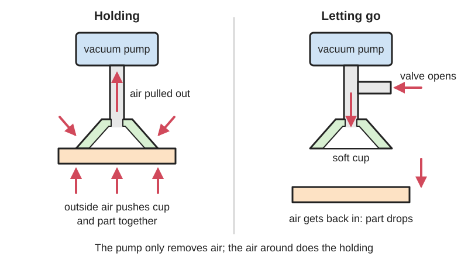
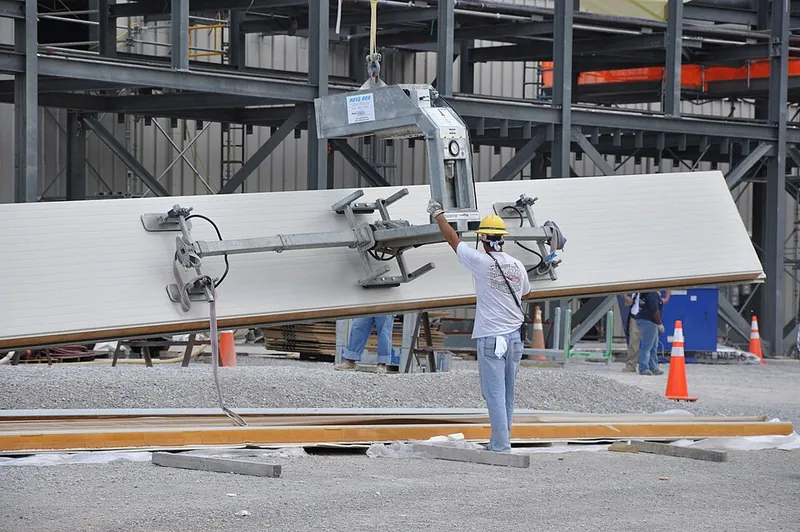
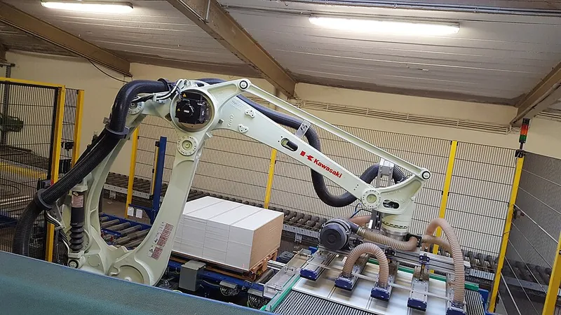

<figure class="eoc-pic eoc-pic-main"><figcaption>Diagram drawn for the encyclopaedia from the research notes. ⚑ Needs confirming: a drawing can simplify or get details wrong; a real photo or a better diagram is welcome.</figcaption></figure>
<figure class="eoc-pic"><figcaption><strong>How it works.</strong> <a href="https://commons.wikimedia.org/wiki/File:Blue_Grass_Chemical_Agent-Destruction_Pilot_Plant_Munitions_Demilitarization_Building_(8461456045).jpg">Blue Grass Chemical Agent-Destruction Pilot Plant Munitions Demilitarization Building (8461456045)</a> by PEO ACWA, <a href="https://creativecommons.org/licenses/by/2.0">CC BY 2.0</a>, from Wikimedia Commons.</figcaption></figure>
<figure class="eoc-pic"><figcaption><strong>Photo.</strong> <a href="https://commons.wikimedia.org/wiki/File:Palettieranlage_f%C3%BCr_M%C3%B6belteile_der_de_Man_Automation_%2B_Service_GmbH.jpg">Palettieranlage für Möbelteile der de Man Automation + Service GmbH</a> by De Man Automation + Service, <a href="https://creativecommons.org/licenses/by-sa/4.0">CC BY-SA 4.0</a>, from Wikimedia Commons.</figcaption></figure>

A flexible cup connected to a vacuum pump or an air-powered vacuum generator that holds smooth objects by pumping the air out from under it, and lets go when a valve lets air back in.

**In plain words:** A soft rubber cup on the end of a hose that sucks onto a smooth object so a robot or tool can lift it, and drops it again as soon as air is let back into the cup. **Proper term:** Vacuum gripper (suction-cup end effector).

**Also called:** suction gripper or suction-cup gripper; vacuum cup, suction cup, suction pad or vacuum pad (the rubber part); vacuum end effector or vacuum end-of-arm tooling (EOAT); [venturi](../glossary.md#venturi) vacuum gripper or compressed-air vacuum gripper (vacuum ejector, vacuum generator); vacuum pen, vacuum pick-up tool or vacuum tweezers (hand-held version for small electronic parts); pick-and-place nozzle (in electronics assembly machines); vacuum lifter (for glass panes and sheets); area gripper (a large vacuum gripper with many suction openings); astrictive gripper (the formal category of grippers that hold with an attracting force such as suction).

## How it works

The cup is pressed onto a smooth, airtight surface and the vacuum source pumps the air out from inside it. The cup does not really 'suck': the surrounding air pressure pushes the cup and the object together, and the [holding force](../glossary.md#holding-force) equals the pressure difference times the area inside the cup's seal (F = Δp × A) (Schmalz 'Vacuum suction cups'; Wikipedia 'Suction cup'). A vacuum ejector makes vacuum from compressed air: the air rushes through a narrow venturi nozzle and drags air in through a side port connected to the cup (Schmalz 'Vacuum ejectors'). To let go, a valve opens the cup to the air or blows a short puff through it; simply switching off a small pump can leave a part stuck for up to about a second (Riemersma, Printables vacuum pen; Automatic Addison).

## Parts

A small assembly that acts as one unit: the suction cup (a rubber part plus a connection nipple), a vacuum source (an electric vacuum pump, or a compressed-air venturi ejector), a valve that switches the vacuum on and off and lets air back in (venting) or blows a short puff (blow-off), hoses and fittings, a dust filter, and often a vacuum switch or pressure sensor that checks a part is really held (Schmalz knowledge base; OpenPnP wiki).

## Everyday examples

- Factory robots stacking boxes, sheet metal or furniture panels with suction cups; vacuum cups and electromagnets dominate car-making and sheet-metal handling (Wikipedia 'Robot end effector'; Wikimedia Commons palletising photo)
- Vacuum pens and pick-and-place machines that place tiny electronic parts on circuit boards (Riemersma, Printables; OpenPnP wiki)
- Suction lifters used to carry panes of glass and raised floor tiles (Wikipedia 'Suction cup')
- Desktop hobby robot arms with a suction cup and a small air pump (Automatic Addison)

## When to use it

Use it when a robot, CNC machine or hand tool must pick up flat or gently curved, smooth, airtight things such as sheets, panes, boxes, bags, lids, circuit boards and small electronic parts (Vention; Wikipedia 'Robot end effector'); when you can only reach one face of the object; when the grip must be gentle and leave no marks, with no fingers to fit around the part; and in pick-and-place jobs where parts must be picked and released quickly (Schmalz 'Suction cup shapes'; OpenPnP wiki).

## When not to use it

Avoid it for porous, rough, ribbed, dusty or very small objects that a cup can't seal on; use a granular jamming gripper, fin-ray fingers or mechanical jaws instead. Porous cardboard or fabric needs a high-flow pump rather than a small hobby pump (Vention). Don't rely on it where the load must stay held if power or air fails: it drops the part unless a non-return valve holds the vacuum (Schmalz), so use mechanical jaws or a [self-locking](../glossary.md#self-locking) gripper instead. For steel parts, a holding electromagnet or switchable magnet is an alternative that doesn't care about porosity (Wikipedia 'Robot end effector').

## Details

- **What it does (jobs):**
  - hold or release using power: it holds only while vacuum is applied and lets go when the vacuum is vented or blown off
  - join and hold: temporarily picks up, carries and places objects, e.g. on a robot arm, a CNC machine or a pick-and-place machine
  - lock, and release by hand: hand-held vacuum pens and lifters let go when you uncover a small air hole or press a valve (Riemersma, Printables)
- **Movement:** none: the object is held still against the cup. Bellows-shaped cups squash slightly as the air is pumped out, which gives a small lifting movement while picking up (Schmalz 'Suction cup shapes'; Schmalz 'Technical data': suction cup [stroke](../glossary.md#stroke))
- **Directions it can move (degrees of freedom):** 0 while holding: the object is locked to the cup. Before the vacuum builds up, the soft lip lets the cup tilt a little to sit flat, and bellows cups also make up for differences in height (Schmalz 'Suction cup shapes')
- **Special behaviour:**
  - quick-release: lets go almost at once when a valve vents the cup or blows air through it; a small leak hole or a blow-off pulse is used because residual vacuum can otherwise hold a small part for up to about a second after the pump stops (Riemersma, Printables vacuum pen; LoboCNC, Printables ejector)
- **How it holds:**
  - suction or air pressure: outside air pressure pushes the cup onto the object (F = Δp × A) (Schmalz)
  - friction or clamping ([force-fit](../glossary.md#form-fit--force-fit--material-bond)): loads along the surface are carried only by friction between the cup lip and the object, so a cup on a vertical face needs to be bigger; friction coefficient about 0.5 on dry wood, metal, glass or stone, 0.2 to 0.3 wet, 0.1 to 0.3 oily (Schmalz 'Theoretical holding force')
  - powered hold: a pump or compressed air must keep the vacuum up, or a non-return valve must seal it in (Schmalz 'Valve technology')
- **Input and output:** not applicable
- **Power:** powered: needs an electric vacuum pump, or compressed air driving a venturi ejector; electric pumps are used when there is no compressed air or very high suction flow is needed (Schmalz 'Vacuum generators'); a hand pump or syringe works for small tools. If power or air is lost the vacuum leaks away and the object is released (it drops), faster on leaky or porous surfaces; a non-return (check) valve can seal the vacuum in and prevent leakage during a power failure (Schmalz 'Valve technology')
- **Load:** light to heavy, set by cup area and vacuum level: an ideal cup 40 mm across at full vacuum would hold about 130 N (Wikipedia 'Suction cup'), but real cups hold less, e.g. a 3D-printed soft cup 20 mm across held over 7.4 N at 55 kPa (Koivikko et al. 2021). Strongest when pulled straight off the surface; much weaker sideways, where only friction holds (Schmalz); weakest when the load levers one edge of the cup up and [peels](../glossary.md#peel-vs-shear) it off ⚑ [uncertain]. Always add a safety factor of at least 2 (Schmalz 'Design of the suction cup')
- **Play and precision:** Play: none while the vacuum is on, although the rubber lip is springy. Flat cups are stiff, so they give good positioning [accuracy](../glossary.md#repeatability--accuracy) and resist high sideways (shear) forces; bellows cups give up some precision to cope with uneven, curved or height-varying parts (Schmalz 'Suction cup shapes'). [Misalignment](../glossary.md#misalignment): it can land anywhere on a flat face, but the face must be flatter and larger than the cup's lip; each cup has a minimum workpiece radius of curvature it can grip (Schmalz 'Technical data of suction cups')
- **Taking it apart:** tool-free quick release: the object is let go by venting the vacuum; the cup itself pushes or screws onto its fitting and is changed by hand or with a spanner
- **How often it can be reused:** effectively unlimited pick-and-release cycles, because nothing locks or deforms permanently; the rubber cup is a wear part that ages from ozone, UV light, heat, oxygen and moisture and wears by abrasion, and is replaced when it stops sealing (Schmalz 'Storage and cleaning of suction cups'; Schmalz material overview)
- **Sealing:** airtight or pressure: the cup's soft lip must seal against the object, and every hose, fitting and printed part must be airtight; porous objects such as cardboard, unvarnished wood, fabric, styrofoam and concrete leak and need a strong vacuum flow to make up for it (Vention; Schmalz)
- **Adjustable:** yes: holding force rises with the vacuum level (chosen by the pump or ejector, or set with a [regulator](../glossary.md#regulator)) and with cup size and number of cups; some ejectors switch vacuum generation off once a safe vacuum is reached and back on when it falls below a set minimum, which saves compressed air (Schmalz 'Vacuum ejectors')
- **Access needed:** one side only (blind): it grips from a single face, so it can lift sheets, panes, boxes and circuit-board parts whose back or edges can't be reached
- **Materials:** Cups: nitrile rubber (NBR; general use, excellent oil resistance, about -10 to +70 °C long-term), silicone (about -30 to +180 °C long-term but only fair oil and abrasion resistance), polyurethane (excellent abrasion resistance, about -30 to +100 °C), natural rubber (about -25 to +80 °C, poor oil and ozone resistance) and others (Schmalz material overview). Bodies and manifolds: aluminium or plastic; hobby ejectors, manifolds and vacuum pens print in PLA, PETG or ABS, and cups can be printed in TPU 85A to 98A (Printables: LoboCNC, Riemersma, Fredslund). Grips smooth, non-porous objects well: glass, steel, aluminium, hard plastic, varnished wood (Vention). Poor on porous, rough or ribbed surfaces; even some 3D-printed surfaces are too rough to seal (Brown et al. 2010)
- **Heat, cold, water and wear:** The cup material sets the temperature range: nitrile rubber about -10 to +70 °C long-term, silicone about -30 to +180 °C, natural rubber about -25 to +80 °C, polyurethane about -30 to +100 °C (Schmalz material overview). Ozone, UV light, heat, oxygen, moisture and mechanical stress shorten cup life (Schmalz 'Storage and cleaning of suction cups'). Wet or oily surfaces cut sideways grip (friction coefficient 0.2-0.3 wet, 0.1-0.3 oily) (Schmalz). Dust gets sucked into the system, so fit a vacuum filter to protect the pump (Schmalz 'Filters and connectors'). Because the force comes from the outside air pressure (Wikipedia 'Suction cup'), the most a cup can hold falls at high altitude; vacuum generator ratings assume 1,013 mbar at sea level and 20 °C (Schmalz 'Vacuum generators').

## Making it

- **Ways to make or get it:**
  - off-the-shelf part: suction cups, vacuum pumps, venturi ejectors, valves, filters and fittings are bought (Schmalz; Automatic Addison)
  - 3D print (FDM): brackets, cup mounts, manifolds, vacuum pens, small venturi ejectors and even TPU cups (Printables: LoboCNC, FabianVeile, Riemersma, Fredslund)
  - 3D print (other): research grippers use a 3D-printed elastomer body for soft suction cups (Koivikko et al. 2021) ⚑ [uncertain which printing process]
  - CNC or sheet metal: frames and manifolds for larger multi-cup grippers ⚑ [uncertain]
- **Printing it in one piece (print in place):** partly: gripper bodies, manifolds and one-piece venturi ejectors print as single parts (FabianVeile's 6 g venturi gripper prints in one piece with supports; LoboCNC's ejector needs its nozzle drilled clean and its ports tapped), but the rubber cup, tubing, fittings and vacuum source are added
- **Tools:** none to operate; spanner, push-in fittings and a tube cutter or scissors to assemble; soldering iron or crimp connectors to wire a hobby pump and valve (Automatic Addison)
- **Difficulty:** moderate: cups, mini pumps, valves and tubing are cheap and easy to buy and the mount prints easily, but making every joint airtight, sizing the cup with a safety factor, and adding a vent or blow-off valve so parts release cleanly takes some care (Automatic Addison; Riemersma, Printables; Schmalz)

### 3D printing tips

1) Make printed air paths airtight: plain FDM walls leak between layers, so for manifolds, adapters and ejector bodies use at least 3-4 [perimeters](../glossary.md#perimeters) (5-6 for awkward shapes), print 5-10 °C hotter than the preset, raise the extrusion multiplier by 5-10 % (or widen lines from 0.4 to 0.44 mm), keep layers around 0.15-0.2 mm and never more than 60-65 % of the nozzle width, and raise XY overlap from 10 % to 25-35 % if the bottom still leaks (Prusa Knowledge Base 'Watertight prints'). 2) Printed venturi ejectors: LoboCNC's ejector prints in PLA (ABS or PETG should also work) with 0.35 mm line width and 0.2 mm layers; afterwards clear the internal nozzle hole with a 0.047 in (1.2 mm) drill bit and tap the ports for 10-32 pneumatic fittings; at 50 psi input it gives about 5 psi of vacuum and weighs under 5 g (Printables). FabianVeile's one-piece venturi gripper prints in PLA at 0.12 mm layers with 20 % gyroid [infill](../glossary.md#infill), 1 mm inner walls and tree supports; one user lifted 11.4 g with it at 6 bar (Printables). 3) Printed cups: TPU from 85A to 98A works; print the cup on a smooth plate (or smooth tape) so the sealing face is smooth, print a little hot so the TPU flows, and expect it to hold strongly for a short time but slowly leak, because the filament is not soft enough to seal completely (Fredslund, 'Suction Cup 2.0'). For a reliable seal, buy moulded rubber cups and print only the mount. 4) Seal threaded fittings with PTFE (Teflon) tape, as in the Team Automata jamming gripper (Hackaday.io). 5) Keep the hose between valve and cup short and the cup volume small: the inner volume has to be evacuated before the part is held, so it sets the gripping time (Schmalz 'Technical data'); putting a small ejector right at the gripper gives nearly instant pick-up and release (LoboCNC, Printables). 6) Add a small adjustable leak or a blow-off valve so parts drop cleanly (Riemersma, Printables vacuum pen).

### Buying one (off-the-shelf parts)

Vacuum cups (suction cups, vacuum pads): flat round, flat oval and bellows types, in NBR, silicone, polyurethane and other rubbers, each with a connection nipple (Schmalz). Vacuum generators: vacuum ejectors (venturi; basic ejectors, compact ejectors with built-in suction and blow-off valves, filter and vacuum switch, and multi-nozzle ejector modules), electric vacuum pumps (dry-running, oil-lubricated or water-ring) and vacuum blowers (Schmalz 'Vacuum generators'). Hobby parts: micro air (vacuum) pump (3.7-6 V, under 0.4 A), 3-6 V [solenoid](../glossary.md#solenoid) valve, silicone tubing 2 mm inside diameter, and 'robot suction cup vacuum pump kits' for servo arms (Automatic Addison). Valves: solenoid valves for vacuum and compressed air, non-return (check) valves, manual 2/2- or 3/2-way valves (Schmalz 'Valve technology'). Also vacuum filters, vacuum distributors (manifolds), push-in fittings and hoses, vacuum switches and pressure sensors for part detection (Schmalz; OpenPnP wiki), and hand-held vacuum pens for SMD parts.

## Rules of thumb

- Holding force = pressure difference × effective area inside the seal (F = Δp × A), with no safety factor and only for a static load; an ideal 40 mm cup at full vacuum gives about 130 N, real cups less (Schmalz 'Vacuum suction cups'; Wikipedia 'Suction cup')
- Cup diameter for a horizontal pick-up: d = 1.12 × √(m × S / (P × n)), with d in cm, m the part mass in kg, P the vacuum in bar, n the number of cups and S the safety factor; for a vertical pick-up also divide by the friction coefficient µ inside the root. Worked example: a 50 kg sheet, 0.4 bar vacuum, 4 cups, S = 2 needs d = 8.85 cm lying flat and 12.5 cm on a vertical face with µ = 0.5 (Schmalz 'Design of the suction cup')
- Safety factor: Schmalz recommends at least 2; German accident-prevention rules (UVV) require 1.5; use 2.5 or more when the part is swung round (Schmalz 'Design of the suction cup'). Minimum 1.5 for smooth, dense parts and 2 or more for rough, porous, oily or uneven parts (Schmalz 'Theoretical holding force of a suction cup')
- Include acceleration (and emergency stops) in the load: needed force = m × (g + a) × S for a straight lift, m × (g + a/µ) × S when a flat-lying part is moved sideways, and (m/µ) × (g + a) × S when the cup holds a vertical face (Schmalz 'Theoretical holding force of a suction cup')
- Friction between cup and object for sideways loads: about 0.5 on dry wood, metal, glass or stone, 0.6 on rough surfaces, 0.2-0.3 wet, 0.1-0.3 oily; measure it on the real part (Schmalz 'Theoretical holding force of a suction cup')
- Flat cups for flat or slightly curved parts and fast cycles (low inner volume, high shear force); bellows cups for curved, uneven, fragile or varying-height parts (Schmalz 'Suction cup shapes')
- Typical suction flow needed on smooth airtight parts: cups up to 60 mm about 0.5 m³/h (8.3 L/min); up to 120 mm about 1.0 m³/h (16.6 L/min); up to 215 mm about 2.0 m³/h; run suction trials on porous parts (Schmalz 'Design of the suction cup')
- Porous objects (cardboard, unvarnished wood, fabric, styrofoam, concrete) need a strong, continuous vacuum flow to make up for air leaking through them; non-porous ones (glass, steel, aluminium, hard plastic, varnished wood) seal and need less flow (Vention)
- Store spare cups cool (0-15 °C, never above 25 °C), dark, dry and without squashing them; clean with soapy warm water and never with solvents (Schmalz 'Storage and cleaning of suction cups', based on DIN 7716)

## Common failures

Leaks: porous, rough, curved or dirty surfaces, a torn, hardened or dirty cup, loose fittings or leaky printed parts stop the vacuum building; choose a suitable cup shape and material, clean the cup, and test on the real part (Schmalz; Vention; Prusa 'Watertight prints'). Part slides or flies off during fast moves: cup too small or too little friction; size it with the load-case formulas and a safety factor (Schmalz). Part stays stuck after release: residual vacuum can hold small parts for up to about a second after the pump stops; add an adjustable air leak, a vent valve or a blow-off pulse (Riemersma, Printables vacuum pen), and use a vacuum sensor to check the part has really gone (OpenPnP wiki). Slow gripping: long hoses and large cups mean more air to pump out; mount the vacuum generator close to the cup (Schmalz 'Technical data'; LoboCNC, Printables). Printed TPU cups slowly lose vacuum (Fredslund, Printables). Dust or grit reaches the pump: fit a filter (Schmalz). Thin, flexible sheets bend and peel away from a single cup; use several cups spread out ⚑ [uncertain].

## Safety

A vacuum gripper drops its load as soon as the vacuum is lost (power cut, air hose off, a leak or a torn cup), so never carry loads over people and always use a safety factor of at least 2 (Schmalz). Fast moves and emergency stops add large sideways forces that can fling a part off, so include them in the sizing (Schmalz 'Theoretical holding force'). Compressed-air ejectors vent air through a silencer (Schmalz 'Vacuum ejectors'); treat compressed-air lines with care and keep the exhaust away from your face ⚑ [uncertain]. Keep fingers clear of the cup and robot as it presses down. The electroadhesive alternative listed under related runs at 500 V to 5 kV DC: coat the electrodes with a proper high-voltage insulator, because soldermask 'does not withstand high voltage very well', never feed it directly from mains (the README says 'Please do not use direct mains voltage'), and treat the pad and its supply as an electric-shock hazard (Jana-Marie 'electrostatic-adhesion-plate' README; Hackaday 2019).

## Related

- Suction cup (passive): pressed on by hand and held by the trapped low pressure, with no pump; it slowly leaks and needs a lever or peel tab to release
- Granular jamming gripper: a bag of grains that moulds around odd shapes and grips by friction, suction and interlocking once the air is pumped out; handles irregular objects a cup can't seal on
- Bernoulli (non-contact) gripper: blows air across the part so it is held close without touching; used for silicon wafers, solar cells, textiles and leather (Wikipedia 'Robot end effector')
- Electroadhesive gripper (electroadhesion) and other astrictive grippers: also hold by an attracting force on the surface, but electrically instead of with air (Wikipedia 'Robot end effector'). A maker version is a circuit board carrying an array of electrodes fed with 500 V to 5 kV DC, made from a low AC voltage by a voltage multiplier (Cockcroft-Walton) on the back of the board (Jana-Marie 'electrostatic-adhesion-plate' README). Figures disagree: Hackaday (2019) reported a sheet of paper held with a shear force of 5 mN at 3 kV, while the designer's README lists 9 N of shear for a 100 x 100 mm board at 1.4 kV uncoated (4 N with a PlastiDip coating). Claimed clamping pressures are 0.5-1.5 N/cm² (Wikipedia 'Electroadhesion'), well below the roughly 10 N/cm² of an ideal cup at full vacuum (arithmetic from the 'about 130 N' for an ideal 40 mm cup in the load field). It needs no airtight seal but works at high voltage: see safety_notes
- Holding electromagnet and switchable permanent magnet: grip steel parts magnetically, regardless of porosity
- Fin-ray gripper and compliant gripper fingers: grip by squeezing, so they work on porous, rough or oddly shaped objects
- Vacuum clamping (vacuum workholding): the same principle used to hold workpieces on a machine table (Schmalz lists vacuum clamping technology as a product area)

## Make it yourself

- [Robotic Arm With Vacuum Suction Cup for Pick and Place (Automatic Addison)](https://automaticaddison.com/robotic-arm-with-vacuum-suction-cup-for-pick-and-place/): Step-by-step Arduino build of a servo arm with a micro vacuum pump, solenoid release valve, suction cups and a force sensor to detect contact, with parts list, wiring and code *(licence: ⚑ [uncertain] (not stated))*
- [Miniature Vacuum Ejector (Air Powered Vacuum Pump) (LoboCNC, Printables) (URL from Printables API, page not opened)](https://www.printables.com/model/132338-miniature-vacuum-ejector-air-powered-vacuum-pump): Printable 5 g venturi vacuum generator for a robot vacuum cup; 50 psi air in gives about 5 psi vacuum; needs drilling and 10-32 tapping *(licence: CC BY-SA)*
- [Compressed Air Vaccum Gripper (Prototype) (FabianVeile, Printables) (URL from Printables API, page not opened)](https://www.printables.com/model/223266-compressed-air-vaccum-gripper-prototype): One-piece printed venturi vacuum gripper with a robot-arm bracket; a user lifted 11.4 g at 6 bar *(licence: CC BY-NC-ND)*
- [Vacuum Pen for Manual SMD Assembly (Thiadmer Riemersma, Printables) (URL from Printables API, page not opened)](https://www.printables.com/model/30983-vacuum-pen-for-manual-smd-assembly): Parametric OpenSCAD vacuum pen for an external pump, with an adjustable air-leak slot so parts release quickly when the pump stops *(licence: CC BY-SA)*
- [Suction Cup 2.0 - 100% Printed (Fredslund, Printables) (URL seen in search results; read via Printables API)](https://www.printables.com/model/73849-suction-cup-20-100-printed): Fully printed lever suction cup with a TPU cup and PETG body; a quick way to test how well a printed cup seals *(licence: CC BY-SA)*

## Pictures, videos and models

- [Suction cup pressure from collisions (Becarlson, Wikimedia Commons)](https://commons.wikimedia.org/wiki/File:Suction_cup_pressure_from_collisions.svg): Diagram showing that the outside air pressure (gas particles colliding with the cup) is what holds a suction cup on *(licence: CC BY-SA 3.0)*
- [Palettieranlage für Möbelteile (palletising system for furniture parts) (De Man Automation + Service, Wikimedia Commons)](https://commons.wikimedia.org/wiki/File:Palettieranlage_f%C3%BCr_M%C3%B6belteile_der_de_Man_Automation_%2B_Service_GmbH.jpg): Photo of an industrial robot palletising furniture parts, filed in Commons' 'Vacuum grippers' category *(licence: CC BY-SA 4.0)*
- [Vacuum Ejectors (Schmalz knowledge base)](https://www.schmalz.com/en/support/know-how/vacuum-knowledge/the-vacuum-system-and-its-components/vacuum-generators/vacuum-ejectors): Labelled explanation of how a venturi ejector turns compressed air into vacuum (air inlet, nozzle, silencer, vacuum port) *(licence: link only)*
- [Suction Cup Shapes (Schmalz knowledge base)](https://www.schmalz.com/en/support/know-how/vacuum-knowledge/the-vacuum-system-and-its-components/vacuum-suction-cups/suction-cup-shapes): Flat and bellows suction cups compared, with their typical uses *(licence: link only)*
- [Robotic Arm With Vacuum Suction Cup for Pick and Place (Automatic Addison, YouTube)](https://www.youtube.com/watch?v=8L8AaNoFm9Q): Video of a hobby servo robot arm picking and placing objects with a suction cup, micro pump and solenoid valve (title and channel confirmed via YouTube oEmbed; video not watched) *(licence: link only)*

## Needs confirming

⚑ marks something nobody has confirmed yet: a fact the research could not confirm from a source, a finder value that is a best guess, or an open point from the research notes. Corrections are welcome (see `research/needs-confirming.md`).

- ⚑ 6 sentences on this page marked [uncertain].
- ⚑ Finder value `power_source` = electricity, compressed air, suction (best guess): `power` names several power sources, and not all may apply
- ⚑ Research note: *Vacuum gripper* (109) and *Bernoulli gripper* (277): electroadhesion figures recorded side by side (Hackaday 2019: a sheet of paper held with 5 mN of shear at 3 kV; the open-source board's README, 100 × 100 mm at 1.4 kV: 9 N uncoated, 4 N with a PlastiDip coat, 2.5 N with Kapton). Not in the files: the README's 90 mN/cm² is far below Wikipedia's claimed 0.5-1.5 N/cm²; check before publishing.

## Sources

- <https://www.schmalz.com/en/support/know-how/vacuum-knowledge/the-vacuum-system-and-its-components/vacuum-suction-cups>
- <https://www.schmalz.com/en/support/know-how/vacuum-knowledge/the-vacuum-system-and-its-components/vacuum-suction-cups/design-of-the-suction-cup>
- <https://www.schmalz.com/en/support/know-how/vacuum-knowledge/the-vacuum-system-and-its-components/system-design-calculation-example/theoretical-holding-force-of-a-suction-cup>
- <https://www.schmalz.com/en/support/know-how/vacuum-knowledge/the-vacuum-system-and-its-components/vacuum-suction-cups/suction-cup-shapes>
- <https://www.schmalz.com/en/support/know-how/vacuum-knowledge/the-vacuum-system-and-its-components/vacuum-suction-cups/suction-cup-materials>
- <https://media.schmalz.com/MAM_Library/Dokumente/Auswahlhilfen/VA/272fbdc64cc1_Document_Selection_Guidelines_Material_Suction_Cup_EN_2025.pdf>
- <https://www.schmalz.com/en/support/know-how/vacuum-knowledge/the-vacuum-system-and-its-components/vacuum-suction-cups/storage-and-cleaning-of-suction-cups>
- <https://www.schmalz.com/en/support/know-how/vacuum-knowledge/the-vacuum-system-and-its-components/vacuum-suction-cups/technical-data-of-suction-cups>
- <https://www.schmalz.com/en/support/know-how/vacuum-knowledge/the-vacuum-system-and-its-components/vacuum-generators>
- <https://www.schmalz.com/en/support/know-how/vacuum-knowledge/the-vacuum-system-and-its-components/vacuum-generators/vacuum-ejectors>
- <https://www.schmalz.com/en/support/know-how/vacuum-knowledge/the-vacuum-system-and-its-components/valve-technology>
- <https://www.schmalz.com/en/support/know-how/vacuum-knowledge/the-vacuum-system-and-its-components/filters-and-connectors>
- <https://en.wikipedia.org/wiki/Suction_cup>
- <https://en.wikipedia.org/wiki/Robot_end_effector>
- <https://vention.io/blogs/getting-started-with-vacuum-grippers-431>
- <https://automaticaddison.com/robotic-arm-with-vacuum-suction-cup-for-pick-and-place/>
- <https://api.semanticscholar.org/graph/v1/paper/DOI:10.1002/aisy.202100034?fields=title,abstract,authors,year,venue,openAccessPdf,externalIds>
- <https://api.crossref.org/works/10.1002/aisy.202100034>
- <https://arxiv.org/pdf/1009.4444>
- <https://help.prusa3d.com/article/watertight-prints_112324>
- <https://raw.githubusercontent.com/wiki/openpnp/openpnp/Setup-and-Calibration_Vacuum-Setup.md>
- <https://raw.githubusercontent.com/wiki/openpnp/openpnp/Setup-and-Calibration_Vacuum-Sensing.md>
- <https://hackaday.io/project/158551/instructions>
- <https://commons.wikimedia.org/wiki/Category:Vacuum_grippers>
- <https://commons.wikimedia.org/wiki/File:Suction_cup_pressure_from_collisions.svg>
- <https://commons.wikimedia.org/wiki/File:Palettieranlage_f%C3%BCr_M%C3%B6belteile_der_de_Man_Automation_%2B_Service_GmbH.jpg>
- <https://www.youtube.com/watch?v=8L8AaNoFm9Q>
- <https://api.printables.com/graphql/>
- <https://github.com/Jana-Marie/electrostatic-adhesion-plate>
- <https://hackaday.com/2019/03/09/look-ma-no-glue-electrostatic-adhesion-as-if-by-magic/>
- <https://en.wikipedia.org/wiki/Electroadhesion>
