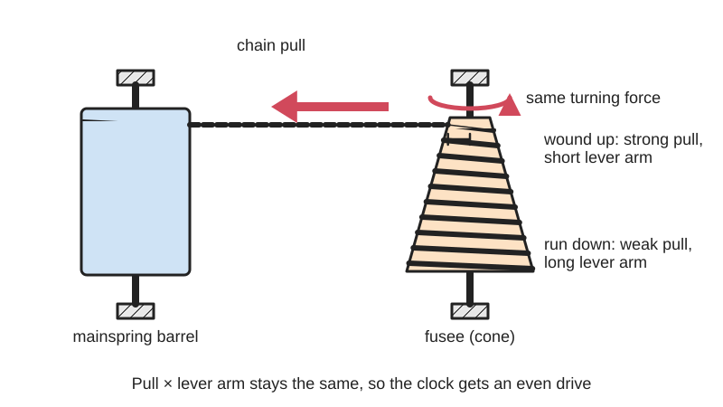
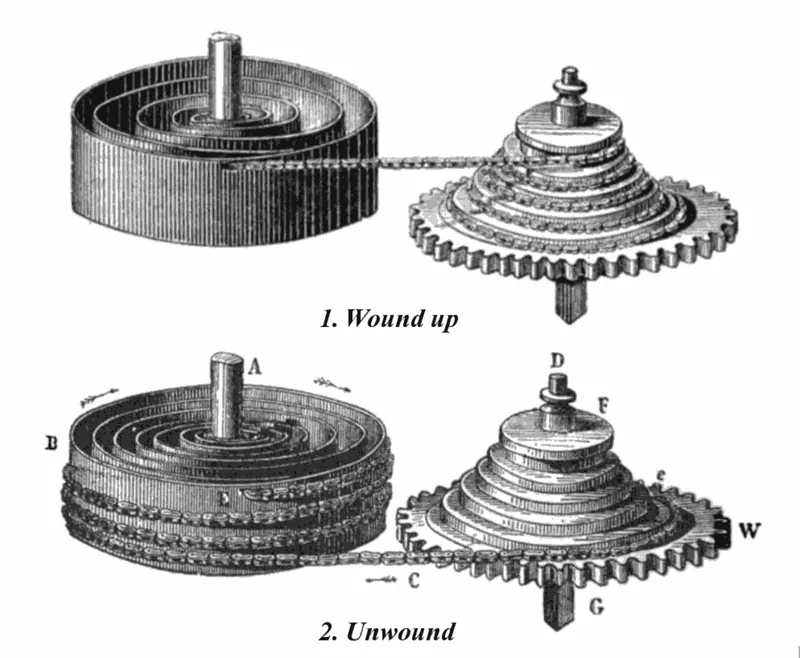
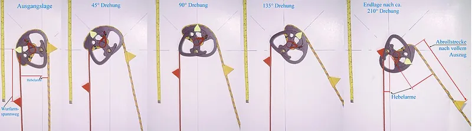

<figure class="eoc-pic eoc-pic-main"><picture><source media="(prefers-reduced-motion: reduce)" srcset="../media/drawn/variable-radius-pulley.svg"></picture><figcaption><strong>Animation.</strong> Diagram drawn for the encyclopaedia from the research notes. ⚑ Needs confirming: a drawing can simplify or get details wrong; a real photo or a better diagram is welcome.</figcaption></figure>
<figure class="eoc-pic"><figcaption><strong>Diagram.</strong> <a href="https://commons.wikimedia.org/wiki/File:Fusee.png">Fusee</a> by Dionysius Lardner, Public domain, from Wikimedia Commons.</figcaption></figure>
<figure class="eoc-pic"><figcaption><strong>How it works.</strong> <a href="https://commons.wikimedia.org/wiki/File:Compound_Cams_Auszug_Weg%26Hebel.jpg">Compound Cams Auszug Weg&amp;Hebel</a> by StromBer, <a href="http://creativecommons.org/licenses/by-sa/3.0/">CC BY-SA 3.0</a>, from Wikimedia Commons.</figcaption></figure>

A variable-radius pulley changes the leverage between a cord and a shaft as it turns, so a spring whose force changes can give a steady turning force (a clock's fusee, a tool balancer's tapered drum) or a force that follows a chosen curve (a compound bow's let-off, a gym machine's cam, a robot arm's gravity balancer).

**In plain words:** A pulley that isn't round, or is cone-shaped with a spiral groove, so the cord winds on at a changing distance from the centre; that changes the leverage as it turns, evening out a spring's pull or making a heavy pull go light near the end. **Proper term:** Variable-radius pulley (non-circular or spiral pulley), including the fusee and the compound-bow cam.

**Also called:** fusee, fusee and chain, fusee cone (Wikipedia, Fusee (horology); 507 Mechanical Movements no. 46); going fusee (with maintaining power), drunken fusee (winds either way) (Wikipedia, Fusee); spiral pulley, conical spiral pulley (patent US7677540); non-circular pulley, noncircular pulley, differential noncircular pulleys (Fedorov and Birglen 2018; Ludovico et al. 2021); tapered drum, conical drum (tapered-drum tool balancer; Hubbell Gleason (brand) spec sheet); cam, cam wheel, eccentric, bow eccentrics; single cam, hybrid cam, dual cam, binary cam (Wikipedia, Compound bow); let-off cam (Wikipedia, Compound bow); logarithmic-spiral cam, Nautilus cam (exercise machines; Wikipedia, BowFlex, Inc.); stackfreed (an older friction cam compensator; Wikipedia, Fusee).

## How it works

Turning force ([torque](../glossary.md#torque)) equals the cord's pull times the radius at the point where the cord leaves the pulley. In a fusee the strong pull of a fully wound mainspring acts on the narrow top of the cone, and as the spring weakens the chain comes off ever wider grooves, so the bigger radius makes up for the weaker pull and the clock gets a nearly constant driving force (Wikipedia, Fusee; 507 Mechanical Movements no. 46). A compound bow's cam does the opposite: the archer starts on the 'short' side of the cam at a mechanical disadvantage, then the cam rolls over so that near full draw the archer has the advantage and holds only a fraction of the peak force, the 'let-off' (Wikipedia, Compound bow). In general the pulley's outline can be calculated to turn a spring's straight-line force into almost any torque curve, as long as the outline stays convex so the cord can wrap it (Ludovico et al. 2021).

## Parts

A few parts: the shaped pulley (a cone with a spiral groove, or a flat cam-shaped wheel with a groove), a cord, cable or chain, the spring it works against (a mainspring in a barrel, bow limbs, a coil spring), a shaft and bearings. Clock fusees add a [ratchet](../glossary.md#ratchet) and click inside the fusee, a winding stop and often maintaining power (Wikipedia, Fusee). Compound bows add a second cam or an [idler](../glossary.md#idler) wheel, buss cables and adjustable draw stops (Wikipedia, Compound bow).

## Everyday examples

- Antique spring-driven clocks, English pocket watches and marine chronometers with a fusee and chain (Wikipedia, Fusee)
- Compound bows, whose cams make the full-draw hold much lighter than the peak pull (Wikipedia, Compound bow)
- Tool balancers hanging above assembly lines, whose tapered drum keeps a tool floating at the height you leave it (Hubbell Gleason spec sheet)
- Nautilus-style gym machines with a spiral cam that varies the resistance through the movement (Wikipedia, BowFlex, Inc.; Arthur Jones)

## When to use it

Use a variable-radius pulley when a spring's force changes but you need a steady force or torque, or when you want the force to follow a particular curve: a spring-driven clock or toy motor that should run evenly (fusee), a counterbalance that holds a lamp, camera arm, robot joint or tool weightless over its whole range (tapered drum, noncircular pulley; Hubbell Gleason; Ludovico et al. 2021), a bow, catapult or exercise device that should be heavy early and light to hold (compound-bow cam; Nautilus cam), or a cable robot that must follow a set path from one motor (Fedorov and Birglen 2018).

## When not to use it

If a nearly constant force is all you need, a constant-force spring or constant-torque spring motor is simpler, though such springs 'store less energy per pound and ... have a shorter life' (US7677540); clockmakers likewise replaced the fusee with a going barrel that uses only the flat part of a long mainspring's curve (Wikipedia, Fusee). If you need to change the force curve often, use a motor with control instead, since the profile is fixed (Fedorov and Birglen 2018). If the force must push as well as pull, a cord can't do it; use non-circular gears or a [cam and follower](../glossary.md#cam-and-follower). For compact or very low-friction designs, the extra bulk and friction may outweigh the benefit (Wikipedia, Fusee: bulky; Fedorov and Birglen: friction).

## Details

- **What it does (jobs):**
  - store energy: shapes how a spring's stored energy is given out or taken in (steady in a fusee, peaking early in a compound bow) (Wikipedia, Fusee; Compound bow)
  - change speed or turning force: changes the leverage between cord and shaft continuously as it turns
  - change the kind of motion: turns a cord's straight pull into rotation of a shaft, with a ratio that changes along the [stroke](../glossary.md#stroke)
- **Movement:** rotate: a fusee turns several times as its spiral groove winds and unwinds; a compound-bow cam turns less than one revolution per draw ⚑ [uncertain]; a printed noncircular pulley in Fedorov and Birglen's cable robot ran over 900 degrees
- **Directions it can move (degrees of freedom):** 1: the pulley turns on its shaft and the cord's position is tied to that angle
- **Special behaviour:**
  - motion conversion (e.g. rotary to linear): converts a cord pull into a shaft rotation with a ratio that changes on purpose along the stroke
  - one-way (moves freely one way, locks the other): a clock fusee has a ratchet between the fusee and its gear so winding doesn't drive the clock backwards (Wikipedia, Fusee); this is an add-on, not part of the pulley itself
  - tensioning (takes up slack and holds): a tapered-drum tool balancer keeps the tool hanging at the height it is left, taking up cable as it rises (Hubbell Gleason spec sheet)
- **How it holds:**
  - not a holding joint (it moves or passes on motion): it passes force from a spring to a shaft
  - shape (the parts interlock; [form-fit](../glossary.md#form-fit--force-fit--material-bond)): the cord or chain runs in a groove and its end is hooked or anchored to the pulley (Wikipedia, Fusee: round grooves for cords, rectangular for chains)
- **Input and output:** Input: cord, cable or chain pull (straight line) <-> output: shaft torque (rotation); the ratio at any moment is the radius where the cord leaves the pulley, and it changes with angle. Fusee: converts the mainspring's falling pull into an almost constant torque (Wikipedia, Fusee; US7677540: 'converting the linearly increasing torque from a power spring into a constant torque'). Compound bow: peak weight early in the draw, then let-off, 'commonly between 65% and 80% of the peak weight', some over 90% (Wikipedia, Compound bow). Efficiency: friction losses are noticeable; a 3D-printed noncircular-pulley balancer with an idler pulley showed [hysteresis](../glossary.md#hysteresis) of 17% of its torque range (Fedorov and Birglen 2018). Shaft arrangement: cord tangent to the pulley; in a fusee the barrel and fusee shafts are parallel. Back-drivable: yes, the spring always pulls back unless a ratchet or the user holds it.
- **Power:** passive (no power needed): it only reshapes the force from a spring or the user; a passive gravity-compensating pulley lets a robot arm hold its position with no power, avoiding collapse if the motors fail (Ludovico et al. 2021)
- **Load:** light to medium: clock fusees carry small chain forces; compound bows handle draw weights of about 40 to 80 lb (18 to 36 kg) for adults (Wikipedia, Compound bow); tool balancers hold hand tools over a work area (Hubbell Gleason). The cord or chain is the weak point: a broken fusee chain whips about inside the clock (Wikipedia, Fusee). Strong only in cord tension; it can't push.
- **Play and precision:** Small play, but the output only matches the target curve if the cord follows the designed path: a cord that isn't tangent to the groove (fleet angle) rubs and wears (US7677540), planar profile calculations drift from a real 3D spiral at large angles (Fedorov and Birglen 2018), and friction adds hysteresis (17% in a printed prototype; others reported 8.6% and 10% errors) (Fedorov and Birglen 2018).
- **Taking it apart:** removable: the cord or chain unhooks and the pulley comes off its shaft, but only after the spring is let down; compound bows need a bow press to take tension off the cables for string changes and adjustments (Wikipedia, Compound bow)
- **How often it can be reused:** many times
- **Sealing:** none
- **Adjustable:** Partly: the profile is fixed once made, so a fusee had to be readjusted when its mainspring was replaced (Wikipedia, Fusee); tool balancers have adjustable spring tension (Hubbell Gleason); compound bows have adjustable draw stops, and draw length and let-off can be changed, usually with a bow press (Wikipedia, Compound bow).
- **Access needed:** not applicable: it is built into a mechanism (on a shaft end or between two shafts) rather than fitted from one side
- **Materials:** Clock fusees: brass and steel with a gut cord, wire or fine steel chain, chains being used from about 1650 because they lasted longer (Wikipedia, Fusee). Compound bows: aluminium, magnesium or carbon-fibre risers, fibreglass-composite limbs, strings and cables of high-modulus polyethylene (Wikipedia, Compound bow); cam material not confirmed ⚑ [uncertain]. Tool balancers: die-cast aluminium housing and steel wire rope (Hubbell Gleason). Maker builds: 3D-printed ABS pulleys with polyethylene-fibre (Spectra) cable, chosen for strength and very low stretch, and laser-cut acrylic frames (Fedorov and Birglen 2018).
- **Heat, cold, water and wear:** Cords stretch and [creep](../glossary.md#creep), and gut cords were replaced by chains around 1650 because chains lasted longer (Wikipedia, Fusee). Compound bows are less sensitive to temperature and humidity than traditional bows (Wikipedia, Compound bow). Printed pulleys: PLA gives at about 60 degrees C and PETG at about 80 degrees C (CNC Kitchen). Springs [fatigue](../glossary.md#fatigue) and lose force over time, which shifts the balance the profile was designed for ⚑ [uncertain].

## Making it

- **Ways to make or get it:**
  - 3D print (FDM): noncircular and spiral pulleys and cams (ABS in Fedorov and Birglen 2018); toy compound-bow cams (Printables 264536; Thingiverse 2764962)
  - laser cut: flat cam-shaped pulleys and frames in acrylic or plywood (Fedorov and Birglen used laser-cut acrylic for the frame) ⚑ [uncertain for the pulleys]
  - CNC: turned or milled fusee cones and machined bow cams ⚑ [uncertain]
  - off-the-shelf part: tapered-drum tool balancers, compound bows, clock fusees and fusee chains from clock-repair suppliers ⚑ [uncertain]
- **Printing it in one piece (print in place):** no: the pulley is printed on its own and then fitted with a shaft or bearing, a cord or cable, and a spring
- **Tools:** Screwdrivers and spanners for printed or machined builds; a bow press for compound bows (Wikipedia, Compound bow); a winding key and let-down tools for fusee clocks ⚑ [uncertain]; 'everyday tools' to adjust a tool balancer's spring from outside the housing (Hubbell Gleason spec sheet).
- **Difficulty:** moderate: printing the pulley is easy, but the profile must be calculated for your spring and load and the cord kept in its groove; 'Spiral pulleys and fusees are poorly understood and difficult to design' (US7677540)

### 3D printing tips

1) Work out the profile first: the radius where the cord leaves the pulley times the cord's pull gives the torque, so for a steady torque from a spring whose force falls, the radius must grow in proportion (Wikipedia, Fusee; derived). Published methods: a closed-form solution and a convex-optimisation method (Ludovico et al. 2021) and a graphical method with antagonistic pulleys (Fedorov and Birglen 2018). 2) Keep the outline convex with no sharp points, or the cord can't wrap it (Ludovico et al. 2021). 3) A single pulley wound one way can only give a force that keeps rising or keeps falling; for a torque that changes direction, use two pulleys working against each other (Fedorov and Birglen 2018). 4) Angle the groove flanges towards where the cord leaves (towards the idler), not square to the axle, because sudden movements can throw the cable out of the groove (Fedorov and Birglen 2018). 5) Use a low-stretch line such as polyethylene-fibre (Spectra/Dyneema (brands)) braid (Fedorov and Birglen 2018); stretchy cord changes the effective radius ⚑ [uncertain]. 6) Lay a multi-turn profile out as a spiral groove, as a fusee does, and keep the fleet angle small so the cord doesn't rub the groove walls (US7677540). 7) ABS worked for the pulleys in Fedorov and Birglen's prototypes; PLA gives at about 60 degrees C and PETG at about 80 degrees C (CNC Kitchen). Print the pulley flat so the groove is formed by the outline rather than by stacked layer steps ⚑ [uncertain]. 8) Anchor the cord end through a hole or knot in the pulley, and add a ratchet if the spring must not run the output backwards while you wind it (Wikipedia, Fusee).

### Buying one (off-the-shelf parts)

Search for: 'tool balancer', 'spring balancer', 'tapered drum tool balancer' (Hubbell Gleason (brand) BH series), 'constant force spring' (an alternative), 'fusee chain' and 'clock fusee' (clock-repair parts) ⚑ [uncertain], 'compound bow cam' or 'bow cam module' (archery parts) ⚑ [uncertain], 'Dyneema line', 'Spectra braid' or 'HMPE cord', 'extension spring', 'ball bearing', 'cable pulley'. Related constant-torque parts: 'constant torque spring motor'.

## Rules of thumb

- Torque = cord pull x radius at the take-off point; a fully wound mainspring pulls on the smallest radius of the fusee and the run-down spring on the largest (Wikipedia, Fusee; 507 Mechanical Movements no. 46).
- The ideal fusee is not a simple cone but closer to a hyperboloid (Wikipedia, Fusee).
- Groove shape: circular cross-section for cords, rectangular for chains (Wikipedia, Fusee).
- The pulley outline must stay convex, its radius must not run off to infinity, and it must have no points where the rope can't wrap (Ludovico et al. 2021).
- One pulley winding one way gives only a strictly increasing or decreasing function; two antagonistic pulleys give a two-way torque (Fedorov and Birglen 2018).
- Expect friction hysteresis: 17% of the compensated torque range in a 3D-printed ABS balancer with one idler pulley (Fedorov and Birglen 2018).
- Cables rub and wear on the groove sides when they aren't tangent to the groove (the fleet angle) (US7677540).
- Compound bows: let-off commonly 65-80% of peak weight (older bows about 50%, some over 90%); arrows should weigh at least 5 grains per pound of draw weight (IBO) to avoid damage like a dry fire (Wikipedia, Compound bow).

## Common failures

1) Cord rubbing on the groove walls and wearing because of a large fleet angle (US7677540). 2) Cord or cable jumping out of the groove on a sudden movement; angle the flanges towards the cord's exit (Fedorov and Birglen 2018). 3) A bowstring derailing from the cams when the archer twists (torques) it, more likely when drawing with fingers instead of a release aid (Wikipedia, Compound bow). 4) Fusee chain breaking (Wikipedia, Fusee). 5) Profile no longer matching after a spring is replaced or has weakened (Wikipedia, Fusee). 6) Larger-than-expected friction and hysteresis, especially with extra idler pulleys (Fedorov and Birglen 2018). 7) Calculated profiles that are not convex or have points the cord can't wrap (Ludovico et al. 2021).

## Safety

Stored spring energy: if a fusee chain breaks, 'the force of the mainspring sent the end whipping about the inside of the clock' (Wikipedia, Fusee); let a spring down before taking the cord off. Compound bows store a lot of energy: dry firing (releasing without an arrow) can damage or destroy the bow and injure the archer or bystanders, and arrows lighter than about 5 grains per pound of draw weight risk the same (Wikipedia, Compound bow; Dry fire); string and cable work needs a bow press (Wikipedia, Compound bow). Tool balancers should hang with a safety chain, and good ones have a catch that 'prevents free-spooling if springs fail' (Hubbell Gleason spec sheet). Fingers can be pinched where the cord winds onto the pulley ⚑ [uncertain].

## Related

- Spiral power spring (clock spring): the spring a fusee was invented to even out
- Constant-force spring (spring-return reel): gives a nearly flat force on its own, with no shaped pulley, but stores less energy per pound (US7677540)
- Spring balancer (gravity compensation): holds a weight steady; tapered-drum balancers use a variable-radius drum inside (Hubbell Gleason)
- Non-circular gears: change the ratio along the turn with teeth instead of a cord, so they can push both ways
- Cam and follower: a shaped wheel that moves a follower by contact, rather than winding a cord
- Capstan and windlass, and pulley system (block and tackle): fixed-ratio cord drives
- Escapement: the timekeeping part whose [accuracy](../glossary.md#repeatability--accuracy) the fusee protected
- Stackfreed: an older, high-friction cam compensator replaced by the fusee (Wikipedia, Fusee)

## Make it yourself

- [Cam for Compound Bow (Patrick Boschian, Printables) (URL from Printables API, page not opened)](https://www.printables.com/model/264536-cam-for-compound-bow): A simple printable cam for a toy compound bow, designed from photos of real cams *(licence: CC BY)*
- [Miniature Compound Bow (DonStick3l, Thingiverse)](https://www.thingiverse.com/thing:2764962): Printable miniature compound bow with cams; page opened but its description could not be read, so details are unconfirmed; a Printables accessory for it (model 322237, read through the Printables API) holds arrows of about 3.5-5.5 mm diameter, such as skewers *(licence: not shown ⚑ [uncertain])*
- [Differential Noncircular Pulleys for Cable Robots and Static Balancing (Fedorov and Birglen, Journal of Mechanisms and Robotics 2018; accepted version from PolyPublie)](https://pdfs.semanticscholar.org/3abb/deb9722c008e6c5747bfcfe42150f1dfd99c.pdf): Open-access paper with a graphical method for designing noncircular pulleys and two built prototypes (3D-printed ABS pulleys, Spectra cable, laser-cut acrylic) *(licence: CC BY (accepted version))*

## Pictures, videos and models

- [File:Fusee.png (Wikimedia Commons; woodcut by Dionysius Lardner)](https://commons.wikimedia.org/wiki/File:Fusee.png): Fusee and mainspring barrel in the wound and run-down states, with chain, fusee, winding arbor and output gear labelled *(licence: public domain)*
- [File:Compound Cams Auszug Weg&Hebel.jpg (Wikimedia Commons, StromBer)](https://commons.wikimedia.org/wiki/File:Compound_Cams_Auszug_Weg%26Hebel.jpg): A compound-bow cam wheel at work, with coloured ropes showing how the lever arms change during the draw *(licence: CC BY-SA 3.0 / GFDL 1.2+)*
- [File:Compound bow chart.svg (Wikimedia Commons, MiklyxoMaklai)](https://commons.wikimedia.org/wiki/File:Compound_bow_chart.svg): Draw-force curve of a compound bow: force against draw length, peaking early and dropping at full draw (let-off) *(licence: CC BY-SA 4.0)*
- [507 Mechanical Movements no. 46: Fusee chain and spring-box (Brown, 1868; animated)](https://507movements.com/mm_046.html): Animated fusee and spring barrel: 'The chain is on the small diameter of the fusee when the watch is wound up' *(licence: book public domain; website animation link only)*
- [Full Rotation Static Balancer Using Differential Noncircular Pulleys (YouTube, PolyLabrobot; title confirmed through YouTube oEmbed, video not watched; cited in Fedorov and Birglen 2018)](https://www.youtube.com/watch?v=yUw34IeZnIM): A 3D-printed noncircular-pulley mechanism balancing a pendulum over a full turn *(licence: link only (standard YouTube licence))*

## Needs confirming

⚑ marks something nobody has confirmed yet: a fact the research could not confirm from a source, a finder value that is a best guess, or an open point from the research notes. Corrections are welcome (see `research/needs-confirming.md`).

- ⚑ 13 sentences on this page marked [uncertain].
- ⚑ Finder value `tools` = hand tools (source uncertain): `tools_needed` is marked ⚑ [uncertain] here: "…dia, Compound bow); a winding key and let-down tools for fusee clocks ⚑ [uncertain]; 'everyday tools' to adjust…"
- ⚑ Finder value `straight_drive` = long travel or pulling (best guess): carried over from the finder's old rule on entry names (R33), for "What kind of straight-line motion?" under "Change a movement > Turning into straight-line motion, or back"
- ⚑ Finder value `spring_kind` = straight push or pull (best guess): carried over from the finder's old rule on entry names (R33), for "How should it push back?" under "Spring back, or store energy"

## Sources

- <https://en.wikipedia.org/wiki/Fusee_(horology)>
- <https://en.wikipedia.org/wiki/Compound_bow>
- <https://en.wikipedia.org/wiki/Dry_fire>
- <https://en.wikipedia.org/wiki/Arthur_Jones_(inventor)>
- <https://en.wikipedia.org/wiki/BowFlex,_Inc.>
- <https://507movements.com/mm_046.html>
- <https://patents.google.com/patent/US7677540B1/en>
- <https://elib.dlr.de/141572/1/2021_RAL_Design%20of%20Non-Circular%20Pullyes.pdf>
- <https://pdfs.semanticscholar.org/3abb/deb9722c008e6c5747bfcfe42150f1dfd99c.pdf>
- <https://www.ergonomicpartners.com/pdf/hubbell-gleason-spring-balancer-specs.pdf>
- <https://www.cnckitchen.com/blog/comparing-pla-petg-amp-asa-feat-prusament>
- <https://commons.wikimedia.org/wiki/File:Fusee.png>
- <https://commons.wikimedia.org/wiki/File:Compound_Cams_Auszug_Weg%26Hebel.jpg>
- <https://commons.wikimedia.org/wiki/File:Compound_bow_chart.svg>
- <https://commons.wikimedia.org/wiki/File:Free_mainspring_torque_curve.svg>
- <https://commons.wikimedia.org/wiki/Category:Compound_bows>
- <https://www.youtube.com/watch?v=yUw34IeZnIM>
- <https://www.thingiverse.com/thing:2764962>
- <https://api.printables.com/graphql/>
