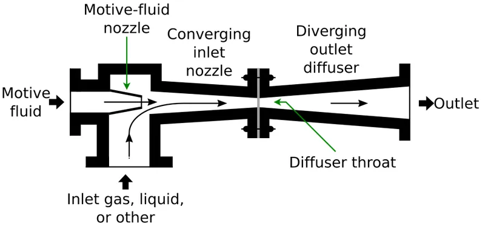
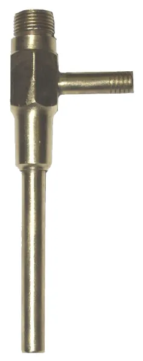

<figure class="eoc-pic eoc-pic-main"><figcaption><strong>Diagram.</strong> <a href="https://commons.wikimedia.org/wiki/File:Ejector_or_Injector.svg">Ejector or Injector</a> by Johannes Rössel, <a href="https://creativecommons.org/licenses/by/3.0">CC BY 3.0</a>, from Wikimedia Commons.</figcaption></figure>
<figure class="eoc-pic"><figcaption><strong>Photo.</strong> <a href="https://commons.wikimedia.org/wiki/File:Aspirator.jpg">Aspirator</a> by Spatula Tzar at English Wikipedia, Public domain, from Wikimedia Commons.</figcaption></figure>

A nozzle fires a fast jet of compressed air or water across a gap inside a T-shaped body; the fast jet has low pressure and carries surrounding air with it, so the side port sucks, giving vacuum for suction cups, fume extraction or lab filtering with no moving parts (Wikipedia 'Vacuum ejector'; Hackaday 2019).

**In plain words:** A T-shaped nozzle with no moving parts: blow compressed air (or run tap water) straight through it and the fast jet drags air in through the side branch, so the side branch sucks. It is a pump made of nothing but a carefully shaped hole. **Proper term:** [Venturi](../glossary.md#venturi) vacuum generator (vacuum ejector, aspirator).

**Also called:** vacuum ejector, ejector, air ejector; venturi pump, venturi vacuum pump, venturi nozzle; vacuum generator (pneumatic), compressed-air vacuum generator; water aspirator, filter pump, water-jet pump, tap aspirator (the tap-water version used in labs); eductor, water eductor, jet pump (usually when a liquid drives it or is pumped); injector (the same device used to push a fluid into a pressurised system, e.g. a steam injector); steam ejector, steam jet ejector, evactor (industrial steam-driven version); multistage ejector, eco-nozzle ejector (Schmalz term), COAX (Piab brand); compact ejector (ejector with built-in valves and vacuum switch); inspirator (the venturi that mixes gas and air in grills and Bunsen burners); airlift pump, mammoth pump, gas lift (covered here: bubbles of air lift water up a pipe, another pump with no moving parts); geyser pump (an improved airlift pump).

## How it works

Compressed air or water is forced through a narrow nozzle, so it speeds up and its pressure drops (the Venturi effect, from Bernoulli's principle). The fast jet crosses a small chamber and drags the air around it along (entrainment), so air is sucked in through the side port; the mixture then passes a narrow throat and a slowly widening diffuser, which slows it down until it can escape to the open air (Wikipedia 'Vacuum ejector'; Schmalz). How strong the suction is depends on the jet speed and the shapes of the nozzle, throat and mixing section; with water it can never go below the water's vapour pressure (about 3.2 kPa at 25 C), while an air-driven ejector has no such floor (Wikipedia). In the airlift pump, air bubbled into the bottom of a submerged pipe makes the water inside lighter than the water outside, so the outside water pushes the bubbly mixture up and out of the top (Wikipedia 'Airlift pump').

## Parts

Single piece or a few parts: a body containing a narrow driving nozzle (motive or Laval nozzle), a mixing chamber with the side suction port, and a narrow throat that widens into a diffuser (receiver nozzle); usually plus a silencer on the exhaust, push-in or threaded fittings, and an on/off valve (Wikipedia 'Vacuum ejector'; Schmalz; Festo VN data sheets). The tap version is one moulded or printed piece with a tap connector and a hose barb (Wikipedia; Printables 253828). The airlift pump is a riser pipe standing in the water, an air line and an air-injection foot fed by an air pump or compressor (Wikipedia 'Airlift pump').

## Everyday examples

- The tap aspirator ('filter pump') screwed onto a lab or school sink tap to suck liquid through a filter funnel (Wikipedia 'Vacuum ejector'; LibreTexts)
- Airbrushes, spray guns and perfume atomisers, where the fast air jet sucks liquid up a tube and sprays it (Wikipedia 'Venturi effect' and 'Vacuum ejector')
- Gas grills, gas stoves and Bunsen burners, which use a venturi (inspirator) to suck in air to mix with the gas (Wikipedia 'Venturi effect')
- Airlift pumps: aquarium filters driven by bubbles from an air pump, and the coffee percolator, which lifts coffee the same way (Wikipedia 'Airlift pump')

## When to use it

Use a venturi when you already have compressed air (or a tap) and want suction with nothing to wear out, jam or spark: suction-cup grippers on robots and pick-and-place machines, holding parts that must be picked up and dropped quickly, or a cheap vacuum for lab filtering (Schmalz; Wikipedia; LibreTexts). Because nothing moves inside, it can move corrosive fumes, dusty or wet gases and even debris that would damage a fan or pump (Hackaday 2019: chlorine fumes from a PCB etching tank; Wikipedia: eductors that pass debris and are used where flammable vapours make electric pumps risky). It is small, light and starts and stops instantly, so it can sit right next to the suction cup (Schmalz). An airlift pump is a good, gentle, no-moving-parts way to circulate and aerate water in aquariums, ponds and aquaponics, or to lift sandy or muddy water (Wikipedia 'Airlift pump').

## When not to use it

Avoid it when you have no compressed air: running a compressor just to make vacuum wastes energy, and a small electric diaphragm vacuum pump is the better choice (Wikipedia notes that water aspirators are used less now because small electric vacuum pumps are more effective, cleaner and affordable). Don't use a water aspirator for solvents or hazardous chemicals, because they end up in the drain water, which may break environmental rules, and it wastes a lot of water (Wikipedia; Printables 253828 suggests recirculating water from a bucket with a small pump). It is a poor choice where noise matters or where a hard vacuum is needed (use a mechanical vacuum pump), or for liquids you don't want to turn into mist: an air ejector sucking liquid sprays it (Wikipedia). An airlift pump is unsuitable for lifting water high or controlling flow finely; use a conventional pump (Wikipedia 'Airlift pump').

## Details

- **What it does (jobs):**
  - hold or release using power: supplies the suction that holds a part on a suction cup or vacuum gripper, and lets go as soon as the air is switched off or a vent opens (Schmalz; see the Vacuum (suction) gripper entry)
  - seal it, or pass cables or fluid through: moves air, fumes or liquid along a pipe with no moving parts, e.g. pulling corrosive fumes away from a PCB etching tank, sucking a lab flask, or (as an airlift pump) lifting water in an aquarium or pond (Hackaday 2019; Wikipedia 'Vacuum ejector' and 'Airlift pump')
  - change the kind of motion: turns a flow of pressurised air or water into suction (Wikipedia 'Vacuum ejector')
- **Movement:** none: nothing in the device moves; only the air or water flows through it
- **Directions it can move (degrees of freedom):** 0: it is one fixed part with no moving pieces (Wikipedia 'Vacuum ejector')
- **Special behaviour:**
  - motion conversion: a flow of compressed air or water becomes suction at the side port (Wikipedia; Schmalz)
  - quick-release: suction starts and stops almost instantly with the air supply, and a short blow-off pulse can push the part off the cup; Schmalz notes that venturi vacuum generators suit very high accelerations (Schmalz 'Operating principles of vacuum generation'; Festo VN data sheet lists an 'ejector pulse valve')
  - none of the locking behaviours: it is not [self-locking](../glossary.md#self-locking); suction stops when the supply stops, so a held part drops unless a [check valve](../glossary.md#check-valve) or valve keeps the vacuum sealed in (Schmalz compact ejectors switch the air off once enough vacuum is reached and back on when it falls)
- **How it holds:**
  - suction or air pressure: makes the low pressure that holds suction cups and vacuum grippers (Schmalz)
  - powered hold: suction exists only while compressed air or water is flowing through it (Wikipedia 'Vacuum ejector')
- **Input and output:** Flow of compressed air (typically 1-8 bar, nominal 6 bar) or tap water -> suction (partial vacuum). Examples: a Festo VN-10 with a 0.95 mm nozzle reaches 93% vacuum at only 3.5 bar in its 'high vacuum' version, 86% at 5.8 bar in a straight inline version, and sucks 21.8-40.5 l/min from open air, with a trade-off between deep vacuum and high suction flow (Festo data sheets 532640, 193554, 532641). Water aspirators stop at the water's vapour pressure, about 3.2 kPa absolute at 25 C (Wikipedia); one printable aspirator's maker estimates 20-30 mmHg (Printables 1556574). A printed compressed-air venturi is claimed to work at 2-6 bar and give 'up to 300mBars of underpressure' (maker's claim, Printables 128131). Rough efficiency: low; it consumes compressed air the whole time it runs, which is why industrial compact ejectors switch the air off once a safe vacuum is reached (Schmalz), and airlift pumps need a lot of compressed air for the water they move (Wikipedia 'Airlift pump'). Arrangement: in line (T shape, driving flow straight through, suction from the side). Back-drivable: not applicable (no moving parts); if the water supply drops, water can be sucked back the wrong way into the vacuum line (LibreTexts).
- **Power:** powered: needs a supply of compressed air (from a compressor or air tank) or running water at mains pressure; an airlift pump needs an air pump or blower (Wikipedia 'Vacuum ejector', 'Airlift pump'). When power is lost: suction stops at once and the held part releases, unless a check valve or a closed valve traps the vacuum; with a tap aspirator, a drop in water pressure can suck water back into the vacuum line (LibreTexts; Printables 1556574)
- **Load:** light: the suction flow is small (tens of litres per minute for a 0.95 mm nozzle; Festo) and the [holding force](../glossary.md#holding-force) depends on the cup area and vacuum level. The airlift pump lifts water only a small height ('relatively low' head; Wikipedia)
- **Play and precision:** not applicable: it doesn't locate parts or pass on mechanical motion
- **Taking it apart:** tool-free quick release: industrial ejectors use push-in fittings, and tap aspirators push on to a hose barb and screw on to a tap (Festo VN data sheets: QS-6 push-in connections; Wikipedia; LibreTexts)
- **How often it can be reused:** effectively unlimited: there are no moving or wearing parts, so it can be connected and disconnected as often as needed; only the nozzle and silencer can clog with dirt (Wikipedia 'Vacuum ejector'; Festo asks for filtered, oil-free air)
- **Sealing:** airtight or pressure: the vacuum side, hoses and cup must be airtight or the suction leaks away; printed bodies must be dense enough not to leak through their [layer lines](../glossary.md#layer-lines) (Printables 1556574: 4-6 walls, 100% [infill](../glossary.md#infill); Hackaday 2019 comments: printed vacuum fittings 'leak like a sieve' until painted)
- **Adjustable:** yes: supply pressure (set with a [regulator](../glossary.md#regulator)) changes the vacuum level and suction flow; nozzle and throat sizes set the trade-off between deep vacuum and high flow (Festo 'high vacuum' and 'high suction volume' versions); several nozzles in a row (multistage) add their suction rates together (Schmalz). Airlift pumps can only be adjusted crudely by the air flow; they behave mostly on/off (Wikipedia 'Airlift pump')
- **Access needed:** not applicable: it is a self-contained in-line component connected by hoses
- **Materials:** Industrial ejectors: aluminium alloy driving nozzle, POM (acetal) receiving nozzle, reinforced PA or POM housing, NBR seals, nickel-plated brass fittings (Festo VN data sheets). Lab water aspirators: a simple tee fitting that screws onto a tap, with a hose barb on the side (Wikipedia); steam ejectors can be made entirely of PTFE or graphite for very corrosive gases (Wikipedia). Printed: PETG, ASA or ABS for durability; polypropylene for best chemical resistance; PLA only for prototypes or water-only use; resin parts are less porous (Printables 1556574, 253828, 128131). Airlift pumps: plain PVC pipe and an air line (Printables 1793376). Whatever passes through gets mixed into the driving air or water, so that material must suit it too (Hackaday 2019; Wikipedia)
- **Heat, cold, water and wear:** Air quality: industrial ejectors need clean, filtered, oil-free air (ISO 8573-1 class 7:4:4 for Festo VN) and won't run on lubricated air; dirt can clog the tiny nozzle or the silencer (Festo data sheets). Temperature: Festo VN rated 0-50 C or 0-60 C ambient and media depending on model (Festo data sheets). Water aspirators lose vacuum as the water gets warmer, because the vapour-pressure limit rises (Wikipedia). Chemicals: whatever is sucked in mixes with the driving air or water and touches the body, so choose the body material to suit (PP or PVDF for harsh chemicals; PLA degrades with chemicals and heat) (Printables 1556574, 253828). Freezing water in a tap aspirator or airlift line ⚑ [uncertain: not checked in a source].

## Making it

- **Ways to make or get it:**
  - 3D print (FDM): one-piece venturi nozzles, ejectors and water aspirators in PETG, ASA/ABS or PP (Printables 128131, 1051026, 253828, 1556574)
  - 3D print (resin): smoother, less porous bodies for water aspirators (Printables 253828)
  - off-the-shelf part: industrial vacuum generators (single-stage, multistage and compact ejectors) and glass, plastic or metal lab water aspirators (Festo; Schmalz; Wikipedia)
  - off-the-shelf parts assembled by hand: an airlift pump from PVC pipe, an air line and an aquarium air pump or compressor (Wikipedia 'Airlift pump'; Printables 1793376)
- **Printing it in one piece (print in place):** yes: it has no moving parts, so the whole body with its internal nozzle, throat and side port prints as one working piece without internal supports when printed upright (Printables 1051026, 253828, 1556574); air versions usually also get a push-in fitting screwed or melted into the inlet (Printables 1051026)
- **Tools:** none for push-in fittings; a spanner and thread-seal tape for threaded ports; for printed ejectors, possibly a drill bit to clear the nozzle, a tap to cut threads, or a soldering iron to melt-screw a fitting in (Printables 1051026 'hot screwed in'; the Vacuum (suction) gripper entry describes drilling and tapping a printed ejector); plus a pressure regulator and valve for the air supply
- **Difficulty:** easy to moderate: a venturi prints as one part with no assembly, but a small, smooth, well-centred nozzle matters, and shapes designed for water often fail with air (Hackaday 2019); you also need a compressor, or a tap for the water version

### 3D printing tips

1) Print it upright with the jet axis vertical (the large inlet or water inlet towards the bed), so the internal nozzle and throat stay round and need no internal supports (Printables 1556574, 253828, 1051026). 2) Use fine layers: 0.1 mm in PETG for a small M5 compressed-air venturi (Printables 128131), 0.2 mm or less for a tap aspirator, because smooth inner walls cut turbulence (Printables 1556574). 3) Make it airtight: 4-6 [perimeters](../glossary.md#perimeters) and 100% infill so pressure and vacuum don't leak through the layer lines (Printables 1556574); a resin print is less porous than FDM (Printables 253828); printed vacuum fittings may need painting to seal (Hackaday 2019 comments). 4) Air is not water: many published venturi shapes are designed for water and just blow air out of both ends; a more pronounced nozzle surrounded by a mixing cavity made one maker's air ejector work (Hackaday 2019). Comments on the same article add that the jet must leave a sharp-edged, straight nozzle so it stays narrow (Hackaday 2019 comments). 5) Geometry starting points from one maker's parametric aspirator: throat about 1.2-1.5 times the nozzle diameter (too wide and air leaks back, too narrow and water spits out of the suction port), and a long diffuser tapering at about 5-7 degrees for better vacuum and less noise; use a smaller nozzle (about 1.5 mm) for low water pressure and a larger one (about 2.5 mm) for higher flow (Printables 1556574) ⚑ [uncertain: maker's guidance, not checked against a design standard]. 6) If water [creeps](../glossary.md#creep) into the vacuum side, lengthen the mixing section (Printables 253828 V3). 7) Choose the plastic for what you will suck: PLA only for water and prototypes; PETG, ASA/ABS, or PP/PVDF for chemicals (Printables 1556574, 253828). 8) The printed part sees supply pressure only in the short nozzle section; still keep the supply regulated, and never use a printed part as an air tank or reservoir.

### Buying one (off-the-shelf parts)

Vacuum generator or vacuum ejector (single-stage, inline or T-shape; 'high vacuum' or 'high suction flow' versions), compact ejector with built-in on/off and blow-off valves and vacuum switch, multistage ejector module; silencer (muffler); push-in fittings (e.g. QS-6, brand) and M5 or G1/8 threaded ports; 2/2 or 3/2 [solenoid](../glossary.md#solenoid) valve; pressure regulator; vacuum gauge or vacuum switch; vacuum (suction) cups; thick-walled vacuum tubing; laboratory water aspirator ('filter pump') with tap connector and hose barb, vacuum trap flask; for an airlift: aquarium air pump, airline tubing, PVC riser pipe (Festo VN data sheets; Schmalz; Wikipedia; LibreTexts; Printables 1793376)

## Rules of thumb

- A water-driven aspirator can't pull a better vacuum than the water's vapour pressure: about 3.2 kPa absolute (32 mbar) at 25 C, and worse with warmer water (Wikipedia 'Vacuum ejector')
- Air ejectors reach deep vacuum at modest pressure: Festo VN-10 'high vacuum' type 93% vacuum at 3.5 bar; 'inline high vacuum' type 86% at 5.8 bar; usable range 1-8 bar, nominal 6 bar (Festo data sheets 532640, 193554)
- Choose vacuum or flow: for the same 0.95 mm nozzle, the high-vacuum type sucks 21.8 l/min from open air and the high-suction-volume type 40.5 l/min (Festo data sheets 532640, 532641); several nozzles in series stages (multistage, eco-nozzle) add their suction rates (Schmalz)
- Expect noise: about 71-72 dB(A) at 6 bar even with a silencer on a small ejector (Festo data sheets); fit a silencer or pipe the exhaust away from people (HSE HSG39 para 116)
- Use clean, oil-free air: Festo's VN generators can't run on lubricated air (Festo data sheets)
- Stages: a single steam-ejector stage is generally not used below about 10 kPa; air ejectors are usually limited to two stages because air can't be condensed between them (Wikipedia 'Vacuum ejector')
- Airlift pump: inject the air at least as deep below the water surface as the height you want to lift (water table 50 ft down means air injected 100 ft deep); it passes solids up to about 70% of the pipe diameter and only suits low lifts (Wikipedia 'Airlift pump')
- Water aspirator: put a trap flask between the aspirator and your work, and always open the system to the air before turning the tap off, to stop back-suction (LibreTexts 'Suction Filtration')

## Common failures

1) No suction at all, air blowing out of both ends: the nozzle shape suits water rather than air, or the nozzle is too big or off-centre; use a design made for air with a pronounced nozzle and mixing cavity (Hackaday 2019). 2) Weak vacuum from leaks: through printed layer lines, threads or loose hoses; print dense (4-6 walls, 100% infill), seal threads, use thick-walled vacuum tubing (Printables 1556574; Hackaday 2019 comments). 3) Water spitting out of the suction port or creeping into the vacuum line: throat too narrow or mixing section too short (Printables 1556574, 253828). 4) Clogged nozzle or silencer from dirty or oily air (Festo asks for clean, unlubricated air). 5) Not enough air: the supply pressure is too low or the supply line too small, so the vacuum never builds (Festo lists the pressure each model needs for maximum vacuum) ⚑ [uncertain: supply-line sizing not checked in a source]. 6) Back-suction when the water is turned off before the system is vented (LibreTexts). 7) Airlift pump stops lifting when the pipe isn't submerged deeply enough for the lift height (Wikipedia 'Airlift pump').

## Safety

Noise: air ejectors are loud (about 71-72 dB(A) for a small one with a silencer; Festo); HSE advises silencers, or piping the exhaust away, and shielding people from exhaust blasts (HSE HSG39 para 116). Compressed air can blow particles into eyes, penetrate skin at high pressure and enter body openings with fatal results, and a burst hose can whip; never point the exhaust or supply at anyone (HSE HSG39 paras 2, 95-96). Back-suction: if the tap pressure drops, water can be sucked into your experiment or the liquid into the water supply, so use a trap flask and vent the system before turning off the water (LibreTexts; Printables 1556574). Fumes and chemicals sucked through end up in the exhaust air or drain water, so vent outdoors and dispose of the water properly (Hackaday 2019; Wikipedia). Air carrying flammable dust or pellets at speed can build up static (Hackaday 2019 comments) ⚑ [uncertain: forum comment only]. Never hold stored pressure in a 3D-printed part.

## Related

- Vacuum (suction) gripper: the suction cup and valves that a venturi ejector usually drives; see that entry for cup sizing and release
- Bernoulli gripper: also uses a fast air jet, but blows it out across the part to hold it without contact, instead of sucking air out of a sealed cup
- Diaphragm pump and squeeze bulb (micro vacuum pump): an electric pump with a flexing rubber disc; makes vacuum without a compressed-air supply, at lower noise and air cost but with moving parts
- Suction cup: the passive version, pressed on by hand with no pump
- Granular jamming gripper and Vacuum-driven artificial muscle: other devices that are often powered by a venturi's suction
- Vacuum hold-down table: holds flat work using a vacuum source, which can be a venturi
- Centrifugal pump and Peristaltic pump: pumps with moving parts for liquids; the airlift pump is the no-moving-parts alternative for low lifts
- Hydraulic ram pump: another pump with no motor, using [water hammer](../glossary.md#water-hammer) instead of a jet to lift water

## Make it yourself

- [VENTURI VACUUM PUMP | Venturi nozzle (MarcelloV, Printables)](https://www.printables.com/model/1051026-venturi-vacuum-pump-venturi-nozzle (URL from Printables API, page not opened)): Compressed-air venturi printed in place upright without supports, with a 1/8 in push-in fitting melted in and an M5 suction port *(licence: CC BY-SA)*
- [Venturi nozzle / Vacuum generator / Atomizer (Nikoś, Printables)](https://www.printables.com/model/128131-venturi-nozzle-vacuum-generator-atomizer (URL from Printables API, page not opened)): Small PETG venturi for an M5 pneumatic connector; maker says it works at 2-6 bar and gives up to 300 mbar of underpressure; print at 0.1 mm without supports *(licence: CC BY-NC)*
- [Aspirator (water powered vaccum pump) (Cederb, Printables)](https://www.printables.com/model/253828-aspirator-water-powered-vaccum-pump (URL from Printables API, page not opened)): Support-free tap-water aspirator for FDM or resin, for 8 mm-3/8 in vacuum hose; version 3 lengthens the mixing section to stop water entering the vacuum side *(licence: CC BY-SA)*
- [Vacuum Aspirator Pump (Jose, Printables)](https://www.printables.com/model/1556574-vacuum-aspirator-pump (URL from Printables API, page not opened)): Parametric Fusion 360 water aspirator (3 mm nozzle, 3/8 in tap thread) with a guide to how nozzle, throat and diffuser sizes change its performance, plus print and safety advice *(licence: CC0 / public domain)*
- [Large airlift pump (Ruudimental, Printables)](https://www.printables.com/model/1793376-large-airlift-pump (URL from Printables API, page not opened)): Printed airlift ('mammoth') pump head for 40 mm PVC pipe and a 1/4 in BSP air coupling, with internal venturi channels; the maker lifted water and mud from 4 m deep but notes it uses a lot of air *(licence: CC BY-NC-SA)*

## Pictures, videos and models

- [Ejector or Injector.svg (Johannes Rössel; Wikimedia Commons)](https://commons.wikimedia.org/wiki/File:Ejector_or_Injector.svg): Cross-section diagram of an ejector: driving nozzle, side suction inlet, mixing section and diffuser (used on Wikipedia's 'Vacuum ejector' page) *(licence: CC BY 3.0)*
- [Aspirator.jpg (Spatula Tzar; Wikimedia Commons)](https://commons.wikimedia.org/wiki/File:Aspirator.jpg): Photo of a laboratory water aspirator on a tap *(licence: Public domain)*
- [Airliftpump1.PNG (Masao Kondo; Wikimedia Commons)](https://commons.wikimedia.org/wiki/File:Airliftpump1.PNG): Labelled diagram of an airlift pump: air line, injection port, riser tube and air-water mixture *(licence: Public domain)*
- [Airlift Pump vs Geyser Pump (Gaomingwu; Wikimedia Commons)](https://commons.wikimedia.org/wiki/File:Airlift_Pump_vs_Geyser_Pump.JPG): Side-by-side comparison of an airlift pump's small bubbles and a geyser pump's large air slugs *(licence: Public domain)*
- [How VACUUM GENERATOR works? |Vacuum Ejector| (Animation | Sub) (Ms. Pneumatic, YouTube)](https://www.youtube.com/watch?v=l-wZYJXpVFg): Animation of the inside of a pneumatic vacuum generator (title and channel confirmed via YouTube oEmbed; video not watched) *(licence: link only)*

## Needs confirming

⚑ marks something nobody has confirmed yet: a fact the research could not confirm from a source, a finder value that is a best guess, or an open point from the research notes. Corrections are welcome (see `research/needs-confirming.md`).

- ⚑ 4 sentences on this page marked [uncertain].
- ⚑ Finder value `power_source` = compressed air, liquid, suction (best guess): `power` names several power sources, and not all may apply
- ⚑ Research note: *Venturi vacuum generator*: throat and diffuser proportions come from one maker's model description and are marked [uncertain]; a "300 mbar" figure is labelled as a maker's claim.

## Sources

- <https://en.wikipedia.org/wiki/Vacuum_ejector>
- <https://en.wikipedia.org/wiki/Airlift_pump>
- <https://en.wikipedia.org/wiki/Venturi_effect>
- <https://en.wikipedia.org/wiki/Injector>
- <https://hackaday.com/2019/02/08/a-crash-course-in-3d-printed-venturi-pumps/>
- <https://www.schmalz.com/en/support/know-how/vacuum-knowledge/the-vacuum-system-and-its-components/vacuum-generators/vacuum-ejectors>
- <https://www.schmalz.com/en/vacuum-knowledge/basic-knowledge/operating-principles-of-vacuum-generation/>
- <https://ftp.festo.com/public/PNEUMATIC/SOFTWARE_SERVICE/DataSheet/EN_GB/532640.pdf>
- <https://ftp.festo.com/public/PNEUMATIC/SOFTWARE_SERVICE/DataSheet/EN_GB/193554.pdf>
- <https://www.motionworld.com/assets/Festo-VN-10-L-T3-PQ2-VQ2-RO1-B-Datasheet.pdf>
- <https://chem.libretexts.org/Bookshelves/Organic_Chemistry/Organic_Chemistry_Lab_Techniques_(Nichols)/01%3A_General_Techniques/1.05%3A_Filtering_Methods/1.5D%3A_Suction_Filtration>
- <https://www.hse.gov.uk/pubns/priced/hsg39.pdf>
- <https://api.printables.com/graphql/ (models 1051026, 128131, 253828, 1556574, 1793376)>
- <https://commons.wikimedia.org/wiki/File:Ejector_or_Injector.svg>
- <https://commons.wikimedia.org/wiki/File:Aspirator.jpg>
- <https://commons.wikimedia.org/wiki/File:Airliftpump1.PNG>
- <https://commons.wikimedia.org/wiki/File:Airlift_Pump_vs_Geyser_Pump.JPG>
- <https://www.youtube.com/watch?v=l-wZYJXpVFg>
