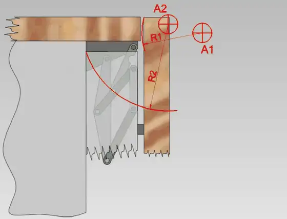

<figure class="eoc-pic eoc-pic-main"><picture><source media="(prefers-reduced-motion: reduce)" srcset="../media/virtual-pivot-linkage.still.webp"></picture><figcaption><strong>Animation.</strong> <a href="https://commons.wikimedia.org/wiki/File:Scharnier_02.gif">Scharnier 02</a> by Manfredgoellner, <a href="https://creativecommons.org/licenses/by-sa/4.0">CC BY-SA 4.0</a>, from Wikimedia Commons.</figcaption></figure>

A set of links, a curved track or bending strips arranged so that a part rotates about a point out in empty space, such as a surgeon's incision, the tip of a peg, a person's knee or the corner of a folding door, where no real pin could be placed.

**In plain words:** An arrangement of arms and pivots that makes a part swing around a point where there is nothing at all, as if an invisible hinge pin floated in the air beside it. **Proper term:** Virtual-pivot [linkage](../glossary.md#linkage); remote centre of motion (RCM) mechanism when the point stays fixed.

**Also called:** remote center of motion (US spelling); RCM mechanism; virtual pivot / virtual pivot point / virtual centre of rotation; instant centre (instantaneous centre of rotation, ICR) of a linkage; the path it moves along is the centrode (Wikipedia 'Instant centre of rotation'); imaginary axis (German 'gedachte Achse', for multi-joint furniture and fridge hinges); polycentric joint / four-bar knee (prosthetic and orthotic knees); double-parallelogram RCM (surgical robots); circular-arc (curved-rail) guide / goniometer stage / goniometric stage (rotates about a point above the stage); remote centre compliance, RCC (a springy version used in robot wrists for peg-in-hole assembly); crossed-flexure or cross-axis flexural pivot (a bendy version whose pivot is where the blades cross); Virtual Pivot Point, VPP (Santa Cruz Bicycles' name for its suspension (brand)) ⚑ [uncertain] (trademark status not checked).

## How it works

In any four-bar linkage the moving part (the coupler) is, at each instant, turning about the point where the lines drawn through the two side links cross (Wikipedia 'Instant centre of rotation'). Angle the side links so those lines meet away from the parts, and the part swings about that empty point; as the linkage moves, the point drifts along a curve, which is fine for knees, bike suspension and cabinet or fridge hinges whose door edges swing about 'imaginary axes' (Wikipedia 'Instant centre of rotation'; German Wikipedia 'Scharnier'; BikeRadar). When the point must stay put over the whole movement, as for a surgical tool pivoting at the incision, designers use two linked parallelograms, a curved rail whose centre is the pivot, or a spherical linkage whose axes all pass through one point (Zhou et al. 2018; Taylor et al. US 5,397,323). Springy versions do the same by bending: crossed [flexure](../glossary.md#flexure) blades pivot about their crossing point, which shifts slightly as they bend (C-Flex design guide), and a remote centre compliance (RCC) device uses angled rubber-and-metal pads so that a gripped peg tilts and slides about a point at its tip and slips into a hole instead of jamming (PFA RCC manual; Wikipedia 'Remote center compliance').

## Parts

A small assembly that acts as one unit. Linkage versions: a base, two or more links, pins or bearings, and the moving part (a four-bar has four links including the base; a double-parallelogram RCM has two linked parallelograms, i.e. about six to eight links). Track version: a curved rail and a carriage (goniometer stage). Springy versions: crossed flexure blades, or angled elastomer-and-metal [shear](../glossary.md#peel-vs-shear) pads between two plates (RCC device) (Zhou et al. 2018; Taylor et al. US 5,397,323; PFA RCC manual).

## Everyday examples

- Kitchen cabinet cup hinges and built-in fridge door hinges, whose doors swing about imaginary axes so they clear their neighbours (German Wikipedia 'Scharnier')
- Full-suspension mountain bikes with linkage rear suspension (virtual pivot / instant centre) (BikeRadar)
- Four-bar (polycentric) prosthetic knees (Phoengsongkhro et al. 2023)
- Surgical robot arms, such as the da Vinci system, that pivot instruments about the incision (Zhou et al. 2018)

## When to use it

Use a virtual-pivot linkage when the natural turning point is somewhere you can't put a pin: inside a person's joint (a knee brace, or a Morse key knob that follows the wrist), at an incision or opening that a tool passes through, at the tip of a peg being inserted (RCC), at a sample or lens that must tilt without moving sideways (goniometer), or at the corner of a door or panel that must fold without hitting its neighbour (cabinet and fridge hinges). Also use it when a hinge must be hidden behind a panel, or when you want a part to follow a special path (rotate and shift at once).

## When not to use it

If a real pin can go at the pivot, use a plain pivot or knuckle hinge: it is simpler, stiffer and more precise. For large angles (beyond roughly 90-120°) linkages run into their limits and links collide (Zhou et al. 2018): use a real axle, a ring bearing or a gimbal. For heavy loads at long reach, the long levers make it flexible and wear the pins; use a curved rail with rollers or a real bearing. For exact positions without play, use a flexure (small angles) or a goniometer stage. If a small drift of the pivot doesn't matter, a simple four-bar is enough; if it must not move, use a double parallelogram or arc.

## Details

- **What it does (jobs):**
  - let it move (turn, slide or bend): a part rotates about a point where no pin can go
  - line parts up exactly: goniometer stages tilt a sample about a fixed point, and RCC wrists let a peg self-align into a hole (linearmotiontips; PFA RCC manual)
  - change the kind of motion: with a moving pivot, the part swings and shifts at once, e.g. a cabinet door that moves outward as it opens, or a bike axle path (German Wikipedia 'Scharnier'; BikeRadar)
- **Movement:** rotate about a remote point, usually through a limited arc: goniometer stages from a few arc-seconds up to about 90° (linearmotiontips); linkages are limited by links colliding at extreme angles (Zhou et al. 2018). Surgical RCM mechanisms give two rotations ([pitch](../glossary.md#pitch) and yaw) about the same point, often plus an in-out slide, i.e. multiple (Zhou et al. 2018).
- **Directions it can move (degrees of freedom):** Usually 1 for a single planar virtual-pivot linkage, crossed flexure or goniometer; 2 rotations about one point for surgical RCM mechanisms (stacked goniometers do the same; linearmotiontips), with the instrument having 4 in total (pitch, yaw, roll and in-out; Zhou et al. 2018); an RCC device floats a little in several directions, held by springs (PFA RCC manual)
- **Special behaviour:**
  - self-aligning or self-centring: an RCC places the centre of compliance at the peg's tip so contact forces steer the peg into the hole instead of jamming it (Wikipedia 'Remote center compliance'; PFA RCC manual)
  - motion conversion: in moving-pivot designs the part rotates and translates together along a designed path (e.g. four-bar knees place the instant centre where it keeps the knee stable; Phoengsongkhro et al. 2023)
  - none: a pure double-parallelogram or arc-guide RCM just rotates about its fixed point
- **How it holds:**
  - not a holding joint (it moves or passes on motion)
  - spring force (a spring or springy part presses it in place): only the compliant versions (flexures, RCC shear pads) spring back to their rest position
- **Input and output:** rotation of an input link, or travel of a carriage along a curved rail -> rotation of the output about a remote point. In a parallelogram RCM the tool turns through the same angle as the driven link (about 1:1) ⚑ [uncertain]; four-bar versions vary their ratio through the [stroke](../glossary.md#stroke). Efficiency is high with bearings (no sliding apart from the pins) ⚑ [uncertain]. Axes are parallel for planar linkages and all pass through one point for spherical linkages (Zhou et al. 2018). Back-drivable: yes for plain pinned linkages; goniometer stages driven by a worm drive (Wikipedia 'Positioning goniometer') are effectively not ⚑ [uncertain].
- **Power:** passive (no power needed) as a mechanism; robots drive it with motors. A mechanical RCM keeps the pivot constraint even if power or electronics fail, which is why surgical robots prefer it over a software 'virtual RCM' (Zhou et al. 2018).
- **Load:** light to medium: the long reach to the remote point turns small forces there into large twisting loads on the pins. Parallelogram RCMs are rigid but bulky; circular-arc and spherical ones are compact but less rigid and mainly carry light instruments (Zhou et al. 2018). An RCC with soft CR35 pads carries about 25 lb (11 kg) hanging vertically and only about 3 lb (1.4 kg) sideways, 60 lb and 8 lb with stiffer CR55 pads (PFA RCC manual).
- **Play and precision:** noticeable unless well made: any play in the pins is magnified at the distant pivot point, and link-length errors make the point wander. A research RCM prototype kept its pivot within 2 mm, with the remaining error mainly from [backlash](../glossary.md#backlash) in the hinge points due to machining and assembly errors (Zhou et al. 2018). Moving-pivot four-bars drift by design (Wikipedia 'Instant centre of rotation'), and crossed-flexure pivots shift more the further they turn, with no shift at their centre position (C-Flex design guide).
- **Taking it apart:** removable: linkages are pinned or bolted together and can be taken apart; RCC devices and goniometer stages bolt on as units
- **How often it can be reused:** effectively unlimited as a moving joint if the pins or bearings don't wear; RCC elastomer devices are quoted at 3 to 6 million operating cycles with no [lubrication](../glossary.md#lubrication) (PFA RCC manual)
- **Sealing:** none
- **Adjustable:** Depends on design: adjusting link lengths moves the remote point and working radius (Taylor et al. US 5,397,323 uses links adjustable in length); in four-bars, changing pivot positions moves the instant centre and its path; RCC devices are chosen or ordered so the centre of compliance lands at the part's tip (PFA RCC manual).
- **Access needed:** not applicable
- **Materials:** Machined aluminium or steel links with ball bearings for precision robots ⚑ [uncertain]; 3D-printed PLA or PETG links with metal screws, nylon-insert lock nuts and small ball bearings for maker builds (e.g. M3 screws and 693ZZ bearings in Digirig's virtual-pivot Morse key); spring steel or printed PETG for flexure versions; neoprene, natural rubber or silicone laminated with metal for RCC shear pads (PFA RCC manual).
- **Heat, cold, water and wear:** Elastomer RCC pads have temperature limits: neoprene about -29 to 82 °C, natural rubber -40 to 82 °C, silicone -54 to 177 °C; severe cutting fluids can degrade them (PFA RCC manual). Printed plastic links and flexures [creep](../glossary.md#creep) under steady load and soften with heat, so a loaded printed mechanism slowly sags and its pivot drifts ⚑ [uncertain]. Gear-based RCMs need lubrication, which conflicts with sterilisation (Zhou et al. 2018). Wear in pins increases play over time, making the pivot wander ⚑ [uncertain].

## Making it

- **Ways to make or get it:**
  - 3D print (FDM): links, flexures and demonstrators, with metal pins, bolts or small bearings at the joints
  - CNC: machined links and arc guides for precise, stiff versions ⚑ [uncertain]
  - laser cut: flat links from acrylic or plywood for planar four-bars ⚑ [uncertain]
  - off-the-shelf part: goniometer stages, RCC devices and cup hinges already contain these mechanisms
- **Printing it in one piece (print in place):** partly: compliant versions and some linkage hinges print in place, e.g. SigmaT4's [print-in-place](../glossary.md#print-in-place) concealed linkage hinge, and BYU's cross-axis flexure pivot is two printed parts clipped together (Printables); most pinned linkages are printed as separate links and joined with bolts, pins or bearings.
- **Tools:** hex keys or screwdrivers for bolted pivots; a reamer or drill to size pin holes in printed links; none to operate
- **Difficulty:** moderate: a four-bar whose pivot is in empty space is easy to print and bolt together, but a pivot point that truly stays fixed needs exact, equal link lengths and low-play bearings, so plan it in a linkage simulator first

### 3D printing tips

1) Design it first in a free linkage simulator: PMKS+ runs in the browser and is free and open source; Linkage (rectorsquid) is free for Windows and can draw the path of any joint during simulation. Draw lines through the two side links: where they cross is the instant pivot (Wikipedia 'Instant centre of rotation'), so you can see how far it drifts over the stroke. 2) Precision is everything, because play at the pins is multiplied at the distant pivot (Zhou et al. 2018 blamed backlash from machining and assembly errors for most of their error). Use metal pins, shoulder bolts or small ball bearings rather than printed pins: Digirig's printed 'Virtual Pivot Point Straight Morse Key' uses M3 socket screws, nylon-insert lock nuts, thin washers and 693ZZ (3 x 8 x 4 mm) bearings at the link pivots (Printables). 3) Ream pin holes to size and start with at least 0.3 mm [clearance](../glossary.md#clearance) for parts that must move (Prusa); make parallel links truly identical, e.g. print them in one batch in the same orientation ⚑ [uncertain]. 4) Print links flat so the layers run along the link and the pin holes are round and strong; add extra [perimeters](../glossary.md#perimeters) around holes ⚑ [uncertain]. 5) Check for collisions at the extreme angles: parallelogram bars close up and overlap near their limits, so they must be spaced apart, which makes the mechanism bulky (Zhou et al. 2018). 6) For a springy version, print crossed flexure blades in PETG (BYU's cross-axis flexure pivot on Printables; a double-parallelogram flexure demo recommends PETG with at least two continuous perimeters so the hinges don't crack), and keep the rotation small, since the pivot shifts more as it turns (C-Flex design guide). 7) If you need the pivot to stay exactly at one point over a big angle, a printed curved rail with a carriage (a DIY goniometer) is often simpler than a linkage, but needs a smooth, accurate arc ⚑ [uncertain].

### Buying one (off-the-shelf parts)

Search for: 'goniometer stage' or 'goniometric stage' (tilts about a point above the stage; stack two for two axes), 'tilt stage', 'curved rail' or 'arc guide', 'remote center compliance' or 'RCC compliance device' (e.g. PFA Accommodator (brand)), 'compliance unit', 'cross-axis flexural pivot' or 'flexural pivot bearing' (e.g. C-Flex (brand)), 'polycentric knee joint' (prosthetics and knee braces). For DIY linkages: 'shoulder bolt', '693ZZ bearing', 'flanged ball bearing', 'nylon-insert lock nut', 'dowel pin', 'rod end'.

## Rules of thumb

- A four-bar's moving part turns, at each instant, about the point where the lines through its two side links cross; as the linkage moves this point traces a curve (the centrode) (Wikipedia 'Instant centre of rotation'). In bike suspension this 'virtual pivot' moves through the travel (BikeRadar).
- For a pivot that stays fixed, use a double parallelogram, a circular arc or a spherical linkage. Parallelograms: large range, simple, rigid, but bulky, and the RCM position depends on the relative positions of the bars. Arcs and spherical linkages: compact but need high machining and assembly precision and are less rigid (Zhou et al. 2018).
- Expect some wander: a research RCM prototype held its pivot within 2 mm, limited mainly by backlash from machining and assembly errors (Zhou et al. 2018).
- Crossed-flexure pivots: the pivot shift grows with rotation angle and with the size of the pivot, and is zero at the centre position (C-Flex design guide).
- RCC for insertion: put the centre of compliance at the leading edge of the part being inserted, where contact first occurs, and make the [chamfer](../glossary.md#chamfer--fillet) bigger than the expected sideways [misalignment](../glossary.md#misalignment) (PFA RCC manual).
- Goniometers: stack two stages designed to share the same centre height to rotate about one point in two axes (linearmotiontips).
- Prosthetic four-bar knees are designed to place the instant centre in a 'stability zone', which makes them more stable than single-axis knees (Phoengsongkhro et al., Sci. Rep. 2023).
- Mechanical RCM keeps patients safe if power or control fails, unlike a software-generated 'virtual RCM' (Zhou et al. 2018).

## Common failures

Pivot point wanders because link lengths are unequal or pins have play (magnified at the remote point); fix with bearings, reamed holes and identical links (Zhou et al. 2018). Links collide at the ends of travel; space parallelogram bars apart or limit the angle (Zhou et al. 2018). Crossed flexures crack when over-rotated, and their pivot shifts at large angles; add hard stops (C-Flex design guide). RCC insertion still jams if parts have no chamfer or the misalignment is larger than the chamfer, or if the payload is over the pads' rating (PFA RCC manual). A four-bar designed without checking its centrode swings about the wrong point for part of its travel; simulate first (Wikipedia 'Instant centre of rotation').

## Safety

Parallelogram and four-bar links close together like scissors: keep fingers out of the gaps between moving links. Arms with long reach can swing or fall if not balanced or braked ⚑ [uncertain]. In robotics, a mechanical RCM stays safe if power fails, whereas a software RCM does not (Zhou et al. 2018).

## Related

- Plain pivot and rolling bearing: a real pin at the pivot; use it whenever you can reach the pivot point
- Four-bar linkage (incl. parallelogram linkage): the basic building block; its coupler turns about a moving virtual pivot
- Flexure hinge (cross-axis pivot): a bending joint whose pivot is the point where its blades cross, with no pin
- Rolling-contact joint (CORE, Jacob's-ladder hinge): two curved surfaces rolling on each other, so the pivot moves along the contact point
- Gimbal: two real crossed axes that meet at one point; an RCM gives similar motion with nothing at the centre
- Ball-and-socket joint: a real sphere at the centre of rotation
- Clip-on concealed hinge (cup hinge): an everyday four-bar with a moving virtual pivot
- Invisible barrel hinge (Soss-type): a hidden hinge whose pivot moves inside the hinge during the swing
- Scissor linkage and straight-line linkages: other multi-bar linkages that shape a path rather than a rotation point

## Make it yourself

- [Virtual Pivot Point Straight Morse Key (Digirig, design by K0TX, Printables) (URL from Printables API, page not opened)](https://www.printables.com/model/1853041-virtual-pivot-point-straight-morse-key): A printed Morse key whose knob follows the natural path of the wrist using a virtual-pivot linkage; M3 screws, nylon lock nuts and 693ZZ bearings; build video https://www.youtube.com/watch?v=miGSeoow_kU. Read through the Printables public API. *(licence: CC BY-NC-SA 4.0)*
- [Cross-Axis Flexure Pivot (BYU CMR, Printables) (URL from Printables API, page not opened)](https://www.printables.com/model/576067-cross-axis-flexure-pivot): Two printed parts clipped together to make crossed flexures that rotate about their crossing point without a pin. Read through the Printables public API. *(licence: CC BY-NC)*
- [Print in place concealed hinge mechanism + fidget toy (SigmaT4, Printables) (URL from Printables API, page not opened)](https://www.printables.com/model/1176854-print-in-place-concealed-hinge-mechanism-fidget-to): A print-in-place concealed linkage hinge whose door turns about a moving virtual pivot; a working version and a fidget toy. Read through the Printables public API. *(licence: CC BY-SA)*
- [PMKS+ (planar linkage designer and simulator)](https://pmksplus.com/): Free, open-source, browser-based tool for designing and simulating planar linkages, with kinematic and force analysis *(licence: free and open source (licence not stated on the page))*
- [Linkage – Mechanism Designer and Simulator (rectorsquid)](https://blog.rectorsquid.com/linkage-mechanism-designer-and-simulator/): Free Windows program for prototyping linkages; can draw the path of any joint during simulation *(licence: free (licence type not stated))*

## Pictures, videos and models

- [Scharnier 02.gif: 'Animation eines Mehrgelenkscharniers für einen Kühlschrank' (Manfredgoellner, Wikimedia Commons)](https://commons.wikimedia.org/wiki/File:Scharnier_02.gif): Animation of a built-in fridge's multi-joint hinge; the door and panel edges swing about imaginary axes where there is no pin *(licence: CC BY-SA 4.0)*
- [Mechanism analysis.png (VanBuren, Wikimedia Commons)](https://commons.wikimedia.org/wiki/File:Mechanism_analysis.png): Diagram of a four-bar linkage with velocity arrows and the instant centre P where the lines through the two side links cross *(licence: CC BY-SA 3.0 or GFDL 1.2+)*
- [Remote Center of Compliance.svg (Arne Nordmann, Wikimedia Commons)](https://commons.wikimedia.org/wiki/File:Remote_Center_of_Compliance.svg): Diagram of a remote centre compliance device yielding to tilt and sideways offset during a peg-in-hole insertion *(licence: CC BY-SA 3.0/2.5/2.0/1.0 or GFDL 1.2+)*
- [US 5,397,323 'Remote center-of-motion robot for surgery' (Taylor et al., IBM, 1995; USPTO)](https://image-ppubs.uspto.gov/dirsearch-public/print/downloadPdf/5397323): Patent drawing of a double-parallelogram arm that pivots a surgical instrument about a fixed point at the patient's body wall *(licence: link only (US patent drawings are generally public domain) ⚑ [uncertain])*
- [Instant Center (Virtual Pivot) - MTB rear suspension (Ep.10) (YouTube, andrextr)](https://www.youtube.com/watch?v=yBJPLY4xukU): Video explaining the virtual pivot of bike suspension linkages (title confirmed via YouTube oEmbed; content not viewed) ⚑ [uncertain] *(licence: link only (standard YouTube licence))*

## Needs confirming

⚑ marks something nobody has confirmed yet: a fact the research could not confirm from a source, a finder value that is a best guess, or an open point from the research notes. Corrections are welcome (see `research/needs-confirming.md`).

- ⚑ 15 sentences on this page marked [uncertain].

## Sources

- <https://en.wikipedia.org/wiki/Instant_centre_of_rotation>
- <https://en.wikipedia.org/wiki/Remote_center_compliance>
- <https://en.wikipedia.org/wiki/Positioning_goniometer>
- <https://de.wikipedia.org/wiki/Scharnier>
- <https://commons.wikimedia.org/wiki/File:Scharnier_02.gif>
- <https://commons.wikimedia.org/wiki/File:Mechanism_analysis.png>
- <https://commons.wikimedia.org/wiki/File:Remote_Center_of_Compliance.svg>
- <https://pmc.ncbi.nlm.nih.gov/articles/PMC6245885/>
- <https://www.ebi.ac.uk/europepmc/webservices/rest/PMC6245885/fullTextXML>
- <https://www.ebi.ac.uk/europepmc/webservices/rest/PMC10739707/fullTextXML>
- <https://image-ppubs.uspto.gov/dirsearch-public/print/downloadPdf/5397323>
- <https://www.pfa-inc.com/user-guides/remote-center-compliance-application-manual.pdf>
- <https://c-flex.com/wp-content/uploads/2024/10/DESIGN-GUIDE.pdf>
- <https://www.linearmotiontips.com/what-are-goniometer-stages-and-where-are-they-used/>
- <https://www.bikeradar.com/advice/buyers-guides/the-ultimate-guide-to-mountain-bike-rear-suspension-systems>
- <https://www.youtube.com/watch?v=yBJPLY4xukU>
- <https://www.youtube.com/watch?v=miGSeoow_kU>
- <https://pmksplus.com/>
- <https://blog.rectorsquid.com/linkage-mechanism-designer-and-simulator/>
- <https://help.prusa3d.com/article/modeling-with-3d-printing-in-mind_164135>
- <https://api.printables.com/graphql/>
