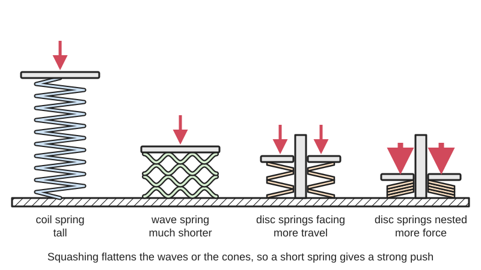
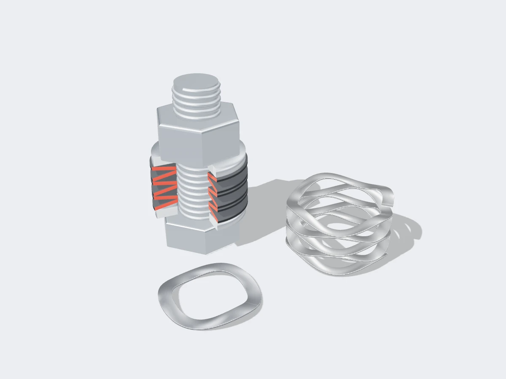
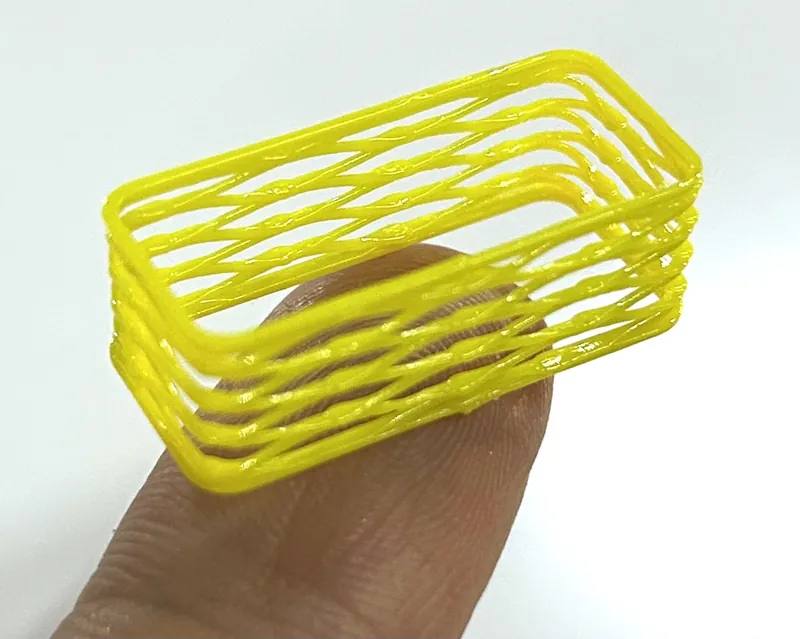
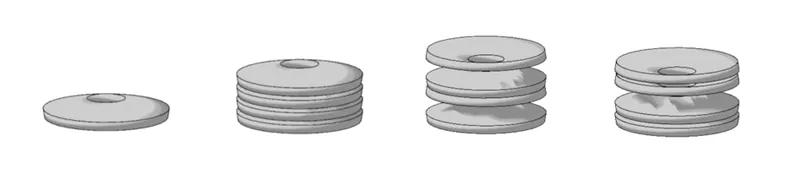

<figure class="eoc-pic eoc-pic-main"><picture><source media="(prefers-reduced-motion: reduce)" srcset="../media/drawn/wave-and-disc-springs.svg"></picture><figcaption><strong>Animation.</strong> Diagram drawn for the encyclopaedia from the research notes. ⚑ Needs confirming: a drawing can simplify or get details wrong; a real photo or a better diagram is welcome.</figcaption></figure>
<figure class="eoc-pic"><figcaption><strong>Cut-away render.</strong> A 3D model made for the encyclopaedia, not a photo: a real photo is also shown. ⚑ Needs confirming: a model can simplify or get details wrong.</figcaption></figure>
<figure class="eoc-pic"><figcaption><strong>Photo.</strong> <a href="https://www.printables.com/model/1069910-midair-rectangular-wave-spring-g-code-hack">Midair Rectangular Wave Spring (g-code hack)</a> by Makefast Workshop, <a href="https://creativecommons.org/publicdomain/zero/1.0/">CC0 1.0</a>, from Printables.</figcaption></figure>
<figure class="eoc-pic"><figcaption><strong>Diagram.</strong> <a href="https://commons.wikimedia.org/wiki/File:Washerstack.png">Washerstack</a> by SammusWikiDude, <a href="http://creativecommons.org/publicdomain/zero/1.0/deed.en">CC0</a>, from Wikimedia Commons.</figcaption></figure>

Washer-shaped springs, either wavy flat rings (wave springs) or shallow cones (disc or Belleville springs), that give a strong, steady push along a shaft or bolt in a very short height, used to [preload](../glossary.md#preload) bearings, keep bolted joints tight and take up play.

**In plain words:** Springy washers (a flat ring bent into gentle waves, or a washer pressed into a shallow cone) that push back hard when squashed while taking up almost no height; used to press bearings, clutch plates and bolted joints together and take out rattle. **Proper term:** Wave springs and disc springs (Belleville washers): compact [axial](../glossary.md#axial--radial) springs.

**Also called:** disc spring, Belleville spring, Belleville washer, coned-disc spring, conical spring washer, cupped spring washer (Wikipedia); Tellerfeder (German); DIN EN 16983 (formerly DIN 2093) disc springs, Series A, B and C; conical spring washer for bolted joints, DIN 6796 (German: Spannscheibe); wave washer (single-turn wave washer); curved disc spring or curved spring washer (bent one way only, four contact points); wave spring, coiled wave spring, flat-wire wave spring, edge-wound wave spring, multi-turn wave spring, nested wave spring, single-turn gap or overlap wave spring, linear wave spring; bearing preload spring, preload washer, slotted disc spring; drag spring washer (fishing reels); Crest-to-Crest and Spirawave (brands, Smalley); scrowave spring (trade term listed by Wikipedia).

## How it works

A disc spring is a washer shaped like a very shallow cone: pressing it towards flat bends the whole ring, which takes a large force over a small movement, so it stores a lot of energy in very little height. How its force rises depends on the cone height compared with the thickness: shallow cones behave almost like an ordinary spring, taller ones level off so the force stays almost constant over part of the travel (handy for taking up wear), and very tall ones can snap through. A wave spring is a flat ring, or a coil of flat wire, formed with waves; squashing it flattens the waves, which bend like small beams between the high and low points, and a multi-turn wave spring does the job of a stack of wave washers in one piece. Stacking disc springs the same way up (in parallel) multiplies the force; stacking them alternately (in series) multiplies the travel.

## Parts

Single piece (one wave washer or one disc spring), or a small stack of identical pieces arranged by the user; a multi-turn wave spring is one continuous coil of wavy flat wire. It needs something to guide it (a shaft or rod through the middle, or a bore around it) and something to hold it at its working height (a shoulder, nut, [circlip](../glossary.md#circlip) or the parts it presses on).

## Everyday examples

- the drag knob on a fishing reel, where a pair of dished 'drag spring washers' lets the drag be set gradually instead of jumping from loose to locked (Mike's Reel Repair)
- heavy electrical busbar and cable connections, which use Belleville washers under the nuts to stay tight as the joint heats and cools (EC&M)
- a thin wavy washer behind a ball bearing in a small electric motor, which takes out play, vibration and noise (SKF material in Design World on small electric motors; Smalley on noise)

## When to use it

When you need a strong, steady push in very little height: preloading ball bearings so they do not rattle or hum; taking up end float on a shaft or wheel; keeping a bolted joint tight when parts settle, [creep](../glossary.md#creep) or expand (aluminium, busbars, dissimilar metals); setting the squeeze on friction stacks such as clutches and fishing-reel drags; and adding a little cushioning or [damping](../glossary.md#damping) (parallel disc stacks). Choose disc springs for high force with small travel, and wave springs for lighter, more even force with a little more travel, especially around bearings and shafts where the space is thin and ring-shaped.

## When not to use it

Not for long travel (use a coil spring) or for pulling and twisting (use extension or [torsion](../glossary.md#torsion) springs; wave springs work in compression only, Smalley). Not as a lock washer to stop nuts shaking loose under side-to-side vibration: they keep tension but do not lock (NASA; German Wikipedia 'Spannscheibe'); use a nylon-insert nut, thread-locking adhesive or a wedge-locking washer. Not for bearings that need high [stiffness](../glossary.md#stiffness) or see reversing axial loads (use solid preload with shims or locknuts, SKF material in Design World). Not in printed plastic where the force must last: buy a steel spring.

## Details

- **What it does (jobs):**
  - store energy: a stiff, compact push along an axis
  - tighten and hold tension: keeps a bearing, bolted joint, clutch or drag stack pressed together and takes up play, wear, settling and heat growth
- **Movement:** flex: squashes along its axis (compression only); travel is small (a single disc should move no more than 75% of its cone height), and longer travel comes from stacking discs in series or using a multi-turn wave spring
- **Directions it can move (degrees of freedom):** 1: it compresses and springs back along the shaft or bolt axis; the shaft or bore keeps it centred, and it is not meant to take sideways loads
- **Special behaviour:**
  - tensioning (takes up slack and holds): keeps a nearly steady push on a bearing or bolted joint while parts wear, settle or grow with heat; spring preload 'remains practically constant' despite thermal elongation (SKF material in Design World), and busbar Belleville washers accommodate thermal cycling (EC&M)
  - [over-centre](../glossary.md#over-centre) (only in tall, thin disc springs): with a cone height more than about 1.5 to 2 times the thickness the disc can push through or invert when taken towards flat, so it must be supported (SPIROL); this is normally a failure to design out, not a feature
  - none of the other listed behaviours; discs stacked the same way up also rub on each other, which damps vibration ([hysteresis](../glossary.md#hysteresis)) (SPIROL; Wikipedia)
- **How it holds:** spring force (it pushes on the parts it sits between; it does not hold anything by itself)
- **Input and output:** not applicable
- **Power:** passive (no power needed)
- **Load:** Disc springs: heavy for their size, supporting very large loads in a small space (Wikipedia; SPIROL 'high load capacity with small [deflection](../glossary.md#deflection)'). Wave springs: light to medium; a wave washer gives less force than a Belleville washer of the same size (Wikipedia 'Washer'), while multi-turn, nested and round-wire wave springs carry more. Axial compression only: they cannot pull or twist, and sideways loads push them off-centre.
- **Play and precision:** Removes play rather than locating: a spring-preloaded bearing has its axial and radial play taken out, and the wave spring helps keep the shaft centred (Smalley). It tolerates end float, [tolerance](../glossary.md#tolerance) stack-up and heat growth. Force is predictable only up to about 75% of a disc's cone height (SPIROL); wave springs are specified as a load at a working height (Smalley). Both types change diameter as they are squashed, so they need a guiding shaft or bore with [clearance](../glossary.md#clearance), and misaligned stacks load unevenly (SPIROL).
- **Taking it apart:** removable: it slips over a shaft or drops into a bore and comes out when the assembly is taken apart; it is usually trapped by a circlip, nut, shoulder or the parts it presses on
- **How often it can be reused:** many times, if it has not been flattened too far, cracked or taken a set: steel disc springs sized with enough preload and limited travel are rated for millions of load cycles (SPIROL [fatigue](../glossary.md#fatigue) charts run to 2 million cycles), but a Belleville washer on an electrical joint gives less clamping force if it is backed off and flattened a second time (EC&M), and fishing-reel drag washers can eventually stay flat and need replacing (Mike's Reel Repair)
- **Sealing:** none
- **Adjustable:** Yes, by the way they are fitted: add or remove discs, change the parallel/series arrangement (e.g. eight identical discs stacked 2-3-1-2 give 3/7 of one disc's rate, 4-4 gives twice it; Wikipedia), add shims, or tighten a nut or knob to squash the spring further (e.g. a fishing-reel drag). A given spring's force at a given height is fixed.
- **Access needed:** end of a tube or shaft: slid over the end of a shaft or bolt, or dropped into the open end of a bore
- **Materials:** Disc springs: spring steels C67S (carbon) and 51CrV4 (alloy) with a zinc-phosphate-and-oil finish, 301 stainless for corrosion resistance, precipitation-hardening stainless for corrosion plus fatigue (SPIROL); Lee Spring's standard Bellevilles are 300-series stainless. Wave springs: carbon steel (standard), stainless steel, beryllium copper, Inconel and Elgiloy (Wikipedia 'Wave spring'). Plastic (e.g. PETG) printed wave springs for light, short-term use. They press on any material, but on soft materials (aluminium, plastic, wood) put a hardened or flat washer under them so the edge does not dig in (SPIROL; EC&M).
- **Heat, cold, water and wear:** Heat: standard disc spring steels start to take a set above about 100 °C and lose their strength at 150-200 °C; stainless grades go to about 260-300 °C (SPIROL; Lee Spring); Inconel wave springs suit high temperatures (Wikipedia 'Wave spring'). Printed plastic springs soften far lower (PLA about 60 °C, PETG about 80 °C, CNC Kitchen) and creep under steady load. Water and chemicals: the standard zinc-phosphate-and-oil finish only protects against humidity and occasional moisture; use stainless, beryllium copper or Elgiloy in wet or marine places (SPIROL; Wikipedia). Avoid electroplated hard springs: hydrogen can make them [brittle](../glossary.md#brittle--ductile) so they shatter under impact or vibration (EC&M; SPIROL). Springs lose force over time if over-stressed; as long as the permissible stress is not exceeded, disc springs show no impermissible relaxation (Wikipedia, citing the Schnorr handbook).

## Making it

- **Ways to make or get it:**
  - off-the-shelf part: the usual choice (DIN disc springs, conical spring washers, wave washers, single- and multi-turn wave springs, bearing preload springs)
  - 3D print (FDM): plastic wave springs from parametric models or special g-code, for light, low-cycle jobs
  - CNC: machining the bore, shaft or pocket that guides the spring and sets its working height
- **Printing it in one piece (print in place):** yes, but only for plastic wave springs: a printed wave spring comes off the printer as one working piece with no supports (e.g. the OpenSCAD wave spring generator, printed in PETG); steel wave and disc springs are bought, and plastic versions creep
- **Tools:** none to fit a loose wave or disc spring; circlip pliers or a spanner for whatever retains it; a [torque](../glossary.md#torque) wrench for Belleville washers on bolted joints (tighten until the washer just goes flat, as specified by the maker, EC&M); a vice, press or long bolt to compress a stack safely during assembly
- **Difficulty:** easy to fit: standard steel wave washers, wave springs and DIN disc springs are cheap and easy to buy; hard to make yourself in metal (needs spring steel and heat treatment); printed plastic wave springs are easy to print but weak and lose force over time

### 3D printing tips

For anything that must keep its force for weeks or months, design the printed parts around a bought steel wave washer or disc spring: plastics creep and relax under constant load (Thrinter's creep test), and PLA in particular 'makes for a very poor spring material' (Hackaday, 2026). Design a proper spring pocket: set the gap so the spring sits at its intended working height, never flat; for a disc spring stay at or below 75% of its cone height (SPIROL). Guide the spring on a printed shaft or in a printed bore, and leave radial clearance because both types change diameter as they compress (SPIROL; Smalley 'wave springs expand during compression'). To preload a pair of ball bearings in a printed housing, put the wave spring against the outer ring of one bearing and give that bearing's outer ring a sliding fit so it can move along its seat (SKF material in Design World). Where a steel spring presses on plastic, add a flat or hardened washer so it does not dig in (SPIROL). If you do print a wave spring: the OpenSCAD 'Parametric Wave Spring' prints in PETG without supports, and its author warns not to add solid flat rings on the top and bottom, because the spring expands outwards as it compresses and solid rings stop it working; leave room around it for that growth. A 'midair' g-code method prints rectangular wave springs by [bridging](../glossary.md#overhang--bridging) slowly so the plastic cools in the air (Printables 'Midair Rectangular Wave Spring'). Keep printed springs away from heat (PLA starts to give at about 60 °C and PETG at about 80 °C, CNC Kitchen). A steel Belleville washer under a screw that clamps a printed part may keep some clamping force as the plastic creeps; Lee Spring notes Bellevilles are used against relaxation and bolt creep ⚑ [uncertain: not tested on 3D prints].

### Buying one (off-the-shelf parts)

Disc springs to DIN EN 16983 (formerly DIN 2093) in Series A, B and C, Groups 1-3; conical spring washers to DIN 6796 for bolted joints; stainless Belleville disc washers; slotted disc springs; bearing preload springs (e.g. disc-type 'K' series, Schnorr; single-turn wave 'SSB' series, Smalley; brands); wave washers; curved disc springs (curved washers); single-turn gap and overlap wave springs; multi-turn wave springs with plain or shim ends; nested wave springs; round-wire and linear wave springs; pre-assembled disc spring stacks; hardened guide rods or sleeves and hardened thrust washers; retaining rings (circlips) to hold them.

## Rules of thumb

- DIN EN 16983 disc spring series by approximate ratios: Series A outside diameter/thickness about 18 and cone height/thickness about 0.4 (almost straight-line force); Series B about 28 and 0.75; Series C about 40 and 1.3 (SPIROL, 'Standard product range', https://www.spirol.com/assets/files/dsc-disc-spring-design-guide-us.pdf).
- Do not deflect a disc spring more than 75% of its cone height: beyond that the force rises sharply and no longer follows the calculation; choose a disc that gives the maximum force needed below 75% deflection (SPIROL, 'Deflection and load characteristics' and 'Design guidelines', https://www.spirol.com/assets/files/dsc-disc-spring-design-guide-us.pdf).
- Cone height/thickness up to 1.5: safe to take flat; about 1.5: nearly flat force curve over a long range, good for wear compensation; above 1.5: the force falls off and the disc can push through, so support it fully; above 2: it may invert (SPIROL, https://www.spirol.com/assets/files/dsc-disc-spring-design-guide-us.pdf).
- Stacking: in parallel the force multiplies by the number of discs at the same deflection; in series the deflection multiplies at the same force; keep stacks no taller than three times the outside diameter or ten discs, and no more than four discs in parallel; allow 2-3% friction per sliding surface (SPIROL, https://www.spirol.com/assets/files/dsc-disc-spring-design-guide-us.pdf; Wikipedia, https://en.wikipedia.org/wiki/Belleville_washer; Lee Spring, https://www.leespring.com/learn-about-belleville-washers).
- For repeated loading, keep a minimum preload of about 15-20% of the disc's maximum rating at all times (otherwise it tends to crack at the top inner edge), prefer larger, lighter discs (Series B or C) over small heavy ones, pick the largest outside diameter that fits, and use an outside/inside diameter ratio of 1.7-2.2 (SPIROL, 'Fatigue life' and 'Design guidelines', https://www.spirol.com/assets/files/dsc-disc-spring-design-guide-us.pdf).
- Temperature: standard disc spring steels begin to creep (take a set) above about 100 °C and are no longer viable at 150-200 °C; stainless grades work to about 300 °C (SPIROL, https://www.spirol.com/assets/files/dsc-disc-spring-design-guide-us.pdf); Lee Spring rates its 300-series stainless Bellevilles to 260 °C (https://www.leespring.com/learn-about-belleville-washers).
- A wave spring gives the same force and deflection as a coil spring in up to 50% less height; it is for compression only and is not the right choice for long travel with high load, such as a pogo stick (Smalley, https://www.smalley.com/blog/wave-spring-vs-coil-spring).
- Spring preload for a pair of deep-groove ball bearings: F = k x d, with F in kN and d the bore diameter in mm; k = 0.005-0.01 for small electric motors, k = 0.02 if the preload mainly protects stationary bearings from vibration (SKF material quoted in Design World, https://www.designworldonline.com/what-are-the-best-methods-for-preload-in-a-bearing-system/). Worked example (own calculation): an 8 mm bore bearing gives 0.04-0.08 kN, i.e. about 40-80 N.
- Spring preload is not suitable where high stiffness is needed, where the axial load changes direction, or where large unpredictable peak loads occur; use solid preload with shims, nuts or matched bearings instead (SKF material quoted in Design World, https://www.designworldonline.com/what-are-the-best-methods-for-preload-in-a-bearing-system/).
- Belleville washers on bolts are for maintaining a uniform bolt tension, not for locking; unless serrated they have no significant locking capability (NASA RP-1228 Fastener Design Manual, 1990, PDF p. 13, https://ntrs.nasa.gov/api/citations/19900009424/downloads/19900009424.pdf). DIN 6796 conical spring washers are matched to property class 8.8-10.9 bolts; ordinary DIN 2093 disc springs are much softer and unsuitable for that job (German Wikipedia 'Spannscheibe', https://de.wikipedia.org/wiki/Spannscheibe).
- On electrical busbar joints, mount the Belleville washer so its cup points toward the connection (away from the bolt head or nut), never let it overhang the connection pad, and tighten until it just goes flat (EC&M, https://www.ecmweb.com/content/article/20890080/how-to-use-belleville-washers-correctly).
- Guide stacks on a rod through the middle (preferred) or in a sleeve, case-hardened to about 58 HRC and ground; lubricate parallel stacks (e.g. molybdenum disulfide); avoid electroplated finishes on hard discs because of hydrogen embrittlement (SPIROL, https://www.spirol.com/assets/files/dsc-disc-spring-design-guide-us.pdf).

## Common failures

(1) Squashed too far or overloaded: taken past about 75% of its cone height, or flat, the disc takes a permanent set and loses force; fishing-reel drag washers can end up flat and 'mushy' and need replacing (SPIROL; Mike's Reel Repair). (2) Fitted upside down or in the wrong order: a busbar Belleville with its cup the wrong way adds little clamping force, and stack ends should rest on the discs' outer edges (EC&M; SPIROL). (3) Wrong size: a washer overhanging the connection pad gives much less clamping force, and a big flat washer under it just bends (EC&M). (4) Fatigue cracks at the inner edge in repeated loading when no minimum preload is kept; keep 15-20% preload and limit travel (SPIROL). (5) Binding: wave washers pushed too far into their cavity can bind and give unpredictable load (Smalley), and springs rub on the shaft or bore if no room is left for their change in diameter. (6) Long stacks deflect unevenly because of friction; keep stacks short, guided and lubricated (SPIROL). (7) Discs digging into soft seats; add hardened washers (SPIROL). (8) Corrosion or hydrogen embrittlement from the wrong finish. (9) Plastic springs creeping and losing their push.

## Safety

Stored energy: a compressed disc stack can push very hard, so release it gradually (back off the nut, or use a press or long threaded rod) rather than prising it apart. Tall, thin discs can snap through suddenly. Small wavy washers and the circlips that hold them can spring out when removed; wear eye protection. Hard electroplated washers can break into pieces from hydrogen embrittlement (EC&M). On electrical busbar joints, isolate the supply before work and check each washer is flat and not cracked before switching back on (EC&M).

## Related

- Coil spring (compression, extension, torsion): the baseline spring; much longer travel, but can need up to about twice the height of a wave spring for the same force and deflection (Smalley)
- Ortho-planar spring: a flat, one-piece spring cut or printed from sheet whose centre moves out of the plane; the easiest compact axial spring to 3D print or laser cut
- Printed leaf spring (flat [cantilever](../glossary.md#cantilever) spring): a springy printed strip; easy to make but plastic creeps
- Split (helical) spring lock washer: a cheap spring washer often used to 'lock' nuts, though NASA calls it useless for locking; Belleville washers keep bolt tension better
- Torque limiters and friction clutches: set their slipping force with a spring; fishing-reel drags use a pair of Belleville washers for exactly this (Mike's Reel Repair)
- Crush ribs and spring-fit features (compliant press fit): printed features that take up play by bending once, rather than by a separate spring
- Constant-force spring and gas spring: other ways of giving a nearly steady force, over much longer travel
- Ball [detent](../glossary.md#detent) (spring plunger): a coil-spring-loaded ball that clicks into positions; uses a spring's push for indexing instead of preload

## Make it yourself

- [Parametric Wave Spring by PrintyMcPrintFace (Printables) (URL from Printables API, page not opened)](https://www.printables.com/model/1510812-parametric-wave-spring): OpenSCAD wave spring generator (wire width and height, diameter, wave count, layers, wave height); the included STL printed on a Prusa MK4 in PETG without supports *(licence: CC BY-NC-SA)*
- [Stacked wave spring by aiber (Printables) (URL from Printables API, page not opened)](https://www.printables.com/model/241564-stacked-wave-spring): Parametric SolidWorks model of a stacked (multi-layer) wave spring with configurable diameters, section height, overlap and number of waves *(licence: CC BY-NC)*
- [Stacked Wave Disc Plastic Springs by Mechanical Stuff (Printables) (URL from Printables API, page not opened)](https://www.printables.com/model/352444-stacked-wave-disc-plastic-springs): Printable plastic wave disc springs with several rows of waves for higher loads *(licence: CC BY-NC)*
- [Wave Spring Fusion 360 Parametric Model by Maker (Printables) (URL from Printables API, page not opened)](https://www.printables.com/model/1588728-wave-spring-fusion-360-parametric-model): Fusion 360 wave spring model driven by user parameters *(licence: Public Domain)*
- [Midair Rectangular Wave Spring (g-code hack) by Makefast Workshop (Printables) (URL from Printables API, page not opened)](https://www.printables.com/model/1069910-midair-rectangular-wave-spring-g-code-hack): Open-source g-code generator that prints rectangular wave springs partly in mid-air (tested in PETG on Prusa MK3/MK3S printers) *(licence: Public Domain)*

## Pictures, videos and models

- [Washerstack.png (Wikimedia Commons, SammusWikiDude)](https://commons.wikimedia.org/wiki/File:Washerstack.png): Belleville spring stacking configurations: single, parallel, series and series-parallel *(licence: CC0)*
- [Disc spring load-deflection characteristic curve.svg (Wikimedia Commons, Yapparina)](https://commons.wikimedia.org/wiki/File:Disc_spring_load-deflection_characteristic_curve.svg): Force against deflection curves for disc springs with different cone-height to thickness ratios, calculated with the Almen-Laszlo formula *(licence: CC0)*
- [Single turn wave spring.png (Wikimedia Commons, Slashme)](https://commons.wikimedia.org/wiki/File:Single_turn_wave_spring.png): Rendered 3D model of a single-turn wave spring with a gap; companion files show multi-turn and nested wave springs *(licence: CC BY-SA 4.0)*
- [Crest-to-Crest Wave Springs (Smalley, YouTube; title confirmed via YouTube oEmbed)](https://www.youtube.com/watch?v=-VdQ8pqu7Zs): Manufacturer's video of multi-turn wave springs compressing, compared with round-wire coil springs *(licence: link only)*
- [Belleville Disc Spring Stacking Demo (BelleFlexTech, YouTube; title confirmed via YouTube oEmbed)](https://www.youtube.com/watch?v=QhODuFC3BFc): Demonstration of stacking Belleville disc springs in series and parallel *(licence: link only)*

## Needs confirming

⚑ marks something nobody has confirmed yet: a fact the research could not confirm from a source, a finder value that is a best guess, or an open point from the research notes. Corrections are welcome (see `research/needs-confirming.md`).

- ⚑ 1 sentence on this page marked [uncertain].

## Sources

- <https://en.wikipedia.org/wiki/Belleville_washer (read as raw wikitext)>
- <https://en.wikipedia.org/wiki/Wave_spring (read as raw wikitext)>
- <https://en.wikipedia.org/wiki/Washer_(hardware) (read as raw wikitext)>
- <https://de.wikipedia.org/wiki/Spannscheibe (read as raw wikitext)>
- <https://www.spirol.com/assets/files/dsc-disc-spring-design-guide-us.pdf (SPIROL, 'Disc Springs' design guide, US edition)>
- <https://www.smalley.com/blog/wave-spring-vs-coil-spring>
- <https://www.smalley.com/blog/how-and-why-you-should-use-wave-spring-bearing-preload>
- <https://www.smalley.com/wave-springs/bearing-preload>
- <https://www.smalley.com/spring-design>
- <https://www.rotorclip.com/post/key-design-differences-between-wave-springs-and-coil-springs/>
- <https://www.designworldonline.com/what-are-the-best-methods-for-preload-in-a-bearing-system/ (Design World, 'What are the best methods for preload in a bearing system?', M. Santora, 12 Dec 2019, reproducing SKF material)>
- <https://www.schnorr-group.com/en/products/disc-springs/bearing-preload-springs/>
- <https://www.schnorr-group.com/en/expertise-technologies/disc-springs>
- <https://www.leespring.com/learn-about-belleville-washers>
- <https://ntrs.nasa.gov/api/citations/19900009424/downloads/19900009424.pdf (Barrett, R. T., NASA Reference Publication 1228, 'Fastener Design Manual', 1990)>
- <https://www.ecmweb.com/content/article/20890080/how-to-use-belleville-washers-correctly>
- <https://www.mikesreelrepair.com/10ew3-drag-spring-washer-8l-bnt1613-tgt0358/>
- <http://thrinter.com/creep-abs-pla-petg-alloy-910/>
- <https://hackaday.com/2026/04/27/the-challenges-of-3d-printing-reliable-springs/>
- <https://www.cnckitchen.com/blog/comparing-pla-petg-amp-asa-feat-prusament>
- <https://commons.wikimedia.org/wiki/File:Washerstack.png>
- <https://commons.wikimedia.org/wiki/File:Disc_spring_load-deflection_characteristic_curve.svg>
- <https://commons.wikimedia.org/wiki/File:Single_turn_wave_spring.png>
- <https://commons.wikimedia.org/wiki/File:Nested_Wave_Spring.png>
- <https://commons.wikimedia.org/wiki/File:Multi-turn_wave_spring_with_shim_ends.png>
- <https://commons.wikimedia.org/wiki/File:Belleville_washer_stack_illustration.png>
- <https://www.youtube.com/watch?v=-VdQ8pqu7Zs (verified via YouTube oEmbed)>
- <https://www.youtube.com/watch?v=QhODuFC3BFc (verified via YouTube oEmbed)>
- <https://api.printables.com/graphql/ (Printables models 1510812, 241564, 352444, 1588728 and 1069910 read via the public API)>
