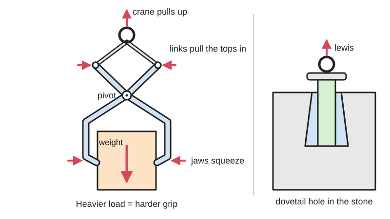
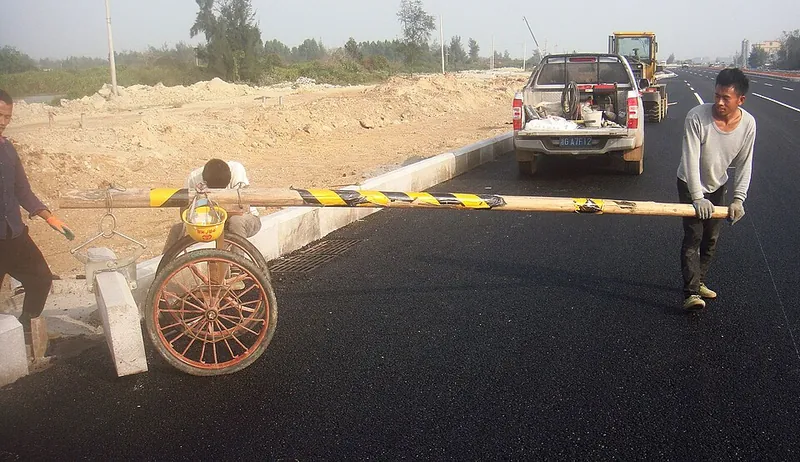

<figure class="eoc-pic eoc-pic-main"><picture><source media="(prefers-reduced-motion: reduce)" srcset="../media/drawn/weight-activated-gripping-tongs.svg"></picture><figcaption><strong>Animation.</strong> Diagram drawn for the encyclopaedia from the research notes. ⚑ Needs confirming: a drawing can simplify or get details wrong; a real photo or a better diagram is welcome.</figcaption></figure>
<figure class="eoc-pic"><figcaption><strong>How it works.</strong> <a href="https://commons.wikimedia.org/wiki/File:A_lewis_in_Hainan_-_01.jpg">A lewis in Hainan - 01</a> by Anna Frodesiak, <a href="http://creativecommons.org/publicdomain/zero/1.0/deed.en">CC0</a>, from Wikimedia Commons.</figcaption></figure>

Weight-activated tongs and the lewis turn the pull of the crane hook into a squeeze (or a wedging force inside a hole) on the load, so the grip grows in step with the load's weight and lets go once the load is set down.

**In plain words:** Big scissor-like tongs, or a set of steel wedges or pins slipped into a hole in a stone, that hang from a crane hook and grip harder the heavier the thing they lift, because the load's own weight squeezes the jaws shut. **Proper term:** Weight-activated lifting tongs (gravity-actuated scissor grab) and lewis.

**Also called:** lifting tongs, lifting grabs, below-the-hook lifting device (Mazzella; ASME B30.20 category, Bushman); scissor tongs, scissors tongs, pressure tongs, gripping tongs, supporting tongs, tong grab (Bushman, 'Application Basics for Lifting Tongs'; Crosby Airpes); self-closing lifting tongs (patent EP0790211); [self-locking](../glossary.md#self-locking) tongs, lever grip tongs, load-actuated grip ⚑ [uncertain: vendor explainer wording]; ice tongs, ice block tongs (CooksInfo); log tongs, timber tongs, log lifting tongs (Crosby Airpes; vendor listings); stone tongs, kerb lifter or curb lifter, slab lifter, external lewis, 'dogs' and 'dog holes' (Wikipedia, Lewis); Steinzange, Steinschere (German: stone tongs, stone scissors; Wikimedia Commons category Stone lifting tools); lewis, lewisson, lewis hole, lewis pins (Wikipedia, Lewis; YouTube); three-legged lewis, dovetailed lewis, St Peter's keys, Wilson bolt, three pin lewis (Wikipedia; YouTube 'Three Pin Lewis Demonstration'); two-pinned lewis, chain-linked lewis (chain lewis), split-pin lewis (Wikipedia, Lewis); billet, ingot, slab, drum, sheet, pallet, beam, coil and pipe tongs (Bushman; Crosby Airpes).

## How it works

Pulling up on the shackle pulls the two links, which pull the upper ends of the arms together; because the arms cross at a pin, the lower jaws are forced inwards against the load, so 'the greater the weight the harder the tongs bite' (507 Mechanical Movements no. 494). A simple four-bar analysis gives the squeeze on the load as proportional to the load (including the tongs' own weight), multiplied by a ratio of link lengths, and the load stays put as long as the friction at each jaw (squeeze x friction coefficient) exceeds the half-weight each jaw carries (Bushman). Pointed jaws also dig into the load, so it is partly held by shape (Bushman; CooksInfo). A lewis does the same inside a prepared hole: the stone's weight acts on long [lever arms](../glossary.md#lever-arm) and creates very high reaction and friction where the short ends press on the hole's walls; the three-legged lewis also locks by its dovetail shape (Wikipedia, Lewis).

## Parts

A few parts. Scissor tongs: two crossed arms on a centre pin, two short links (or a chain) joining the top ends of the arms to a shackle or bail, and jaws with friction pads or hardened points; an optional automatic latch holds them open between lifts (Bushman; 507 Mechanical Movements no. 494). Lewis: two or three steel legs or pins with a shackle and bolt, rings or a short chain; the three-legged lewis has two flared outer legs and a parallel middle leg held by a shackle (Wikipedia, Lewis; 507 Mechanical Movements no. 493).

## Everyday examples

- Old-fashioned ice-delivery tongs, which 'ended in picks that pointed in at each other, to dig into the block of ice' (CooksInfo)
- Kerb stone lifters used by road crews, swung between two people or hung from a machine (Wikipedia, Lewis; Commons photo from Hainan)
- Log or timber tongs that bite harder as the log is dragged or lifted (Crosby Airpes; vendor listings) ⚑ [uncertain]
- Lewis holes and 'dog holes' still visible in Roman stonework, old bridges and walls (Wikipedia, Lewis)

## When to use it

Use weight-activated tongs to lift heavy objects that have no lifting point and can't easily have a sling passed round them: stone blocks, kerbs and slabs, logs, ice, concrete barriers, steel billets, drums and hot metal (Mazzella; Bushman; Crosby Airpes). They need no power, are not affected by electromagnetic interference, tolerate heat and shock loading, and are quick to hook on and off (Bushman). Use a lewis when a stone must be lowered exactly into place and slings would be trapped underneath or would damage carved faces: closing stones in a string course, column drums, capitals, coping stones (Wikipedia, Lewis). Makers can use the same scissor principle for a toy-crane grab, a garden-stone lifter or a passive robot gripper that tightens as it lifts ⚑ [uncertain].

## When not to use it

Avoid them where headroom is low or space is confined (Mazzella), where the load may bump, swing or be partly set down mid-lift, which can let a lewis slip out (Wikipedia, Lewis), and on oily, wet or dusty surfaces that cut friction (Bushman), unless the jaws have points. Soft or delicate loads may be marked or crushed: use supporting tongs, a vacuum lifter or slings instead (Bushman). If the load must be released while still hanging, use a powered gripper or a quick-release hook. Don't improvise lifting tongs for anything lifted over people; buy rated, tested equipment (Bushman; Mazzella).

## Details

- **What it does (jobs):**
  - join and hold: grips a heavy block, log, slab or stone so it can be lifted, with no rigging point needed on the load (Mazzella)
  - lock, and release by hand: holds while the load hangs and lets go once the load is set down and the tongs are opened by hand or by an automatic latch (Bushman)
- **Movement:** rotate: the arms swing a little about the centre pin to open and close the jaws over their grip range; once gripping, nothing moves. A lewis doesn't move once seated (none)
- **Directions it can move (degrees of freedom):** 1 while opening or closing: the arms and links form a four-bar [linkage](../glossary.md#linkage) (Bushman: 'most of them can be broken down into a simple four-bar linkage'), so the two jaws open and close together; 0 once gripping. A seated lewis has 0.
- **Special behaviour:**
  - self-locking (holds under load, won't back-drive): the heavier the load, the harder the jaws squeeze, so the load can't pull itself out (507 Mechanical Movements no. 494; Crosby Airpes: 'The gripping force increases as the load gets heavier')
  - hand-release only (locks under load, releases when a person operates it): the tongs can't open while the weight hangs; they open only when the load is set down and the tension comes off (Bushman)
  - quick-release: tongs with an automatic latch lock open when set down on the floor, so the hoist can lift them clear without anyone handling the arms (Bushman; YouTube 'Automatic Latching of Tong Grab')
  - self-aligning or self-centring: the symmetric links close both jaws equally, centring the load between them ⚑ [uncertain]
- **How it holds:**
  - friction or clamping ([force-fit](../glossary.md#form-fit--force-fit--material-bond)): pads squeeze the sides of the load; the friction must exceed the weight carried at each jaw (Bushman: 'Fy < Fx fo')
  - shape (the parts interlock; form-fit): hardened points dig into the load (Bushman; ice tongs' picks 'to dig into the block of ice', CooksInfo), and the three-legged lewis locks by its dovetail shape, 'the safest' type (Wikipedia, Lewis)
- **Input and output:** Input: vertical pull on the bail (load + tongs weight, L) -> output: horizontal squeeze at each jaw, Fx = L(B + C) / (2(D + A)), where B, C and A, D are lever lengths of the links and arms (Bushman). ASME B30.20 calls Fx / load the 'grip ratio'; Bushman recommends more than 1 where points penetrate the load, 2 or more for friction-only grips, usually 1 to 2 for gripping tongs that reach below the middle of round loads, and as low as 1/2 for supporting tongs that hold the load from underneath. Shaft arrangement: not applicable. Back-drivable: no while loaded, the load cannot pry the jaws open; it releases only when the pull stops.
- **Power:** passive (no power needed): the load's weight does the clamping; Bushman's paper 'will concentrate on tongs that are activated by gravity (no motorization)'. Electric and hydraulic closing versions exist (Crosby Airpes) but are a different, powered type. If the pull is reduced (the load is set down or bumps on something), the grip drops with it (Wikipedia, Lewis)
- **Load:** light to heavy: from hand-carried ice and log tongs to crane tongs for metal ingots, slabs and concrete highway barriers (Bushman). Strong in a steady straight lift; weak if the load swings, tilts, bumps or is set down partly, because the grip falls as soon as weight is taken off (Wikipedia, Lewis), and in sideways pulls. Edges of the load must bear the weight or the corners crumble and the load drops (Bushman).
- **Play and precision:** not applicable as a locator: it doesn't place the load precisely; the symmetric jaws roughly centre it ⚑ [uncertain]. Pivot pins and bushings wear: Bushman advises consulting the maker when pins show more than 2-5% wear (obvious indentations), and checking that the legs meet in the centre when closed.
- **Taking it apart:** tool-free quick release: tongs open once the load is down (by hand or an automatic latch). A lewis is lifted out of its hole after the stone is bedded, and the lewis hole in visible stones is patched with a matching plug (Wikipedia, Lewis)
- **How often it can be reused:** effectively unlimited for the tool itself if inspected and maintained (Bushman: a tong 'will outlast most other types of material handling equipment'); pads and points wear and are made replaceable (Bushman)
- **Sealing:** none
- **Adjustable:** Partly: each tong has a set grip range; gripping tongs for round loads should keep the ratio of smallest to largest diameter at 0.80 or more, e.g. 10 to 12.5 in pipe (Bushman). Manual kerb lifters are 'large, adjustable' tongs (Wikipedia, Lewis). Pads can be changed for different loads (Bushman).
- **Access needed:** Tongs: both sides (the jaws must reach two opposite faces, and there must be headroom above; Mazzella: 'not ideal for low headroom applications'). Lewis: one side only (blind): it works from a hole in the top face, preferably above the centre of mass, so the stone can be lifted where slings can't go under or round it (Wikipedia, Lewis).
- **Materials:** Steel arms, links, pins and bails; replaceable pads of rubber or bronze for delicate loads and pins of hardened alloy or tool steel for loads that may be marked (Bushman); composite arms with [damping](../glossary.md#damping) in one patent design (EP0790211). Three-legged lewis: 13 mm thick rectangular steel legs (Wikipedia, Lewis). Works on stone, concrete, ice, timber, steel and even cotton bales (Bushman). For maker-size grabbers, printed PETG or nylon arms with steel bolts as pins and rubber or TPU pads ⚑ [uncertain].
- **Heat, cold, water and wear:** The grip depends on friction, which is 'sensitive to atmospheric dust and humidity, oxide films, surface finish, temperature, vibration, and the extent of contamination' (Bushman); ice and wet stone are slippery, which is why ice tongs use points (CooksInfo). Steel tongs can be built for hot loads (Bushman). Printed parts: PLA gives at about 60 degrees C and PETG at about 80 degrees C (CNC Kitchen), and printed plastics [creep](../glossary.md#creep) under steady load ⚑ [uncertain].

## Making it

- **Ways to make or get it:**
  - off-the-shelf part: lifting tongs (scissor, log, drum, plate, billet), ice tongs, kerb and slab lifters, lewis pins and three-legged lewises
  - 3D print (FDM): small demonstrators, toy-crane grabs and light-duty grabbers ⚑ [uncertain]
  - laser cut: plywood or acrylic arms and links for demonstrators ⚑ [uncertain]
  - sheet metal: steel plate arms cut and drilled for real lifting tools, made by specialist manufacturers (Bushman)
  - woodwork: wooden arms for light demonstrators ⚑ [uncertain]
- **Printing it in one piece (print in place):** no: the arms and links are printed separately and joined with pins or bolts, which are stronger and smoother than printed pins ⚑ [uncertain]
- **Tools:** None to use tongs beyond a hoist, crane or two people for manual kerb lifters (Wikipedia, Lewis). A lewis needs a drill or chisel to cut the lewis hole, a spanner for the shackle bolt, and metal shims to pack a loose lewis (Wikipedia, Lewis).
- **Difficulty:** easy for a small demonstrator or light grabber (two arms, a pin, two links and a ring); moderate to get a reliable grip on real objects; hard and not a DIY job for anything lifted over people, which needs rated tongs designed to ASME BTH-1 and inspected to ASME B30.20 (Bushman; Mazzella)

### 3D printing tips

1) Get the geometry right: the squeeze grows as the top lever lengths (the 'X-links') grow relative to the lower ones (the 'Y-links'), the same principle as pliers (Bushman, relationship 1); a wider grip range needs taller links and a wider tong to keep the grip ratio up (Bushman, relationship 2). 2) Aim for a grip ratio (squeeze on one side / load) of at least 2 for friction-only jaws; from Bushman's friction condition this only works if the friction coefficient is above 0.25 (derived from Bushman's 'Fy < Fx fo' with Fy = half the load) [derived]. Add rubber or TPU pads, or small points that dig in, to raise grip ⚑ [uncertain on TPU]. 3) For round objects, let the jaws reach below the object's middle so it is partly carried from underneath, and shape the pads to match the largest diameter (Bushman: pad curvature half of the largest diameter). 4) Print the arms flat so the layers run along the arm; CNC Kitchen found PLA hooks printed standing up failed at only 55% of the load of hooks printed lying flat. 5) Use metal bolts or shoulder bolts as pivot pins and keep the holes snug; worn or bent pins are the first sign of overload (Bushman). 6) PLA starts to give at about 60 degrees C (CNC Kitchen) and creeps under steady load, so don't leave a printed grab holding a load ⚑ [uncertain on creep]. 7) Test by lifting just off the ground first, as stonemasons test a lewis (Wikipedia, Lewis), and never lift over people or feet.

### Buying one (off-the-shelf parts)

Search for: 'lifting tongs', 'scissor lifting tongs', 'scissor grab', 'tong grab', 'log lifting tongs' or 'timber tongs', 'ice block tongs', 'kerb lifter' or 'curb stone lifter', 'slab lifter', 'drum lifting tongs', 'plate lifting tongs', 'billet tongs', 'automatic latch tongs' (Bushman; Crosby Airpes; Mazzella), 'lewis pins', 'split pin lewis', 'three legged lewis' or 'Wilson bolt' (Wikipedia; YouTube), 'shackle', 'clevis pin', 'shoulder bolt' and 'friction pads'. A related cam-type device is the 'plate lifting clamp' ⚑ [uncertain]. Rated devices are covered by ASME B30.20 (Below-the-Hook Lifting Devices) and designed to ASME BTH-1 (Bushman; Mazzella).

## Rules of thumb

- Squeeze per jaw Fx = L(B + C) / (2(D + A)); L = load + tong weight; the load is safe only while the jaw friction exceeds the half-load each jaw carries, 'Fy < Fx fo', with 'sufficient margin' because friction changes with dust, humidity, oxide films, surface finish, temperature, vibration and contamination (Bushman).
- Grip ratio (ASME B30.20: horizontal force on one side / load): more than 1:1 where points penetrate the load, 2 or higher for straight friction lifting; 1 to 2 usual for gripping tongs reaching below the centre line of round loads; 1/2 to 1 for supporting tongs (Bushman).
- Gripping tongs for round loads: smallest/largest diameter should generally not be below 0.80 (e.g. 10 to 12.5 in pipe); pad curvature half the diameter of the largest load (Bushman).
- Points: leave 1/16 to 1/8 in (1.5 to 3 mm) of point shank free to bite into the load in every position (Bushman).
- For mill-duty tongs with frequent cycles, designers may allow for shock loading of 150% or more (Bushman); inspect pins and consult the maker at 2-5% wear (Bushman).
- Lewis: seat it above the stone's centre of mass; drill two-pin lewis holes at about 15 degrees from vertical; use a safety sling until the stone is close to its final position, and test by lifting a small distance first (Wikipedia, Lewis).
- The three-legged (dovetail) lewis is the safest type because it relies on shape rather than friction alone; the outer legs go in first and the parallel middle leg last (Wikipedia, Lewis).

## Common failures

1) Load slips out because friction is lower than designed, from grease, scale, dust or wet surfaces; keep a margin and use points where marking is acceptable (Bushman). 2) Pads or points worn down, lowering the grip ratio the design relied on; replace them (Bushman). 3) Lewis slips when the stone bumps or the hole is badly cut; test with a small lift and correct the hole or pack with metal shims (Wikipedia, Lewis). 4) Load too wide or narrow for the grip range, so the tong drags on the floor or neighbouring loads (Bushman: keep the diameter ratio at 0.80 or more). 5) Load edges crumble or a long load sags and slides out of supporting tongs (Bushman). 6) Bent pins, cracked links, worn bushings or a worn automatic latch; inspect regularly (Bushman). 7) Printed grabbers: arms splitting along layers or pins wearing oval ⚑ [uncertain].

## Safety

A dropped load can kill: 'The wrong application or improper use of a tong can cause significant property damage and even the loss of life' (Bushman). A lewis can slip out if some of the stone's weight is taken off, for example when it bumps on scaffolding, so use a safety sling until it is near its final position (Wikipedia, Lewis). Keep fingers clear between jaws and load and when removing packing under a stone (Wikipedia, Lewis: 'dunnage removed with fingers clear'). Never stand or put hands or feet under a suspended load ⚑ [uncertain: general rigging practice]. Rated tongs need inspection under ASME B30.20 and new devices are tested by a qualified person before first use (Mazzella; Bushman).

## Related

- Rope grab and ascender (cam rope clamp): a cam that pinches a rope harder as the load pulls, rather than jaws pinching an object
- Binding-plate lock (tilting friction plate): a tilted plate that jams on a rod under load
- Woven self-tightening grip (finger-trap grip): a braid that narrows and grips harder when pulled
- Self-locking wedge (wedge clamp, [taper](../glossary.md#taper) key): a wedge driven in by the load, as the central pin of the classic lewis is (507 Mechanical Movements no. 493)
- Scissor linkage (lazy tongs): many crossed arms that multiply movement, not a load-driven grip
- Compliant gripper and force amplifier: multiplies a force someone applies, rather than using the load's weight
- Fin-ray gripper and vacuum (suction) gripper: other passive or powered grippers for robots
- Toggle clamp: locks shut over centre by hand, independent of the load's weight
- Plate lifting clamp (cam type): a cam that bites a steel plate harder as it is lifted ⚑ [uncertain]

## Pictures, videos and models

- [507 Mechanical Movements no. 494: Tongs for lifting stones (Brown, 1868; animated)](https://507movements.com/mm_494.html): Animation of scissor stone tongs: the pull on the shackle and links forces the points into the stone; 'The greater the weight the harder the tongs bite' *(licence: book public domain; website animation link only)*
- [File:Three-legged lewis diagram - 02.png (Wikimedia Commons, Anna Frodesiak)](https://commons.wikimedia.org/wiki/File:Three-legged_lewis_diagram_-_02.png): Diagram of a three-legged (dovetail) lewis: the pieces are inserted 1, 2, 3 into an undercut hole *(licence: CC0 1.0 (public domain dedication))*
- [File:A lewis in Hainan - 01.jpg (Wikimedia Commons, Anna Frodesiak)](https://commons.wikimedia.org/wiki/File:A_lewis_in_Hainan_-_01.jpg): Workers using a kerb lifter (external lewis, scissor tongs) to place kerb stones *(licence: CC0 1.0 (public domain dedication))*
- [Three Pin Lewis Demonstration (YouTube, Stephen Critchley Master Stonemason & Stone Carver; title confirmed through YouTube oEmbed, video not watched)](https://www.youtube.com/watch?v=76zOAf3uXUA): A stonemason demonstrating a three-pin (three-legged) lewis *(licence: link only (standard YouTube licence))*
- [Automatic Latching of Tong Grab (YouTube, Hussam Bastug; title confirmed through YouTube oEmbed, video not watched)](https://www.youtube.com/watch?v=WcCxJ-tkP4I): A tong grab's automatic latch holding it open and releasing on alternate set-downs *(licence: link only (standard YouTube licence))*

## Needs confirming

⚑ marks something nobody has confirmed yet: a fact the research could not confirm from a source, a finder value that is a best guess, or an open point from the research notes. Corrections are welcome (see `research/needs-confirming.md`).

- ⚑ 17 sentences on this page marked [uncertain].
- ⚑ Finder value `motion_in` = straight push or pull (best guess): could not read both sides of `input_output`: "Input: vertical pull on the bail (load + tongs weight, L) -> output: horizontal squeeze at..."
- ⚑ Finder value `motion_out` = not applicable (best guess): could not read both sides of `input_output`: "Input: vertical pull on the bail (load + tongs weight, L) -> output: horizontal squeeze at..."
- ⚑ Finder value `shaft_layout` = not applicable (best guess): could not read both sides of `input_output`: "Input: vertical pull on the bail (load + tongs weight, L) -> output: horizontal squeeze at..."
- ⚑ Research note: *Weight-activated gripping tongs*: "a grip ratio of 2 needs a friction coefficient above 0.25" is the agent's own calculation from Bushman's equations, labelled [derived]; check it.

## Sources

- <https://507movements.com/mm_494.html>
- <https://507movements.com/mm_493.html>
- <https://en.wikipedia.org/wiki/Lewis_(lifting_appliance)>
- <https://www.bushman.com/wp-content/uploads/files/pdf/technical-papers/application-basics-for-lifting-tongs-technical-paper.pdf>
- <https://www.mazzellacompanies.com/learning-center/a-breakdown-of-lifting-tongs-5-benefits-important-industry-standards/>
- <https://www.airpes.com/types-of-lifting-tongs/>
- <https://patents.google.com/patent/EP0790211A1/en>
- <https://www.cooksinfo.com/ice-tongs>
- <https://www.cnckitchen.com/blog/comparing-pla-petg-amp-asa-feat-prusament>
- <https://commons.wikimedia.org/wiki/Category:Stone_lifting_tools>
- <https://commons.wikimedia.org/wiki/File:Three-legged_lewis_diagram_-_02.png>
- <https://commons.wikimedia.org/wiki/File:A_lewis_in_Hainan_-_01.jpg>
- <https://www.youtube.com/watch?v=76zOAf3uXUA>
- <https://www.youtube.com/watch?v=WcCxJ-tkP4I>
