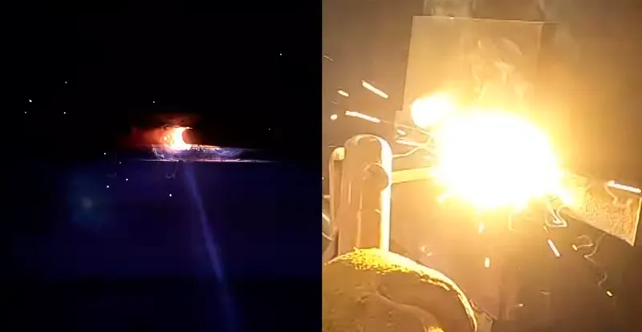

*Picture: [Common joint types.png](https://commons.wikimedia.org/wiki/File:Common_joint_types.png) by unknown, [CC BY-SA 3.0](https://creativecommons.org/licenses/by-sa/3.0), from Wikimedia Commons.*

Welding melts the edges of two metal parts, usually with extra filler metal from a wire or rod, using an electric arc or a gas flame, so the melted metal flows together and cools into one continuous piece: the strongest permanent way to join metal parts of the same or compatible metals.

**In plain words:** Melting the edges of two metal parts together with a very hot electric spark or gas flame, usually adding a little extra metal, so they cool and set as one solid piece. **Proper term:** Welded metal joint (fusion welding: stick, MIG, TIG, flux-cored and gas welding).

**Also called:** weld, weldment, fusion weld; arc welding; stick welding = shielded metal arc welding (SMAW) = manual metal arc (MMA or MMAW) welding (Wikipedia 'Welding'); MIG welding = gas metal arc welding (GMAW); 'MAG' when an active gas such as CO2 is used ⚑ [uncertain: MAG not on an opened page]; 'wire feed welding'; flux-cored arc welding (FCAW), 'gasless MIG', self-shielded flux-cored; 'dual shield' when gas is added (Wikipedia 'Welding'); TIG welding = gas tungsten arc welding (GTAW); 'Heliarc' (old name) (Wikipedia 'Gas tungsten arc welding'); gas welding = oxy-acetylene or oxy-fuel welding (Wikipedia 'Welding'); forge welding = fire welding (blacksmithing) (Wikipedia 'Forge welding'); tack weld (a small temporary weld that holds parts before the full weld) (TWI); butt weld, lap weld, corner weld, edge weld, T-joint or [fillet](../glossary.md#chamfer--fillet) weld, plug weld; bead, weld pool or puddle, heat-affected zone (HAZ).

## How it works

An electric arc (or a gas flame) heats a small spot until both edges melt into a pool of liquid metal (the weld pool or puddle); filler metal from the wire or rod melts into the pool, and the welder moves along the joint so the pool leaves behind a solid ridge (the bead) (Wikipedia 'Welding'). Hot liquid metal reacts with air, so it is protected by a shielding gas from a bottle (MIG and TIG), or by flux on the rod or inside the wire that makes its own gas and a crust of slag to chip off (stick and flux-cored); gas welding uses the flame itself. The processes differ mainly in how the heat and filler arrive: stick uses a flux-coated rod, MIG a continuously fed wire, TIG a non-melting tungsten electrode with a hand-fed filler rod, and gas welding a torch flame. Forge welding is the old blacksmith's method: two pieces are heated to a bright yellow heat with a borax flux and hammered together without fully melting (Wikipedia 'Forge welding').

## Parts

Single piece once made: the two parts and the weld bead become one. Making it needs a small assembly of equipment: a power source or gas torch, an electrode (consumable rod or wire, or a tungsten electrode plus filler rod), shielding gas or flux, a work (earth) clamp and cable, clamps or magnets to hold the parts, and protective gear.

## Everyday examples

- steel gates, railings, trailer frames and fencing (Miller lists trailer frames and fencing as typical projects)
- car-body repairs and motorcycle or car restoration (Miller lists auto body and car and motorcycle projects)
- bicycle frames (TIG-welded steel, aluminium and titanium) and lawnmower or go-kart tube frames
- the bead of melted metal along the corners of steel workbenches, shelving and playground climbing frames

## When to use it

For strong, rigid, permanent joints in steel and other weldable metals: frames, brackets, stands, trailers, carts, robot chassis made of steel tube or angle, repairs to broken metal parts, and leak-tight tanks and pipes. Choose the process by metal, thickness, place and budget (Miller; Wikipedia): MIG is the easiest to learn, fast and clean on thin to medium steel and also does stainless and aluminium; flux-cored uses the same machine without gas, for outdoors, wind and rusty metal; stick is the cheapest machine, works outdoors and on dirty or thick metal but is harder to learn and not for thin sheet; TIG gives the neatest, most controlled welds on thin steel, stainless, aluminium and copper alloys but is slow and hardest to master; gas (oxy-acetylene) welding uses cheap, simple equipment, is still used for pipes, tubes and repairs, and the same torch heats, bends and cuts metal; forge welding is for blacksmiths joining iron and steel in a forge.

## When not to use it

When parts must come apart again: use bolts (Ordinary screw joint). For thin sheet that would burn through or warp, or for joining different metals: use brazing, blind rivets, clinching or adhesive. For aluminium to steel: not by ordinary welding; bolt or rivet them, with insulating washers to prevent galvanic corrosion (Wikipedia 'Washer (hardware)'). For plastics: use plastic welding entries. Near bearings, electronics, batteries, fuel, or on parts that have held flammable liquids (they can explode even when 'cleaned', Lincoln manual). On hardened or heat-treated parts such as shafts, springs and high-carbon steel: the heat-affected zone becomes weak or [brittle](../glossary.md#brittle--ductile) and cracks (Wikipedia 'Welding'); to fix a hub to a motor shaft use a shaft-to-hub joint (key, D-flat, clamp hub) or a retaining compound instead. Indoors without fume extraction: HSE no longer accepts any welding without suitable exposure control.

## Details

- **What it does (jobs):**
  - join and hold: permanently joins metal parts into one rigid piece; tack welds also hold parts in line before the full weld
- **Movement:** none
- **Directions it can move (degrees of freedom):** 0: the parts become one piece.
- **Special behaviour:**
  - none: it is a plain permanent joint
- **How it holds:** [material bond](../glossary.md#form-fit--force-fit--material-bond) (glue, solvent or melting): the parts are melted together (metallic bond); forge welding bonds them by heat and hammering
- **Input and output:** not applicable
- **Power:** passive (no power needed) once made; making it needs a welding power supply (mains or generator) or a gas torch
- **Load:** Heavy: a sound weld can be stronger than the metal around it and is strong in pull, [shear](../glossary.md#peel-vs-shear) and twist (Wikipedia 'Welding'). The weak spot is the heat-affected zone (HAZ) next to the bead, which 'is often weaker than both the base material and the fusion zone' and holds leftover (residual) stresses; under repeated loads (vibration, [fatigue](../glossary.md#fatigue)) cracks start at the edge of the bead, and grinding the weld flat improves fatigue life (Wikipedia 'Welding'). Tack welds are light-duty and only hold parts for final welding (TWI).
- **Play and precision:** No play: the joint is rigid. [Accuracy](../glossary.md#repeatability--accuracy) is limited by distortion: the weld shrinks as it cools and pulls parts out of line, more so with spread-out heat such as gas welding (Wikipedia 'Welding'). Clamps, jigs and tack welds placed in a planned order hold alignment and the joint gap and reduce distortion (TWI). Not suitable for parts that must keep machined accuracy unless re-machined after welding.
- **Taking it apart:** permanent: can only be undone by cutting or grinding the weld out (small tack welds are easy to grind off and redo, TWI)
- **How often it can be reused:** once
- **Sealing:** airtight or pressure when the weld is continuous and sound: tanks, pipes and pressure vessels are made by welding (Wikipedia 'Welding'); porosity (gas holes) or gaps leak
- **Adjustable:** no: once welded the position is fixed; tack welds can be ground off and redone if alignment is wrong (TWI)
- **Access needed:** one side only (blind) for many joints (fillet, lap and plug welds and thin butt welds); thick butt joints are often prepared and welded from both sides (double-V preparation) (Wikipedia 'Welding'). The work clamp must also go on clean bare metal near the weld.
- **Materials:** Can join: mild (carbon) steel (all processes); stainless steel (MIG, TIG, stick); aluminium (TIG with AC, or MIG; harder: clean the oxide off first); cast iron (special stick rods); chromoly tube, copper and brass, magnesium and titanium (mostly TIG) (Miller; Wikipedia 'Gas tungsten arc welding', 'Shielded metal arc welding'). Joins the same or compatible metals: steel can't be fusion-welded to aluminium in a home workshop (dissimilar welding is still a research topic, and aluminium-to-steel transition joints are made by explosion welding, Wikipedia 'Welding'); use bolts, rivets or brazing instead. Galvanised, painted, oily or plated metal must be cleaned back to bare metal first (fumes and porosity). Plastics are joined by plastic welding instead (separate entries). Forge welding can join iron and steels of similar carbon content (Wikipedia 'Forge welding').
- **Heat, cold, water and wear:** A finished steel weld handles the same heat and cold as the metal, but: steel welds rust unless painted; some steels become brittle in cold, below a 'transition temperature' (Wikipedia 'Welding'); welds under vibration fail by fatigue starting at the bead edge (grind flat to improve, Wikipedia); cracks in the heat-affected zone can appear as late as two days after welding (Wikipedia 'Welding'). While welding: wind blows MIG and TIG shielding gas away, causing porosity, so use stick or flux-cored outdoors (Wikipedia 'Gas metal arc welding'; Miller); damp or wet conditions increase the risk of electric shock (OSHA 1910.252; Lincoln manual).

## Making it

- **Ways to make or get it:**
  - sheet metal (and steel tube and plate fabrication): the main use
  - off-the-shelf part (have it welded by a fabrication shop, or buy welded brackets and frames)
- **Printing it in one piece (print in place):** no: welding joins metal; 3D-printed parts can only help as jigs, gauges and fixtures (and melt if they get near the arc)
- **Tools:** A welder (MIG/flux-cored, stick or TIG machine, or an oxy-acetylene torch set); a gas cylinder and [regulator](../glossary.md#regulator) for MIG, TIG and gas welding; a welding helmet with the right filter (auto-darkening is common), leather gloves and a flame-resistant jacket; clamps or welding magnets; an angle grinder and wire brush to clean and bevel the metal; a chipping hammer for slag (stick and flux-cored); a fire extinguisher; fume extraction indoors (Miller; Lincoln manual; HSE)
- **Difficulty:** hard: needs a welder, protective gear, a safe place to work and practice; MIG is the easiest process to learn (Miller), but many makers have a local fabricator weld parts instead

### 3D printing tips

not applicable to the joint itself (plastics are joined by Melted plastic weld, Friction-welded plastic and Ultrasonic weld). 3D printing is useful around welding: print alignment jigs, angle templates, magnet holders and weld gauges, but keep them away from the arc and hot metal: a printed fillet weld gauge's designer warns to let the weld cool or print in a heat-resistant filament (Printables 1445951). Never leave printed (flammable) parts in the spark zone: clear combustibles well away from welding (OSHA 1910.252).

### Buying one (off-the-shelf parts)

Search terms: 'MIG welder' or 'MIG/flux-core welder' (120 V or 230 V hobby units), 'multiprocess welder', 'stick welder' or 'MMA inverter welder', 'TIG welder' ('AC/DC TIG' for aluminium), 'oxy-acetylene welding kit' and 'flashback arrestor', 'MIG wire' (e.g. ER70S-6 for mild steel) and 'flux-core wire' ⚑ [uncertain: wire grade names not on an opened page], 'stick electrodes' (e.g. 7018, as in the Commons weld-pool photo), 'argon/CO2 shielding gas', 'auto-darkening welding helmet', 'welding gloves', 'welding magnets' or 'magnetic squares', 'welding clamps' or 'locking C-clamp', 'welding table', 'fume extractor', 'welding curtain' or 'welding screen'.

## Rules of thumb

- Current: 'for every .001 inch of material thickness, you need 1 amp of output' (about 125 A for 1/8 in (3.2 mm) steel) (Miller, https://www.millerwelds.com/resources/article-library/buying-your-first-welder-a-practical-informative-guide-for-doityourselfers).
- Thickness limits: MIG and flux-cored can join metal as thin as 26 gauge; stick is 'limited to metals no thinner than 18 gauge'; a small 120 V MIG welds 24 gauge to 3/16 in (0.8-4.8 mm) mild steel in one pass (Miller, https://www.millerwelds.com/resources/article-library/buying-your-first-welder-a-practical-informative-guide-for-doityourselfers).
- Duty cycle: the minutes out of every 10 that a welder can run before it must cool; 30% at 215 A means 3 minutes welding then 7 minutes rest, and the duty cycle rises at lower current (Miller, https://www.millerwelds.com/resources/article-library/buying-your-first-welder-a-practical-informative-guide-for-doityourselfers).
- Outdoors or in wind use stick or self-shielded flux-cored wire, which need no gas; MIG gas is blown away by drafts (Miller; Wikipedia 'Gas metal arc welding', https://en.wikipedia.org/wiki/Gas_metal_arc_welding).
- Connect the work (earth) clamp 'as close as possible to the area being welded' on clean metal, so welding current doesn't take other paths (Lincoln Electric manual, https://static.prd.echannel.linde.com/wcsstore/AU_SPW_Store/pdf/product/en_AU/lincoln_operatingmanual_redimig455.pdf).
- Move combustibles at least 35 ft (10.7 m) away or cover them, and keep a fire watch for at least half an hour after welding (OSHA 29 CFR 1910.252, https://www.osha.gov/laws-regs/regulations/standardnumber/1910/1910.252).
- Gas welding: acetylene is unstable and can explode above about 15 psi (1 atm), so regulators are set below that, and flashback arrestors are fitted to stop a flame running back into the cylinders (Wikipedia, https://en.wikipedia.org/wiki/Oxy-fuel_welding_and_cutting).
- Forge welding: common steel (0.2-0.8% carbon) welds at a bright yellow heat; both pieces must be at the same heat and cleaned with a flux such as borax (Wikipedia, https://en.wikipedia.org/wiki/Forge_welding).
- Wear ear plugs above 85 dB(A): welding can exceed 100 dB(A) (Wikipedia, https://en.wikipedia.org/wiki/Welding).

## Common failures

(1) Porosity (gas bubbles) from dirty, oily, rusty or painted metal, wind blowing the gas away, or a long arc: clean to bright metal and shield from drafts (Wikipedia 'Gas metal arc welding'); aluminium is especially prone because of its oxide skin, so wire-brush or chemically clean it. (2) Lack of fusion or incomplete penetration (a 'cold' bead sitting on top): too little current or too fast; follow the 1 A per 0.001 in guide (Miller) and prepare thick joints with a bevel. (3) Burn-through and holes on thin sheet: too much heat; use MIG or TIG, lower current, tack and stitch. (4) Distortion and [warping](../glossary.md#warping--shrinkage) as the weld shrinks: clamp, tack weld in a planned order, and alternate sides (TWI; Wikipedia). (5) Cracks, especially in the heat-affected zone of high-carbon steel or from excess hydrogen in the weld, sometimes appearing up to two days later: preheat and cool slowly (Wikipedia 'Welding'). (6) [Undercut](../glossary.md#undercut), slag inclusions and spatter (Wikipedia list of defects): chip slag between passes with stick and flux-cored. (7) Weak tack welds that tear when the part is moved (TWI). (8) Arcing damage where welding current returns through the wrong path, e.g. lifting chains or a machine's bearings: clamp the work lead next to the weld (Lincoln manual) ⚑ [uncertain: bearings are not named on the opened page]. (9) Running the welder past its duty cycle so it cuts out (Miller).

## Safety

Major hazards: get training and read the machine's manual. ARC LIGHT: the arc gives off intense ultraviolet light that burns the eyes ('arc eye' or welder's flash, a sunburn of the cornea) and bare skin; wear a welding helmet with the correct filter (auto-darkening helmets darken automatically) and cover all skin, and screen bystanders with welding curtains (Wikipedia 'Welding', 'Photokeratitis'). Gas welding needs shaded goggles. ELECTRIC SHOCK can kill: the electrode, wire, torch and work circuit are live when the welder is on; wear dry, hole-free gloves, insulate yourself from the work and ground, take extra care in damp places, never cool the electrode holder in water, and replace damaged cables (Lincoln manual). FIRE AND BURNS: welding is 'hot work'; sparks fly far and through cracks, so clear or cover combustibles (OSHA: 35 ft / 10.7 m), keep an extinguisher ready and watch for smouldering fires for at least half an hour afterwards (OSHA 1910.252); wear leather gloves and flame-resistant, non-synthetic clothing, because molten metal melts through polyester (Wikipedia 'Welding'). Never weld or cut drums, tanks or containers that held fuel or chemicals: they can explode (Lincoln manual; OSHA). FUMES: all welding fume, including mild-steel fume, is classed as a cause of lung cancer and contains manganese (nerve damage); HSE expects extraction (local exhaust ventilation) indoors and a suitable respirator where extraction isn't enough and outdoors, and says there is 'no known level of safe exposure' (HSE bulletin STSU1-2019). Stainless steel gives off hexavalent chromium (cancer-causing) (Wikipedia 'Welding'); galvanised (zinc-coated) steel gives off zinc oxide fume that causes metal fume fever, so grind the coating off first (Wikipedia 'Metal fume fever'); lead- or cadmium-plated metal is worse still (Lincoln manual). Keep chlorinated solvent degreasers away: the arc turns their vapour into phosgene, a highly toxic gas (Lincoln manual; OSHA 1910.252). Shielding gases can displace air in small rooms (Lincoln manual). GAS CYLINDERS: keep them upright and chained; acetylene is explosive above about 15 psi and needs flashback arrestors (Lincoln manual; Wikipedia 'Oxy-fuel welding and cutting'). NOISE above 100 dB(A): wear ear protection (Wikipedia 'Welding'). Arc welding's magnetic fields may affect pacemakers (Lincoln manual).

## Related

- Brazed joint (brazing, silver soldering, hard soldering): melts only a brass or silver filler into a close gap, not the parts; joins thinner metal and different metals with less distortion, but is weaker than a weld
- Soldered metal joint (soft soldering, sweat-soldered copper pipe): much lower temperature and much weaker; for copper pipe, tinplate and electronics
- Spot weld (resistance spot welding): joins overlapping sheets (up to about 3 mm, Wikipedia) by clamping and passing current, with no bead or filler; also battery tabs
- Melted plastic weld, Friction-welded plastic and Ultrasonic weld: the plastic equivalents
- Blind rivet (pop rivet) and Clinching: cold, one-sided or press joints for sheet metal, including different metals
- Ordinary screw joint (bolt and nut, machine screw): removable alternative for metal frames
- Metal brackets and plates (angle bracket, mending plate): bolt-on alternative for frames
- Shaft-to-hub joints and rigid couplings (key, [set screw](../glossary.md#set-screw), D-flat, clamp hub): use instead of welding a hub to a motor shaft
- Two-part epoxy and Epoxy putty: 'cold weld' products (e.g. JB Weld (brand)) that glue rather than weld; much weaker but need no welder

## Make it yourself

- [Fillet Weld Gauge (Printables 1445951; URL from Printables API, page not opened)](https://www.printables.com/model/1445951-fillet-weld-gauge): Printable metric gauge for checking fillet weld sizes; the designer warns to let welds cool or use a heat-resistant filament *(licence: CC BY-NC-SA (Creative Commons Attribution-NonCommercial-ShareAlike))*
- [Magnetic Welding Clamp (Printables 590972; URL from Printables API, page not opened)](https://www.printables.com/model/590972-magnetic-welding-clamp): Small printed holder with two 10 x 3 mm magnets for holding small metal parts in place for welding *(licence: CC BY-NC (Creative Commons Attribution-NonCommercial))*
- [Welding Practice Object (Printables 420818; URL from Printables API, page not opened)](https://www.printables.com/model/420818-welding-practice-object): A practice object for working on welding technique *(licence: Public domain (Creative Commons Public Domain))*

## Pictures, videos and models

- [Common joint types.png (Wikimedia Commons)](https://commons.wikimedia.org/wiki/File:Common_joint_types.png): Diagram of basic weld joint types: square butt, V-butt, lap and T joints *(licence: CC BY-SA 3.0 (reuse with credit))*
- [Weld puddle, also known as a weld pool or welding pool.png (Wikimedia Commons, by Jose Bueno)](https://commons.wikimedia.org/wiki/File:Weld_puddle,_also_known_as_a_weld_pool_or_welding_pool.png): A stick weld pool seen through a welding lens and without it, on a single-bevel groove weld *(licence: CC BY 3.0 (reuse with credit))*
- [MIG welding.webm (Wikimedia Commons, by Chris MacDonald)](https://commons.wikimedia.org/wiki/File:MIG_welding.webm): Video of MIG welding filmed through a shaded lens, showing the arc and bead forming *(licence: CC BY 3.0 (reuse with credit))*
- [Man dressed in full welding gear.jpg (Wikimedia Commons, by Borderlands Roomba)](https://commons.wikimedia.org/wiki/File:Man_dressed_in_full_welding_gear.jpg): A welder in full protective gear (helmet, jacket, gloves) *(licence: CC BY-SA 4.0 (reuse with credit))*
- [4 Types of Welding Explained: MIG vs TIG vs Stick vs Flux Core (TimWelds, YouTube; title confirmed via YouTube oEmbed)](https://www.youtube.com/watch?v=y-OKi8oSNQ4): Video comparing the four common arc welding processes for beginners (a 5-process version with oxy-acetylene is https://www.youtube.com/watch?v=5M9I_bBrnZ0) *(licence: link only)*

## Needs confirming

⚑ marks something nobody has confirmed yet: a fact the research could not confirm from a source, a finder value that is a best guess, or an open point from the research notes. Corrections are welcome (see `research/needs-confirming.md`).

- ⚑ 3 sentences on this page marked [uncertain].

## Sources

- <https://en.wikipedia.org/wiki/Welding>
- <https://en.wikipedia.org/wiki/Gas_metal_arc_welding>
- <https://en.wikipedia.org/wiki/Shielded_metal_arc_welding>
- <https://en.wikipedia.org/wiki/Gas_tungsten_arc_welding>
- <https://en.wikipedia.org/wiki/Flux-cored_arc_welding>
- <https://en.wikipedia.org/wiki/Oxy-fuel_welding_and_cutting>
- <https://en.wikipedia.org/wiki/Forge_welding>
- <https://en.wikipedia.org/wiki/Metal_fume_fever>
- <https://en.wikipedia.org/wiki/Photokeratitis>
- <https://en.wikipedia.org/wiki/Welding_joint>
- <https://en.wikipedia.org/wiki/Washer_(hardware)>
- <https://www.millerwelds.com/resources/article-library/buying-your-first-welder-a-practical-informative-guide-for-doityourselfers>
- <https://www.hse.gov.uk/safetybulletins/mild-steel-welding-fume.htm>
- <https://www.osha.gov/laws-regs/regulations/standardnumber/1910/1910.252>
- <https://static.prd.echannel.linde.com/wcsstore/AU_SPW_Store/pdf/product/en_AU/lincoln_operatingmanual_redimig455.pdf>
- <https://www.twi-global.com/technical-knowledge/faqs/what-is-a-tack-weld>
- <https://commons.wikimedia.org/wiki/File:Common_joint_types.png>
- <https://commons.wikimedia.org/wiki/File:Weld_puddle,_also_known_as_a_weld_pool_or_welding_pool.png>
- <https://commons.wikimedia.org/wiki/File:MIG_welding.webm>
- <https://commons.wikimedia.org/wiki/File:Man_dressed_in_full_welding_gear.jpg>
- <https://www.youtube.com/watch?v=y-OKi8oSNQ4>
- <https://www.youtube.com/watch?v=5M9I_bBrnZ0>
- <https://api.printables.com/graphql/>
