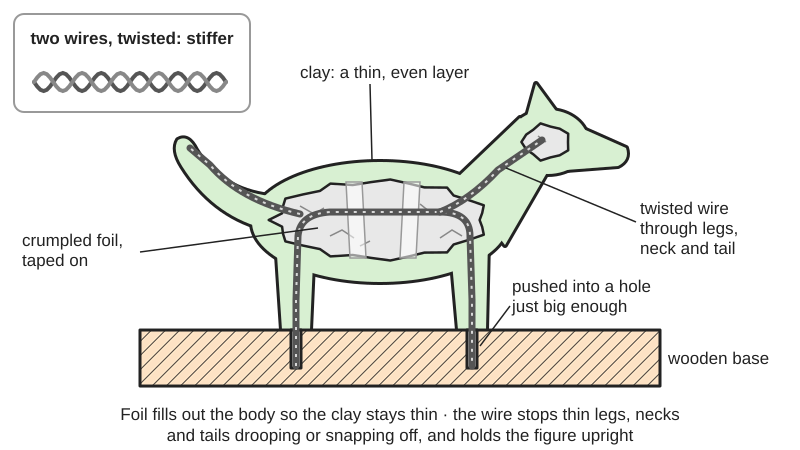
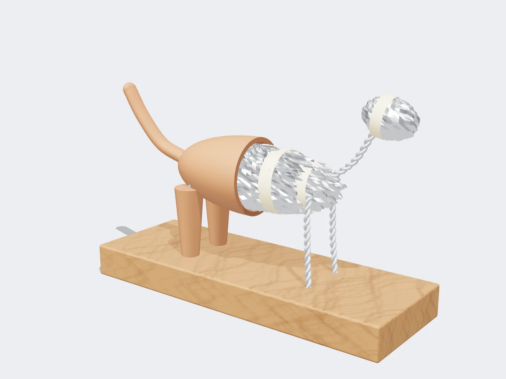

<figure class="eoc-pic eoc-pic-main"><figcaption>Diagram drawn for the encyclopaedia from the research notes. ⚑ Needs confirming: a drawing can simplify or get details wrong; a real photo or a better diagram is welcome.</figcaption></figure>
<figure class="eoc-pic"><figcaption><strong>Render.</strong> A 3D model made for the encyclopaedia, not a photo: a stand-in until a good real photo is found. ⚑ Needs confirming: a model can simplify or get details wrong; a real photo is welcome.</figcaption></figure>

A skeleton of bent, often twisted wire, anchored in a base and bulked out with foil, tape or other filler, that clay or putty is built up over so the finished figure has a strong core that holds its shape, keeps thin parts attached and stands up.

**In plain words:** A bendable wire skeleton, stuck into a base and padded out with scrunched-up foil, that you press clay over so thin legs, tails and necks don't droop or snap off and the figure can stand up. **Proper term:** Sculpture armature (wire and foil armature; foil core).

**Also called:** armature, sculpting armature, wire armature; foil armature, foil core, aluminium foil armature (polymer clay); bulking, bulking out (Art Shed / Mont Marte); armature wire, craft wire (aluminium wire sold for armatures); doll armature, body armature (art dolls; Sculpey blog); skeleton (stop-motion and animation term; Wikipedia 'Armature (sculpture)').

## How it works

The wire is bent into a stick-figure of the pose, with its lower end pushed into a hole drilled in a wooden base or set in plaster, so the figure is fixed upright and its proportions are set before any clay goes on (Make: owl; Mont Marte fox). Twisting two wires together makes the skeleton stiffer, and a thin coat of epoxy putty, allowed to [cure](../glossary.md#cure), stops the wire bending while clay is pressed on (Make: owl; Sculpey squirrel project). Crumpled foil, taped on, fills out the body so the clay layer is thin and even, which saves clay, keeps the figure light and helps it bake or dry evenly (Sculpey blog; Art Shed). The clay grips the rough foil and tape and wraps right round the wire, so limbs and heads are held mechanically by the wire running through them rather than by the clay alone. The armature usually stays inside for good, except in clay that will be fired in a kiln, where it must come out (Wikipedia 'Armature (sculpture)').

## Parts

A few parts. Wire skeleton (aluminium armature wire, often two strands twisted together; wire coat hangers for art-doll bodies); a base (wood block or a plaster-filled form) that the wire is pushed or set into; bulking material (crumpled aluminium foil, polystyrene, paper or cotton strips); tape to hold the foil in place (masking tape, hockey tape); optional epoxy putty to stiffen the wire; optional wooden dowels for a weight-bearing leg; toothpicks as short neck pins (Make: owl; Sculpey blog; Mont Marte fox; Art Shed).

## Everyday examples

- Polymer clay animal and fantasy figures on a wooden base (Make: owl; Mont Marte fox)
- Stop-motion puppets built on an armature, such as the Gromit model (Wikimedia Commons 'Armature for Gromit'; Wikipedia)
- Large statues with an inner frame, such as the Statue of Liberty, whose armature was designed by Gustave Eiffel (Wikipedia 'Armature (sculpture)')

## When to use it

Use a wire and foil armature for any clay, putty or wax figure larger than a few centimetres, and whenever it has thin limbs, a tail, a long neck, a dynamic pose or must stand on one or two legs: without one, soft polymer clay droops and cracks in the oven (Sculpey 'Importance of Armature'). It also sets the proportions before you sculpt, saves clay and weight, and fixes the figure to a base.

## When not to use it

Skip it for very small, compact pieces (Sculpey 'Importance of Armature'). Don't leave metal inside clay that will be fired in a kiln; use a removable paper or wood armature or hollow the piece (Wikipedia). Don't use a PLA print as a bakeable core (Wikipedia 'Polylactic acid'). For a figure that must stay posable after it is finished, use an elastic-strung ball-jointed body or a posable segmented armature instead. To join two separately made hard parts, use a pinned glue joint.

## Details

- **What it does (jobs):**
  - join and hold: the wire runs through thin parts such as limbs, necks and tails so they stay attached to the body and to the base
  - line parts up exactly: the skeleton sets the figure's proportions and pose before sculpting starts (Make: owl; Sculpey 'Importance of Armature')
- **Movement:** none once the clay has hardened; while sculpting the wire can be bent to adjust the pose, and joints left free of epoxy putty can still be posed (Sculpey squirrel project); art-doll body armatures made of coat-hanger wire can be re-posed after assembly (Sculpey 'Creating Doll Armatures')
- **Directions it can move (degrees of freedom):** 0 in the finished sculpture (it is a rigid core). Before the clay sets, the wire can be bent anywhere, so it is effectively a bendable frame.
- **Special behaviour:**
  - none: it is a passive support structure; its only trick is that soft wire bends to any pose and then stays put
- **How it holds:**
  - shape (the parts interlock; [form-fit](../glossary.md#form-fit--force-fit--material-bond)): clay wraps all the way round the wire and foil, and the wire end is trapped in a hole in the base or set in plaster
  - friction or clamping (force-fit): the wire is a snug push fit in a drilled base hole (Make: owl)
  - material bond (glue, solvent or melting): epoxy putty bonds to the wire, and tape holds the foil (Make: owl; Sculpey blog)
- **Input and output:** not applicable
- **Power:** passive (no power needed)
- **Load:** light: carries the figure's own weight and protects thin parts from bending and snapping. Strongest along the wire; weak where clay is thin over the wire or where a limb has no wire. Heavier or one-legged poses need thicker or doubled wire, epoxy putty reinforcement or a wooden dowel in the weight-bearing leg (Make: owl; Sculpey 'Importance of Armature').
- **Play and precision:** not applicable
- **Taking it apart:** permanent: the armature stays inside the finished piece. For clay that will be kiln-fired it must be removed while the clay is still soft, so armatures for firing are usually paper or wood (Wikipedia 'Armature (sculpture)').
- **How often it can be reused:** once
- **Sealing:** none
- **Adjustable:** yes, before the clay hardens: the wire can be re-bent to change the pose. No once the piece is baked or dry.
- **Access needed:** not applicable
- **Materials:** Wire: aluminium armature or craft wire (light, easy to bend, holds its shape; Sculpey uses 1.5, 2 and 3 mm; Make: owl uses 9 and 14 gauge), steel tie-wire (Mont Marte fox), coat-hanger wire (Sculpey doll armatures); garden and galvanised steel wire works but is hard to bend (Sculpey 'Importance of Armature'). Base: wood (Make: owl; Wikipedia), plaster (Mont Marte fox). Bulking: aluminium foil, polystyrene, paper, cotton strips, aluminium mesh for wings (Art Shed; Sculpey). Suits: polymer clay, air-dry clay, epoxy putty and wax (Wikipedia; Art Shed). Doesn't suit: clay to be kiln-fired with metal still inside (Wikipedia); 3D-printed PLA cores under polymer clay that will be baked (PLA's glass transition is 60-65 °C, far below the 130 °C bake; Wikipedia 'Polylactic acid'; Sculpey).
- **Heat, cold, water and wear:** Polymer clay softens when warm, so a weak armature lets the figure droop or collapse during baking (Sculpey 'Importance of Armature'). Wood and stone hold moisture that expands in the oven and can crack the clay, and wood can warp, crack or distort when heated (Sculpey blog). Air-dry clay over an armature is water-based and needs sealing against damp (Art Shed). Metal armatures expand in kiln heat and can burst fired clay (Wikipedia). Steel wire can rust inside damp air-dry clay ⚑ [uncertain].

## Making it

- **Ways to make or get it:**
  - off-the-shelf part: armature wire, foil, tape, epoxy putty, wooden plinths
  - woodwork: drilling the base and cutting dowels
  - hand modelling in polymer clay, air-dry clay or epoxy putty over the armature
  - casting: plaster poured round the wire to make a base (Mont Marte fox)
- **Printing it in one piece (print in place):** no: an armature is bent from wire by hand. A 3D-printed core is not a bakeable armature for polymer clay, because PLA softens far below the baking temperature (Wikipedia 'Polylactic acid'; Sculpey).
- **Tools:** Wire cutters and pliers (to twist and bend wire), a drill for the base hole, tape, and optionally gloves for epoxy putty; plaster and a mould or canvas form for a plaster base (Make: owl; Mont Marte fox).
- **Difficulty:** easy: needs only wire, pliers, foil, tape and a base; the skill is getting the proportions and the pose right before adding clay

### 3D printing tips

not applicable for a bakeable armature: a PLA print is not a substitute for a wire armature under polymer clay, because PLA's glass transition is about 60-65 °C (Wikipedia 'Polylactic acid') and polymer clay is baked at 275 °F (130 °C) (Sculpey). A printed part could serve as a non-baked base or stand for an air-dry clay or epoxy putty figure ⚑ [uncertain].

### Buying one (off-the-shelf parts)

Search for: 'armature wire' or 'aluminium craft wire' (1.5-3 mm, or 9-14 gauge), 'epoxy sculpting putty' / 'two-part epoxy clay' (e.g. Apoxie Sculpt (brand), Milliput (brand), 'green stuff'), 'aluminium foil', 'masking tape' or 'hockey tape', 'polystyrene balls and eggs' (bulking), 'wooden plinth' or 'wood base', 'plaster of Paris', 'wooden dowel', 'aluminium mesh' (wings) (Make: owl; Sculpey blogs; Art Shed; Mont Marte fox).

## Rules of thumb

- Twist two lengths of wire together for the main support, and drill the base hole just large enough for the twisted wire (Make: owl; Mont Marte fox: twisting tie-wire 'effectively double[s] its thickness').
- Fold one long wire in half and twist it to make neck, arms, torso, legs and tail in one piece; the Sculpey squirrel starts with about 3.5 ft of 14 gauge aluminium wire (Sculpey squirrel project).
- Coat the wire thinly with epoxy putty and let it cure 24 hours before adding clay; leave joints bare if you still want to pose them (Make: owl; Sculpey squirrel project).
- Aluminium foil expands less than 2% in the oven, so it won't crack polymer clay; press the clay on from the centre outwards to push out air, because trapped air expands and cracks or puffs the clay (Sculpey 'Creating Armature That Supports Your Sculpts'; Mont Marte fox: 'Ensure there's no air between the clay and the armature').
- Bulk out with foil so the clay is thin and even: polymer clay cures best when not too thick (Sculpey 'Importance of Armature'); bake Super Sculpey at 275 °F (130 °C) for 15 minutes per 1/4 in (6 mm) of thickness (Sculpey product page).
- Pre-dry wood and stone bases before baking on them: Sculpey's blogger bakes them at 150-200 degrees for a couple of hours or overnight (the page gives no unit; as a US page this is presumably °F, about 65-95 °C) (Sculpey 'Creating Armature That Supports Your Sculpts').
- For a small figure, a toothpick pushed into the neck of a baked body can carry a separately made head (oocities polymer clay how-to); small parts without wire must be propped up while baking or they droop (same source).
- Air-dry clay over a foil, polystyrene or wire core dries more evenly and cracks less; don't speed drying with sun, a hairdryer or an oven (Art Shed).

## Common failures

Figure collapses or limbs droop in the oven: armature too flimsy or missing (Sculpey 'Importance of Armature'); use thicker or twisted wire, epoxy putty or a dowel. Cracks or bulges after baking: air trapped between foil and clay (Sculpey blog), or moisture in a wood or stone base (Sculpey blog). Clay cracks over thick sections or cures unevenly: not enough bulking, so the clay is too thick (Sculpey blogs). Air-dry clay cracks: dried too fast (Art Shed). Head or limb snaps off at a thin neck or ankle: no wire through that part; run wire or a toothpick pin through it. Wire pokes through the surface: clay too thin over the wire.

## Safety

Wood and stone bases should be pre-dried before baking, or trapped moisture can crack the piece (Sculpey blog); trapped air between foil and clay cracks or puffs in the oven (Sculpey blog). Wear gloves when mixing epoxy putty and read the label precautions (Make: owl). A PLA print is not a bakeable armature: it softens at about 60-65 °C, far below polymer clay's 130 °C bake (Wikipedia 'Polylactic acid'; Sculpey). Metal armatures must be removed from clay that will be kiln-fired, or the piece can burst (Wikipedia). Cut wire ends are sharp; polymer clay baking should be done by an adult, and Sculpey says not to exceed the stated temperature or time (Sculpey squirrel project).

## Related

- Pinned glue joint (wire, rod, toothpick or skewer pins): joins already-hardened parts with a short pin; an armature runs through the whole figure from the start
- Epoxy putty (kneadable two-part putty): used to stiffen wire armatures and as a sculpting material over them
- Baked-in findings (embedded hardware in clay): small wire loops and pins baked into clay to attach things, not to support a figure
- Elastic-strung ball joint: makes a figure that stays posable after it is finished, instead of a fixed pose
- Posable segmented arm (ball chain): a ready-made posable skeleton of snap-together balls
- Liquid-clay bond and Score-and-slip join: ways of joining clay to clay; an armature supports the clay rather than joining it

## Make it yourself

- [Sculpey Medium Blend: How to Sculpt a Fantasy Gatherer Squirrel (Sculpey)](https://www.sculpey.com/how-to/sculpey-medium-blend-how-to-sculpt-a-fantasy-gatherer-squirrel): Step-by-step project: one folded and twisted 14 gauge aluminium wire makes the whole skeleton, stiffened with epoxy putty on a wood base, then covered in polymer clay *(licence: link only)*
- [Creating Doll Armatures (Maria Saracino, Sculpey blog)](https://blog.sculpey.com/creating-doll-armatures): A printable template and steps for a 12 in posable art-doll body armature from coat-hanger wire, cotton strips and hockey tape *(licence: link only)*
- [The Importance of Armature in Sculpting (Sculpey blog)](https://www.sculpey.com/blogs/blog/the-importance-of-armature-in-sculpting): Beginner guide to choosing armature wire (1.5, 2 and 3 mm aluminium), foil, tape, dowels and aluminium mesh *(licence: link only)*

## Pictures, videos and models

- [Armature for a figure holding a lyre (from Edouard Lanteri, Modelling, 1904; Wikimedia Commons)](https://commons.wikimedia.org/wiki/File:Armature-sculpture.png): Classic drawing of a sculptor's wire and pipe armature for a standing figure, fixed to a base board *(licence: public domain (PD-1923))*
- [Armature for Gromit (Geni, Wikimedia Commons, 2016)](https://commons.wikimedia.org/wiki/File:Armature_for_Gromit.JPG): Photo of the metal armature inside a stop-motion Gromit puppet *(licence: GFDL 1.2+ or CC BY-SA 4.0/3.0/2.5/2.0/1.0 (choice of licence))*
- [How to Sculpt a Fantasy Owl (Make:)](https://makezine.com/projects/how-to-sculpt-a-fantasy-owl): Photos of a twisted aluminium wire armature pushed into a drilled wood base, reinforced with epoxy putty, then covered with polymer clay *(licence: link only)*
- [Creating Armature That Supports Your Sculpts (Maria Saracino, Sculpey blog, 2019)](https://blog.sculpey.com/creating-armature-that-supports-your-sculpts): Photo of a foil armature for a portrait bust, plus advice on air bubbles and pre-drying wood and stone *(licence: link only)*
- [Polymer clay fox tutorial: sculpting (Mont Marte)](https://www.montmarte.com.au/blogs/projects-how-to/how-to-sculpt-a-fox): Step photos of a doubled tie-wire armature set in a plaster base, packed out with taped foil and covered in clay *(licence: link only)*

## Needs confirming

⚑ marks something nobody has confirmed yet: a fact the research could not confirm from a source, a finder value that is a best guess, or an open point from the research notes. Corrections are welcome (see `research/needs-confirming.md`).

- ⚑ 2 sentences on this page marked [uncertain].

## Sources

- <https://en.wikipedia.org/wiki/Armature_(sculpture)>
- <https://en.wikipedia.org/wiki/Polylactic_acid>
- <https://blog.sculpey.com/creating-armature-that-supports-your-sculpts>
- <https://blog.sculpey.com/creating-doll-armatures>
- <https://www.sculpey.com/blogs/blog/the-importance-of-armature-in-sculpting>
- <https://www.sculpey.com/how-to/sculpey-medium-blend-how-to-sculpt-a-fantasy-gatherer-squirrel>
- <https://www.sculpey.com/products/polymer-clay/super-sculpey>
- <https://makezine.com/projects/how-to-sculpt-a-fantasy-owl>
- <https://www.montmarte.com.au/blogs/projects-how-to/how-to-sculpt-a-fox>
- <https://www.artshedonline.com.au/blog/art-shed-blog/sculpting-and-modelling/14-air-dry-clay-techniques>
- <https://www.oocities.org/Athens/Olympus/3457/clay_howto.htm>
- <https://commons.wikimedia.org/wiki/Category:Armatures_(sculpture)>
- <https://commons.wikimedia.org/wiki/File:Armature-sculpture.png>
- <https://commons.wikimedia.org/wiki/File:Armature_for_Gromit.JPG>
