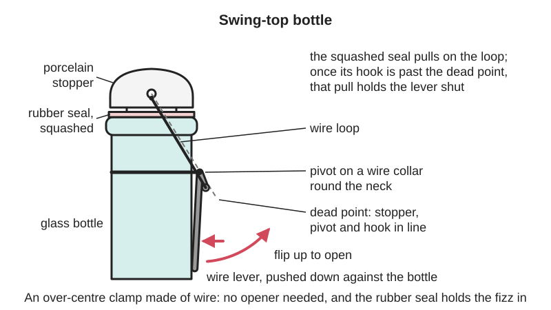
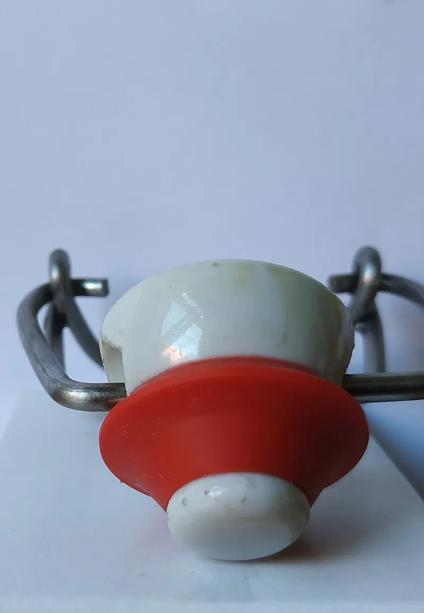
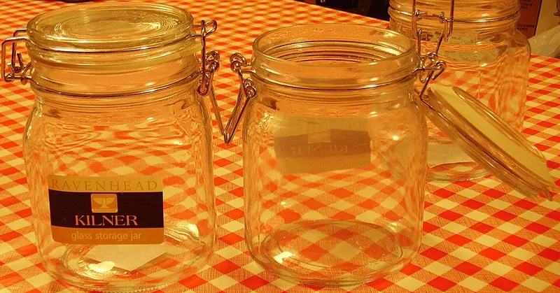

<figure class="eoc-pic eoc-pic-main"><picture><source media="(prefers-reduced-motion: reduce)" srcset="../media/drawn/wire-bail-closure.svg"></picture><figcaption><strong>Animation.</strong> Diagram drawn for the encyclopaedia from the research notes. ⚑ Needs confirming: a drawing can simplify or get details wrong; a real photo or a better diagram is welcome.</figcaption></figure>
<figure class="eoc-pic"><figcaption><strong>How it works.</strong> <a href="https://commons.wikimedia.org/wiki/File:B%C3%BCgelverschluss_C.jpg">Bügelverschluss C</a> by IgorCalzone1, <a href="https://creativecommons.org/licenses/by-sa/4.0">CC BY-SA 4.0</a>, from Wikimedia Commons.</figcaption></figure>
<figure class="eoc-pic"><figcaption><strong>Photo.</strong> <a href="https://commons.wikimedia.org/wiki/File:French_kilner.jpg">French kilner</a> by Roger Burton West, <a href="http://creativecommons.org/licenses/by-sa/3.0/">CC BY-SA 3.0</a>, from Wikimedia Commons.</figcaption></figure>

A wire-bail closure is a wire loop and lever, fixed permanently to a bottle neck or jar, that swings a stopper or glass lid with a rubber seal onto the mouth and locks it there by snapping over centre, so the container can be opened and resealed by hand many times.

**In plain words:** The wire clip on a swing-top beer bottle or a clip-top storage jar: you swing the lid or stopper, with its rubber ring, onto the mouth and push a wire lever down until it snaps flat and holds the lid tight, and you flip the lever back up to open it, with no opener needed. **Proper term:** Wire-bail closure (bail closure; flip-top or swing-top stopper; clip-top or bail-lid jar).

**Also called:** flip-top, swing-top, lightning toggle, Quillfeldt stopper, bail closure (Wikipedia 'Flip-top'); swing-top bottle, flip-top bottle, swing cap, EZ Cap (brand), Grolsch-style bottle (brand used as a style name) (Midwest Supplies; Howdy Brewer); Bügelverschluss (German), beugelsluiting (Dutch) (names seen in Wikimedia Commons file names) (Wikimedia Commons 'Swing-top closures'); clip-top jar, clip top jar, bail jar, bail-lid jar, bail closure jar, wire bail jar, 'French Kilner' jar, lightning jar, toggle closure; Kilner, Le Parfait and Fido (brands) (Healthy Canning; Wikimedia Commons 'French kilner.jpg'; Kilner); swing-top gasket, flip-top washer, bottle gasket, jar seal, jar rubber, rubber ring (Midwest Supplies; Kilner; Printables 1779340, 1188957); wire bail, wire cage, bail and brace, stopper and bail (Howdy Brewer; AHA forum).

## How it works

The stopper or lid is held by a 'permanently attached wire bail', and the wires act 'in the same way as a latch clamp' (Wikipedia 'Flip-top'). One wire is hinged to the bottle neck or jar and carries the stopper; the second wire, the lever, links the first wire to the neck. Pushing the lever down pulls the stopper hard onto the rubber gasket, and as the lever passes its [dead point](../glossary.md#dead-point) (in line with the pull) it snaps a little further and rests against the bottle, so the squeezed rubber pushes it shut rather than open, and it stays locked until you lift it back over the dead point ⚑ [uncertain: no opened page describes the dead-centre geometry; this is the [over-centre](../glossary.md#over-centre) principle covered in the Over-centre [linkage](../glossary.md#linkage) entry]. The squashed rubber ring makes the seal, so the closure holds pressure on fizzy drinks and keeps air out of jars (Wikipedia 'Flip-top'; Kilner).

## Parts

A few parts: the glass bottle or jar (with a neck groove, ears or holes the wire hooks into), a stopper of porcelain or plastic or a glass lid, a rubber gasket or ring, and a two-part wire bail: a loop that holds the stopper or presses on the lid, and a lever (brace) that pulls it down (Wikipedia 'Flip-top'; Howdy Brewer; Healthy Canning).

## Everyday examples

- A swing-top beer or lemonade bottle with a porcelain stopper, such as Grolsch (brand) (Wikipedia 'Flip-top'; Kombucha Kamp)
- A clip-top glass storage jar for pasta, coffee or pickles (Kilner, Le Parfait or Fido type) (Healthy Canning; Wikimedia Commons 'Swing top jars')
- Home-brewed beer, cider or kombucha in flip-top bottles (Wikipedia 'Flip-top'; Kombucha Kamp)
- Antique 'Lightning' fruit jars (Wikipedia 'Flip-top'; Healthy Canning)

## When to use it

Use a wire-bail closure when a glass bottle or jar must be opened and resealed by hand many times, with no opener or capper: homebrewers like flip-top bottles 'since they are easy to close after filling' and need no separate capping device (Wikipedia 'Flip-top'). Clip-top jars are good for dry goods and fridge pickles (Healthy Canning). Swing tops are also easier than crown caps to ease open to let pressure out of an over-lively batch (Craft Beer & Brewing). Printing a TPU seal is a quick fix when a jar's rubber ring is lost (Printables 1188957).

## When not to use it

Not for shelf-stable home canning: use two-piece canning lids, because a bail jar gives no reliable sign of a vacuum seal, and Weck avoids mechanical clamps so that a spoiled jar's lid lifts as a warning (Healthy Canning). Not on thin or decorative bottles for fermenting drinks; use pressure-rated bottles (Kombucha Kamp). Kombucha Kamp does not recommend flip-tops at all for kombucha, because pressure builds unpredictably. For a plastic box or case lid use a Draw latch (over-centre latch) and a Gasket; for a bottle that only needs a cap, a screw cap (Printed screw thread) or a Push-and-turn child-resistant cap where children are around.

## Details

- **What it does (jobs):**
  - lock, and release by hand: snaps shut and opens again by hand, with no bottle opener (Wikipedia 'Flip-top')
  - seal it, or pass cables or fluid through: the compressed rubber gasket makes the bottle or jar airtight and lets bottles hold carbonation pressure (Wikipedia 'Flip-top'; Kilner)
  - let it move (turn, slide or bend): the stopper or lid stays attached and swings out of the way on its wire when open (Wikipedia 'Flip-top')
- **Movement:** rotate: the wire loop and lever pivot in the neck holes or groove; the stopper swings through roughly a half turn to clear the mouth, and the lever moves through a short arc to snap over centre ⚑ [uncertain: angles not given on an opened page].
- **Directions it can move (degrees of freedom):** 1 when open (the bail swings about its pivot in the neck), 0 when locked: the over-centre lever holds the stopper fixed against the gasket.
- **Special behaviour:**
  - over-centre (snaps past a point and stays): the lever is pushed past its dead point so the stretched wire and squashed gasket hold it shut (Wikipedia 'Flip-top', 'like a latch clamp') ⚑ [uncertain: geometry not described on an opened page]
  - quick-release: opens and reseals by hand, 'without the use of a bottle opener' (Wikipedia 'Flip-top')
  - [fail-safe](../glossary.md#fail-safe--fail-secure) or breakaway (partly): on an over-pressured bottle the gasket and bail 'are much more likely to fail than the glass', and the stopper can be eased open to let gas out (Craft Beer & Brewing); but Kombucha Kamp warns the stopper can snap up hard when opened under high pressure, so this is not a reliable safety valve
- **How it holds:**
  - spring force (a spring or springy part presses it in place): the springy wire bail and the squashed rubber gasket keep the stopper pressed shut once the lever is over centre (Wikipedia 'Flip-top') ⚑ [uncertain: role of wire springiness inferred]
  - shape (the parts interlock; [form-fit](../glossary.md#form-fit--force-fit--material-bond)): the wire ends hook into holes or a groove in the glass neck, so the bail can't pull off (Howdy Brewer: the replacement fits only narrow necks it can grip)
- **Input and output:** not applicable
- **Power:** passive (no power needed)
- **Load:** Light to medium, in one direction: it holds the stopper down against internal gas pressure in a beer or soda bottle and resists casual knocks, but the lever is easily lifted by hand, and the wire bail is the weak part if a bottle is over-pressured (Wikipedia 'Flip-top'; Craft Beer & Brewing). Standard pressure figures for swing-top bottles were not found on an opened page ⚑ [uncertain].
- **Play and precision:** not applicable
- **Taking it apart:** tool-free quick release: the stopper or lid opens by hand; the whole wire bail can also be sprung off the neck to clean or replace the gasket (Wikipedia 'Flip-top'; Midwest Supplies).
- **How often it can be reused:** many times: the bottle and bail are reused for years; the rubber gasket wears and is replaced (homebrewers report changing gaskets every 3-5 uses as a precaution, while a supplier says gaskets 'will last for many uses') (AHA forum; Midwest Supplies). For home canning a fresh jar rubber is needed each time (Healthy Canning).
- **Sealing:** airtight or pressure: a rubber gasket squeezed between the stopper and the bottle lip holds carbonated drinks, and Kilner rubber seals 'ensure an airtight seal' on clip-top jars (Wikipedia 'Flip-top'; Kilner). It only seals on a clean, smooth, unchipped rim with a gasket in good condition (AHA forum).
- **Adjustable:** partly: a loose closure can be tightened by fitting a thicker or new gasket (one printed gasket is 3.5 mm thick 'for extra tight sealing') or by bending the wire cage (Printables 1779340; AHA forum).
- **Access needed:** one side only (blind): everything is worked from the outside of the bottle or jar.
- **Materials:** Bottle or jar: glass (thick, rounded bottles are preferred for fizzy drinks) (Kombucha Kamp). Stopper: porcelain (ceramic) or plastic; jars use a glass lid (Wikipedia 'Flip-top'; Howdy Brewer). Wire: galvanised or stainless steel wire ⚑ [uncertain: wire grade not stated on an opened page]. Seal: food-safe rubber (Kilner), silicone, or printed TPU (Printables 1779340, 1188957, 1635064). Suits glass bottles and jars made for it; not a closure for plastic bottles or thin decorative glass under pressure (Kombucha Kamp).
- **Heat, cold, water and wear:** Rubber gaskets dry out and crack with age, and need replacing (Midwest Supplies). Warm storage speeds fermentation and raises pressure in sealed bottles, so keep fermenting bottles cool (Kombucha Kamp). Kilner seals are hand-wash only (Kilner). Printed TPU seals have not been tested for heat, dishwashers or long food contact ⚑ [uncertain].

## Making it

- **Ways to make or get it:**
  - off-the-shelf part: swing-top bottles, complete replacement swing tops, clip-top jars and rubber seals (Howdy Brewer; Kilner)
  - 3D print (FDM): TPU gaskets for bottles and jars, retaining clips that put a swing top on another bottle, and screw-on flip-top adapters (Printables 1779340, 1188957, 1635064, 1139514, 311158)
- **Printing it in one piece (print in place):** no: the printed parts are single pieces (a gasket, a clip or an adapter) used with a bought wire bail and stopper (Printables 1779340, 1139514, 311158).
- **Tools:** none to open and close. To replace a gasket, pull the old one off the stopper and stretch the new one on; to clean thoroughly, remove the swing-top cage from the bottle and the gasket from the top (Midwest Supplies). Pliers can be used to bend a loose wire cage tighter (AHA forum, a user report).
- **Difficulty:** easy: buy swing-top bottles or clip-top jars and replacement gaskets, or print a TPU gasket; making a new wire bail is rarely worth it, and complete replacement swing tops (bail, stopper and gasket) are sold for standard narrow-neck bottles (Howdy Brewer).

### 3D printing tips

1) Gaskets: print in TPU. A flat swing-top bottle gasket 3.5 mm thick at 100% [infill](../glossary.md#infill) seals tightly and takes under 2 g of filament (Printables 1779340). A parametric clip-top jar seal uses 0.7 mm top and bottom shells, 1.6 mm walls and 30% infill to make it softer, with the inner diameter shrunk 1% for a snug fit; its defaults are for Kilner-type jars (Printables 1188957, public domain OpenSCAD). Another Kilner-style seal fits 90 mm lids (Printables 1635064). 2) Retaining clip: a printed clip and a cable tie let you move a swing top from a broken bottle onto a sturdy champagne bottle; versions are given for 27.5 mm and 28.1 mm necks (Printables 1139514). 3) Screw-on flip-top adapter: one maker prints a screw cap that takes the bail from a beer bottle, in PLA scaled to 103% so the thread isn't too tight (Printables 311158). 4) Food contact: printed parts have grooves between layers that are 'a seedbed for bacteria' and hard to clean, brass nozzles are not considered food-safe, and Prusa does 'not recommend using 3d-prints as food-containers' (Prusa Knowledge Base). Treat a printed gasket as a temporary or non-food fix, use food-grade filament and a stainless-steel nozzle if it will touch drinks, and replace it often ⚑ [uncertain: no source tests printed TPU gaskets for food safety or pressure]. 5) Never rely on a printed part to hold back the pressure of a fermenting drink; use the bottle maker's bail and stopper (see safety_notes).

### Buying one (off-the-shelf parts)

Search terms: 'swing top bottle' or 'flip top bottle' (500 ml, 750 ml, 1 L), 'EZ Cap' (brand), 'replacement swing top' (complete wire bail, plastic or ceramic stopper and gasket), 'swing top gasket' or 'flip top washer' (rubber or silicone), 'clip top jar', 'Kilner rubber seals', 'Le Parfait seals', 'Fido jar gasket' (brands) (Howdy Brewer; Midwest Supplies; Kilner; Healthy Canning). Catalogue examples: Howdy Brewer replacement swing top (https://www.howdybrewer.com/products/swing-top-complete-replacement-for-narrow-neck-flip-top-bottles); Kilner replacement seals (https://www.kilnerjar.co.uk/products/accessories/0025489-pack-of-6-rubber-seals-035-2-litres). Check the neck size: a replacement for narrow-neck bottles 'likely won't seal' on a 54 mm neck (Howdy Brewer).

## Rules of thumb

- Replace a swing-top gasket if it has visible cracks, any mould, has become thin, failed to seal last time, or its age is unknown (Midwest Supplies); some homebrewers fit new gaskets every 3-5 uses (AHA forum).
- The bottle must be smooth where the neck meets the seal: 'no chips or scratches' (AHA forum). A chipped rim won't seal.
- Clean gasket and lip before closing; to clean properly, take the cage off and the gasket off the stopper and sanitise them separately (AHA forum; Midwest Supplies).
- Fermented drinks in bottles: use strong, pressure-rated, preferably rounded thick glass, leave about 1-2 in (25-50 mm) of headspace, keep second ferments out of heat, check bottles daily in warm weather and refrigerate when in doubt (Kombucha Kamp).
- Open the first homebrewed bottle 4-5 days after bottling to catch over-carbonation early (Craft Beer & Brewing).
- Clip-top (bail) jars are recommended only for dry or refrigerated storage, not shelf-stable home canning, which has been advised against for more than 25 years; jars with a glass lid, wire bail and jar rubber 'have not been recommended since 1989' because there is no sure way to tell a vacuum seal has formed (Healthy Canning, quoting Ball's FAQ and University of Wyoming Extension).
- Hand-wash Kilner rubber seals and sterilise them before preserving any food (Kilner).

## Common failures

Bottle won't hold its fizz: worn or dried gasket, dirt on the gasket or lip, or a loose wire cage; replace the gasket, clean both faces, and tighten the cage (AHA forum; Midwest Supplies). Uneven fizz across a batch: priming sugar not mixed evenly (AHA forum; Craft Beer & Brewing). Jar seal leaks: rubber ring old, missing or the wrong size; fit a new ring for the jar size (Kilner). Replacement top doesn't seal: wrong neck size (Howdy Brewer). Bottle bursts: too much sugar, bottling too early or infection (Craft Beer & Brewing). Printed gasket too stiff to seal: print with lower infill or thinner walls in TPU (Printables 1188957).

## Safety

Pressure: fermenting and fizzy drinks build pressure in a closed bottle, and 'Bottle bombs are very dangerous'; if one bottle bursts, treat every bottle in the batch as dangerous, wear safety glasses or a face shield, gloves and a heavy jacket, chill the bottles and open them outdoors wrapped in a towel (Craft Beer & Brewing). Use thick, pressure-rated bottles, not 'very cheap or decorative swing-tops' or thin glass, don't overdo the sugar or fruit, and store bottles in a box or cooler so a burst is contained (Kombucha Kamp). Sources disagree on whether swing tops are the safer choice: Craft Beer & Brewing says the gasket and bail are more likely to fail than the glass, so they are safer; Kombucha Kamp says a ceramic stopper and clasp opened under high pressure can snap up and hit hands or wrists, and it has heard of painful injuries. Open swing tops pointing away from faces. Chipped glass rims don't seal and can cut lips (AHA forum). Food: bail jars are not recommended for shelf-stable home canning (Healthy Canning); 3D-printed parts are hard to clean and not recommended as food containers (Prusa Knowledge Base). Small rubber gaskets and stoppers are a choking hazard for young children ⚑ [uncertain].

## Related

- Over-centre linkage (toggle linkage): the snap-past-centre principle the bail uses
- Draw latch (over-centre latch): the same lever idea on boxes and cases, pulling two parts together
- Toggle clamp: an over-centre clamp for holding work, not a sealing closure
- Gasket (flat, cord-in-groove or cast-in-place) and [O-ring](../glossary.md#o-ring) seal: the sealing part of the closure
- Printed screw thread: a screw cap, the usual alternative for bottles and jars
- Push-and-turn child-resistant cap: a screw cap that children can't open
- [Taper](../glossary.md#taper) fit (Morse taper): a cork or ground-glass stopper seals by a tapered push fit instead

## Make it yourself

- [Swing Top Bottle Gasket TPU (Tom Holt, Printables) (URL from Printables API, page not opened)](https://www.printables.com/model/1779340-swing-top-bottle-gasket-tpu): A flat 3.5 mm TPU gasket for swing-top bottles *(licence: Creative Commons Attribution-NonCommercial)*
- [Clip-top / snap-top "pickling" jar seal (gasket) (Galiel, Printables) (URL from Printables API, page not opened)](https://www.printables.com/model/1188957-clip-top-snap-top-pickling-jar-seal-gasket): Parametric OpenSCAD TPU seal for clip-top jars, defaulting to Kilner-type sizes *(licence: Creative Commons Public Domain)*
- [Kilner/clip top jar seal (Sam, Printables) (URL from Printables API, page not opened)](https://www.printables.com/model/1635064-kilnerclip-top-jar-seal): TPU replacement seal for clip-top jars with 90 mm lids *(licence: Creative Commons Attribution-NonCommercial)*
- [swing-top bottle retaining clip for non-swing-top bottles (hkern0, Printables) (URL from Printables API, page not opened)](https://www.printables.com/model/1139514-swing-top-bottle-retaining-clip-for-non-swing-top): Clip that, with a cable tie, fits a swing top onto a champagne bottle neck (27.5 or 28.1 mm) *(licence: Creative Commons Attribution-ShareAlike)*
- [Bügelflasche MKII (flip-top bottle cap) (AlmightyFrog, Printables) (URL from Printables API, page not opened)](https://www.printables.com/model/311158-bugelflasche-mkii-flip-top-bottle-cap): Screw-on adapter that carries a flip-top bail on a screw-cap bottle *(licence: Creative Commons Attribution-NonCommercial-ShareAlike)*

## Pictures, videos and models

- [Benutzung eines Bierbügels.gif (Wikimedia Commons, by Joho345)](https://commons.wikimedia.org/wiki/File:Benutzung_eines_Bierbügels.gif): Animation of hands opening and closing a swing-top beer bottle *(licence: CC BY-SA 4.0)*
- [Bügelverschluss C.jpg (Wikimedia Commons, by IgorCalzone1)](https://commons.wikimedia.org/wiki/File:Bügelverschluss_C.jpg): Photo of a swing-top closure with its wire bail and stopper *(licence: CC BY-SA 4.0)*
- [French kilner.jpg (Wikimedia Commons, by Roger Burton West)](https://commons.wikimedia.org/wiki/File:French_kilner.jpg): A modern clip-top (bail closure) jar *(licence: GFDL 1.2+ or CC BY-SA 3.0 / 2.5 / 2.0 / 1.0 (choice))*
- [Category: Swing-top closures (Wikimedia Commons)](https://commons.wikimedia.org/wiki/Category:Swing-top_closures): Photos of swing-top closures, with subcategories of swing-top bottles and swing-top jars *(licence: per file (mostly CC BY-SA; check each))*
- [Bail Lid Jars (Healthy Canning)](https://www.healthycanning.com/bail-type-lids/): Photos of old Lightning and modern bail jars, how the two-part wire clasp works, and why they are not recommended for canning *(licence: all rights reserved (link only); some photos credited CC0 from Pixabay)*

## Needs confirming

⚑ marks something nobody has confirmed yet: a fact the research could not confirm from a source, a finder value that is a best guess, or an open point from the research notes. Corrections are welcome (see `research/needs-confirming.md`).

- ⚑ 9 sentences on this page marked [uncertain].
- ⚑ Finder value `connects` = lid, door or cover (best guess): worked out from its name, but joining parts is not one of its two main jobs
- ⚑ Research note: *Wire-bail closure* (444): safety views disagree: swing tops are safer because the gasket and bail fail before the glass (Craft Beer & Brewing) versus not for kombucha because the stopper can snap up and hurt hands (Kombucha Kamp). The over-centre geometry is [uncertain] (the Quillfeldt patent could not be opened; Google Patents 503).

## Sources

- <https://en.wikipedia.org/wiki/Flip-top>
- <https://commons.wikimedia.org/wiki/Category:Swing-top_closures>
- <https://commons.wikimedia.org/wiki/Category:Swing_top_jars>
- <https://commons.wikimedia.org/wiki/File:Benutzung_eines_Bierbügels.gif>
- <https://commons.wikimedia.org/wiki/File:Bügelverschluss_C.jpg>
- <https://commons.wikimedia.org/wiki/File:French_kilner.jpg>
- <https://www.healthycanning.com/bail-type-lids/>
- <https://www.kilnerjar.co.uk/products/accessories/0025489-pack-of-6-rubber-seals-035-2-litres>
- <https://www.midwestsupplies.com/blogs/bottled-knowledge/how-often-do-i-need-to-replace-the-rubber-gaskets-on-my-grolsch-style-swing-cap-bottles>
- <https://www.howdybrewer.com/products/swing-top-complete-replacement-for-narrow-neck-flip-top-bottles>
- <https://forum.homebrewersassociation.org/t/swing-top-bottle-carbonation-issues/10759>
- <https://www.beerandbrewing.com/safety-first-don-t-get-bottle-bombed>
- <https://www.kombuchakamp.com/bottling-kombucha-tea-jun-water-kefir-and-milk-kefir-without-explosions-geysers-or-blowouts>
- <https://help.prusa3d.com/article/food-safe-fdm-printing_112313>
- <https://api.printables.com/graphql/ (models 1779340, 1188957, 1635064, 1139514, 311158; no Printables pages opened)>
