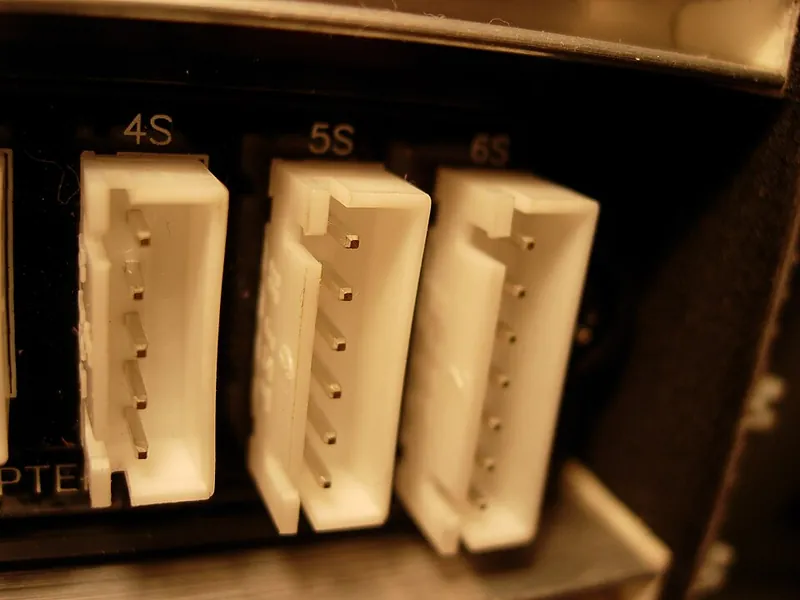
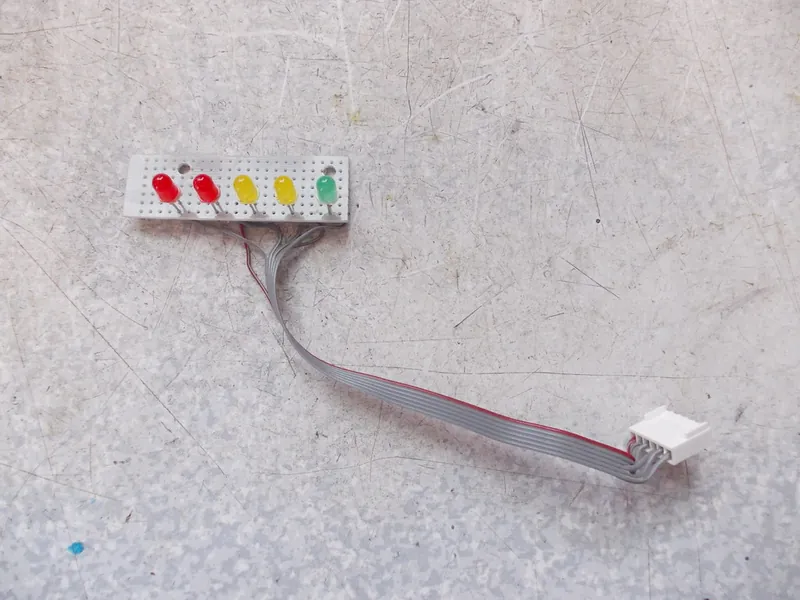
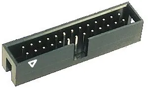

<figure class="eoc-pic eoc-pic-main"><figcaption><strong>Photo.</strong> <a href="https://commons.wikimedia.org/wiki/File:Balancer_Buchse_XH.JPG">Balancer Buchse XH</a> by Laurenz Wagner, <a href="https://creativecommons.org/licenses/by/3.0">CC BY 3.0</a>, from Wikimedia Commons.</figcaption></figure>
<figure class="eoc-pic"><figcaption><strong>Photo.</strong> <a href="https://www.flickr.com/photos/43851301@N02/9339188957">LED module</a> by tony_duell, <a href="https://creativecommons.org/licenses/by/2.0/">CC BY 2.0</a>, from Flickr via Openverse.</figcaption></figure>
<figure class="eoc-pic"><figcaption><strong>Photo.</strong> <a href="https://commons.wikimedia.org/wiki/File:Stiftwanne2x13v2.jpg">Stiftwanne2x13v2</a> by User:PANAMATIK, <a href="http://creativecommons.org/licenses/by-sa/3.0/">CC BY-SA 3.0</a>, from Wikimedia Commons.</figcaption></figure>

A plastic plug (housing) holding small sprung metal sockets that have been crimped onto wire ends pushes onto a matching row of pins (header) soldered to a circuit board, making a removable, often latched and polarised, low-current connection.

**In plain words:** The small plastic plugs on the ends of thin wires that push onto rows of little metal pins on a circuit board, often with a clip that catches and a shape that only fits one way round: the plugs on servos, sensors, 3D-printer boards, battery balance leads and Arduino jumper wires. **Proper term:** Wire-to-board connector (pin header and crimp housing).

**Also called:** pin header, header, male header, breakaway header; female header, pin socket, header socket (Wikipedia 'Pin header'); shrouded header, box header (BH): a header inside a plastic guide box with a key notch (Wikipedia 'Pin header'); crimp housing, connector housing, receptacle housing; crimp contact, crimp terminal, crimp socket (SparkFun 'Connector Basics'; JST XH datasheet); Dupont connector, DuPont wire, Berg connector (historic trade names now used for any 0.1 in housing; Wikipedia 'Pin header'); Hackaday says the 'Dupont' parts are really the Mini-PV series (brand); JST connector (brand): J.S.T. Mfg. Co.; 'JST' is often used loosely for 'any small white electrical connector' on a board (Wikipedia 'JST connector'); common series JST-XH, PH, ZH, GH, SH (brand series names); Molex connector (brand), e.g. KK 254 (2.54 mm signal) and Mini-Fit Jr. (power), and the PC 'Molex' drive power plug, which is really an AMP Mate-n-Lok style (Wikipedia 'Molex connector'); jumper wire, jump wire, DuPont wire, breadboard wire (Wikipedia 'Jump wire'); solderless breadboard, protoboard, plugboard (Wikipedia 'Breadboard'); stackable header, stacking header, shield header (SparkFun 'Arduino Shields'); card-edge connector, edge connector (Wikipedia 'Edge connector'); IC socket, DIP socket, DIL socket, machined-pin socket, ZIF socket (zero insertion force) (Wikipedia 'Dual in-line package', 'Zero insertion force'); balance lead, balance plug (JST-XH on RC lithium batteries; Wikipedia 'JST connector'); servo plug (radio-control).

## How it works

Each wire end is stripped and a small metal contact is squeezed onto it with a crimp tool: one pair of tabs bites the copper and a second pair wraps the insulation for strain relief (Hackaday 'Good In A Pinch'). The crimped contact is then pushed into its cavity in the plastic housing until it is 'fully seated and locked', so it is captured and can't push back out when the plug is mated (SparkFun 'Connector Basics'; NASA-STD-8739.4A §13.2.1). When the housing is pushed onto the header, each springy socket grips a pin, and the spring pressure keeps the metal surfaces touching (SparkFun 'Connector Basics'). The housing shape, a shroud or a blocked hole lines the plug up and stops it going on the wrong way round, and a latch or friction ramp stops it shaking loose (Wikipedia 'Pin header', 'Electrical connector').

## Parts

A few parts: the board half (a pin header, plain or in a shrouded box, soldered into the circuit board); the cable half (a moulded plastic housing); one crimp contact per wire (a stamped metal socket with a wire crimp and an insulation crimp, locked into the housing); and the wires. Many housings add a latch, ramp or friction lock and a polarising key (JST XH datasheet; Wikipedia 'Pin header'; SparkFun 'Connector Basics'). Related forms: jumper wires (wire with a single-way housing at each end), solderless breadboards (blocks of sprung clips at 0.1 in [pitch](../glossary.md#pitch)), stacking headers, card-edge sockets and IC sockets.

## Everyday examples

- Arduino and Raspberry Pi pin headers with rainbow jumper wires and a white solderless breadboard (SparkFun 'Connector Basics'; Wikipedia 'Jump wire')
- The white balance plug on a radio-control lithium battery and the stepper-motor plugs on a 3D-printer control board (JST-XH type) (Hackaday 'JST Is Not A Connector'; Wikipedia 'JST connector')
- The three-wire plug on a hobby servo (Wikipedia 'JST connector')
- Computer motherboard headers for the front-panel buttons, USB and fans, and PC power plugs (Wikipedia 'Pin header', 'Molex connector')

## When to use it

Use it whenever a low-current wire must connect to a circuit board and you may want to unplug it later: sensors, servos, motors, LEDs, switches, displays, battery balance leads, and modules on a robot or 3D printer. It keeps parts swappable and lets you take a project apart for repair (Hackaday 'Inside The Secret World Of Crimping': 'a proper connector can solve a lot of headaches'). Pick a latching, polarised, shrouded series for anything that vibrates or is wired by someone else; use jumper wires and a breadboard for trying a circuit before building it permanently (Wikipedia 'Breadboard'); use stacking headers to stack add-on boards, and IC sockets where a chip may need replacing or reprogramming (Wikipedia 'Dual in-line package').

## When not to use it

Not for mains voltage or for currents above a few amps: use proper high-current battery plugs, screw terminals or spring-clamp terminals sized for the load, and follow local law for any mains wiring (e.g. Approved Document P in England). Not where the joint must be permanent and vibration-proof with no latch (solder or crimp the wire directly, or use a latching series). Avoid breadboards in finished projects: they have 'relatively high resistance, and less reliable connections, which are subject to jostle and physical degradation' (Wikipedia 'Breadboard'). Avoid unkeyed, unshrouded headers for power, where a reversed or shifted plug can damage the board; use a keyed connector (see [Keying](../glossary.md#keying)). Don't solder wires onto crimp contacts instead of crimping them: 'It makes for easily damaged connections' (Hackaday 'Inside The Secret World Of Crimping').

## Details

- **What it does (jobs):**
  - join and hold: connects wires to a circuit board (or board to board) so signals and small currents pass through; the finder reaches this entry through the 'electrical connections' family
  - lock, and release by hand: latching housings (e.g. JST XH-type, Molex KK 254-type friction ramp) hold until the latch is pressed or the plug is pulled off by its housing
- **Movement:** none: a fixed joint once mated; the plug only moves when it is plugged in or pulled out.
- **Directions it can move (degrees of freedom):** 0 when mated and latched; an unlatched friction-fit plug can work loose along the pins (Wikipedia 'Molex connector': 'held in place by friction instead of a latch').
- **Special behaviour:**
  - quick-release: plugs in and pulls out by hand with no tools, which is the main reason to use it instead of soldering wires to the board
  - hand-release only (locks under load, releases when a person operates it): latching housings resist a pull on the wires and are released by lifting or pressing the latch; SparkFun warns the small 2 mm JST-PH battery plug is 'wicked hard to disconnect' (SparkFun 'Connector Basics')
  - self-aligning or self-centring: a shroud (box header) guides the plug onto the pins, and a notch, bump, missing pin or blocked socket makes it fit only one way round (polarised or keyed) (Wikipedia 'Pin header'; see Keying)
- **How it holds:**
  - spring force (a spring or springy part presses it in place): each socket is a sprung metal contact that grips its pin (e.g. JST XH 'double-leaf contact'; breadboards use 'spring clips') (JST XH datasheet; Wikipedia 'Breadboard')
  - shape (the parts interlock; [form-fit](../glossary.md#form-fit--force-fit--material-bond)): a latch or ramp on the housing hooks over the header, and each crimp contact is locked into its housing cavity, e.g. by a retaining clip (JST XH datasheet; NASA-STD-8739.4A §13.2.1)
  - friction or clamping (force-fit): unlatched plugs and the crimp itself, which deforms the contact 'past its yield point' so it grips the wire by static friction (Wikipedia 'Electrical connector', 'Crimp (joining)')
- **Input and output:** not applicable
- **Power:** passive (no power needed).
- **Load:** Electrical: up to about 3 A; extra-low voltage only (in maker projects). Examples: JST-XH 3 A per contact with 22 AWG wire, JST-PH 2 A with 24 AWG (JST XH and PH datasheets); 2.54 mm 'Dupont'-like JST RE 2 A (Wikipedia 'JST connector'); breadboard clips 'rated for 1 ampere at 5 volts and 0.333 amperes at 15 volts' (Wikipedia 'Breadboard'). Larger power housings of the same style carry more (Molex-type 1.57 mm pins 5 A, 2.36 mm pins 8.5 A; Wikipedia 'Molex connector'). Some series carry a maker's 250 V rating for use inside finished equipment (JST XH datasheet), but open headers are not a mains connection for a hobby project; mains work must follow local law. Mechanical: light. The latch or friction holds against vibration and a light tug; the crimp is the weak point (minimum crimp pull strengths are only 22 N for 28 AWG and 57 N for 22 AWG wire; NASA-STD-8739.4A Table 12-1), so never pull a plug out by its wires and give the cable strain relief.
- **Play and precision:** small: sprung sockets take up a little sideways error, and shrouds guide the plug, but the pitch must match exactly. A 2.50 mm part looks like a 2.54 mm one and is sometimes sold as such (Wikipedia 'JST connector'); the 0.04 mm difference per pin adds up along a row (0.4 mm over 11 pins). Unshrouded headers let a plug go on shifted by one pin or turned round.
- **Taking it apart:** tool-free quick release: the plug mates and unmates by hand. The crimp on each contact is permanent ('Crimped contacts are permanent'; Wikipedia 'Crimp (joining)'), but contacts can be released from the housing with a thin depinning tool and re-arranged.
- **How often it can be reused:** many times, but not unlimited: every connector has a datasheet life in mating cycles; 'a board-to-board connector designed for use inside of consumer electronics may be limited to tens of cycles' (SparkFun 'Connector Basics'), and tight PC drive power plugs are 'intended to be connected and disconnected only a few times' (SparkFun). Machined-pin headers last longer than stamped ones (SparkFun). Small crimp housings are typically rated for tens of cycles ⚑ [uncertain].
- **Sealing:** none: open housings and headers let in dust and moisture; use a sealed connector series or an enclosure where that matters.
- **Adjustable:** no: pin positions are fixed. Contacts can be moved to other cavities with a depinning tool to change the pin order.
- **Access needed:** one side only (blind): the plug is pushed on from the front, with finger room to grip the housing and work the latch; fitting the header itself needs both sides of the board for soldering through-hole pins.
- **Materials:** Housings: nylon, e.g. natural (white) PA 6 for JST-XH housings with a glass-filled PA 66 header option (JST XH datasheet), and nylon rated UL 94V-0 for Molex KK 254 housings (Molex datasheet via Farnell). Contacts: tin-plated phosphor bronze (JST-XH) or copper alloy (JST-PH), gold plating on request (JST XH and PH datasheets); breadboard clips are 'tin plated phosphor bronze or nickel silver alloy' (Wikipedia 'Breadboard'). Wire: stranded copper in a narrow size range per contact, e.g. 30-22 AWG with insulation 0.9-1.9 mm across for JST-XH, and 32-24 AWG for JST-PH (JST datasheets); breadboard jumpers usually 22 AWG solid tin-plated copper (Wikipedia 'Breadboard'). Header pins: 0.64 mm square for 2.54 mm pitch or 0.50 mm round for machined pins (Wikipedia 'Pin header').
- **Heat, cold, water and wear:** Temperature: JST-XH is rated -25 to +85 °C and JST-PH -40 to +105 °C, including self-heating from the current (JST datasheets); most JST through-hole headers can't survive reflow soldering heat (Wikipedia 'JST connector'). Vibration: friction-held plugs work loose; latching types and standard (not low-insertion-force) contacts hold better (JST datasheets; Wikipedia 'Molex connector'). Damp and dirt: open tin-plated contacts can become 'soiled or oxidized', and 'the springiness required to hold the contacts together may fade with time' (SparkFun 'Connector Basics'). Wear: each mating cycle wears the plating, so connectors have a finite life (SparkFun; NASA-STD-8739.4A §17.1).

## Making it

- **Ways to make or get it:**
  - off-the-shelf part: headers, housings, crimp contacts, pre-crimped leads, jumper wires, breadboards, stacking headers and IC sockets are bought
  - 3D print (FDM): custom multi-way housings for single 'Dupont' jumper ends, connector covers and strain-relief sleeves, depinning tools, crimp-tool contact holders and hot-glue moulds (Printables 219847, 1224903, 394200, 1195233, 15081)
  - soldering: through-hole or surface-mount headers are soldered to the board (Wikipedia 'Pin header')
- **Printing it in one piece (print in place):** no: the metal contacts must be bought and crimped; only holders, covers and tools around them are printed.
- **Tools:** To plug in: none. To make leads: wire strippers, a crimp tool with the die made for that contact family (ratcheting tools are preferred), and a depinning tool or needle to remove contacts; the official crimper for 'Dupont'-type contacts costs over $1500, but suitable third-party tools cost under $60 (Hackaday 'Inside The Secret World Of Crimping'). To fit headers: a soldering iron. Ready-made pre-crimped leads and jumper wires need no tools.
- **Difficulty:** moderate: plugging in and soldering headers is easy, and ready-made leads are cheap, but crimping the tiny contacts needs the matching die and practice; most general crimp tools 'make a mess of these terminals' (Hackaday 'Inside The Secret World Of Crimping').

### 3D printing tips

1) Printed multi-way housings for jumper ends: measure the single-way housings first; one designer found little difference between brands except length, 12-14 mm, most at 14 mm, and used an inner width of 10.6 mm for 4 ends, 1.7 mm side walls and snap-on lid tabs (Nerd Corner); print in PLA or PETG, though nylon would suit the flexing tabs best (Nerd Corner). Add a small rib inside the lid that pushes the wires down and pulls each housing against a stop, so pulling the cable can't drag the ends back. 2) Covers and sleeves that hold a plug to its header and keep the wires from bending at the crimp are popular for battery and printer leads (Printables 1224903, 15081); keep them clear of the latch so the plug can still be released. 3) For printed contact holders and crimp jigs, the slot for the contact should be a tight fit; adjust with the slicer's XY size compensation if it is too tight (Printables 1195233). 4) In printed enclosures leave finger room and a straight pull path to the plug, and clamp the cable to the case so a tug never reaches the crimp (SparkFun 'Connector Basics': strain relief). 5) Don't rely on printed plastic springs as electrical contacts; use the metal crimp contacts ⚑ [uncertain].

### Buying one (off-the-shelf parts)

Male pin headers (straight or right-angle, single or double row, through-hole or SMD, 36/40/50-pin breakaway strips), female headers (pin sockets), machined-pin headers and IC sockets, shrouded box headers, stackable (stacking) headers (Wikipedia 'Pin header'; SparkFun 'Arduino Shields'); crimp housings and crimp contacts by series (e.g. JST-XH, JST-PH, Molex KK 254, Mini-PV-type 'Dupont' housings: brand series names); pre-crimped leads and jumper wire kits (male-male, male-female, female-female); solderless breadboards and breadboard jumper wire sets; card-edge connectors; ZIF sockets; depinning (extraction) tools; ratcheting open-barrel crimpers with dies for 0.1 in and 2.5 mm contacts. Search terms: 'pin header 2.54 mm', 'crimp housing', 'crimp terminal', 'pre-crimped lead', 'box header', 'stacking header', 'DIP socket'.

## Rules of thumb

- Match the pitch first: common header pitches are 5.08, 3.96, 2.54, 2.00, 1.27 and 1.00 mm (Wikipedia 'Pin header'); JST series run XH 2.50 mm, PH 2.00 mm, ZH 1.50 mm, GH 1.25 mm and SH 1.00 mm (Wikipedia 'JST connector'; Hackaday 'JST Is Not A Connector'). Some 2.50 mm parts are sold as 2.54 mm and some 1.25 mm parts as 1.27 mm (Wikipedia 'JST connector').
- Name connectors by maker, series and pitch, e.g. 'JST-XH 2.50 mm', never just 'JST' or 'Molex' (Wikipedia 'JST connector'; Hackaday 'JST Is Not A Connector').
- Check the current rating per contact for your wire size: JST-XH 3 A at 22 AWG, 250 V, wire 30-22 AWG, -25 to +85 °C; JST-PH 2 A at 24 AWG, 100 V, wire 32-24 AWG, -40 to +105 °C (JST XH and PH datasheets); breadboard clips 1 A at 5 V (Wikipedia 'Breadboard').
- Breadboards: 0.1 in hole spacing, five clips per half-row, 22 AWG solid tin-plated copper jumpers; usable for signals up to about 10 MHz only (Wikipedia 'Breadboard').
- Use only the wire size and contact combination the maker specifies, with the matching tool, and don't modify contacts or wire (NASA-STD-8739.4A §12.3.3-12.3.4); crimp tools should have a full-cycle [ratchet](../glossary.md#ratchet) (§12.3.1).
- Pull-test crimps: minimum crimp pull strength 22 N (28 AWG), 36 N (26 and 24 AWG), 57 N (22 AWG), 92 N (20 AWG), 142 N (18 AWG); for other combinations at least 60% of the wire's own tensile strength (NASA-STD-8739.4A Table 12-1, §12.3.5).
- Leave 0.25 mm to 0.75 mm of bare wire between the insulation and the crimp barrel for 20 AWG and smaller (NASA-STD-8739.4A §10.1.4.b), and push each contact in until it is 'fully seated and locked' (§13.2.1).
- Low-insertion-force contact versions are easier to plug but 'less resistant to the vibration' (JST XH datasheet; JST PH datasheet).
- When stacking boards on stacking headers, make sure no two boards use the same pins (SparkFun 'Arduino Shields').

## Common failures

Wrong pitch or series: the plug won't fit or fits badly because 2.50, 2.54 and 2.00 mm look alike; identify by pitch and datasheet (Hackaday 'JST Is Not A Connector'). Plug fitted backwards or shifted one pin on an unshrouded header: use shrouded or keyed headers (Wikipedia 'Pin header'). Bad crimp: wire pulls out or connection is intermittent; use the correct die and ratcheting tool and pull-test (Hackaday 'Good In A Pinch'; NASA-STD-8739.4A §12.3). Contact not clicked fully into the housing, so it backs out when the plug is pushed on (NASA-STD-8739.4A §13.2.1). Wires breaking at the crimp after being used as a handle or flexed: pull by the housing and add strain relief (SparkFun 'Connector Basics'). Tight plugs damaged while unplugging: SparkFun notes a JST-PH battery plug can be damaged when disconnected for charging (SparkFun). Friction plugs loosening, pins skewing or detaching, spread sockets arcing (Wikipedia 'Molex connector'). Breadboard faults: loose, worn or dirty clips and long jumpers (Wikipedia 'Breadboard'). Thin flat tabs (e.g. on flex sensors) breaking or working loose in a breadboard (SparkFun 'Connector Basics').

## Safety

Low current only: overloaded or worn contacts heat up; female sockets 'can spread, making the connection imperfect and subject to arcing', and 'in extreme cases the whole connector can melt'; replace any plug whose shell shows blackening or browning (Wikipedia 'Molex connector'). Reversed or shifted plugs: keying exists to prevent 'incompatible or dangerous electrical connections' (Wikipedia 'Electrical connector'); forcing a polarised connector in wrong 'will result in damage to the device' (SparkFun 'Connector Basics'), and a maker on a synth forum reported burnt parts after plugging a module's power header in backwards (Look Mum No Computer forum). Check pin 1 and polarity before powering up. Batteries: balance leads of lithium batteries are live all the time; a short across their pins can make a cell overheat ⚑ [uncertain], and NASA's rule to de-energise circuits before mating is noted as 'not applicable to circuits containing batteries' (NASA-STD-8739.4A §17.2.1). Mains: these are not mains connectors in a hobby project; mains work must follow local law (in England, Building Regulations Part P; Approved Document P, 2013 edition).

## Related

- Keying (polarization, poka-yoke): the one-way-only shapes and blocked pins that make these plugs fit only one way
- Insulation-displacement connector (IDC, ribbon-cable plug): the other common way to terminate a header plug, pressing all wires of a ribbon cable on at once with no stripping or crimping
- Crimp terminals (ring, fork, spade, blade): larger single-wire crimped ends for screws and tabs, for higher currents
- Soldered wire joint: wires soldered straight to the board; permanent, smaller, no connector to buy
- Screw terminal and Spring-clamp wire connector: take bare or ferruled wire ends, carry more current, no crimping, but bulkier and slower to disconnect
- Standard plug-and-socket connector (USB, barrel jack, JST-RCY-style wire-to-wire): plugs between devices or cables rather than onto a board
- High-current battery plug: for motor and battery power above a few amps
- Pogo pin: spring-loaded pins that touch flat pads, for docking and test jigs with no plug at all
- Flat flexible cable and latching connector (FFC with ZIF): a thin ribbon slid into a latching board connector, for very fine pitches
- Cable [gland](../glossary.md#gland) and strain relief: how to stop a pull on the cable reaching the crimp
- Genderless connector: plugs where both halves are identical

## Make it yourself

- [Connector housing Dupont/Jumper 4Pin (NT / Nerd Corner, Printables) (URL from Printables API, page not opened)](https://www.printables.com/model/219847-connector-housing-dupontjumper-4pin): Printed snap-lid housing that groups four single 'Dupont' jumper ends into one plug; other pin counts are separate models *(licence: GNU General Public License v2.0)*
- [3D printed Dupont connector for jumper cable (Nerd Corner blog)](https://nerd-corner.com/3d-printed-dupont-connector-for-jumper-cable/): Design write-up for the printed housing above, with measured jumper-housing sizes, wall thicknesses and snap-tab design *(licence: link only)*
- [JST-XH.2 Connector Depinner (Micro Center, Printables) (URL from Printables API, page not opened)](https://www.printables.com/model/394200-jst-xh2-connector-depinner): Printed tool for releasing crimp contacts from JST-XH-type housings of up to 15 pins *(licence: Creative Commons Attribution-NonCommercial)*
- [JST-XH Connector Protector Case (2-9pin) Kit (Ferret, Printables) (URL from Printables API, page not opened)](https://www.printables.com/model/1224903-jst-xh-connector-protector-case-2-9pin-kit): Snap-on covers for 2-9 pin JST-XH-type plugs that stop the wires bending and breaking at the plug *(licence: Creative Commons Attribution-ShareAlike)*
- [Crimp tool dupont contact holder (GunbleR, Printables) (URL from Printables API, page not opened)](https://www.printables.com/model/1195233-crimp-tool-dupont-contact-holder): Printed positioner that holds a 'Dupont' crimp contact in a generic crimp tool for repeatable crimps *(licence: Creative Commons Attribution)*

## Pictures, videos and models

- [Balancer Buchse XH.JPG (Wikimedia Commons)](https://commons.wikimedia.org/wiki/File:Balancer_Buchse_XH.JPG): 2.50 mm JST-XH-type vertical board headers, the kind used for battery balance leads and 3D-printer boards *(licence: CC BY 3.0)*
- [Stiftwanne2x13v2.jpg (Wikimedia Commons)](https://commons.wikimedia.org/wiki/File:Stiftwanne2x13v2.jpg): A 2x13 shrouded (box) header with its key notch and the triangle marking pin 1 *(licence: CC BY-SA 3.0 / GFDL)*
- [Insidebreadboard (2).jpg (Wikimedia Commons)](https://commons.wikimedia.org/wiki/File:Insidebreadboard_(2).jpg): The underside of a solderless breadboard with the backing removed, showing the strips of spring clips that join each row *(licence: CC BY-SA 3.0 / GFDL)*
- [Connector Basics (SparkFun Learn)](https://learn.sparkfun.com/tutorials/connector-basics/all): Photos and terms for gender, polarity, pitch, mating cycles and strain relief, plus pin headers, machine-pin headers, crimp housings and IDC ribbon plugs *(licence: CC BY-SA 4.0)*
- [JST Is Not A Connector (Hackaday, 2017)](https://hackaday.com/2017/12/27/jst-is-not-a-connector/): Photos of JST RCY, XH, PH, ZH, GH and SH plugs and how to tell look-alike connectors apart by pitch *(licence: link only)*

## Needs confirming

⚑ marks something nobody has confirmed yet: a fact the research could not confirm from a source, a finder value that is a best guess, or an open point from the research notes. Corrections are welcome (see `research/needs-confirming.md`).

- ⚑ 3 sentences on this page marked [uncertain].
- ⚑ Finder value `load_max` = light (best guess): electrical entry whose mechanical load has no light/medium/heavy band; set to light
- ⚑ Finder value `wire_use` = to a board or terminal (best guess): carried over from the finder's old rule on entry names (R33), for "What are you connecting?" under "Connect wires or power"
- ⚑ Finder value `plugs_in` = yes (best guess): carried over from the finder's old rule on entry names (R33), for "Will you unplug it often?" under "Connect wires or power > A wire to a board, terminal or device"
- ⚑ Research note: *Wire-to-board plug connectors*: no mating-cycle figure for small crimp housings could be opened (`reuse_cycles` is [uncertain]).

## Sources

- <https://en.wikipedia.org/wiki/Pin_header>
- <https://en.wikipedia.org/wiki/JST_connector>
- <https://en.wikipedia.org/wiki/Molex_connector>
- <https://en.wikipedia.org/wiki/Jump_wire>
- <https://en.wikipedia.org/wiki/Breadboard>
- <https://en.wikipedia.org/wiki/Edge_connector>
- <https://en.wikipedia.org/wiki/Dual_in-line_package>
- <https://en.wikipedia.org/wiki/Zero_insertion_force>
- <https://en.wikipedia.org/wiki/Electrical_connector>
- <https://en.wikipedia.org/wiki/Crimp_(joining)>
- <https://www.jst-mfg.com/product/pdf/eng/eXH.pdf>
- <https://www.jst-mfg.com/product/pdf/eng/ePH.pdf>
- <https://www.farnell.com/datasheets/4644099.pdf>
- <https://learn.sparkfun.com/tutorials/connector-basics/all>
- <https://learn.sparkfun.com/tutorials/arduino-shields-v2/all>
- <https://hackaday.com/2017/12/27/jst-is-not-a-connector/>
- <https://hackaday.com/2019/02/28/inside-the-secret-world-of-crimping/>
- <https://hackaday.com/2017/02/09/good-in-a-pinch-the-physics-of-crimped-connections/>
- <https://nepp.nasa.gov/files/27631/nstd87394a.pdf>
- <https://lookmumnocomputer.discourse.group/t/help-i-plugged-veils-in-backwards/1869>
- <https://nerd-corner.com/3d-printed-dupont-connector-for-jumper-cable/>
- <https://assets.publishing.service.gov.uk/government/uploads/system/uploads/attachment_data/file/441872/BR_PDF_AD_P_2013.pdf>
- <https://commons.wikimedia.org/wiki/File:Balancer_Buchse_XH.JPG>
- <https://commons.wikimedia.org/wiki/File:Stiftwanne2x13v2.jpg>
- <https://commons.wikimedia.org/wiki/File:Insidebreadboard_(2).jpg>
- <https://commons.wikimedia.org/wiki/File:6_Pin_Header.jpg>
- <https://api.printables.com/graphql/>
