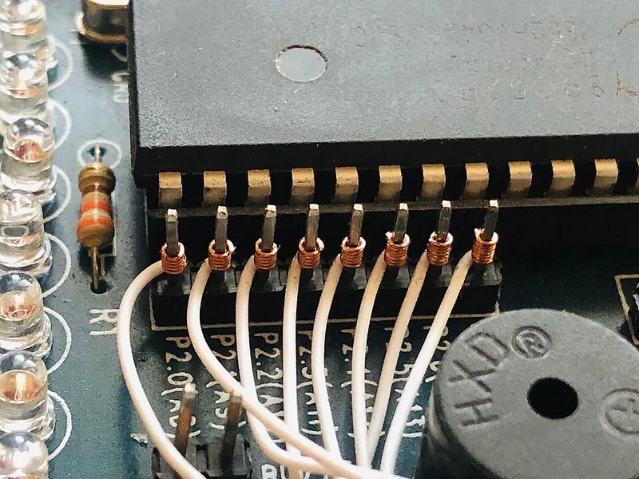
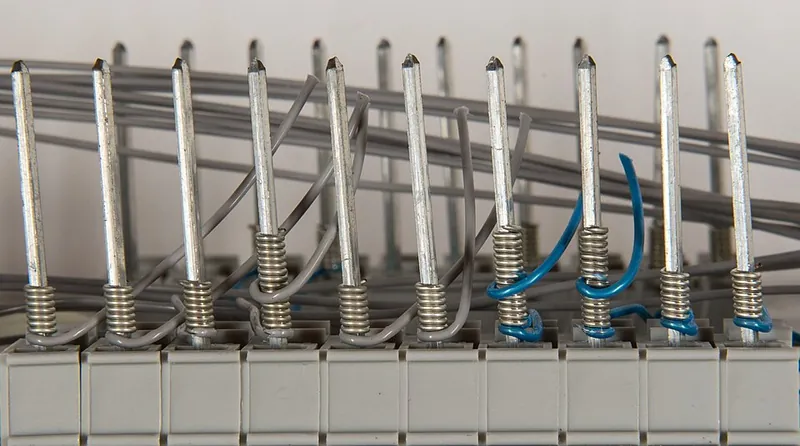
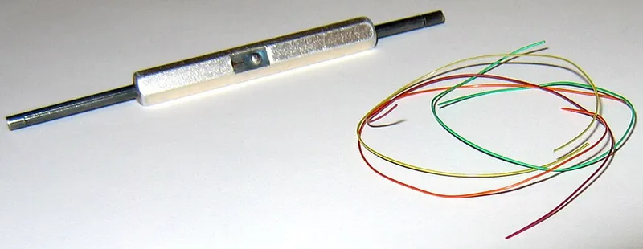

<figure class="eoc-pic eoc-pic-main"><figcaption><strong>Photo.</strong> <a href="https://commons.wikimedia.org/wiki/File:Wire_Wrap_1.jpg">Wire Wrap 1</a> by Shri Hari Ram, <a href="https://creativecommons.org/licenses/by-sa/4.0">CC BY-SA 4.0</a>, from Wikimedia Commons.</figcaption></figure>
<figure class="eoc-pic"><figcaption><strong>How it works.</strong> <a href="https://commons.wikimedia.org/wiki/File:Drahtwickelpistole-wires_hg.jpg">Drahtwickelpistole-wires hg</a> by Hannes Grobe, <a href="https://creativecommons.org/licenses/by-sa/4.0">CC BY-SA 4.0</a>, from Wikimedia Commons.</figcaption></figure>
<figure class="eoc-pic"><figcaption><strong>Photo.</strong> <a href="https://commons.wikimedia.org/wiki/File:Manual_wire_wrap_tool_and_wire_wrap_wire_in_various_colours.jpg">Manual wire wrap tool and wire wrap wire in various colours</a> by User Mike1024 on en.wikipedia, Public domain, from Wikimedia Commons.</figcaption></figure>

Wire wrap joins a thin solid wire to a square metal post by winding the bared wire tightly round it with a small spinning tool: the post's sharp corners bite into the wire at every turn, making about 28 tiny gas-tight, cold-welded contact points that need no solder and can be unwound and redone.

**In plain words:** A pen-like hand tool spins a stripped end of very thin solid wire tightly round a square metal pin, about seven turns, so the pin's sharp corners dig into the wire and make a lasting electrical joint with no solder; the same tool's other end unwinds it again. **Proper term:** Wire wrap (solderless wrapped connection, wire-wrapped connection).

**Also called:** wire wrap, wire-wrap, wirewrap, wire wrapping (Wikipedia 'Wire wrap'; Nuts and Volts 'Wire Wrap Is Alive And Well!'); solderless wrapped connection, solderless wrapped electrical connection (MIL-STD-1130C title and §3.1); wire-wrapped connection, wire-wrap connection (ECSS-Q-ST-70-30C); modified wrap = Class A wrap = the 'preferred' wrap with a part-turn of insulated wire at the bottom for strain relief; regular or conventional wrap = Class B wrap, bare wire only (MIL-STD-1130C §3.2-3.3; Nuts and Volts; Hackaday 2024); wrappost, wrap post, terminal post, wire-wrap pin (MIL-STD-1130C; ECSS-Q-ST-70-30C); wire-wrap socket, wire-wrap DIP socket, two-level / three-level socket, wire-wrap header or SIP strip (Nuts and Volts; Hackaday 'Wire Wrap 101'); wire-wrap wire, Kynar wire (30 AWG silver-plated copper with Kynar (PVDF) or Tefzel insulation) (Wikipedia; Nuts and Volts); wrap gun, wire-wrap gun, wrap/strip/unwrap tool, WSU-30 and WSU-30M (OK Industries / Jonard Tools, brand) (Nuts and Volts; Hackaday 2024); Keller Wrap Gun (historic brand name of the first tool) (Wikipedia); not to be confused with wire-wrapped jewellery (Wikipedia hatnote).

## How it works

The stripped wire end (about 1 in / 25 mm for 30 AWG) goes into the small hole near the edge of the tool bit, and the centre hole goes over the post; turning the tool winds the wire round the post under tension (Wikipedia; Nuts and Volts). At each of the post's four sharp corners the wire is bent so hard that the oxide on both metals is crushed or sheared and the corner indents the wire, giving 'a clean, oxide-free metal-to-metal' contact that is gas-tight, so air can't get in to corrode it (Nuts and Volts; MIL-STD-1130C §4.1). Seven turns on a four-cornered post make about 28 such contact points, and the wire and post can form a cold weld (Wikipedia; Hackaday 2018). In a 'modified' wrap, the tool also winds half a turn to 1.5 turns of the still-insulated wire round the bottom of the post, which supports the wire and stops it snapping from vibration where it leaves the post (MIL-STD-1130C §3.2; Wikipedia).

## Parts

A few parts: a square (or rectangular) metal post with sharp corners, usually the long tail of a wire-wrap socket or header (typically 0.025 in / 0.64 mm square, gold- or tin-plated); a length of single-strand (solid) wire, usually 30 AWG silver-plated copper with thin Kynar insulation; and the hand tool (a bit with two holes, often with an unwrap bit and a stripper in the handle) (Wikipedia; MIL-STD-1130C §5.2; Nuts and Volts).

## Everyday examples

- Old telephone exchange equipment: wire wrap was invented to wire Bell System crossbar switches (Wikipedia, with a photo of a crossbar switch)
- Backplanes of 1960s-1980s computers such as the IBM 1401, PDP-8 and Z80 systems, with 'bed of nails' rows of posts (Wikipedia; Wikimedia Commons category 'Wire wrapping'; EE World 'Before the Dinosaurs, there was Wire-Wrap…')
- A modern compact fluorescent lamp, where the lamp's wires are wrapped onto pins (Wikipedia photo 'Wire wrap in OSRAM CFL')
- Hobby retro-computer builds and hand-wired computer keyboards (Hackaday 'wire wrap' tag; Thingiverse 4273748, 5892385)

## When to use it

For one-off digital prototypes with many connections, where designing a printed circuit board is too slow and loose jumper wires are too messy: 'It's relatively fast, reliable, simple, solderless, inexpensive, and easy to learn' and 'ideal for complex one-of-a-kind circuits' (Nuts and Volts). When you expect to change the wiring: a wrap unwinds in seconds and can be redone, and modifications can be added on the post's third level (Nuts and Volts; ECSS-Q-ST-70-30C §5.3.2.2). Where vibration or temperature changes would crack solder: wire wrap is 'very stable when exposed to temperature changes, corrosive atmospheres, humidity, and vibration', and 'stronger than a solder connection' (Nuts and Volts). Where heat must be avoided or no iron is to hand, e.g. field repairs (Make 2009). For wiring many signals in tight spaces, e.g. hand-wired keyboards and repair jumpers with 30 AWG wire-wrap wire (Hackaday 'Wire Wrap 101').

## When not to use it

Not for anything carrying real power or more than about 1 A: use heavier wire with soldered, crimped or screw-terminal joints (Nuts and Volts; SparkFun). Never for mains voltage (see safety_notes): use a listed connector such as a Screw terminal, Spring-clamp wire connector or Twist-on wire connector, fitted to local rules. Not onto round component leads or stranded wire: the wrap needs a square post and solid wire (MIL-STD-1130C §1.1, §4.1); Nuts and Volts adds a drop of solder when wrapping onto round leads. Not for analogue, sensitive or very fast circuits: the wires cause cross-talk, radiate interference, have unpredictable impedance and can't give ground and power planes (Wikipedia, citing Horowitz and Hill); use a PCB. Not with surface-mount parts unless on adapter boards: surface-mount technology has made wire wrap 'comparatively much less useful' (Wikipedia). Not for several identical boards: a PCB is better for repeats (Nuts and Volts). For a quick temporary test, a solderless breadboard is faster; for a lasting one-off where sockets are unwanted, a Soldered wire joint on stripboard or perfboard is cheaper (Wikipedia: sockets 'are an additional cost' and 'add size and mass').

## Details

- **What it does (jobs):**
  - join and hold: connects a thin solid wire to a square post (socket pin, header pin or terminal) for low-voltage signal wiring and prototypes; the finder reaches it through the 'electrical connections' family
- **Movement:** none: the wrap holds the wire still on the post; long wires should be tied down so they don't vibrate (ECSS-Q-ST-70-30C §5.3.4e).
- **Directions it can move (degrees of freedom):** 0: the wrapped wire can't move along or round the post until it is unwrapped.
- **Special behaviour:**
  - none: it simply joins a wire to a post; its useful extra is that it can be unwound with an unwrap tool and redone, which is why it is used for prototypes and modifications (Wikipedia; ECSS-Q-ST-70-30C Annex A.2)
- **How it holds:**
  - friction or clamping ([force-fit](../glossary.md#form-fit--force-fit--material-bond)): the wire is wound under tension so it grips the post, and the sharp corners create 'high pressure points' that 'shall provide electrical continuity and mechanical stability' (MIL-STD-1130C §4.1); the wire and post can cold-weld at the corners (Hackaday 2018; Wikipedia)
  - shape (the parts interlock; form-fit): the corners leave indentations in the wire (or in both wire and post) that resist the wrap being pushed along the post (MIL-STD-1130C §4.1, strip test §5.6.1)
- **Input and output:** not applicable
- **Power:** passive (no power needed): the joint itself needs no power; the wrapping tool can be hand-turned, or an electric, battery or air-powered wrap gun (Nuts and Volts; Wikipedia).
- **Load:** Electrical: up to about 3 A, and in practice signal and small logic-supply currents: 'Although a short run of 30 AWG wire can carry up to an amp, higher currents will require a heavier gauge wire soldered in place' (Nuts and Volts); MIL-STD-1130C tests 30 AWG wraps at 1.0 A, 24-26 AWG at 2.4 A and 18-20 AWG at 7.5 A (Table V); SparkFun warns that wire-wrap wire 'is not able to handle a lot of power due to the thickness of the wire'. Extra-low voltage only (see safety_notes; one 30 AWG Kynar wire data sheet lists 300 V, but the same sheet's heading says 'no voltage rated' (Talmir data sheet), so don't rely on it). Mechanical: light. Minimum strip force (the push needed to slide a finished wrap along its post) is 2.0 lb (about 8.9 N) for 30 AWG on a 0.025 in post, rising to 5.0 lb for 24 AWG (MIL-STD-1130C Table IV); ECSS asks for 20 N for 30 AWG on a 0.64 mm post (ECSS-Q-ST-70-30C Table 5-3). The thin wire itself is the weak point: a pull on the wire, or wire 'strung banjo string tight', strains the wrap and post (Nuts and Volts), and repeated bending where the wire leaves the post breaks it unless there is an insulated turn (Wikipedia).
- **Play and precision:** not applicable
- **Taking it apart:** removable: an unwrap tool turned the other way uncoils the wire without damaging the post (Nuts and Volts; MIL-STD-1130C §5.6.3); ECSS says 'A wire-wrapped joint is not intended to be a “removable” joint, but it can be easily reprocessed' (ECSS-Q-ST-70-30C Annex A.2). Pulling or stripping a wrap off the post instead of unwrapping it is not allowed (MIL-STD-1130C §5.5.2).
- **How often it can be reused:** a few times per post: ECSS allows a post to be reworked, with new wire each time, 'up to 3 times, using copper alloy wire, or up to 5 times, using soft copper wire' (ECSS-Q-ST-70-30C Annex A.2). The wrapped part of the wire itself is not re-used in high-reliability work: 'It is not permissible to rewrap the portion of wire that has been previously wrapped' (MIL-STD-1130C §5.5.1); hobby guides straighten and re-wrap it once or twice with care (Nuts and Volts), or just snip it and re-strip (Nuts and Volts).
- **Sealing:** none: the wrap doesn't seal anything; only the contact points under the corners are gas-tight, which keeps air and moisture out of the electrical contact itself (Nuts and Volts; MIL-STD-1130C §3.6, §5.6.2). In flight hardware, assemblies may be conformally coated with wax to damp vibration (Wikipedia).
- **Adjustable:** no: to change a connection, unwrap it and wrap again (Nuts and Volts).
- **Access needed:** end of a tube or shaft: the tool's centre hole must slide down over the free tip of the post, so the post must stick out (usually through the back of the board) with room round it for the tool bit (MIL-STD-1130C §5.3.3: post spacing 'shall allow sufficient room to accommodate the wrapping tool').
- **Materials:** Posts: premium posts are hard-drawn beryllium copper with gold plating; cheaper ones are bronze with tin plating (Wikipedia); MIL-STD-1130C allows gold over nickel or tin-lead plating and forbids silver underplating (§5.2.5); ECSS lists copper and nickel alloys such as brass, phosphor bronze, nickel silver, beryllium copper, Monel and nickel-clad copper (ECSS-Q-ST-70-30C §5.2.2.1). Wire: single-strand (solid) round wire only (MIL-STD-1130C §1.1), normally 30 AWG (0.25 mm) silver-plated soft copper with Kynar (PVDF) or Tefzel (ETFE) insulation (Wikipedia; Nuts and Volts); one data sheet gives 30 AWG Kynar wire a 0.0195 in (0.5 mm) outside diameter and -60 to +105 °C rating (Talmir data sheet). Larger sizes (28-18 AWG) exist for bigger posts but are hard to buy as a hobbyist (Nuts and Volts). Round component leads are a poor fit: wire wrap 'is designed for posts with sharp corners' (Nuts and Volts). Stranded wire can't be wrapped ⚑ [uncertain: implied by the 'single, solid, round wire' scope of MIL-STD-1130C, not stated as a ban].
- **Heat, cold, water and wear:** Heat: set by the wire insulation; 30 AWG Kynar wire is rated about -60 to +105 °C (Talmir data sheet; Allied Wire & Cable KYN30-1, 'maximum temperature of 105°C'). Humidity and corrosion: good, because the contact is gas-tight and any corrosion forms 'on the outside of the wire, not on the gas-tight contact' (Wikipedia; Nuts and Volts). Vibration: good if a 'modified' wrap (insulated turn) is used, since 'the turn and a half of insulated wire helps prevent wire [fatigue](../glossary.md#fatigue) where it meets the post' (Wikipedia); long wires should be tied down every 50-75 mm 'to reduce resonance in the wire during vibration' (ECSS-Q-ST-70-30C §5.3.4e); space assemblies may be wax-coated, never epoxy-potted, so they stay repairable (Wikipedia). Ageing: the wrap does not loosen by itself in normal use (Nuts and Volts: stable under temperature changes) ⚑ [uncertain: no long-term test data opened]. Chemicals: Kynar insulation 'is resistant to cut-through and many chemicals' (Allied Wire & Cable).

## Making it

- **Ways to make or get it:**
  - off-the-shelf part: wire-wrap sockets, headers, posts, wire and tools are bought
  - 3D print (FDM): the hand wrapping tool can be printed (Thingiverse and Printables models in make_it_yourself), as can board holders, wire organisers and enclosures
  - 3D print (resin): Hackaday suggests an SLA printer is 'probably a good idea' for the tool's fine wire channel (Hackaday 2024)
- **Printing it in one piece (print in place):** no: the joint is metal wire on a metal post; only the hand tool and holders are printed (and a printed tool is a single solid part, not a mechanism).
- **Tools:** A wire-wrap tool matched to the wire size and post: for hobby use a hand wrap/strip/unwrap tool for 30 AWG (e.g. WSU-30 regular or WSU-30M modified, brand), with the wrap and unwrap bits at opposite ends and a 30 AWG stripper in the handle (Nuts and Volts; Hackaday 2024); for many joints a squeeze-ratchet hand gun, battery gun or 115 V electric gun with a bit and sleeve for each wire size (Nuts and Volts; Make 2009). A stripper that does not nick the thin wire: 'A universal V-notch stripper will nick and weaken or break the wire' (Nuts and Volts). Flush cutters. Optional: a pin or needle to straighten unwrapped wire (Nuts and Volts). No soldering iron is needed.
- **Difficulty:** easy to moderate: a hand tool, sockets and wire are cheap and the knack takes a few practice wraps, much like soldering (Nuts and Volts); the hard parts are finding long-post sockets and keeping a large board's wiring organised and checked, and a printed tool needs a fine nozzle (Hackaday 2024).

### 3D printing tips

The connection itself can't be printed, but printing helps around it. 1) Printed wrap tools: the bit needs a centre hole for the post and a small off-centre hole or side channel for the wire; designs with a side channel stop the wire tangling and snagging (Hackaday 2024). [Tolerances](../glossary.md#tolerance) matter, so use a 0.2 mm nozzle on FDM or a resin printer (Hackaday 2024); one Printables designer recommends 0.12-0.2 mm layers, PLA or PETG, a slightly reduced extrusion width on a 0.4 mm nozzle, no supports and a brim so the thin tool doesn't fall over (Printables 977002); another prints at 0.1 mm layers and says to scale the model for other wire sizes (Printables 1072612). Printed tools don't include a stripper or an unwrap end (Hackaday 2024), and cheap tools with sloppy tolerances give poor wraps (Hackaday 2024), so test-wrap and inspect. 2) Hand-wired keyboards are a popular modern use; makers have printed small wrap tools for wiring keyboard switches and diode legs (Thingiverse 4273748, 5892385; Printables 977002). 3) Enclosures and mounts: wrap posts stick out from the back of the board, so mount it on standoffs long enough to keep the post tips off the case: 5/8 in (16 mm) or longer clears three-level posts (Nuts and Volts). 4) Wire routing: leave slack and route the longest wires first so the short ones hold them down (Nuts and Volts); tie or clip long wires down every 50-75 mm against vibration (ECSS-Q-ST-70-30C §5.3.4e), e.g. with printed clips; never route wire over the post tips (ECSS §5.3.4d). 5) Keep the soldering iron or hot-air gun away from printed parts and the wrap posts; ECSS forbids adding solder to posts that carry wraps (ECSS §5.3.2.1e).

### Buying one (off-the-shelf parts)

Wire-wrap IC sockets (DIP and SIP) with long square posts, sold as two-level or three-level (the number of wraps the post will take) (Nuts and Volts); wire-wrap pin headers and single wire-wrap pins that press into perfboard (Nuts and Volts); ordinary 2.54 mm pin headers also have 0.64 mm square pins (Wikipedia 'Pin header') and can take a wrap if long enough (SparkFun used male headers); 30 AWG Kynar wire-wrap wire on rolls or pre-cut with 1 in stripped ends (Nuts and Volts; Wikipedia); hand wrap/strip/unwrap tools such as WSU-30 (regular) and WSU-30M (modified) (OK Industries / Jonard Tools, brand), squeeze-ratchet, battery and electric wrap guns with interchangeable bits and sleeves, and 'modified' bits that also wrap 1.5 turns of insulation (Nuts and Volts; Hackaday 2024); wire dispensers that cut and strip; slip-on 'Wrap-ID' labels for reading pin numbers from the back of the board (Hackaday 'Wire Wrap 101'). Search terms: 'wire wrap socket', 'wire wrap wire 30 AWG Kynar', 'wire wrap tool WSU-30M', 'wire wrapping bit modified'.

## Rules of thumb

- Number of turns of bare wire: at least 7 for 30 and 28 AWG, 6 for 26 AWG, 5 for 24 and 22 AWG and 4 for 20 and 18 AWG; a Class A ('modified') wrap adds at least half a turn of insulated wire touching at least three corners of the post (MIL-STD-1130C Table III, §3.2). ECSS asks for 7 + 3/4, 7 + 3/4, 6 + 3/4 and 5 + 3/4 turns (bare + insulated) for 30, 28, 26 and 24 AWG (ECSS-Q-ST-70-30C Table 5-2). Wikipedia gives 7 turns plus 0.5-1.5 insulated turns for 30 and 28 AWG, and says a hand tool typically lays 7-9 bare turns over 1.5-2 insulated turns. Hobby articles quote fewer: 'between 5-6 turns', and 'a good wrap has 3-4 turns' (Bil Herd, Hackaday 'Wire Wrap 101'), or 'about five complete turns' (Hackaday 2018); go by the standards.
- Strip about 1 in (25 mm) of insulation for a 30 AWG hand-tool wrap (Nuts and Volts; SparkFun; Hackaday 'Wire Wrap 101'); pre-cut wires come with 1 in stripped at each end (Wikipedia).
- Wire size must match the post: 30-26 AWG on 0.025 in (0.64 mm) square posts; 22, 20 and 18 AWG are 'not recommended' on 0.025 in posts, and 30 and 28 AWG not on the larger 0.045 in posts (MIL-STD-1130C Table III note; ECSS-Q-ST-70-30C Table 5-1). Hobby hand tools are for 30 AWG only; a mismatched bit gives a loose wrap (Nuts and Volts).
- Usual posts are 0.025 in (0.64 mm) square, 1 in (25.4 mm) long and spaced at 0.1 in (2.54 mm) (Wikipedia); a post takes up to three wraps (Wikipedia; ECSS §5.3.2.2). Minimum wrappable length on the post for 30 AWG: 0.185 in for one wrap, 0.320 in for two and 0.455 in for three (MIL-STD-1130C Table I); ECSS gives 4.7, 8.2 and 11.6 mm (ECSS Fig. 5-1).
- Turns must lie close: the gap between neighbouring bare turns must not exceed half the wire's diameter, and all gaps together not more than one wire diameter (first and last turns excepted); turns must not overlap; the cut end ('end tail') must not stick out more than one wire diameter (MIL-STD-1130C §5.3.2, §5.3.2.1; ECSS-Q-ST-70-30C Fig. 5-3, §5.3.3).
- Quality targets: minimum strip force 2.0 lb (30 AWG), 3.0 lb (28), 4.0 lb (26) and 5.0 lb (24 AWG) on 0.025 in posts (MIL-STD-1130C Table IV); ECSS gives 20 N for 30 AWG and 25 N for 28 and 26 AWG on 0.64 mm posts (ECSS Table 5-3). Voltage drop across a wrap no more than 4 mV at 1 A for 30 AWG (MIL-STD-1130C §5.6.4, Table V); ECSS: connection resistance of a single wrap no more than 2 mΩ (ECSS §5.5.3.4).
- Position the wire before wrapping so that the way it is later routed doesn't tend to unwrap the connection (MIL-STD-1130C §5.3.1.1, §5.3.2.1g); route wires so they don't press on post corners hard enough to cut the insulation (ECSS-Q-ST-70-30C §5.3.4a).
- Leave slack: avoid 'banjo string tight' wires, leave enough for a re-strip and re-wrap, and if a pre-cut wire looks just long enough, use the next size up (Nuts and Volts).
- Rework: unwrap with an unwrap tool, never pull the wrap off; a post can be re-wrapped 'up to 3 times, using copper alloy wire, or up to 5 times, using soft copper wire', with new wire each time (ECSS-Q-ST-70-30C Annex A.2; MIL-STD-1130C §5.5).

## Common failures

Insufficient turns: the stripped end wasn't pushed all the way into the bit (Nuts and Volts; MIL-STD-1130C Fig. 8). Loose wrap or 'pigtail': the bit doesn't match the wire size (Nuts and Volts). Overwrap (turns piled on each other): too much downward pressure on a power tool; let the tool do the work (Nuts and Volts; MIL Fig. 10). Open or spiral wrap (gaps between turns): the power tool was lifted off before the wrap finished (Nuts and Volts; MIL Figs 11-12). No insulated turn: wire fatigue and breakage at the post under vibration; use a 'modified' bit (Wikipedia; Nuts and Volts). Nicked or broken wire from a general-purpose stripper (Nuts and Volts; ECSS §5.3.1). Insulation cut through where a tight wire presses on a neighbouring post's corner, causing a short (ECSS §5.3.4). Wrap pushed onto the bevelled post tip, or wraps overlapping a lower wrap (ECSS §5.3.2.2, Fig. 5-4). Damaged post corners from careless handling or unwrapping, which spoil later wraps (ECSS §5.2.2.3, §5.1.3.4). Posts that twist while wrapping: stackable female headers 'can twist with the wire wrap tool' (SparkFun); posts must not rotate (MIL-STD-1130C §5.3.1.2). Wrong pin wired because the pin numbers are mirrored when seen from the back of the board; slip-on labels help (Hackaday 'Wire Wrap 101'). Wiring mistakes are slow to find on big boards: 'Debugging was an absolute nightmare' (Hackaday 2023 reader comment). Noise and cross-talk in analogue or fast circuits (Wikipedia; Hackaday 'Wire Wrap 101' on routing power and ground together). Adding solder on top: SparkFun and Nuts and Volts suggest a drop of solder for extra security (Nuts and Volts only on round leads), but ECSS forbids solder on posts that carry wraps (ECSS §5.3.2.1e), and it makes unwrapping harder ⚑ [uncertain].

## Safety

LOW VOLTAGE ONLY: wire wrap is a prototyping and signal-wiring method with very thin wire and thin insulation; this entry gives no mains wiring steps, and mains work must follow local law. In US workplaces, for example, OSHA requires conductors to be 'spliced or joined with splicing devices identified for the use' and every joint covered with insulation equivalent to the wire's (29 CFR 1910.303(c)(3)(i)); wire-wrapped posts are bare. HEAT: overloaded 30 AWG wire gets hot; SparkFun warns it 'is not able to handle a lot of power'. SHARP POINTS AND OFFCUTS: posts are sharp-cornered pins that stick out of the back of the board, and the ECSS standard requires that workers are not 'exposed to hazards such as electric shock, cutting edges, sharp points' (ECSS-Q-ST-70-30C §5.1.1); snipped wire ends are tiny and sharp ⚑ [uncertain: no source opened on offcuts]. Bare posts on the back of a board can short against a metal case, so mount it on standoffs (Nuts and Volts). Don't strip wire with your teeth ('PSA: using your teeth is not recommended', Hackaday 2024). AIR TOOLS: air-powered wrap guns go on a 'regulated, lubricated and filtered air supply' and are disconnected when not in use (ECSS §5.1.1b).

## Related

- Soldered wire joint (soldered splice): permanent and works on round leads and stranded wire, but needs heat and is harder to undo
- Wire-to-board plug connectors (pin header and crimp housing): crimped sockets that push onto the same 0.64 mm square header pins and unplug in a second
- Crimped butt splice and Crimp terminals: also cold, gas-tight metal-to-metal joints, but squeezed with a crimp tool and permanent
- Insulation-displacement connector (IDC, ribbon-cable plug, punch-down): also solderless; blades cut through the insulation, and punch-down blocks replaced wire wrap in much telephone wiring ⚑ [uncertain]
- Screw terminal (terminal block): for heavier wires and higher currents, undone with a screwdriver
- Spring-clamp wire connector (lever connector): tool-free and reusable, but bulky and for heavier wire
- Pogo pin (spring-loaded contact pin): a temporary pressed contact for test fixtures, not a lasting joint
- Binding knots and seizings (cable lacing): the traditional way to tie the bundles of wires in a wired frame or loom
- Solderless breadboard and stripboard (not separate entries): breadboards are quicker and fully reusable but their spring contacts are loose; stripboard needs soldering (Wikipedia 'Wire wrap' see-also)

## Make it yourself

- [Wire Wrap Tool by DieKatzchen (Thingiverse)](https://www.thingiverse.com/thing:5892385): Printable hand wire-wrap tool with a side wire channel, slim enough to reach into small spaces; made for wiring the LucidVR glove (named in Hackaday 2024 as one of the better printed designs) *(licence: CC BY 4.0)*
- [Wire wrap tool — Stupid tool, the original by 4sStylZ (Thingiverse)](https://www.thingiverse.com/thing:4273748): Large printable wrap tool made for bending diode legs round keyboard switch pins in hand-wired keyboards; scale it for other sizes *(licence: CC BY 4.0)*
- [Simple wire wrap tool (RINZLER, Printables) (URL from Printables API, page not opened)](https://www.printables.com/model/977002-simple-wire-wrap-tool): Compact printable wrap tool for electronics and hand-wired keyboards, with print settings (0.12-0.2 mm layers, PLA/PETG, no supports) *(licence: GNU GPL v2.0)*
- [Super Simple Wire Wrapping Tool (Red Dot Geek, Printables) (URL from Printables API, page not opened)](https://www.printables.com/model/1072612-super-simple-wire-wrapping-tool): Very small printable wrap tool for 22-24 AWG wire, printed at 0.1 mm layers; can be scaled for other wire sizes or remixed as a hex driver bit *(licence: CC0 (Public Domain))*
- [Wire wrapping tool head (Chip, Printables) (URL from Printables API, page not opened)](https://www.printables.com/model/115486-wire-wrapping-tool-head): Printed wire-wrap bit that fits a multi-bit screwdriver handle *(licence: CC BY)*

## Pictures, videos and models

- [Wire Wrap 1.jpg (Wikimedia Commons, by Shri Hari Ram / Bullygram)](https://commons.wikimedia.org/wiki/File:Wire_Wrap_1.jpg): Close-up of wire-wrapped connections on an 8051 (AT89S51) development board, with coloured wires coiled on square posts *(licence: CC BY-SA 4.0)*
- [Wire wrap tool.jpg (Wikimedia Commons, by Amr Bekhit)](https://commons.wikimedia.org/wiki/File:Wire_wrap_tool.jpg): The working end of a hand wire-wrap tool: the off-centre hole for the wire and the centre hole for the post *(licence: Public domain)*
- [Introduction to Wire Wrap (Hackaday, Bil Herd; video for the article 'Wire Wrap 101')](https://www.youtube.com/watch?v=IXvEDM-m9CE): Video walkthrough of wire-wrap tools, wire, sockets and demonstrations of wrapping *(licence: link only (YouTube))*
- [Wire Wrap Is Alive And Well! (Russ Shumaker, Nuts and Volts)](https://www.nutsvolts.com/magazine/article/wire_wrap_is_alive_and_well): Illustrations (with OK Industries' permission) of the gas-tight corner contact, regular vs modified wraps, hand and power tools, two- and three-level sockets, and pictures of each wrapping fault (overwrap, open/spiral wrap, insufficient turns, loose wrap) *(licence: link only)*
- [MIL-STD-1130C Connections, Electrical, Solderless Wrapped (US DoD, 2012; copy hosted by RF Cafe, downloaded from everyspec.com)](https://rfcafe.com/references/electrical/pdf/MIL-STD-1130C.pdf): Line drawings of Class A and Class B wraps on a square post (Fig. 1), the wrapping process (Fig. 4) and every rejection fault (Figs 5-12), plus the strip-test fixture *(licence: US government standard; generally public domain in the US ⚑ [uncertain])*

## Needs confirming

⚑ marks something nobody has confirmed yet: a fact the research could not confirm from a source, a finder value that is a best guess, or an open point from the research notes. Corrections are welcome (see `research/needs-confirming.md`).

- ⚑ 6 sentences on this page marked [uncertain].
- ⚑ Finder value `load_max` = light (best guess): electrical entry whose mechanical load has no light/medium/heavy band; set to light
- ⚑ Finder value `made_of` = 3D prints, metal (best guess): proposed from the words in the research text (R37); not yet checked
- ⚑ Research note: *Wire wrap*: recorded side by side: turns (standards 7 plus ½ or ¾ insulated for 30 AWG; Hackaday writers 3-6); strip force (MIL-STD-1130C 2.0 lb, about 8.9 N; ECSS-Q-ST-70-30C 20 N); re-using unwrapped wire (MIL forbids; Nuts and Volts re-uses it); adding solder (SparkFun and Nuts and Volts suggest it; ECSS forbids it). One Kynar wire data sheet says both '300 V' and 'no voltage rated'.

## Sources

- <https://en.wikipedia.org/wiki/Wire_wrap>
- <https://en.wikipedia.org/wiki/Pin_header>
- <https://rfcafe.com/references/electrical/pdf/MIL-STD-1130C.pdf>
- <https://ecss.nl/wp-content/uploads/standards/ecss-q/ECSS-Q-ST-70-30C31July2008.pdf>
- <https://www.nutsvolts.com/magazine/article/wire_wrap_is_alive_and_well>
- <https://learn.sparkfun.com/tutorials/working-with-wire/how-to-use-a-wire-wrap-tool>
- <https://makezine.com/article/technology/lost-knowledge-wire-wrapping/>
- <https://hackaday.com/2024/09/22/3d-printing-a-wire-wrap-tool-emergency-fix-or-permanent-solution/>
- <https://hackaday.com/2018/05/04/ask-hackaday-whatever-happened-to-wire-wrapping/>
- <https://hackaday.com/2014/12/18/wire-wrap-101/>
- <https://hackaday.com/tag/wire-wrap>
- <https://hackaday.com/2023/12/18/ask-hackaday-what-do-you-do-when-you-cant-solder/>
- <https://www.eeworldonline.com/dinosaurs-wire-wrap/>
- <https://www.talmir.co.il/gallery/1505412469.pdf>
- <https://www.awcwire.com/product/kyn30-1>
- <https://www.osha.gov/laws-regs/regulations/standardnumber/1910/1910.303>
- <https://www.youtube.com/watch?v=IXvEDM-m9CE>
- <https://commons.wikimedia.org/wiki/File:Wire_Wrap_1.jpg>
- <https://commons.wikimedia.org/wiki/File:Wire_wrap_tool.jpg>
- <https://commons.wikimedia.org/wiki/File:Manual_wire_wrap_tool_and_wire_wrap_wire_in_various_colours.jpg>
- <https://commons.wikimedia.org/wiki/Category:Wire_wrapping (file list read via the Commons API)>
- <https://www.thingiverse.com/thing:5892385>
- <https://www.thingiverse.com/thing:4273748>
- <https://api.printables.com/graphql/>
