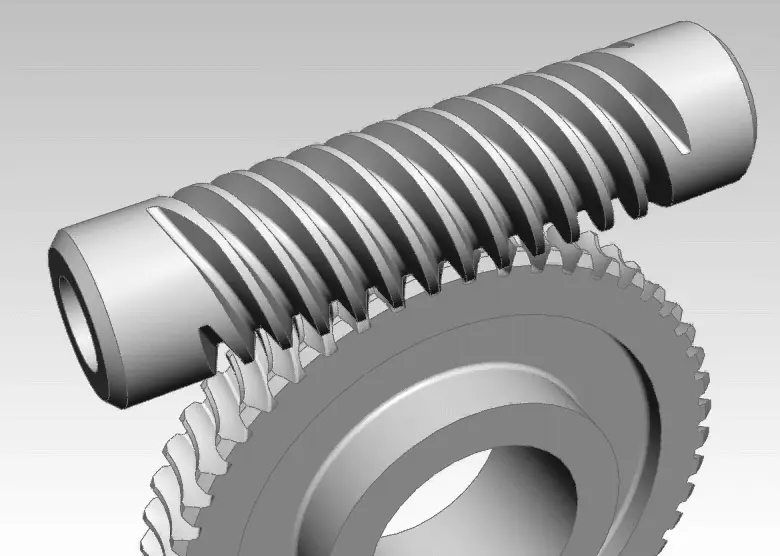
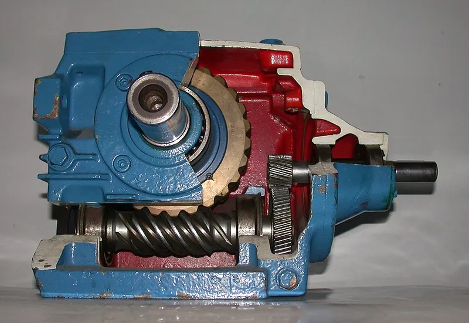
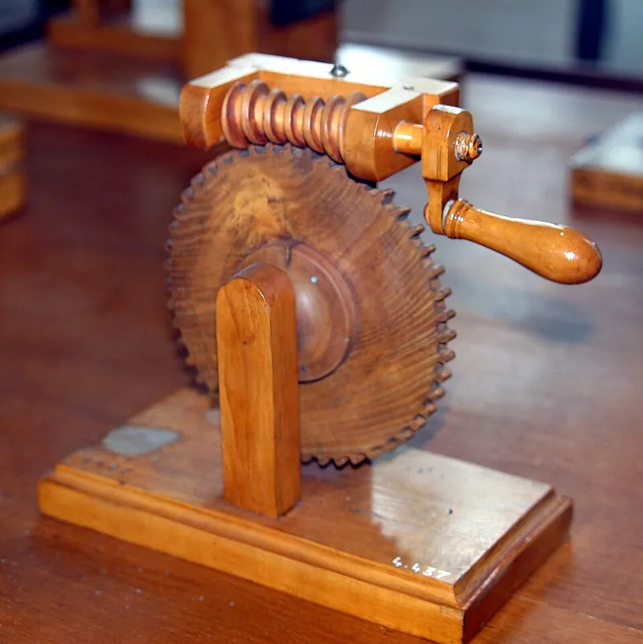

<figure class="eoc-pic eoc-pic-main"><picture><source media="(prefers-reduced-motion: reduce)" srcset="../media/worm-drive.still.webp"></picture><figcaption><strong>Animation.</strong> <a href="https://commons.wikimedia.org/wiki/File:Worm_Gear.gif">Worm Gear</a> by User:Catsquisher, Public domain, from Wikimedia Commons.</figcaption></figure>
<figure class="eoc-pic"><figcaption><strong>Cross-section.</strong> <a href="https://commons.wikimedia.org/wiki/File:Worm-WormWheel-gearbox.jpg">Worm-WormWheel-gearbox</a> by unknown, <a href="https://creativecommons.org/licenses/by-sa/2.0">CC BY-SA 2.0</a>, from Wikimedia Commons.</figcaption></figure>
<figure class="eoc-pic"><figcaption><strong>Photo.</strong> <a href="https://commons.wikimedia.org/wiki/File:Engrenage_%C3%A0_vis_creuse_CNAM-IMG_0602.jpg">Engrenage à vis creuse CNAM-IMG 0602</a> by Rama, <a href="https://creativecommons.org/licenses/by-sa/2.0/fr/deed.en">CC BY-SA 2.0 fr</a>, from Wikimedia Commons.</figcaption></figure>

A screw-like gear (the worm) meshes with a gear wheel (the worm wheel) at right angles, giving a large speed reduction and turning-force increase in one step, and in low-angle, single-thread designs the wheel cannot drive the worm backwards.

**In plain words:** A screw-shaped gear that turns a gear wheel beside it at right angles, slowly and with a lot of force; in many versions the wheel can't turn the screw back, so it stays where you left it. **Proper term:** Worm drive (worm gear pair: worm and worm wheel).

**Also called:** worm gear; worm gearing; worm and wheel; worm and worm wheel; worm gear set; worm gearbox / worm gear reducer / right-angle worm gearbox; worm gear motor (a small motor with a worm stage); endless screw (old name, used in 507 Mechanical Movements); screw gear (loosely; strictly that name means crossed helical gears); globoid or double-enveloping worm (variant with an hourglass-shaped worm); duplex worm / dual-lead worm (variant whose [backlash](../glossary.md#backlash) can be adjusted); Schneckengetriebe (German).

## How it works

The worm is a screw with one or more spiral threads (starts). Each full turn of a single-start worm pushes the wheel on by exactly one tooth, so a 20-tooth wheel gives a 20:1 reduction in a single mesh (ratio = wheel teeth divided by worm starts). The teeth slide across each other rather than rolling, which wastes energy as heat, and that same friction is why a worm with a shallow thread angle (lead angle) jams instead of turning when the wheel tries to drive it backwards ([self-locking](../glossary.md#self-locking)). Worms with more starts have a steeper thread, run more efficiently and can usually be driven backwards.

## Parts

A few parts: the worm (a screw-shaped gear on the input shaft), the worm wheel (a gear wheel on the output shaft, often with curved 'throated' teeth that hug the worm), two shafts with bearings (including thrust bearings or washers, because the worm gets pushed along its own axis), and usually a housing that fixes the distance between the shafts and holds the grease or oil.

## Everyday examples

- Guitar and double-bass tuning pegs: turning the small knob slowly turns the string post, and the string's pull can't unwind it
- Worm-drive hose clamps (Jubilee clip (brand)): a small screw drives the slotted band (the worm here acts on a straight band rather than a wheel)
- Gate openers, lifts and conveyor drives
- Car steering boxes (and, historically, some truck rear axles)

## When to use it

Use a worm drive when you need a big slow-down (or a big increase in turning force) in a small space, when the output shaft has to be at right angles to the motor, or when the output should stay put when the motor stops, such as a robot arm joint, a tilting camera or tablet stand, a winch that holds its load, or a rotating table. It is also quiet and smooth, and a single stage replaces several spur gear stages.

## When not to use it

Avoid it when efficiency matters (battery robots, continuous high-power drives), because a self-locking worm is usually under 50% efficient, so more than half the input turns into heat (tec-science); use a spur, helical or planetary gearbox instead. Avoid it when you need to back-drive the output by hand or let it give way safely, as with compliant robots, things people push, or mechanisms that must not be damaged by knocks; use a back-drivable gearbox with a clutch. Don't rely on it as the only brake for lifting people or heavy loads; add a real brake or a [ratchet](../glossary.md#ratchet) and [pawl](../glossary.md#pawl). For straight-line motion, use a lead screw or rack and pinion.

## Details

- **What it does (jobs):**
  - change speed or turning force: a big reduction (typically 5:1 to 75:1, over 100:1 possible) in one small, right-angle step
  - stop it moving back (one-way): single-start, low-angle worms hold the output where it was left when the load tries to turn it back; note the worm itself can still be driven either way, and this hold is not guaranteed
- **Movement:** rotate: continuous rotation in at the worm, slower continuous rotation out at the wheel, turned through 90 degrees; unlimited range, either direction
- **Directions it can move (degrees of freedom):** 1: once the worm and wheel mesh, turning the worm is the only independent motion; the wheel's position is tied to it by the [gear ratio](../glossary.md#gear-ratio)
- **Special behaviour:**
  - self-locking (holds under load, won't back-drive): with a single-start worm and a small lead angle (about 4 degrees or less), friction stops the wheel from turning the worm, so a lifted load or a robot arm stays put when the motor stops. Makers warn it is not dependable: vibration, smooth ground worms, good [lubrication](../glossary.md#lubrication) or multi-start worms can let it slip, so add a brake where safety matters
- **How it holds:**
  - not a holding joint (it moves or passes on motion): it transmits rotation
  - friction or clamping ([force-fit](../glossary.md#form-fit--force-fit--material-bond)): its self-locking hold comes from sliding friction between the worm thread and the wheel teeth, not from the parts interlocking
- **Input and output:** Continuous rotation -> slower continuous rotation. Ratio = number of wheel teeth / number of worm starts; normal single-stage range 5:1 to 75:1 (RoyMech) or 5:1 to 100:1 for worm gear reducers (KHK), over 100:1 possible in one stage (tec-science), and two worm reducers in series can reach 10,000:1 (KHK). Efficiency is poor because the teeth slide, and sources give different ranges: 30-90% in theory (KHK technical reference), typically 30-60% for cylindrical worms (KHK worm gear page), 60-95% for worm reducers depending on lead angle (KHK reducer page), and from about 98% at the lowest ratios down to about 20% at the highest (RoyMech). Compare 98-99.5% per mesh for spur and helical gears (KHK). Shafts: crossed (at right angles, not intersecting). Back-drivable: no for most single-start, high-ratio worms with a small lead angle (self-locking drives are usually under 50% efficient), but only reliably when there is no vibration; yes for multi-start, steep-lead worms (drives above about 50% efficiency are often not self-locking, per tec-science).
- **Power:** passive (no power needed). When it is driven by a motor and the power is lost, a self-locking worm drive keeps its last position (the load cannot turn it back), while a back-drivable (multi-start) one lets the load turn the output
- **Load:** medium to heavy for its size, because the output gets a large [torque](../glossary.md#torque) multiplication. The weak points are the worm wheel's teeth (usually the softer part) and the worm's push along its own axis ([axial](../glossary.md#axial--radial) thrust), which needs thrust bearings or washers. ⚑ [uncertain] Because a self-locking drive cannot give way when the output is hit, shock loads from the output side go straight into the teeth.
- **Play and precision:** Small to noticeable backlash depending on quality; KHK advises keeping some backlash rather than zero, so an oil film can form. The big reduction makes the output position fine and steady. ⚑ [uncertain] It tolerates little [misalignment](../glossary.md#misalignment): the centre distance, the 90-degree shaft angle and the wheel's centre plane lining up with the worm axis all matter, or the contact moves to the tooth edges and it binds or wears quickly.
- **Taking it apart:** removable: the worm and wheel are separate parts fixed to their shafts ([set screws](../glossary.md#set-screw), keys or clamps) inside a frame or housing and can be taken apart and refitted
- **How often it can be reused:** many times: it can be dismantled and reassembled repeatedly; the limit is tooth wear, not the assembly
- **Sealing:** none: the gear mesh itself does not seal anything. Industrial worm gearboxes run in a closed housing that keeps the lubricant in and dirt out, so the housing (not the gears) does the sealing
- **Adjustable:** Not in normal running. Backlash (play) can be set by adjusting the distance between the shafts, or, with a duplex (dual-lead) worm, by sliding the worm along its axis without changing the centre distance (KHK quotes 0.02 mm backlash change per 1 mm of axial worm movement)
- **Access needed:** not applicable: it is a pair of gears mounted on two shafts inside a frame or housing, reached wherever the housing opens
- **Materials:** Classic metal pair: a hardened (case-hardened and ground) steel worm with a phosphor-bronze wheel, the pairing RoyMech calls ideal; worms are made harder than wheels to limit wear (KHK). Other wheels: cast iron, aluminium bronze, acetal (POM) and nylon; stainless steel worms for wet places (KHK, McMaster-Carr). Grease-free self-lubricating plastic sets exist (igus iglide (brand)). Old wooden worm drives exist too (museum example at CNAM, Paris). For 3D printing, nylon is the usual first choice; PLA, ABS and PETG work only if greased (Let's Print test via Hackaday; EngineerDog ranks nylon > PLA > ABS > PETG for printed gears).
- **Heat, cold, water and wear:** Heat: sliding friction makes heat, and metal pairs need an unbroken oil film (KHK); PLA softens and deforms above about 60 °C (Prusa), and a printed worm next to a powered stepper motor can reach that (Libre Space community). igus's grease-free plastic modular worm gear is rated for +5 to +50 °C (igus). Vibration: shocks and vibration can undo static self-locking and let the gearbox start turning under the load (tec-science; RoyMech). Dirt: fully plastic, self-lubricating sets are described as resistant to dirt and dust (igus); greased sets pick up grit.

## Making it

- **Ways to make or get it:**
  - off-the-shelf part (worm gear sets, worm gear motors and worm gearboxes are cheap and common)
  - 3D print (FDM): demo and light-duty drives; best with nylon or greased PLA/PETG
  - CNC: worms are turned and thread-cut or hobbed; the wormgear tool offers a straight-flank (ZA) profile for CNC
  - woodwork: historic wooden worm drives exist (e.g. CNAM museum photo)
- **Printing it in one piece (print in place):** yes, as a demo: Tomas Endlicher's 'Worm Gear Drive - Print In Place Test' prints already meshed with 0.4 mm [clearances](../glossary.md#clearance), but it needs supports and the moving parts must be carefully freed afterwards. Working drives are normally printed as separate parts and assembled on shafts.
- **Tools:** Hex keys or a screwdriver for set screws and housing screws; grease or oil for metal and most plastic pairs (self-lubricating plastic sets run dry); for a printed throated wheel split in two halves, glue or screws to join the halves
- **Difficulty:** moderate: cheap to buy ready-made, and printable from free generators (BOSL2, wormgear), but the curved (throated) wheel is awkward to print because of [overhangs](../glossary.md#overhang--bridging), and the pair needs a rigid, accurate centre distance, a thrust bearing and grease to last

### 3D printing tips

1) Don't model the teeth by hand: generate a matched pair with BOSL2 (worm() and worm_gear(), with backlash and clearance settings and a choice of starts and pressure angle) or the Python 'wormgear' tool (DIN 3975 geometry, reports efficiency and whether the pair will self-lock, and has a slightly convex ZK profile described as 3D-print-friendly). EngineerDog notes worms are hard to model and suggests starting from a template. 2) The throated worm wheel has overhangs on both faces: split it in half through its middle plane, print both halves flat without supports and join them (Libre Space community advice; DenverDude's 'Filament Spool Winder (Split Worm Gear)' prints flat with no supports this way). 3) ⚑ [uncertain] Print the worm standing upright so its thread is built up like a bolt's, with fine layers for smoother flanks. 4) Layers of 0.2 mm or finer, lots of part cooling and slow [perimeters](../glossary.md#perimeters) (about 25 mm/s) help the overhangs (Libre Space). 5) Leave clearance: the [print-in-place](../glossary.md#print-in-place) test uses 0.4 mm under the wheel and 0.4-0.6 mm around the axles; in BOSL2 set a small backlash value. 6) Grease it: in Let's Print's test (reported by Hackaday), ungreased PLA, PETG and ABS worm sets failed in under two minutes at 8,000 rpm, while with plastic-safe grease each ran over ten minutes at 12,000 rpm (with almost no load, so treat this as a friction test only). 7) Material: nylon first (low friction, no grease needed, but absorbs water and is harder to print); PLA softens and deforms above about 60 °C (Prusa), and the sliding friction plus a nearby powered stepper motor can get it that hot (Libre Space). 8) EngineerDog suggests a 25-degree pressure angle for stronger printed gear teeth in general, and oversizing shaft holes slightly (about 0.005 in on the diameter) or reaming them. 9) Hold the two shafts rigidly at the right distance and add a thrust washer or bearing at the worm's ends, because the worm is pushed along its axis. 10) Don't count on a printed worm to self-lock under vibration; test it with the real load.

### Buying one (off-the-shelf parts)

Worm and worm gear sets (specified by module or diametral [pitch](../glossary.md#pitch), number of starts, hand and pressure angle, typically 14.5 or 20 degrees); shaft-mounted worms; worm gears (wheels) in bronze, cast iron, acetal or nylon (McMaster-Carr 'Metal Worms and Worm Gears' and 'Plastic Worm Gears'); worm gear motors (small DC motors with a worm stage, e.g. the 'JGY-370' type seen on Printables); worm gear reducers or right-angle worm gearboxes; grease-free plastic modular worm gears (igus Apiro (brand), ratios 4:1, 32:1, 64:1); LEGO Technic worm gears (brand) for quick experiments; thrust bearings and thrust washers for the worm shaft.

## Rules of thumb

- Ratio = number of wheel teeth / number of worm starts; a single-start worm on a 20-tooth wheel gives 20:1 (Wikipedia 'Worm drive'; tec-science). Worms usually have 1 to 4 starts (tec-science).
- Normal single-stage range 5:1 to 75:1 (RoyMech); 5:1 to 100:1 for worm gear reducers, and 10,000:1 with two in series (KHK reducer page); KHK stock sets go up to 120:1 (KHK worm gear page).
- Efficiency: 30-90% theoretical (KHK technical reference), typically 30-60% for cylindrical worms (KHK worm gear page), 60-95% for worm reducers (KHK reducer page); about 98% at the lowest ratios down to about 20% at the highest (RoyMech). Higher ratio and smaller lead angle mean lower efficiency, and phosphor-bronze wheels are more efficient than aluminium-bronze or cast-iron ones (KHK Q&A).
- Self-locking happens when the lead angle is about 4 degrees or less, but it is unstable because it depends on friction (KHK Q&A). The limit is where the lead angle equals arctan(friction coefficient); use the lower, moving (dynamic) friction value if there is any vibration (RoyMech).
- Self-locking worm drives are usually below 50% efficient; above 50% they are often not self-locking (tec-science).
- Don't use a worm as the braking device for safety-critical lifting such as hoists (RoyMech); combine self-locking with another method when reversal must be prevented completely (KHK).
- Make the worm harder than the wheel; a case-hardened, ground steel worm with a phosphor-bronze wheel is the ideal metal pair (RoyMech; KHK).
- Keep some backlash; zero backlash is not recommended because it disrupts the oil film and can cause abnormal wear and jamming (KHK worm gear page and Q&A).

## Common failures

1) Worn or stripped wheel teeth, since the wheel is the softer part: make it from bronze or nylon, keep it lubricated and don't overload it. 2) Unlubricated plastic worms wear out in minutes: grease them with a plastic-safe grease (Let's Print via Hackaday). 3) Overheating and softening from friction: lower the speed, use a multi-start worm or a better material. 4) Unexpected [back-driving](../glossary.md#back-driving) under vibration or with a multi-start worm: check the lead angle and add a brake. 5) Binding or rapid wear from zero backlash or a wrong centre distance (KHK). 6) ⚑ [uncertain] The worm walks along its shaft or the housing flexes because the axial thrust isn't carried: add thrust bearings and a stiff frame.

## Safety

Self-locking is not a safety brake: a load can [creep](../glossary.md#creep) or drop under vibration, so never stand under a load held only by a worm drive (RoyMech; KHK). The high torque multiplication means a small motor can crush fingers or break parts, and the point where the worm meets the wheel is a pinch point ⚑ [uncertain], so guard it. Worm gearboxes can get hot in continuous use.

## Related

- Spur or helical gear train: the teeth roll instead of sliding, so each mesh is 98-99.5% efficient (KHK), but a big ratio needs several stages and the shafts stay parallel; ⚑ [uncertain] at modest ratios it is easily turned backwards, so it doesn't hold a load by itself
- Crossed helical gears (screw gears): also crossed shafts but with both gears helical; 70-95% efficient (KHK) and not suited to high power
- Bevel gears: turn motion through 90 degrees with the shafts intersecting; 98-99% efficient per mesh (KHK) and used for low ratios
- Lead screw and nut: the same screw-and-friction idea, but the screw drives a nut in a straight line instead of a wheel
- Worm gear screw jack: a worm turning a nut or screw to lift loads, combining both
- Rack and pinion: turns rotation into straight-line motion
- Planetary or cycloidal (Cyclo) reducer: a large ratio in line with the motor shaft, about 98% efficient for one stage (KHK) and better at taking shock loads than a worm reducer (KHK)
- Ratchet and pawl or a brake: what to add when the output must never move back

## Make it yourself

- [Worm Gear Drive - Print In Place Test (Tomas Endlicher, Printables)](https://www.printables.com/model/766698-worm-gear-drive-print-in-place-test): Hand-cranked worm and 18-tooth wheel printed already assembled; two versions with 0.4 or 0.6 mm axle clearance; PLA, 0.2 mm layers, supports needed *(licence: CC BY-SA)*
- [Filament Spool Winder (Split Worm Gear) (DenverDude, Printables)](https://www.printables.com/model/642115-filament-spool-winder-split-worm-gear): A working worm-driven winder whose worm wheel is split in two so it prints flat with no supports *(licence: CC BY-NC)*
- [BOSL2 gears.scad: worm(), worm_gear(), enveloping_worm() (OpenSCAD library)](https://github.com/BelfrySCAD/BOSL2/wiki/gears.scad): Parametric OpenSCAD modules that generate matching worms and worm wheels, with starts, hand, pressure angle, backlash and clearance settings *(licence: BSD 2-Clause)*
- [wormgear (Python / build123d worm gear generator by Paul Fremantle), README](https://raw.githubusercontent.com/pzfreo/wormgear/main/README.md): Generates exact worm and wheel STEP models from module and ratio, using DIN 3975 geometry, and estimates efficiency and self-locking; offers a 3D-print-friendly ZK tooth profile *(licence: MIT)*
- [HUANGYAN920 Mechanical: interactive mechanism animations (entries 'WORM-GEAR', 'WORM-INDEX', 'MULTI-START-WORM', 'WORM-JACK')](https://huangyan920.github.io/Mechanical/): Browser-based parametric animations of worm mechanisms; the listed figures are rough, so check numbers against KHK or RoyMech *(licence: MIT)*

## Pictures, videos and models

- [Worm Gear.gif (Wikimedia Commons, by Catsquisher)](https://commons.wikimedia.org/wiki/File:Worm_Gear.gif): Animated 4-start worm turning a 50-tooth throated wheel (12.5:1) *(licence: Public domain)*
- [Schnecke10.gif (Wikimedia Commons, by Quant3)](https://commons.wikimedia.org/wiki/File:Schnecke10.gif): Looping animation of a worm driving a worm wheel *(licence: CC BY-SA 3.0)*
- [Engrenage a vis creuse, CNAM (Wikimedia Commons, photo by Rama)](https://commons.wikimedia.org/wiki/File:Engrenage_%C3%A0_vis_creuse_CNAM-IMG_0602.jpg): Photo of a wooden worm and worm wheel in the Musee des Arts et Metiers, Paris *(licence: CC BY-SA 2.0 France / CeCILL)*
- [507 Mechanical Movements, No. 31: worm or endless screw and worm-wheel](https://507movements.com/mm_031.html): Historic 1868 drawing with an animated version *(licence: Book public domain; website animation link only)*
- [Worm gear drive 1 (Nguyen Duc Thang, YouTube thang010146)](https://www.youtube.com/watch?v=7Fh2OVpHIO4): CAD animation of a worm gear drive *(licence: link only (standard YouTube licence))*

## Needs confirming

⚑ marks something nobody has confirmed yet: a fact the research could not confirm from a source, a finder value that is a best guess, or an open point from the research notes. Corrections are welcome (see `research/needs-confirming.md`).

- ⚑ 6 sentences on this page marked [uncertain].

## Sources

- <https://en.wikipedia.org/wiki/Worm_drive>
- <https://khkgears.net/new/gear_knowledge/gear_technical_reference/gear_types_terminology.html>
- <https://khkgears.net/new/worm_gear.html>
- <https://khkgears.net/new/gear_knowledge/q_and_a_about_gears.html>
- <https://khkgears.net/new/gear_knowledge/Types_and_Mechanisms_of_Gear_Reducers.html>
- <https://roymech.org/Useful_Tables/Drive/Worm_Gears.html>
- <https://www.tec-science.com/mechanical-power-transmission/gear-types/worms-and-worm-gears/>
- <https://www.mecapedia.uji.es/pages/irreversibilidad.html>
- <https://commons.wikimedia.org/wiki/Category:Worm_gears>
- <https://commons.wikimedia.org/wiki/File:Worm_Gear.gif>
- <https://commons.wikimedia.org/wiki/File:Schnecke10.gif>
- <https://commons.wikimedia.org/wiki/File:Engrenage_%C3%A0_vis_creuse_CNAM-IMG_0602.jpg>
- <https://507movements.com/mm_031.html>
- <https://www.youtube.com/watch?v=7Fh2OVpHIO4>
- <https://www.youtube.com/watch?v=rWnZWvNhi1Y>
- <https://hackaday.com/2021/05/12/testing-3d-printed-worm-gears/>
- <https://www.youtube.com/watch?v=m4VSxVspLoc>
- <https://engineerdog.com/2017/01/07/a-practical-guide-to-fdm-3d-printing-gears/>
- <https://community.libre.space/t/3d-printing-the-worm-gear/56>
- <https://help.prusa3d.com/article/pla_2062>
- <https://www.igus.com/robot-components/modular-worm-gear>
- <https://www.mcmaster.com/products/worm-gears/>
- <https://github.com/BelfrySCAD/BOSL2/wiki/gears.scad>
- <https://raw.githubusercontent.com/BelfrySCAD/BOSL2/master/gears.scad>
- <https://raw.githubusercontent.com/BelfrySCAD/BOSL2/master/LICENSE>
- <https://raw.githubusercontent.com/pzfreo/wormgear/main/README.md>
- <https://huangyan920.github.io/Mechanical/>
- <https://www.printables.com/model/766698-worm-gear-drive-print-in-place-test>
- <https://www.printables.com/model/642115-filament-spool-winder-split-worm-gear>
- <https://api.printables.com/graphql/>
