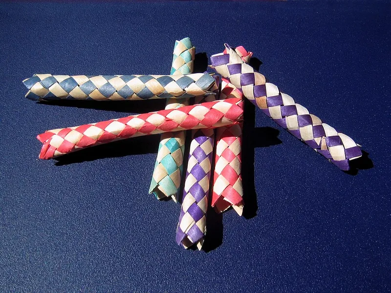
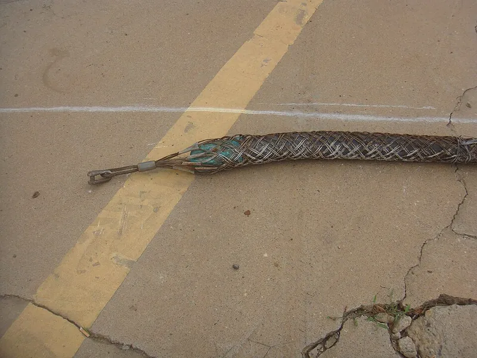

<figure class="eoc-pic eoc-pic-main"><figcaption><strong>Photo.</strong> <a href="https://commons.wikimedia.org/wiki/File:Finger_trap_toys.jpg">Finger trap toys</a> by carol, <a href="https://creativecommons.org/licenses/by/2.5">CC BY 2.5</a>, from Wikimedia Commons.</figcaption></figure>
<figure class="eoc-pic"><figcaption><strong>How it works.</strong> <a href="https://commons.wikimedia.org/wiki/File:Towing_sock_-_01.jpg">Towing sock - 01</a> by Anna Frodesiak, <a href="http://creativecommons.org/publicdomain/zero/1.0/deed.en">CC0</a>, from Wikimedia Commons.</figcaption></figure>

A tube woven from two sets of crossing spiral strands that slides over the end of a cable, rope or finger and then grips it harder the harder it is pulled, because pulling makes the weave longer and narrower.

**In plain words:** A stretchy woven tube that slides easily onto a cable, rope or finger, then squeezes tighter the harder you pull, and lets go when you push its ends towards the middle. **Proper term:** Woven self-tightening grip (biaxial braided grip, the 'finger-trap' principle); as a cable tool it is a wire-mesh cable grip (pulling grip, support grip or strain-relief grip).

**Also called:** Chinese finger trap, Chinese finger puzzle, Chinese thumb cuff, Chinese handcuffs (names for the toy, which is not Chinese in origin, Wikipedia); finger trap; towing sock, cable sock, cable pulling sock; wire pulling grip, wire rope puller (Wikipedia); wire-mesh grip, mesh grip, cable pulling grip; Chinese fingers (trade name for cable socks, e.g. 'Towing Socks (Chinese Fingers)'); strain-relief grip, support grip, splicing grip, slack-pulling grip (split mesh) (Kellems, Klein); Kellems grip (brand, Hubbell; invented by Vivien Kellems in 1927); finger-trap splice, bury splice, long bury splice (in hollow-braid rope); finger trapping (parachute rigging); Schmall'sches Extensionsgeflecht / Schmall's extension mesh (historic medical traction device, 1873); expandable braided sleeving (e.g. Techflex, brand), which shows the same effect; whoopie sling (an adjustable-length spliced rope sling whose buried section works like a finger trap; Animated Knots; Greenbelly).

## How it works

The tube is a braid: two sets of strands wind round it in opposite spirals and cross over and under each other (a biaxial braid). Pulling the ends lengthens the braid, and it can only get longer by the strands swinging closer to the tube's length, which shrinks its circumference, so it squeezes whatever is inside; 'the more one pulls, the more the circumference shrinks and the trap tightens' (Wikipedia, 'Chinese finger trap'). The squeeze makes friction along the whole length, so the grip rises with the load instead of slipping. Pushing the ends towards the middle does the opposite: the tube gets shorter and wider and lets go, which is how you escape the toy and also why an object pushing against the tail of a cable grip can release it by accident (Kellems caution 8). A whoopie sling turns the grip into an adjustable loop: a hollow 12-strand braided rope has a fixed eye spliced into one end and its long end threaded back along inside its own core, so pulling the tail feeds rope through the buried section and changes the size of the loop (Animated Knots 'Whoopie Sling'); the buried section 'works like a Chinese finger trap - push the ends together to loosen and pull the ends away to tighten' (Greenbelly 'Guide to Whoopie Slings').

## Parts

Single piece in its simplest form: a woven tube (the bamboo or paper toy, a length of braided sleeving, or the hollow core of a braided rope). Cable grips are a small assembly that acts as one unit: a tube of woven strands (galvanized steel, tin-coated bronze, stainless steel or aramid fibre); a pulling eye made from the same strands (flexible, rotating or offset); often aluminium shoulders at the eye end to protect the cable; bands or tape over the tail end; and on split-mesh grips a lace or rod that closes the mesh around a cable mid-span (Kellems and Klein catalogues).

## Everyday examples

- The Chinese finger trap toy (Wikipedia)
- A cable-pulling sock on the end of a cable being pulled through a duct or conduit (Wikipedia 'Towing sock'; Kellems)
- A strain-relief grip holding the weight of a power cord that drops from a ceiling to a machine (Wikipedia 'Towing sock')
- Expandable braided sleeving on computer or car wiring, which widens when pushed and narrows when pulled (Techflex)
- Eye splices in hollow-braid Dyneema rope, and finger-trapped parachute suspension lines (Animated Knots; FAA Parachute Rigger Handbook)

## When to use it

When you need to grab the end of something round and fairly firm (a cable, rope, hose or rod) and pull it or hang it, without drilling it, knotting it or crushing it in one spot: pulling cable through conduit or a long duct, hanging a power cord or hose from above, taking strain off a cord where it enters a box, joining two cables temporarily, or making a strong, low-bulk eye in hollow-braid rope. It spreads the grip over a long length, fits a range of diameters, keeps a slim profile that slides through ducts, and comes off again without damage. A whoopie sling gives a light rope loop whose length can be changed: it was developed by and for arborists (with a pulley block), is used in camping to tension a hammock, and in marine yards to balance a load (Animated Knots 'Whoopie Sling').

## When not to use it

Not for loads that push, twist or come from the side, and not where anything can push back on the tail (it releases): use a clamp, a cable [gland](../glossary.md#gland) or a knot/thimble instead. Not for short or tapered objects, because it needs a long straight length to grip. Not for permanent structural hanging with a pulling grip: use a rated support grip, or a proper end fitting such as a swaged or clamped termination. Not for life-safety lines or anything over people unless it is a rated product used within its working load. Not near live electrical conductors with steel mesh (use non-conductive grips). For a quick adjustable hold on thin cord, a cord lock or cam cleat is easier; for pulling electrical cable with a pulling eye already fitted, use that eye.

## Details

- **What it does (jobs):**
  - join and hold: grabs the end (or, with split mesh, the middle) of a cable, rope, hose or finger so it can be pulled, hung or held
  - lock, and release by hand: holds as long as it is pulled, and lets go when the tension is off and its ends are pushed together
  - seal it, or pass cables or fluid through: as a strain-relief grip it takes the pull or weight off an electrical cord where it hangs from a ceiling or enters a box (it does not seal)
- **Movement:** none: once loaded nothing moves; the braid itself changes shape (longer and narrower as it tightens, shorter and wider as it releases), which is how it grips
- **Directions it can move (degrees of freedom):** 0 once it is gripping under load: the cable can't slide out in the pull direction. Before it is loaded it slides freely along the cable (1). Cable and grip together can still twist, which is why pulling eyes are joined to the pull line with a swivel; Kellems says swivels are 'essential' on long high-tension pulls because [torque](../glossary.md#torque) builds up.
- **Special behaviour:**
  - [self-locking](../glossary.md#self-locking) (holds under load, won't back-drive): the harder the pull, the tighter the weave squeezes, so it doesn't slip out under load
  - hand-release only (locks under load, releases when a person operates it): push the ends towards the middle and it opens up (the toy's escape); cable grips come off once the pull is taken off
  - self-aligning or self-centring: the woven tube closes evenly all the way round and centres the cable or rope inside it
- **How it holds:**
  - jamming (grains or a braid lock up under load): the braid narrows onto the object as it is pulled
  - friction or clamping ([force-fit](../glossary.md#form-fit--force-fit--material-bond)): the squeeze makes friction along the whole gripped length
- **Input and output:** not applicable: it holds rather than passing motion on (back-drivable: no; pulling on it only tightens it, while pushing its tail towards the eye loosens it)
- **Power:** passive (no power needed)
- **Load:** Light to heavy, but only as a pull along the gripped object. The bamboo toy is very light and its strips break if pulled hard (Wikipedia). Kellems light-duty pulling grips for 0.50-0.61 in (13-16 mm) cable have an approximate breaking strength of 2,800 lb (12.5 kN), about 560 lb (2.5 kN) working load at Kellems' recommended safety factor of 5; Kellems' worked example is a 27,200 lb (121 kN) grip with a 5,440 lb (24 kN) maximum recommended load. A properly made long-bury splice in hollow-braid rope reaches 90-100% of the rope's breaking strength (Animated Knots). Weak against anything that pushes the tail back (which releases it), and it takes no sideways load or twist.
- **Play and precision:** Noticeable: the braid stretches and tightens progressively, so the grip [creeps](../glossary.md#creep) a little along the object as it takes load ⚑ [uncertain: no source gives an amount]. A buried rope tail also shortens the rope by an amount that depends on how tightly the rope was braided, so Animated Knots advises loading it to 'reset' the braid and measuring. Each cable grip fits only a narrow diameter band (Kellems light-duty sizes step about every 1/8 in: 0.50-0.61 in, 0.62-0.74 in, 0.75-0.99 in). It centres the object but does not locate it precisely.
- **Taking it apart:** removable: take the load off, push the mesh back towards the eye to open it and slide it off (Kellems describes pulling grips as reusable tools). A buried hollow-braid rope splice counts as semi-permanent, and it is usually stitched or locked so it stays put (Animated Knots).
- **How often it can be reused:** many times: the toy works indefinitely and Kellems grips are 'designed to be a reusable tool', but strands kink, fray, corrode and break with use. Kellems' published breaking strengths apply only to new, unused grips, and a damaged grip must not be used (Kellems catalogue T-17, T-18).
- **Sealing:** none: the open weave doesn't seal; for a sealed cable entry combine it with a cable gland or cord connector (see Cable gland and strain relief)
- **Adjustable:** yes, before loading: slide it to where you want it and pull; it adapts to any diameter within its range. Once loaded it can't be adjusted without taking the load off.
- **Access needed:** end of a tube or shaft: a closed grip, sleeve or toy slides over a free end; split-mesh grips (lace or rod closing) wrap around a cable mid-span 'when end of cable is not available' (Kellems, Klein)
- **Materials:** Toy: woven bamboo (Wikipedia) or paper strips. Cable grips: galvanized steel strand for pulling grips; tin-coated bronze (non-magnetic) or stainless steel for permanent support grips; aramid fibre for non-conductive grips (Kellems). Sleeving: PET monofilament (Techflex Flexo PET). Rope splices: hollow-braid HMPE (Dyneema, Spectra, Amsteel), aramid, LCP (Vectran) or polyester (Animated Knots). Printed: TPU strips (Printables). It grips round, fairly firm things well: cable, rope, hose, conduit, fingers. Slippery surfaces need a much longer grip: HMPE rope needs about twice the bury length of polyester (Animated Knots).
- **Heat, cold, water and wear:** Galvanized steel mesh is 'not subject to continuous outside environment' (not for permanent outdoor use); for permanent support Kellems uses tin-coated bronze or stainless steel, and non-metallic aramid grips resist corrosion and have 'superior flex life' but only 'moderate strength' (Kellems catalogue, T-18 and T-29). PET sleeving resists UV, chemicals and abrasion (Techflex). Steel mesh conducts electricity (Klein: 'Do NOT use on live circuits'). Slippery ropes need long grips: HMPE needs about twice the bury of polyester (Animated Knots); wet, oily or icy surfaces are likely to grip less ⚑ [uncertain]. Shaking, flapping or 'inquisitive fingers' can walk a loose tail out, so stitch, band or tape it (Animated Knots; Kellems). TPU and paper toys soften, stretch or tear with heat and age ⚑ [uncertain].

## Making it

- **Ways to make or get it:**
  - off-the-shelf part: wire-mesh pulling, support, splicing and strain-relief grips (Kellems, Klein) and expandable braided sleeving (Techflex)
  - 3D print (FDM): flexible TPU strips printed flat and woven into a tube by hand (Printables 'Finger Trap (for flexible filament)')
  - other (hand work): weaving paper, bamboo or ribbon strips round a cylinder; burying a rope tail inside hollow-braid rope with a fid (Animated Knots)
  - 3D print (resin): not suitable, because resins are too stiff and [brittle](../glossary.md#brittle--ductile) for strands that must bend and slide ⚑ [uncertain: no source tested it]
- **Printing it in one piece (print in place):** no: the strands must bend and slide over one another at every crossing, so the printable design (Nikorasu, Printables) is printed as two flat L-shaped TPU strips, 2 layers thick, which are woven together by hand around a pen and glued at the tab. No working [print-in-place](../glossary.md#print-in-place) braided tube was found ⚑ [uncertain]. (Some 'finger trap' prints are a different mechanism: a rigid tube with angled flaps.)
- **Tools:** none for the toy or a sleeve. Cable grips: banding tool and bands (e.g. Punch-Lok bands, brand) or tape to lock the tail. Rope: a fid or splicing tool to bury the tail, and a needle and thread to stitch it (Animated Knots); parachute riggers use a 'finger-trapping needle' (a threaded fid) or a finger-trapping wire (FAA Parachute Rigger Handbook).
- **Difficulty:** easy to use, moderate to make: buy a mesh grip or a length of expandable braided sleeving, or weave strips by hand; printing a working braid in one go is hard because the strands must slide over each other at every crossing, so the printable version is flat TPU strips woven by hand

### 3D printing tips

1) Use flexible filament (TPU): the toy only works if every strand can bend and slide, and Nikorasu's Printables design notes TPU is 'pretty tough' compared with wood or paper traps that 'usually fall apart'. Flexible filaments are 'suitable mostly for advanced users due to high print difficulty' (Prusa, flexible materials), so print slowly. 2) Print the strips flat on the bed, only about 2 layers thick, so each strip is thin and bendy; level the bed well because a 2-layer print shows every error (Nikorasu). 3) Weave, don't print, the tube: tape the strip corners to a finger-sized former such as a thick pen, on opposite sides, then weave strictly over-under-over-under; tabs and holes at the ends line up and are glued (Nikorasu). 4) Make the strips wide and few rather than many and narrow for a toy; for a real grip, more strands and a longer tube give more friction ⚑ [uncertain: rule of thumb from the Klein advice that longer mesh holds more]. 5) Rigid PLA or PETG will not flex enough to work as a braid ⚑ [uncertain]. 6) For a functional cable or rope grip it is usually better to buy PET braided sleeving (cut and seal its ends with a hot knife, Techflex) or a wire-mesh grip, and print only the parts around it: an end cap or eye that clamps the closed end, and a sleeve or band that locks the tail so it can't be pushed back (the job Kellems' bands do). 7) Typical failures: strands tearing at the glued tab, the weave skipping an over-under and jamming, and strands stretching permanently after a hard pull ⚑ [uncertain].

### Buying one (off-the-shelf parts)

Wire-mesh cable pulling grips (search 'cable pulling grip', 'wire mesh grip', 'cable sock', 'Chinese fingers'): closed mesh (slides over an end) or split mesh with lace or rod closing (fits mid-span); single, double or multi-weave; flexible, rotating or offset eyes. Also support grips (single, double or offset eye) for hanging cable permanently, strain-relief grips for flexible cords and liquid-tight conduit, splicing grips (temporary cable-to-cable joints), hose containment grips (stop a burst hose whipping), Punch-Lok bands and banding tools, and ball-bearing pulling swivels (Kellems, Klein). Expandable braided sleeving (PET, e.g. Techflex Flexo PET, brand). Rope-splicing fids and finger-trapping needles. Finger-trap toys.

## Rules of thumb

- Pick the grip whose diameter range includes the cable's outside diameter; each size covers a narrow band (Kellems light-duty grips: 0.50-0.61 in, 0.62-0.74 in, 0.75-0.99 in, ...), and 'each Kellems Grip is designed to work on a specific range of cable diameters' (Kellems catalogue, T-12 and T-17).
- Working load = approximate breaking strength ÷ safety factor: Kellems recommends a factor of 5 for pulling grips and 10 for support grips (worked examples: 27,200 lb breaking → 5,440 lb; 1,610 lb breaking → 161 lb), and a greater factor 'where risk of injury to persons or property is involved' (Kellems catalogue, T-18).
- Push the cable in fully ('up to the elbows of the aluminum shoulders') and apply two bands about 1 in and 2 in (25 and 50 mm) from the tail end, because 'accidental release can occur if an object contracts and pushes against the tail end of the mesh' (Kellems catalogue, T-15 and T-17).
- Longer mesh holds more: Klein uses standard lengths 'in restricted space for short pulls' and longer lengths 'for higher pulling loads' (Klein Tools wire pulling grips catalogue).
- Hollow-braid rope bury length: about 72 × the rope's diameter for slippery HMPE (Dyneema, Spectra), about half that for polyester; [taper](../glossary.md#taper) the tail and stitch or lock it so movement can't draw it out (Animated Knots, 'Long Bury Splice', citing Brion Toss and Starzinger).
- Expandable braided sleeving covers about a 3:1 range of diameters: Techflex Flexo PET 1/4 in nominal fits from 1/8 in to 7/16 in (Techflex product table).
- Use each grip only for its job: 'Do not use a pulling grip for any application other than pulling cable', and attach hardware only at the pulling eye (Kellems caution list, T-17).
- Whoopie sling marks (a different splice from the long bury above): for slippery high-modulus fibres such as Dyneema, Animated Knots' approximate figures (after Atlantic Braids) put the first bury mark about 40 x the rope diameter from the end and the entry to the adjustable section about 75 x the diameter further on; for less slippery polyester, nylon or polyolefin rope about 25 x and 50 x. Leave the long end untapered so it acts as a stopper and is less likely to be pulled into the adjustable section (Animated Knots 'Whoopie Sling').

## Common failures

Slips off: grip too big for the cable, cable not pushed in far enough, tail not banded, or the tail pushed back by an obstruction or pulley (Kellems T-15, T-17). Breaks or pulls apart: overload beyond the working load, or a mesh already damaged, kinked, corroded or abused (Kellems T-18). The jacket slides off the core: the mesh grips only the outside, so fibre-optic cable makers strip a short section of jacket so the grip also holds the strength member (Kellems T-56). Twisting damage on long pulls: fit a ball-bearing swivel between grip and pull line (Kellems). Rope splice pulls out: bury too short, no taper, or not stitched or locked (Animated Knots). Toy breaks: strips over-stretched by a hard pull (Wikipedia).

## Safety

Pulling harder on a finger trap only tightens it; a strong trap (e.g. TPU) 'can be rather difficult to take off by yourself' (Nikorasu, Printables), and a toy is not a restraint (Wikipedia). Wire-mesh grips carry large loads: Kellems warns that misuse 'may result in property damage, personal injury or death', says grips must be installed by a qualified person, never used at their rated breaking strength, never altered, only attached at the pulling eye, and discarded if damaged. A grip that lets go under tension releases stored energy and the line can whip ⚑ [uncertain]. Do not use steel grips on or near live circuits (Klein); Kellems makes non-conductive aramid grips for utilities. Broken steel strands are sharp; wear gloves ⚑ [uncertain]. A home-made splice or whoopie sling is not rated: never rely on one to hold a person, for example as hammock suspension; use rated, tested gear for that.

## Related

- Cable gland and strain relief: a nut and seal that clamp a cable where it passes through a wall; seals, but grips only a short length
- Cord lock (spring toggle): a spring plunger that pinches a thin cord; adjustable with one hand, but for very light loads
- Cam cleat and clam cleat: grip a rope harder as it pulls back, using toothed cams or grooves instead of a woven tube; hold a rope mid-length and release quickly
- Granular jamming gripper (coffee-balloon gripper): also holds by jamming, but uses loose grains squeezed by vacuum instead of a braid squeezed by tension
- Wrap-spring clutch: a coil wrapped round a shaft that tightens when dragged one way, the same self-energising idea in metal
- [Collet](../glossary.md#collet): a slotted sleeve squeezed onto a rod by a taper or nut; much stiffer and more precise, but needs tightening
- Capstan (rope wrapped round a drum): friction that grows along the wrap, used to hold big loads with a small pull
- Friction hitch (Prusik knot): a cord wrapped round a rope that grips when loaded and slides when relaxed; a knot, not a tube
- McKibben artificial muscle (braided pneumatic muscle): the same braided sleeve, inflated from inside, turns pressure into a pull; braid angles below 54.7° contract (IOP review)
- Rope splices: eye, short and braided-rope splices that tuck or bury a rope's end to make loops and joins; the buried splices in hollow braid hold by this entry's finger-trap grip

## Make it yourself

- [Finger Trap (for flexible filament) by Nikorasu, Printables (URL from Printables API, page not opened)](https://www.printables.com/model/1203456-finger-trap-for-flexible-filament): Two flat L-shaped TPU strips, 2 layers thick, printed flat and woven by hand round a pen into a working finger trap; the tab end is glued. Details read through the Printables public API. *(licence: CC BY-NC-SA)*
- [Finger Trap (for flexible filament) by NikoKun, Thingiverse](https://www.thingiverse.com/thing:6956625): Appears to be the same woven TPU finger-trap design posted on Thingiverse ⚑ [uncertain: title seen in search results; the page needs JavaScript and its content could not be read] *(licence: ⚑ [uncertain: not visible])*

## Pictures, videos and models

- [Finger trap toys.jpg, Wikimedia Commons, photo by carol (CarolSpears)](https://commons.wikimedia.org/wiki/File:Finger_trap_toys.jpg): Several woven Chinese finger trap toys, showing the crossing diagonal strips of the braid *(licence: CC BY 2.5)*
- [Towing sock - 01.jpg, Wikimedia Commons, photo by Anna Frodesiak](https://commons.wikimedia.org/wiki/File:Towing_sock_-_01.jpg): A towing sock seizing the end of a cable so it can be threaded through a tube or tunnel (Haikou, China) *(licence: CC0 1.0 (public domain dedication))*
- [Hubbell Kellems Wire Management Products, Section T (catalogue PDF)](https://www.farnell.com/datasheets/1644328.pdf): Drawings and photos of closed and split-mesh pulling grips, support grips, strain-relief grips, eye styles, banding, plus selection and safety-factor tables *(licence: © Hubbell; link only)*
- [Long Bury Splice, Animated Knots by Grog](https://www.animatedknots.com/long-bury-splice-knot): Step-by-step animation of burying a rope's tail up the hollow core of a braided rope, which then grips it like a finger trap *(licence: © Animated Knots; link only)*
- [Attaching Kellems Grip to 864 RILT (Prysmian North America, YouTube)](https://www.youtube.com/watch?v=oj_Vzbmp6y8): Fitting a wire-mesh pulling grip over the end of a fibre-optic cable ⚑ [uncertain: title and channel confirmed through YouTube's oEmbed data; the video itself was not watched] *(licence: YouTube standard licence; link only)*

## Needs confirming

⚑ marks something nobody has confirmed yet: a fact the research could not confirm from a source, a finder value that is a best guess, or an open point from the research notes. Corrections are welcome (see `research/needs-confirming.md`).

- ⚑ 13 sentences on this page marked [uncertain].
- ⚑ Research note: *Woven self-tightening grip* (148): whoopie-sling bury lengths (Animated Knots: about 40× the rope diameter, 75× for Dyneema-type fibres, or 25× and 50× for polyester and nylon) sit beside the entry's long bury splice (about 72× for HMPE), labelled as a different splice.

## Sources

- <https://en.wikipedia.org/wiki/Chinese_finger_trap>
- <https://en.wikipedia.org/wiki/Towing_sock>
- <https://commons.wikimedia.org/wiki/File:Finger_trap_toys.jpg>
- <https://commons.wikimedia.org/wiki/File:Towing_sock_-_01.jpg>
- <https://commons.wikimedia.org/wiki/Category:Chinese_finger_traps>
- <https://www.farnell.com/datasheets/1644328.pdf>
- <https://data.kleintools.com/sites/kleintools/files/tool-catalog/18-WirePullingGrips-Catalog.pdf>
- <https://www.controlbooth.com/wiki/Kellems-Grip>
- <https://www.animatedknots.com/long-bury-splice-knot>
- <https://www.faa.gov/sites/faa.gov/files/regulations_policies/handbooks_manuals/aviation/prh_change1.pdf>
- <https://www.techflex.com/general-purpose/flexo-pet>
- <https://iopscience.iop.org/article/10.1088/1748-3190/ae66c0>
- <https://en.wikipedia.org/wiki/Pneumatic_artificial_muscles>
- <https://help.prusa3d.com/article/flexible-materials_2057>
- <https://www.youtube.com/watch?v=oj_Vzbmp6y8>
- <https://www.youtube.com/oembed?url=https://www.youtube.com/watch?v=oj_Vzbmp6y8&format=json>
- <https://api.printables.com/graphql/>
- <https://www.thingiverse.com/thing:6956625>
- <https://www.animatedknots.com/whoopie-sling-knot>
- <https://www.greenbelly.co/pages/whoopie-slings>
