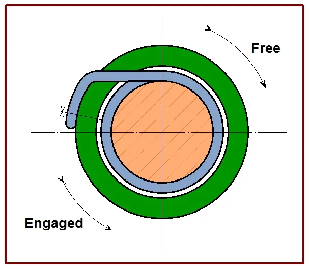

<figure class="eoc-pic eoc-pic-main"><picture><source media="(prefers-reduced-motion: reduce)" srcset="../media/drawn/wrap-spring-clutch.svg"></picture><figcaption><strong>Animation.</strong> Diagram drawn for the encyclopaedia from the research notes. ⚑ Needs confirming: a drawing can simplify or get details wrong; a real photo or a better diagram is welcome.</figcaption></figure>
<figure class="eoc-pic"><figcaption><strong>Diagram.</strong> <a href="https://commons.wikimedia.org/wiki/File:Pru%C5%BEinov%C3%A1volnob%C4%9B%C5%BEka.jpg">Pružinovávolnoběžka</a> by Juniperbushman, <a href="https://creativecommons.org/licenses/by-sa/4.0">CC BY-SA 4.0</a>, from Wikimedia Commons.</figcaption></figure>

A coiled spring wrapped round two hubs end to end that winds down and grips them when the input turns one way, and loosens and slips when it turns the other way; with a collar holding one end of the spring it becomes an on/off clutch that can drive exactly one turn at a time.

**In plain words:** A tight coil spring slipped over the ends of two shafts: turn one way and the coil winds tighter and grips both shafts together, turn the other way and it loosens and slips. **Proper term:** Wrap-spring clutch (spring clutch).

**Also called:** spring clutch; wrap spring clutch; spring wrap clutch; coil spring clutch; helical spring clutch; spring [freewheel](../glossary.md#freewheel); single-revolution clutch or one-turn clutch (a switchable version that drives one turn at a time); start-stop clutch or start/coast clutch (switchable versions); wrap spring clutch-brake (with a second spring that brakes the output); wrap spring brake; electric or electromagnetic wrap spring clutch (solenoid- or coil-operated); roller blind clutch or chain clutch (everyday use); Schlingfederkupplung (German name).

## How it works

The spring's inside diameter is made slightly smaller than the hubs, so it already grips them lightly ([interference fit](../glossary.md#interference-fit)). When the input hub turns in the direction that winds the coil tighter, friction drags the coil down onto both hubs, and because each turn adds to the grip of the turn before (the capstan effect, as with a rope wrapped round a post), the [torque](../glossary.md#torque) it can carry grows exponentially with the number of turns and the friction. Turning the other way, or the output running ahead, tends to unwind the coil, so it opens slightly and slips with only a light drag. In a switchable version one end of the spring is held by a collar: while the collar turns freely the spring grips and drives; when a lever or [solenoid](../glossary.md#solenoid) stops the collar, the spring is unwound, the drive disconnects and the output stops in the same place every turn.

## Parts

A few parts. Basic one-way version: input hub, output hub of the same diameter placed end to end, and a helical spring (often square-section wire) spanning both, usually with one end fixed to one hub. On/off versions add a control collar that holds the spring's end tab (tang), stop lugs on the collar and a trip lever or solenoid. Clutch-brake packages add a brake spring, an anti-back spring and an anti-overrun spring.

## Everyday examples

- Chain-operated roller blinds: the clutch in the end bracket holds the blind at any height and releases when you pull the chain (Louver Lite patent US10309152B2; Johegy, Printables)
- Paper and form feeds in office machines and printers, and slip clutches in printers and tape recorders (patent US3987880A; German Wikipedia, Schlingfederkupplung)
- Old teleprinters: Frederick G. Creed's single-turn wrap spring clutch of 1928 (Wikipedia, Clutch)
- Packaging machines, printing presses, tape dispensers and staplers that start and stop once per cycle (Machine Design; Warner Electric)

## When to use it

Use a wrap-spring clutch when you need a compact one-way drive with a lot of torque for its size and no slip once engaged, or when you need to start and stop a continuously running shaft exactly one turn (or part turn) at a time with an accurate stop position: paper feeds, cut-off knives, dispensers, stitchers and indexing tables. It is also a simple, low-power way to make a hand-operated mechanism that holds its position against a load but moves when you operate it, as in a roller-blind chain drive. Electric versions need little power and switch in milliseconds (Reell).

## When not to use it

Avoid it when you need a soft, gradual start or adjustable slip (use a friction clutch), when the drive must reverse under power (standard units drive one way only), above about 1,800 rpm, or for large shock and [radial](../glossary.md#axial--radial) loads. Single-revolution clutches brake weakly, so use a full clutch-brake or a separate brake for high-inertia loads. For a one-way clutch with no drag or wear while overrunning at high speed, use a [sprag](../glossary.md#sprag) clutch; for a fully printable one-way part, use a [ratchet](../glossary.md#ratchet) and [pawl](../glossary.md#pawl), a printed roller clutch or a compliant ratchet; for a simple positive on/off drive, use a dog clutch.

## Details

- **What it does (jobs):**
  - stop it moving back (one-way): the basic overrunning spring clutch drives one way and slips on reversal
  - let it move (turn, slide or bend): lets the output coast or run faster than the input (overrunning)
  - lock, and release by hand: in a chain-operated roller blind the spring locks against the blind's weight and is released when you pull the chain
  - click into set positions: single-revolution clutches stop the output at 1 to 24 set positions per turn
  - hold or release using power: electric versions engage or release with a coil or solenoid
  - slow it, stop it or keep its speed steady: wrap-spring brakes and clutch-brakes stop and hold the output
  - slip or let go when overloaded: wrap-spring slip devices give a steady slipping torque for overload protection
- **Movement:** rotate: continuous rotation; basic versions drive one way and slip the other; switchable versions can drive single turns or part turns
- **Directions it can move (degrees of freedom):** 1: the output can only turn relative to the input about their shared axis, and only in the free direction (or only while the clutch is switched off); when gripping they act as one piece
- **Special behaviour:**
  - one-way (moves freely one way, locks the other): standard units drive in one direction only and let the load overrun
  - [self-locking](../glossary.md#self-locking) (holds under load, won't back-drive): anti-back springs and roller-blind clutches stop the load turning the mechanism backwards
  - hand-release only (locks under load, releases when a person operates it): the roller-blind chain clutch holds the blind at any height until you pull the chain, which pushes the spring's tang to release it
  - indexing (clicks into set positions): a single-revolution clutch stops the output at the same angle every turn (1 to 24 stops per turn, adjustable on some models)
  - torque-limiting (slips or clicks at a set force/torque): wrap-spring slip devices slip at a steady torque to protect a system
- **How it holds:**
  - friction or clamping ([force-fit](../glossary.md#form-fit--force-fit--material-bond)): the spring grips the hubs by friction, multiplied by the capstan effect
  - spring force (a spring or springy part presses it in place): the spring's slightly undersized coil gives the initial grip that starts the wrap-down
  - not a holding joint (it moves or passes on motion): it passes on or disconnects turning force between two shafts
- **Input and output:** Rotation -> rotation at 1:1 when engaged, with no slip once wrapped down; overrun or disconnect otherwise. Switchable single-revolution and clutch-brake units turn continuous rotation -> start-stop rotation, one turn (or 1/2, 1/4 ... turn) per trip, stopping within about +/-0.5 degrees for clutch-brakes or +/-20 degrees for simple single-revolution clutches (Machine Design). Speed up to about 1,800 rpm and torque up to about 5,000 lb-in (565 N·m) for industrial units (Machine Design). Shaft arrangement: in line (two hubs end to end on one axis). Back-drivable: the output can overrun in the free direction; units with an anti-back spring, and roller-blind clutches, can't be driven backwards from the output; in single-revolution clutches the braking (stop) torque is only about a tenth of the driving torque (Machine Design, Inertia Dynamics).
- **Power:** passive (no power needed) for overrunning and lever-tripped versions. Powered versions use a solenoid or electromagnet coil: Reell's electric wrap-spring clutch disengages when current is removed, and in solenoid clutch-brake packages the [actuator](../glossary.md#actuator) returns to its rest position when not energised, so the clutch spring releases and the brake spring stops and holds the output
- **Load:** medium: small units handle about 25 lb-in (about 2.8 N·m) on a 1/4 inch bore at up to 1,800 rpm (Inertia Dynamics SC-2, Warner CB-2) and industrial units up to about 5,000 lb-in (565 N·m) (Machine Design). More torque than a friction clutch of the same size (Inertia Dynamics, Reell). Strong in twist in the driving direction; weak as a brake in single-revolution units (about 10 percent of rated torque); must not take side or radial loads through its mounting (Inertia Dynamics)
- **Play and precision:** Play: none once engaged (no slip). [Repeatability](../glossary.md#repeatability--accuracy): clutch-brakes stop within +/-0.5 degrees without the error building up from turn to turn; simple single-revolution clutches about +/-20 degrees (Machine Design). Timing is nearly constant and independent of the load's inertia within the rated torque (Machine Design). [Misalignment](../glossary.md#misalignment): the two hubs must be [coaxial](../glossary.md#coaxial) because one spring spans both; mount the stationary plate with a loose pin so it adds no side load (Inertia Dynamics)
- **Taking it apart:** removable: packaged units slide onto a shaft and are held by keys or [set screws](../glossary.md#set-screw); the stationary part is held by a loose anti-rotation pin
- **How often it can be reused:** many times: the unit can be fitted and removed repeatedly; the spring itself wears out after millions of engagements (8 to 10 million cycles for standard clutch-brakes, Machine Design)
- **Sealing:** none: it doesn't seal anything; packaged units are closed only to keep dirt off the spring and hubs
- **Adjustable:** partly: the driving direction is set by which way the spring is wound (clockwise or counter-clockwise units); on switchable units the number of stops per turn is set by the collar (1 to 24), and on some models the stop angle can be adjusted after fitting, e.g. by moving a splined cam or clamp collar (Inertia Dynamics DCB, Helander)
- **Access needed:** end of a tube or shaft: the hubs fit on shaft ends, one from each side, with the spring [bridging](../glossary.md#overhang--bridging) them
- **Materials:** Spring steel spring, usually square-section wire (Wikipedia, Clutch). Hubs of oil-impregnated sintered iron, with hardened steel wear rings where the spring crosses between hubs on longer-life units; control collars of glass-reinforced nylon with metal inserts; actuators of acetal (Inertia Dynamics). Roller-blind clutches use plastic hubs, which can be replaced with PETG, ASA or ABS prints (Johegy, Printables)
- **Heat, cold, water and wear:** Grip depends on friction between spring and hub, and holding torque rises exponentially with the friction coefficient (capstan equation), so oil, grease, dust or wear on the hubs change how much it can carry; industrial units rely on oil-impregnated hubs to lubricate the spring (Inertia Dynamics) and some are sold as needing no [lubrication](../glossary.md#lubrication) or maintenance for life (Warner Electric). No temperature ratings were found in the sources opened ⚑ [uncertain]. Printed plastic hubs wear where the spring rubs (Johegy) and plastic parts [creep](../glossary.md#creep) under steady load (Hackaday).

## Making it

- **Ways to make or get it:**
  - off-the-shelf part (wrap spring clutches, clutch-brakes, roller-blind clutch units)
  - 3D print (FDM): light-duty hubs, collars and housings used with a steel spring
  - CNC: turned steel or brass hubs of matched diameter for a stronger home-made clutch
  - woodwork: not suitable for the hubs
- **Printing it in one piece (print in place):** no: the spring has to be steel (printed plastic springs creep and lose their grip), so at best the hubs are printed separately and a metal spring is fitted over them
- **Tools:** Hex keys for set screws or bolts; a loose-fitting pin or slot for the anti-rotation tab; pliers to squeeze the clip when taking apart a roller-blind clutch
- **Difficulty:** moderate: easy to buy as a unit or salvage from a chain-operated roller blind; making one needs a steel spring with a slightly undersized coil and two hard, smooth hubs of exactly the same diameter, and printed hubs wear

### 3D printing tips

Use a steel spring: plastic springs slowly deform under constant load (creep), and PLA in particular makes a poor spring (Hackaday, 'The Challenges Of 3D Printing Reliable Springs'). Printed hubs work for light duty: Johegy's replacement hub for a chain-operated roller blind clutch is printed in PETG or ASA/ABS with default settings and no supports, in the orientation of the supplied STL, and reuses the original springs; the original plastic hub had worn grooves where the springs rub, so expect printed hubs to wear too and use a tough, wear-resistant filament. Make the input and output hubs exactly the same diameter and keep them on one axis, because one spring spans both (Machine Design). Size the spring's inside diameter slightly smaller than the hubs so it grips lightly before any load (Machine Design). Printing the hub with its axis vertical should give the roundest cylinder, but the spring then runs across [layer lines](../glossary.md#layer-lines), so lightly sand or polish the surface ⚑ [uncertain]. Keep the running surface either consistently dry or consistently lubricated, because the grip depends exponentially on friction (capstan equation), so a change in oiliness changes the torque a lot. For a quick test mechanism, salvage the clutch from a cheap chain-operated roller blind.

### Buying one (off-the-shelf parts)

Search: 'wrap spring clutch', 'spring clutch' (overrunning, start/coast, single revolution), 'wrap spring clutch-brake', 'electric wrap spring clutch', 'wrap spring brake', 'single revolution clutch', 'spring clutch with stop collar' (1, 2 or 4 stops), 'roller blind clutch' or 'chain clutch' (spares for chain-operated roller blinds). Units come in clockwise or counter-clockwise versions, with hub or shaft input, in bores from 1/4 inch upwards; electric versions come for 24 V DC or 115 V AC (Inertia Dynamics, Warner Electric).

## Rules of thumb

- The spring's inside diameter is slightly smaller than the hub diameter, giving an interference fit that starts the wrap-down (Machine Design, 'Getting up to speed with wrap-spring clutch/brakes')
- Holding torque grows exponentially with wrap angle and friction: T_load = T_hold x e^(mu x phi); e.g. two wraps at mu = 0.5 multiply the [holding force](../glossary.md#holding-force) about 535 times, independent of hub radius (Wikipedia, Capstan equation; Wikipedia, Clutch notes wrap-spring torque follows the capstan equation)
- Industrial units run to about 1,800 rpm and 5,000 lb-in; standard clutch-brakes last about 8 to 10 million cycles, extended-life versions 3 to 5 times longer (Machine Design)
- Small size example: 1/4 inch bore, 25 lb-in (about 2.8 N·m) static torque, 1,800 rpm maximum (Inertia Dynamics SC-2 and DCB-2 data; Warner Electric CB-2)
- Single-revolution clutches brake with only about 10 percent of their rated torque and stop within about +/-20 degrees; full clutch-brakes stop within +/-0.5 degrees, non-cumulative (Machine Design; Inertia Dynamics SC series)
- Clutch-brakes need enough load inertia to fully engage the brake spring and release the clutch spring; check both minimum and maximum inertia (Machine Design)
- Hold the stationary plate with a loose-fitting pin that allows no side or radial load, or the unit's bearings get preloaded (Inertia Dynamics DCB installation note)
- Typical engagement about 3 ms and stop about 1.5 ms, nearly constant regardless of load inertia within rated torque (Machine Design)

## Common failures

Hub wear where the spring rubs, until the spring can no longer grip and the load slips or runs back (e.g. a roller blind that glides down by itself; Johegy); longer-life units add hardened wear rings at the spring crossover points (Inertia Dynamics). Springs that don't fully wrap down or release because the load inertia is too low, and excess wear when the maximum load inertia is exceeded (Machine Design). Bearing wear from side loads when the anti-rotation tab is mounted rigidly (Inertia Dynamics). Spring [fatigue](../glossary.md#fatigue) at the end of its cycle life (Machine Design). Changes in grip from contamination or lubricant, because torque depends exponentially on friction (Wikipedia, Capstan equation).

## Safety

Engagement takes only a few milliseconds, so a machine driven through a single-revolution clutch starts suddenly: keep fingers clear of anything it drives (pinch points). A worn roller-blind clutch can let a heavy blind drop by itself (Johegy). Wound springs store energy and their ends are sharp; wear eye protection when fitting or removing them ⚑ [uncertain]. In solenoid clutch-brakes, losing power stops the output and the brake spring holds it (Inertia Dynamics DCB).

## Related

- Sprag clutch: tilted blocks between rings; one-way only, can't be switched on and off, but carries very high torque and can run almost without contact at high speed
- Roller clutch (one-way bearing): rollers on ramps; small and cheap, needs a hardened shaft, can't be switched
- Ratchet and pawl: positive locking on teeth with clicks, easy to print
- Bidirectional anti-back-drive clutch: the roller-blind chain clutch is really this type, built with a wrap spring: input drives either way, the load can't drive back
- Friction slip clutch: slips smoothly in both directions at a set torque; wrap-spring slip devices do a similar job
- Dog clutch: positive on/off engagement by interlocking teeth, but only engages at certain angles
- Band brake and capstan (rope round a post): same exponential-friction physics used for braking or holding
- Woven self-tightening grip (finger-trap grip): another self-tightening grip that gets tighter the harder it is pulled

## Make it yourself

- [Roller Blind Spring Clutch Part (Johegy, Printables)](https://www.printables.com/model/560497-roller-blind-spring-clutch-part): Printable replacement hub for the wrap-spring clutch of budget chain-operated roller blinds; reuse the original springs, print in PETG or ASA/ABS. Shows that printed hubs work for light loads but wear. Details read through the Printables public API because the web page blocks automated access *(licence: CC BY-NC (Creative Commons Attribution-NonCommercial))*

## Pictures, videos and models

- [Pružinovávolnoběžka.jpg (Wikimedia Commons)](https://commons.wikimedia.org/wiki/File:Pružinovávolnoběžka.jpg): Diagram of the principle of a spring freewheel (wrap-spring one-way clutch); used on Czech, German and Croatian Wikipedia *(licence: CC BY-SA 4.0 (Juniperbushman))*
- [One way clutch 5 (spring) (Nguyen Duc Thang, YouTube channel thang010146)](https://www.youtube.com/watch?v=Cshn6B2l2WQ): CAD animation of a spring-type one-way clutch (title and channel confirmed via YouTube oEmbed; content not viewed) *(licence: link only)*
- [What is a wrap spring clutch or brake? (Design World, YouTube)](https://www.youtube.com/watch?v=92Ti7LBjfYQ): Explainer on wrap spring clutch and brake technology (title and channel confirmed via YouTube oEmbed) *(licence: link only)*
- [How a Wrap Spring Brake Works (Thomson Industries, YouTube)](https://www.youtube.com/watch?v=AFFHEb4NEY4): Manufacturer video explaining how a wrap spring brake works (title and channel confirmed via YouTube oEmbed) *(licence: link only)*
- [Getting up to speed with wrap-spring clutch/brakes (Machine Design)](https://www.machinedesign.com/motors-drives/article/21832461/getting-up-to-speed-with-wrap-spring-clutch-brakes): Illustrated article explaining overrunning, single-revolution and clutch-brake wrap spring units, with sizing formulas *(licence: link only)*

## Needs confirming

⚑ marks something nobody has confirmed yet: a fact the research could not confirm from a source, a finder value that is a best guess, or an open point from the research notes. Corrections are welcome (see `research/needs-confirming.md`).

- ⚑ 3 sentences on this page marked [uncertain].
- ⚑ Research note: *Wrap-spring clutch*: the roller-blind chain clutch is really a two-way anti-back-drive clutch; linked from *Bidirectional anti-back-drive clutch*.

## Sources

- <https://www.machinedesign.com/motors-drives/article/21832461/getting-up-to-speed-with-wrap-spring-clutch-brakes>
- <https://en.wikipedia.org/wiki/Clutch>
- <https://de.wikipedia.org/wiki/Schlingfederkupplung>
- <https://en.wikipedia.org/wiki/Capstan_equation>
- <https://commons.wikimedia.org/wiki/File:Pružinovávolnoběžka.jpg>
- <https://commons.wikimedia.org/wiki/Category:Self-locking_couplings>
- <https://reell.com/resources/electric-wrap-spring-technology>
- <https://www.tinyclutch.com/spring-clutches.htm>
- <https://www.electromate.com/media/assets/catalog-library/pdfs/inertia-dynamics/InertiaDynamics_Wrap_Spring_specsheet.pdf>
- <https://warnerelectricparts.com/wrap-spring-clutches-and-clutch-brakes/>
- <https://patents.google.com/patent/US10309152B2/en>
- <https://patents.google.com/patent/US3987880A/en>
- <https://www.printables.com/model/560497-roller-blind-spring-clutch-part>
- <https://api.printables.com/graphql/>
- <https://hackaday.com/2026/04/27/the-challenges-of-3d-printing-reliable-springs/>
- <https://www.youtube.com/watch?v=Cshn6B2l2WQ>
- <https://www.youtube.com/watch?v=92Ti7LBjfYQ>
- <https://www.youtube.com/watch?v=AFFHEb4NEY4>
