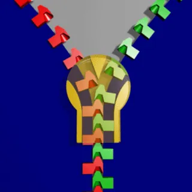

<figure class="eoc-pic eoc-pic-main"><picture><source media="(prefers-reduced-motion: reduce)" srcset="../media/zipper.still.webp"></picture><figcaption><strong>Animation.</strong> <a href="https://commons.wikimedia.org/wiki/File:Zipper_animated.gif">Zipper animated</a> by DemonDeLuxe (Dominique Toussaint), <a href="http://creativecommons.org/licenses/by-sa/3.0/">CC BY-SA 3.0</a>, from Wikimedia Commons.</figcaption></figure>

Two rows of interlocking teeth on fabric tapes, closed or opened in a single pull by a slider whose Y-shaped channel squeezes the teeth together one by one or wedges them apart.

**In plain words:** Two strips of fabric edged with rows of little teeth, and a sliding tab that locks the teeth together or unlocks them as you pull it along. **Proper term:** Zipper (slide fastener, zip fastener).

**Also called:** zip / zip fastener (UK); slide fastener (standards and trade term); clasp locker (Judson's original 1893 name) and hookless fastener (early Talon name); coil zipper / nylon zipper / spiral zipper (teeth formed by a plastic coil); molded plastic or injection-molded zipper; VISLON (YKK brand); metal zipper (brass, aluminium or nickel teeth); invisible or concealed zipper; reverse coil zipper; separating or open-end zipper (with insertion pin and retainer box); two-way zipper; waterproof, water-repellent, airtight or pressure-tight zipper (drysuits, spacesuits); zipper chain / zipper by the yard (the continuous teeth-and-tape without a slider); stringer (one half); Y-zipper / three-sided zipper (experimental 3D-printed version); Reißverschluss (German).

## How it works

Each tooth has a bump on one side and a hollow on the other, and the teeth on the two rows are staggered so they alternate. Pulling the slider to close funnels the two rows down its Y-shaped channel so that each tooth is pressed into the gap between two teeth opposite and springs slightly to nest its bump in their hollows (Sundback's 'contractible jaw'). Once nested, pulls across the zipper or along it can't unhook the teeth, so it holds. Pulling the slider the other way drives the wedge at the fork of the Y between the rows and unhooks them one at a time. Locking sliders have a pin on the pull or on a spring that drops between the teeth so the slider can't [creep](../glossary.md#creep) open.

## Parts

A small assembly that acts as one unit: two stringers (each a fabric tape with a row of teeth, called elements, which are separate metal or plastic teeth or a continuous plastic coil); a slider (body with a Y-shaped channel, and a pull tab, sometimes with spring-loaded locking pins); top stops; and a bottom stop, or on a separating zipper an insertion pin and a retainer (pin) box instead.

## Everyday examples

- the fly of a pair of jeans and the front of a jacket
- backpacks, suitcases and pencil cases (often with two sliders)
- tent doors and sleeping bags
- a diver's drysuit (a waterproof zipper)

## When to use it

When a long opening in fabric, canvas, leather or plastic sheet must close fully and quickly and stay shut under sideways pull: bags, cases, covers, tents, clothing, pouches and soft enclosures. Use a separating zipper when the two parts must come fully apart (jacket fronts, removable panels), a two-way zipper when you want to open it from either end, and a waterproof zipper when it must keep out water.

## When not to use it

Not for joining rigid parts (use latches, clips or magnets). Not where it must adjust in length or tension (use hook-and-loop, a buckle or lacing). Not in very dirty, sandy or icy conditions or where it can't be kept clean, since grit jams sliders (use hook-and-loop or buttons) ⚑ [uncertain: general experience]. Not where a gap-free seal is needed unless you buy a proper waterproof or airtight zipper. For quick fitting by an unskilled sewer, hook-and-loop or press studs are easier to attach.

## Details

- **What it does (jobs):**
  - join and hold: joins two edges of fabric, leather, plastic sheet or a tarp along their whole length
  - lock, and release by hand: opens and closes a long opening in one pull, with no tools
  - seal it, or pass cables or fluid through: special coated or sheeted versions keep out water or hold air pressure (drysuits, survival suits, spacesuits)
- **Movement:** slide: the slider travels along the chain; the closed zipper stays flexible and can bend (coil zippers bend round curves best)
- **Directions it can move (degrees of freedom):** 1 for the slider (it slides along the chain). Once closed, the two rows can't pull apart or slide along each other (0), although the whole chain can still bend and twist with the fabric.
- **Special behaviour:**
  - quick-release (a separating zipper comes completely apart, and any zipper opens in one pull)
  - self-aligning or self-centring (the slider's Y-shaped channel guides each tooth into the right gap, so you don't line them up by hand)
  - hand-release only (with a locking or auto-lock slider, the pins between the teeth stop the slider creeping open under load until someone lifts the pull; Wikipedia)
- **How it holds:** shape (the teeth interlock; [form-fit](../glossary.md#form-fit--force-fit--material-bond)), helped by spring force (the teeth flex slightly to snap into place, and auto-lock sliders use a small spring to push their locking pins between the teeth)
- **Input and output:** not applicable
- **Power:** passive (no power needed)
- **Load:** light to medium: strong across the closed chain (crosswise pull), since the teeth interlock; weaker at the ends, at a separating zipper's insertion pin and box, and wherever the slider is worn. Bigger chain sizes are stronger. It has no strength when open, and a slider without a lock can be pulled down by a crosswise load. The printed Y-zipper, as a rigid rod, carried about 11-18 kg in a bending test (Li et al., CHI 2026). No verified strength figures were found for ordinary zippers ⚑ [uncertain].
- **Play and precision:** not applicable as a locator: it joins edges but doesn't position parts precisely. The closed chain has little play across its width but stays flexible; coil zippers bend round curves best and molded-tooth zippers are stiffer and better for straight runs (Trivantage). If the two stringers have different tooth spacing (for example from mixing halves of different zippers), the closed zipper curves or ends up with uneven lengths (YKK).
- **Taking it apart:** tool-free quick release to open and close; the tapes are usually sewn in, which is semi-permanent (replacing a zipper means unpicking and re-sewing)
- **How often it can be reused:** many times: made to be opened thousands of times, but Wikipedia notes the zipper is often the least durable part of a garment, mostly because the slider wears; a 3D-printed Y-zipper test survived more than 18,000 zipping cycles before the teeth broke off their bridges (Li et al., CHI 2026)
- **Sealing:** none for ordinary zippers: water and air pass through the chain. Water-repellent zippers with a laminated film resist splashes but are not waterproof (YKK's AquaGuard, 'water may leak through the slit'). Watertight and airtight or pressure zippers, used on drysuits and spacesuits, have waterproof sheeting on each row that is squeezed together above and below the teeth when closed (Wikipedia).
- **Adjustable:** partly: it can be left part-open at any point, and two-way zippers can open from either end (for example to sit down in a long coat); it doesn't adjust tension or fit
- **Access needed:** one side only (blind): you work it from the side the pull is on; sewing it in needs access to both sides of the fabric
- **Materials:** Teeth: polyester coil (formerly nylon), injection-moulded plastic (mostly polyacetal (POM), sometimes polyethylene), or metal (brass, aluminium, nickel alloys) (Wikipedia). Tapes: woven polyester or cotton. Sliders: die-cast metal (zinc per Trivantage; Wikipedia says often magnesium) or plastic. Joins fabric, leather, canvas, tarps and plastic sheeting. Printed zippers: PLA (stiffer, carries more load) or TPU (more pliable) (Li et al., CHI 2026); PETG, ABS or PLA for printed sliders and parts.
- **Heat, cold, water and wear:** Heat: coil zippers can be ironed up to about 160 °C and YKK's molded Vislon up to about 130 °C; water-repellent laminated zippers can melt or bubble above about 150 °C (YKK). Cold: molded plastic teeth become [brittle](../glossary.md#brittle--ductile) and can break on impact, and sliders get stiffer at about -40 °C (YKK). Water and salt: metal zippers rust, especially in salt water; plastic teeth and sliders don't (Trivantage). Diecast sliders can corrode once worn, and the corrosion salts jam the slider; vinegar can dissolve them (Wikipedia). Aluminium zippers are harmed by alkaline chemicals, wear quickly and leave grey marks (YKK). Sunlight can turn water-repellent zippers yellow (YKK). Printed PLA zippers soften in heat like any PLA part.

## Making it

- **Ways to make or get it:**
  - off-the-shelf part: the usual choice (finished zippers, or continuous chain by the yard with matching sliders and stops)
  - sewing (textiles): stitched into fabric, canvas or leather; some are heat-welded or have adhesive backing
  - 3D print (FDM): replacement sliders, pulls and retainer boxes, whole printed zippers with holes for sewing, and research designs such as the Y-zipper, which can also be printed straight onto fabric
- **Printing it in one piece (print in place):** partly: in LoboCNC's 'Zippy Bag Clip' the two rows of pivoting teeth print in place but need 40 filament hinge pins and a separately printed slider; most other printed zippers (FunkyArt's zipper, the Y-zipper) print as flat strips plus a slider and are threaded together after printing
- **Tools:** To use: none. To fit: a sewing machine or needle and thread; some zippers are heat-welded or have adhesive backing (for tarps and plastic sheeting). To repair: pliers (to squeeze a worn slider), or a replacement slider or top stops.
- **Difficulty:** moderate: bought zippers are cheap, but sewing one in neatly takes a sewing machine and practice; printing a working zipper is hard (fine teeth and tight [tolerances](../glossary.md#tolerance)), while printing a replacement slider, pull or retainer box is moderate

### 3D printing tips

Replacement slider (the most useful print): MisterJ's two-part slider fits onto the existing chain without unpicking the ends and comes in many chain widths for standard and reverse zippers. His second version prints the connecting pin upright so it no longer relies on layer adhesion (Hackaday notes the orientation puts the [layer lines](../glossary.md#layer-lines) at right angles to the load). Print with a 0.4 mm nozzle, 0.2 mm layers (the model is designed in 0.2 mm steps), 3 walls and 5 top and bottom layers; if it doesn't fit, scale it in X in 0.1-0.2 mm steps; the pin may need light sanding. Whole printed zipper: FunkyArt's PLA zipper prints at 0.1-0.14 mm layers with a very slow first layer; don't press the halves together by hand, because that can break teeth; thread both halves into the slider from the upside-down end so they meet in the right curve. [Print-in-place](../glossary.md#print-in-place) teeth: LoboCNC's bag clip uses a 0.2 mm vertical gap with 0.2 mm layers, and pins cut from 1.75 mm filament, because printed-in-place pins had too much slop. Y-zipper (MIT CSAIL): ball-and-socket tolerances of 0.2-0.8 mm gave reliable closure; ball diameters above 2.8 mm needed more than 15 N to zip; TPU bridges 0.4-2.0 mm thick balanced flexibility and strength (thicker bridges raised the bending load from about 11 kg to 18 kg); PLA was stiffer and carried more load, TPU was more pliable; the design can be printed straight onto fabric; failure came at the joint between teeth and bridges. Printed retainer box: one maker printed a replacement zipper box in ABS and fixed it with a dab of Duco cement (Hackaday, 2018).

### Buying one (off-the-shelf parts)

Finished zippers (closed-end, open-end/separating, two-way, invisible, reverse coil, water-repellent, waterproof and airtight), continuous zipper chain by the yard in coil (e.g. YKK Ziplon), molded plastic (e.g. YKK Vislon) or metal, with matching sliders (sized #3, #5, #8, #10 and so on; locking, non-locking, auto-lock, reversible, double-pull), pulls, top and bottom stops, pin-and-box sets, repair kits, and adhesive-back zippers for tarps and plastic sheeting (McMaster-Carr 'Zippers' and 'Adhesive-Back Zippers'). Search terms: 'zipper by the yard', '#5 coil zipper chain', '#10 molded tooth zipper', 'zipper slider #5', 'separating zipper', 'waterproof zipper', 'zipper repair kit'.

## Rules of thumb

- The size number is roughly the width of the closed chain in millimetres (a #5 chain is about 5 mm wide, wider than a #3), and the slider must match the chain's number and type, e.g. a #8 chain needs a #8 slider, and coil and molded-tooth chains need their own sliders (Trivantage zipper guide, https://www.trivantage.com/zipper-guide).
- Coil zippers bend well round curves (boat covers, U-shaped openings); molded-tooth zippers are stiffer and work better on straight runs; plastic teeth with plastic sliders are best for salt water, since metal zippers rust (same Trivantage guide).
- Iron zippers no hotter than about 160 °C for coil and 130 °C for YKK's molded Vislon type, with the zipper closed and a cloth on top; weld or iron water-repellent zippers below about 140-150 °C (YKK Zipper Usage Instruction Manual, pp. 04 and 21-22, https://ykkamericas.com/wp-content/uploads/2021/10/ykk-zipper-instruction-manual-compressed.pdf).
- Close zippers fully before washing: a part-open zipper pulled sideways in the machine can have its teeth torn off (YKK manual, p. 16).
- When sewing a coil zipper, fold the top tape extension at least 5 mm from the first tooth so a cut tooth end can't poke out and scratch someone; plastic top stops are recommended for children's clothes (YKK manual, p. 27).
- Plastic molded teeth turn brittle and can break on impact in very cold weather, and metal parts can stick to skin at about -40 °C; test zippers for very hot or very cold use (YKK manual, p. 04).
- Printed zippers: a ball-and-socket [clearance](../glossary.md#clearance) of 0.2-0.8 mm on 1.0-2.8 mm features gave smooth, stable zipping in the Y-zipper tests (Li et al., 'Y-zipper', CHI 2026, https://groups.csail.mit.edu/hcie/files/research-projects/y-zipper/y-zipper.pdf).
- Printed replacement sliders: 0.4 mm nozzle, 0.2 mm layers, 3 walls, 5 top and bottom layers, and scale X by 0.1-0.2 mm to fine-tune the fit (MisterJ, Printables model 1570671, read via the Printables API).

## Common failures

(1) Worn or splayed slider that no longer squeezes the teeth, so the zipper splits open behind it: squeeze the back of the slider together a fraction of a millimetre at a time with pliers, or replace the slider (Wikipedia; a printed replacement slider fits without unpicking the ends). (2) Separating zipper splits because the insertion pin isn't pushed fully into the box: clear the box, push the pin right in and re-zip (iFixit). (3) Insertion pin or tape tearing off at the bottom of a separating zipper (Wikipedia). (4) Teeth torn off when a part-open zipper is washed (YKK): close it first. (5) Slider jammed by corrosion salts or grit: soak it in vinegar or clean it (Wikipedia). (6) Chain curved or ends uneven after mixing halves from different zippers (YKK). (7) Printed zippers: teeth break if the halves are pushed together by hand, and pins snap along layer lines; thread the halves through the slider and print pins upright (FunkyArt; MisterJ).

## Safety

Zippers can trap skin as they close; zipper entrapment is the most common cause of penile injury in adults, with roughly 2,000 reported cases a year, and is also seen in small children (StatPearls). Keep the tape clear of skin when zipping, and never force a trapped zipper closed. Cut coil tooth ends at the top of a badly sewn zipper can scratch; use plastic top stops on children's clothing (YKK). Metal parts can stick to skin in extreme cold (YKK).

## Related

- Hook-and-loop fastener: closes at any position and adjusts length, but opens easily by peeling and collects lint
- Press-to-close zipper (resealable bag zipper): a moulded rib that presses into a groove, with no slider or teeth; the ridge seal is weak against pressure from inside (Wikipedia)
- Press studs, buttons and hooks-and-eyes: close at separate points rather than along the whole edge
- Drawstring and lacing: pull the edges together by tension in a cord, while a zipper locks tooth to tooth (Wikipedia contrasts the two)
- Magnetic zipper: a variant for one-handed closing, used in sportswear (Wikipedia)
- Y-zipper (three-sided zipper): three printed strips zip into a stiff triangular rod, turning something floppy into a beam and back (MIT CSAIL)
- Side-release buckle: joins two straps at one point, and quicker for load-carrying straps

## Make it yourself

- [Zipper Slider Replacement - V3 by MisterJ (Printables 1570671; URL seen in search results, details read via the Printables public API)](https://www.printables.com/model/1570671-zipper-slider-replacement-v3): Two-part printable replacement slider for standard and reverse zippers, fitted without unpicking the zipper ends; sizes for chains about 4.2 to 9.8 mm wide; STEP files *(licence: CC BY-NC-SA)*
- [Zipper by FunkyArt (Printables 582696; URL seen in search results, details read via the Printables public API)](https://www.printables.com/model/582696-zipper): A fully printable, working zipper (two toothed strips and a slider) in PLA, with holes for sewing; proof of concept *(licence: CC BY)*
- [Zippy Bag Clip (print-in-place-ish) by LoboCNC (Printables 237467; URL seen in search results, details read via the Printables public API)](https://www.printables.com/model/237467-zippy-bag-clip-print-in-place-ish): A working zipper used as a bag clip: two rows of pivoting teeth printed in place, pinned with bits of filament, plus a printed slider *(licence: CC BY-SA)*
- [Y-zipper: 3D Printing Flexible-Rigid Transition Mechanisms for Rapid and Reversible Assembly (MIT CSAIL HCI Engineering group project page)](https://hcie.csail.mit.edu/research/y-zipper/y-zipper.html): Research project page linking the paper (with FDM print settings and tolerance tests), slides and video; the design tool was built in Rhino and Grasshopper, and the page has no download link for design files *(licence: link only (paper published open access by ACM))*

## Pictures, videos and models

- [Zipper animated.gif (Wikimedia Commons, DemonDeLuxe (Dominique Toussaint), 2006)](https://commons.wikimedia.org/wiki/File:Zipper_animated.gif): Animation of the slider bringing the two rows of teeth together *(licence: CC BY-SA 3.0)*
- [Reissverschluss Teile 2 (fcm).jpg (Wikimedia Commons, Frank C. Müller and Rabensteiner, 2008)](https://commons.wikimedia.org/wiki/File:Reissverschluss_Teile_2_(fcm).jpg): Labelled photo of a zipper's parts: top stop, slider, puller, tape, chain, bottom stop, insertion pin and box *(licence: CC BY-SA 2.5)*
- [Coil plastic and metal zippers.jpg (Wikimedia Commons, Woodbine9, 2014)](https://commons.wikimedia.org/wiki/File:Coil_plastic_and_metal_zippers.jpg): Photo comparing coil, molded plastic and metal teeth *(licence: CC BY-SA 4.0)*
- [WP zip.jpg (Wikimedia Commons, Dhaluza, 2006)](https://commons.wikimedia.org/wiki/File:WP_zip.jpg): Close-up of a waterproof drysuit zipper, whose metal segments clamp waterproof sheeting over hidden teeth *(licence: Public domain)*
- [Y-Zipper: 3D Printing Flexible-Rigid Transitions in One Click (Jiaji Li, YouTube; title and channel confirmed via YouTube oEmbed, not watched)](https://www.youtube.com/watch?v=AWig98GVIno): Video of MIT CSAIL's 3D-printed three-sided zipper stiffening from flexible strips into rods, arches and coils *(licence: link only)*

## Needs confirming

⚑ marks something nobody has confirmed yet: a fact the research could not confirm from a source, a finder value that is a best guess, or an open point from the research notes. Corrections are welcome (see `research/needs-confirming.md`).

- ⚑ 2 sentences on this page marked [uncertain].

## Sources

- <https://en.wikipedia.org/wiki/Zipper (read as raw wikitext)>
- <https://ykkamericas.com/wp-content/uploads/2021/10/ykk-zipper-instruction-manual-compressed.pdf>
- <https://www.trivantage.com/zipper-guide>
- <https://www.mcmaster.com/products/zippers/>
- <https://www.ifixit.com/Guide/Coil+Zipper+Issue+Diagnosis/19454>
- <https://www.ncbi.nlm.nih.gov/sites/books/NBK441886/ (StatPearls, Penile Zipper and Ring Injuries)>
- <https://news.mit.edu/2026/three-sided-y-zipper-design-0504>
- <https://hcie.csail.mit.edu/research/y-zipper/y-zipper.html>
- <https://groups.csail.mit.edu/hcie/files/research-projects/y-zipper/y-zipper.pdf (Li et al., CHI 2026, doi:10.1145/3772318.3790723)>
- <https://hackaday.com/2026/03/14/this-printed-zipper-repair-requires-no-unsewing/>
- <https://hackaday.com/2018/01/31/repairs-you-can-print-the-zipper-box/>
- <https://www.printables.com/model/1570671-zipper-slider-replacement-v3 (read via https://api.printables.com/graphql/)>
- <https://www.printables.com/model/582696-zipper (read via https://api.printables.com/graphql/)>
- <https://www.printables.com/model/237467-zippy-bag-clip-print-in-place-ish (read via https://api.printables.com/graphql/)>
- <https://api.printables.com/graphql/>
- <https://www.youtube.com/watch?v=AWig98GVIno (title confirmed via YouTube oEmbed)>
- <https://commons.wikimedia.org/wiki/File:Zipper_animated.gif>
- <https://commons.wikimedia.org/wiki/File:Reissverschluss_Teile_2_(fcm).jpg>
- <https://commons.wikimedia.org/wiki/File:Coil_plastic_and_metal_zippers.jpg>
- <https://commons.wikimedia.org/wiki/File:WP_zip.jpg>
