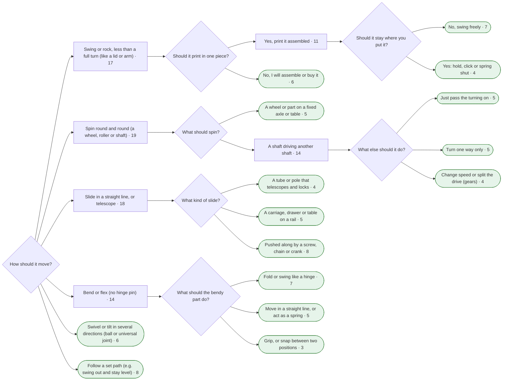
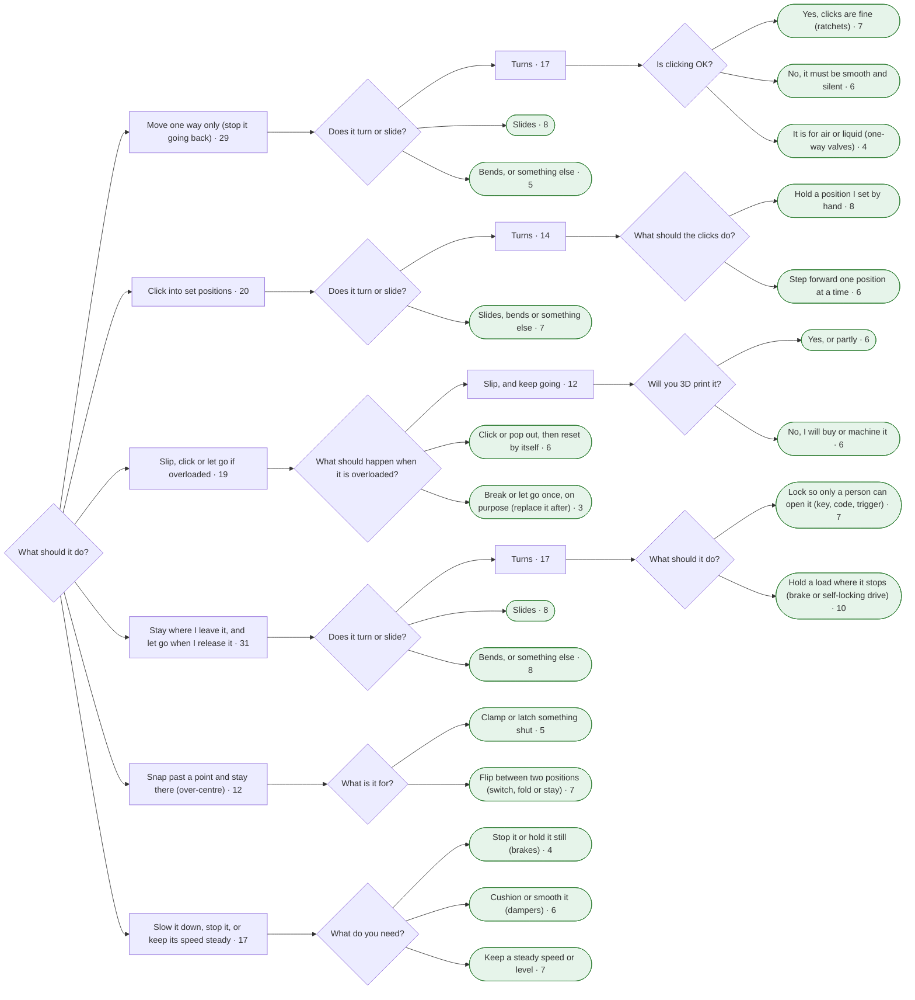
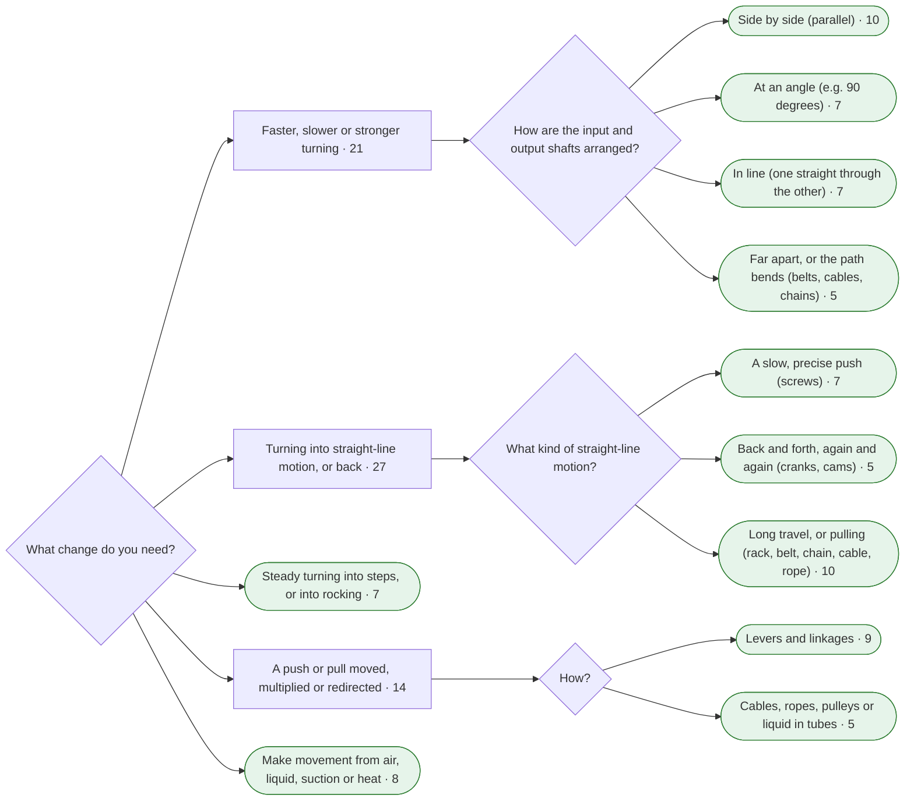
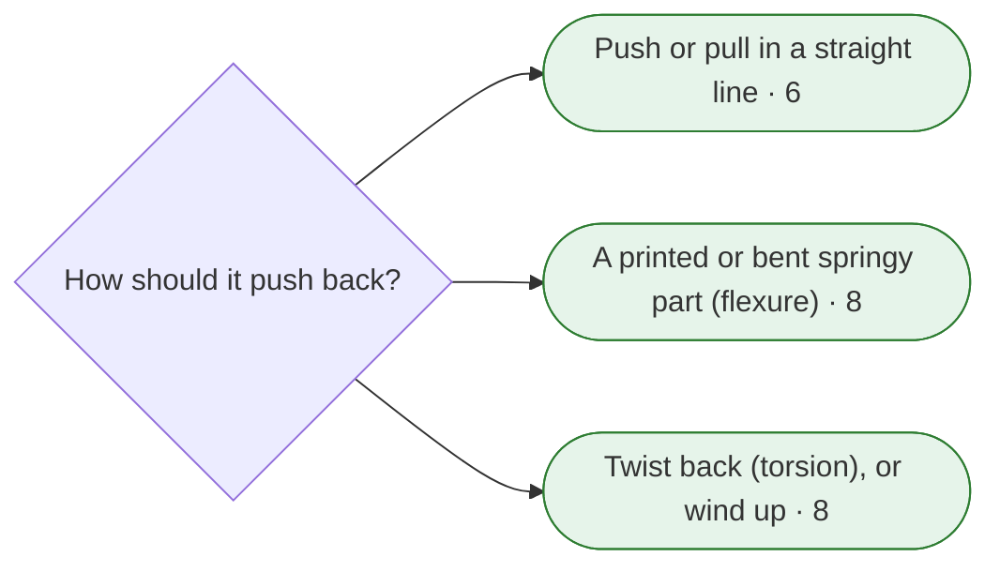
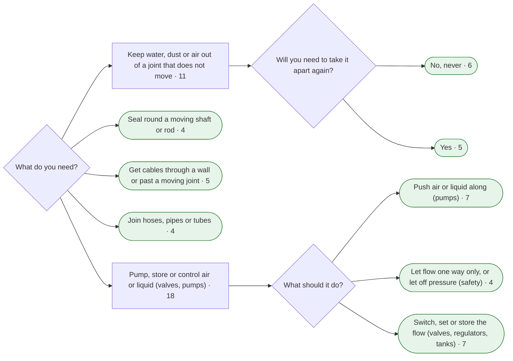
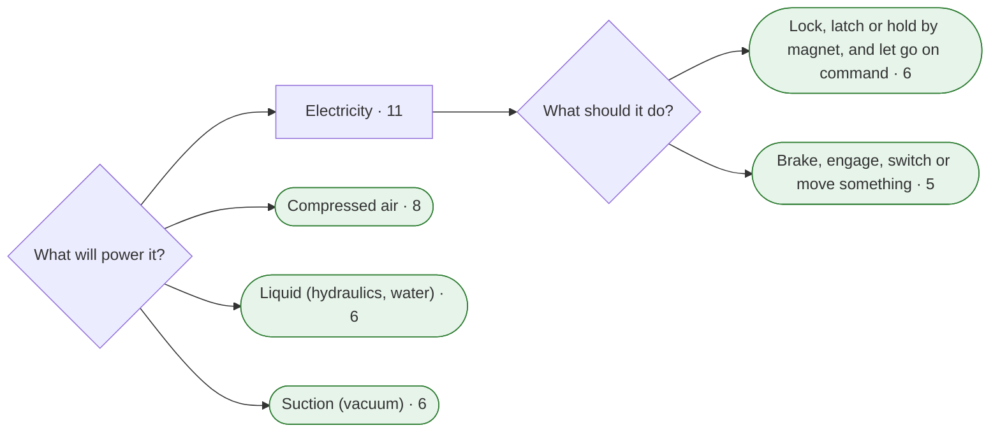

### Overview: first two questions

```mermaid
flowchart LR
  q0{"What do you need it to do?"}
  a1["Hold two things together (they stay still) · 166"]
  q0 --> a1
  q2{"What are you joining?"}
  a1 --> q2
  a3["3D-printed parts, or screws, nuts and magnets into a print · 24"]
  q2 --> a3
  class a3 more
  a4["Boards, panels or sheet (wood, plywood, acrylic, sheet metal) · 30"]
  q2 --> a4
  class a4 more
  a5(["Tube, rod, pole or aluminium extrusion · 9"])
  q2 --> a5
  class a5 leaf
  a6["A wheel, gear or arm onto a shaft, or two shafts end to end · 23"]
  q2 --> a6
  class a6 more
  a7["Strap, cord, rope or fabric · 10"]
  q2 --> a7
  class a7 more
  a8["A lid, door or cover that opens and closes · 28"]
  q2 --> a8
  class a8 more
  a9["Something onto a wall, rail, desk or grid · 17"]
  q2 --> a9
  class a9 more
  a10["Something that has to be gripped or clamped · 11"]
  q2 --> a10
  class a10 more
  a11["I just want to glue it · 18"]
  q2 --> a11
  class a11 more
  a12["Any solid parts / something else · 17"]
  q2 --> a12
  class a12 more
  a13["Let something move (turn, slide, swing or bend) · 89"]
  q0 --> a13
  q14{"How should it move?"}
  a13 --> q14
  a15["Swing or rock, less than a full turn (like a lid or arm) · 17"]
  q14 --> a15
  class a15 more
  a16["Spin round and round (a wheel, roller or shaft) · 19"]
  q14 --> a16
  class a16 more
  a17["Slide in a straight line, or telescope · 18"]
  q14 --> a17
  class a17 more
  a18["Bend or flex (no hinge pin) · 14"]
  q14 --> a18
  class a18 more
  a19(["Swivel or tilt in several directions (ball or universal joint) · 6"])
  q14 --> a19
  class a19 leaf
  a20(["Follow a set path (e.g. swing out and stay level) · 8"])
  q14 --> a20
  class a20 leaf
  a21["Control a movement (one way only, clicks, slips, locks, slows) · 111"]
  q0 --> a21
  q22{"What should it do?"}
  a21 --> q22
  a23["Move one way only (stop it going back) · 29"]
  q22 --> a23
  class a23 more
  a24["Click into set positions · 20"]
  q22 --> a24
  class a24 more
  a25["Slip, click or let go if overloaded · 19"]
  q22 --> a25
  class a25 more
  a26["Stay where I leave it, and let go when I release it · 31"]
  q22 --> a26
  class a26 more
  a27["Snap past a point and stay there (over-centre) · 12"]
  q22 --> a27
  class a27 more
  a28["Slow it down, stop it, or keep its speed steady · 17"]
  q22 --> a28
  class a28 more
  a29["Change a movement (speed, force or kind of motion) · 65"]
  q0 --> a29
  q30{"What change do you need?"}
  a29 --> q30
  a31["Faster, slower or stronger turning · 21"]
  q30 --> a31
  class a31 more
  a32["Turning into straight-line motion, or back · 27"]
  q30 --> a32
  class a32 more
  a33(["Steady turning into steps, or into rocking · 7"])
  q30 --> a33
  class a33 leaf
  a34["A push or pull moved, multiplied or redirected · 14"]
  q30 --> a34
  class a34 more
  a35(["Make movement from air, liquid, suction or heat · 8"])
  q30 --> a35
  class a35 leaf
  a36["Tighten something, or take up slack · 23"]
  q0 --> a36
  q37{"What are you tightening?"}
  a36 --> q37
  a38["A strap, lace, cord or rope · 13"]
  q37 --> a38
  class a38 more
  a39(["A belt, chain or cable in a machine · 6"])
  q37 --> a39
  class a39 leaf
  a40(["Parts clamped or pulled together · 10"])
  q37 --> a40
  class a40 leaf
  a41(["Line parts up exactly, every time · 7"])
  q0 --> a41
  class a41 leaf
  a42["Spring back, or store energy · 17"]
  q0 --> a42
  q43{"How should it push back?"}
  a42 --> q43
  a44(["Push or pull in a straight line · 6"])
  q43 --> a44
  class a44 leaf
  a45(["A printed or bent springy part (flexure) · 8"])
  q43 --> a45
  class a45 leaf
  a46(["Twist back (torsion), or wind up · 8"])
  q43 --> a46
  class a46 leaf
  a47["Seal it, or pass cables, air or liquid through · 49"]
  q0 --> a47
  q48{"What do you need?"}
  a47 --> q48
  a49["Keep water, dust or air out of a joint that does not move · 11"]
  q48 --> a49
  class a49 more
  a50(["Seal round a moving shaft or rod · 4"])
  q48 --> a50
  class a50 leaf
  a51(["Get cables through a wall or past a moving joint · 5"])
  q48 --> a51
  class a51 leaf
  a52(["Join hoses, pipes or tubes · 4"])
  q48 --> a52
  class a52 leaf
  a53["Pump, store or control air or liquid (valves, pumps) · 18"]
  q48 --> a53
  class a53 more
  a54["Hold or let go using power (electric, air or suction) · 36"]
  q0 --> a54
  q55{"What will power it?"}
  a54 --> q55
  a56["Electricity · 11"]
  q55 --> a56
  class a56 more
  a57(["Compressed air · 8"])
  q55 --> a57
  class a57 leaf
  a58(["Liquid (hydraulics, water) · 6"])
  q55 --> a58
  class a58 leaf
  a59(["Suction (vacuum) · 6"])
  q55 --> a59
  class a59 leaf
  classDef leaf fill:#e6f4ea,stroke:#2e7d32
  classDef more fill:#fff4e5,stroke:#b26a00
```

### Branch 1: Hold two things together (they stay still) (166 entries)

```mermaid
flowchart LR
  q60{"What are you joining?"}
  a61["3D-printed parts, or screws, nuts and magnets into a print · 24"]
  q60 --> a61
  q62{"Will you need to take it apart again?"}
  a61 --> q62
  a63(["No, never (permanent) · 10"])
  q62 --> a63
  class a63 leaf
  a64["Yes · 14"]
  q62 --> a64
  q65{"Is there a screw or bolt?"}
  a64 --> q65
  a66(["Yes · 6"])
  q65 --> a66
  class a66 leaf
  a67(["No (clips, pins, rings, magnets) · 8"])
  q65 --> a67
  class a67 leaf
  a68["Boards, panels or sheet (wood, plywood, acrylic, sheet metal) · 30"]
  q60 --> a68
  q69{"Will you need to take it apart again?"}
  a68 --> q69
  a70["No, never (permanent) · 16"]
  q69 --> a70
  q71{"What is the sheet made of?"}
  a70 --> q71
  a72(["Wood or plywood · 6"])
  q71 --> a72
  class a72 leaf
  a73(["Sheet metal or plastic sheet · 10"])
  q71 --> a73
  class a73 leaf
  a74["Now and then, with a tool · 10"]
  q69 --> a74
  q75{"What is the sheet made of?"}
  a74 --> q75
  a76(["Wood or plywood · 6"])
  q75 --> a76
  class a76 leaf
  a77(["Sheet metal, plastic or laser-cut sheet · 4"])
  q75 --> a77
  class a77 leaf
  a78(["Often, by hand, without tools · 4"])
  q69 --> a78
  class a78 leaf
  a79(["Tube, rod, pole or aluminium extrusion · 9"])
  q60 --> a79
  class a79 leaf
  a80["A wheel, gear or arm onto a shaft, or two shafts end to end · 23"]
  q60 --> a80
  q81{"What are you connecting?"}
  a80 --> q81
  a82["A wheel, gear, pulley or arm onto a shaft · 12"]
  q81 --> a82
  q83{"Will you 3D print the part that goes on the shaft?"}
  a82 --> q83
  a84(["Yes · 6"])
  q83 --> a84
  class a84 leaf
  a85(["No, it is metal or bought · 6"])
  q83 --> a85
  class a85 leaf
  a86["Two shafts end to end · 12"]
  q81 --> a86
  q87{"How well do the shafts line up?"}
  a86 --> q87
  a88(["Exactly in line · 5"])
  q87 --> a88
  class a88 leaf
  a89(["A little out of line (needs some give) · 4"])
  q87 --> a89
  class a89 leaf
  a90(["At an angle, or along a bent path · 3"])
  q87 --> a90
  class a90 leaf
  a91["Strap, cord, rope or fabric · 10"]
  q60 --> a91
  q92{"What do you need?"}
  a91 --> q92
  a93(["Close an opening, or attach fabric (zip, hook-and-loop, press stud, button) · 4"])
  q92 --> a93
  class a93 leaf
  a94(["Join strap ends, hook something on, or grip a cord · 6"])
  q92 --> a94
  class a94 leaf
  a95["A lid, door or cover that opens and closes · 28"]
  q60 --> a95
  q96{"How should it open?"}
  a95 --> q96
  a97(["It swings open on a hinge, or stays open at an angle · 6"])
  q96 --> a97
  class a97 leaf
  a98(["Twist a lid, knob or fastener · 5"])
  q96 --> a98
  class a98 leaf
  a99["Press, pull or flip a catch or lever · 14"]
  q96 --> a99
  q100{"Should it lock, so only the right person can open it?"}
  a99 --> q100
  a101(["Yes (key, code, hidden catch or safety lock) · 5"])
  q100 --> a101
  class a101 leaf
  a102(["No, it just has to stay shut · 9"])
  q100 --> a102
  class a102 leaf
  a103(["By power (button, remote, timer) · 3"])
  q96 --> a103
  class a103 leaf
  a104["Something onto a wall, rail, desk or grid · 17"]
  q60 --> a104
  q105{"How should it hold?"}
  a104 --> q105
  a106(["Hooks, slots, clips or pins · 9"])
  q105 --> a106
  class a106 leaf
  a107(["Magnet or suction · 5"])
  q105 --> a107
  class a107 leaf
  a108(["Sticky tape or pads · 3"])
  q105 --> a108
  class a108 leaf
  a109["Something that has to be gripped or clamped · 11"]
  q60 --> a109
  q110{"Who does the gripping?"}
  a109 --> q110
  a111(["I tighten it by hand (clamp, chuck, wedge) · 6"])
  q110 --> a111
  class a111 leaf
  a112(["A robot or machine (gripper) · 5"])
  q110 --> a112
  class a112 leaf
  a113["I just want to glue it · 18"]
  q60 --> a113
  q114{"What are you gluing?"}
  a113 --> q114
  a115["3D-printed plastic (PLA, PETG, ABS) or resin prints · 15"]
  q114 --> a115
  q116{"What matters most?"}
  a115 --> q116
  a117(["Strongest bond · 8"])
  q116 --> a117
  class a117 leaf
  a118(["Stays flexible, or seals too · 5"])
  q116 --> a118
  class a118 leaf
  a119(["Fills gaps, or builds up a shape · 6"])
  q116 --> a119
  class a119 leaf
  a120(["Can be undone later · 4"])
  q116 --> a120
  class a120 leaf
  a121(["Slippery plastics (polyethylene, polypropylene, silicone) · 6"])
  q114 --> a121
  class a121 leaf
  a122["Wood, paper or card · 12"]
  q114 --> a122
  q123{"What matters most?"}
  a122 --> q123
  a124(["Strongest bond · 7"])
  q123 --> a124
  class a124 leaf
  a125(["Stays flexible, or seals too · 3"])
  q123 --> a125
  class a125 leaf
  a126(["Fills gaps, or builds up a shape · 4"])
  q123 --> a126
  class a126 leaf
  a127(["Can be undone later · 3"])
  q123 --> a127
  class a127 leaf
  a128["Metal or glass · 15"]
  q114 --> a128
  q129{"What matters most?"}
  a128 --> q129
  a130(["Strongest bond · 7"])
  q129 --> a130
  class a130 leaf
  a131(["Stays flexible, or seals too · 5"])
  q129 --> a131
  class a131 leaf
  a132(["Fills gaps, or builds up a shape · 6"])
  q129 --> a132
  class a132 leaf
  a133(["Can be undone later · 5"])
  q129 --> a133
  class a133 leaf
  a134["Rubber, fabric, leather or foam · 12"]
  q114 --> a134
  q135{"What matters most?"}
  a134 --> q135
  a136(["Strongest bond · 5"])
  q135 --> a136
  class a136 leaf
  a137(["Stays flexible, or seals too · 4"])
  q135 --> a137
  class a137 leaf
  a138(["Fills gaps, or builds up a shape · 3"])
  q135 --> a138
  class a138 leaf
  a139(["Can be undone later · 4"])
  q135 --> a139
  class a139 leaf
  a140["Any solid parts / something else · 17"]
  q60 --> a140
  q141{"Where can you reach?"}
  a140 --> q141
  a142(["Only one side, or only the end of a tube or shaft · 6"])
  q141 --> a142
  class a142 leaf
  a143(["Both sides · 5"])
  q141 --> a143
  class a143 leaf
  a144(["It does not matter · 6"])
  q141 --> a144
  class a144 leaf
  classDef leaf fill:#e6f4ea,stroke:#2e7d32
  classDef more fill:#fff4e5,stroke:#b26a00
```

### Branch 2: Let something move (turn, slide, swing or bend) (89 entries)

### Branch 3: Control a movement (one way only, clicks, slips, locks, slows) (111 entries)

### Branch 4: Change a movement (speed, force or kind of motion) (65 entries)

### Branch 5: Tighten something, or take up slack (23 entries)

### Branch 6: Line parts up exactly, every time (7 entries)

This answer goes straight to a shortlist; no further question.

### Branch 7: Spring back, or store energy (17 entries)

### Branch 8: Seal it, or pass cables, air or liquid through (49 entries)

### Branch 9: Hold or let go using power (electric, air or suction) (36 entries)

