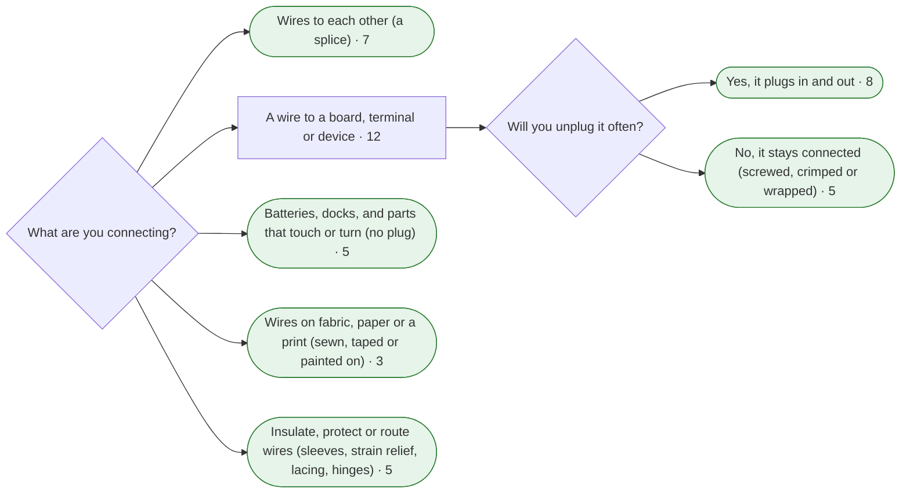
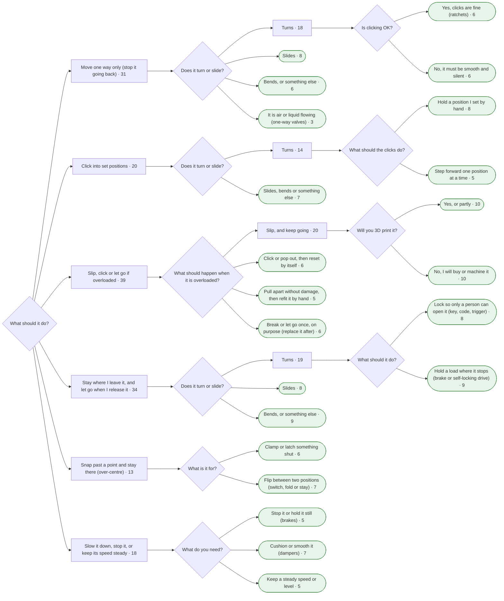
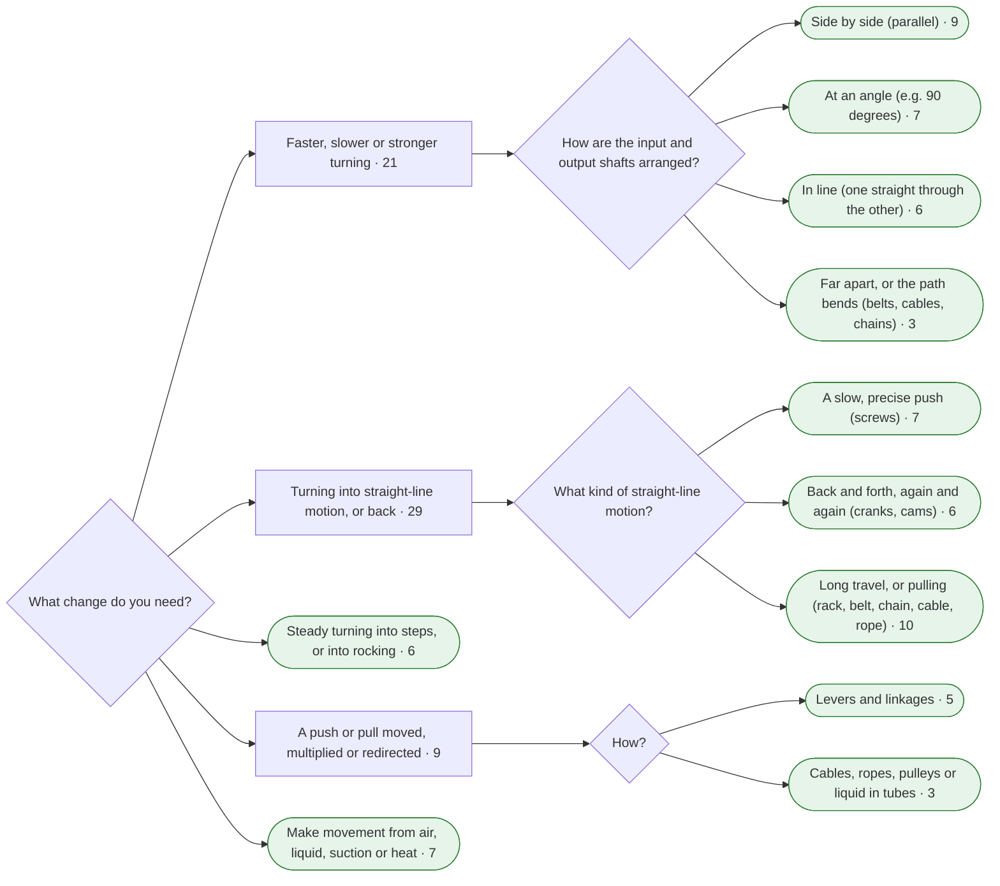
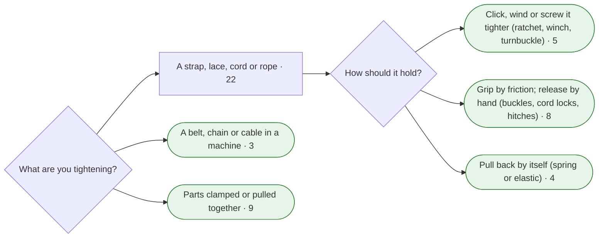
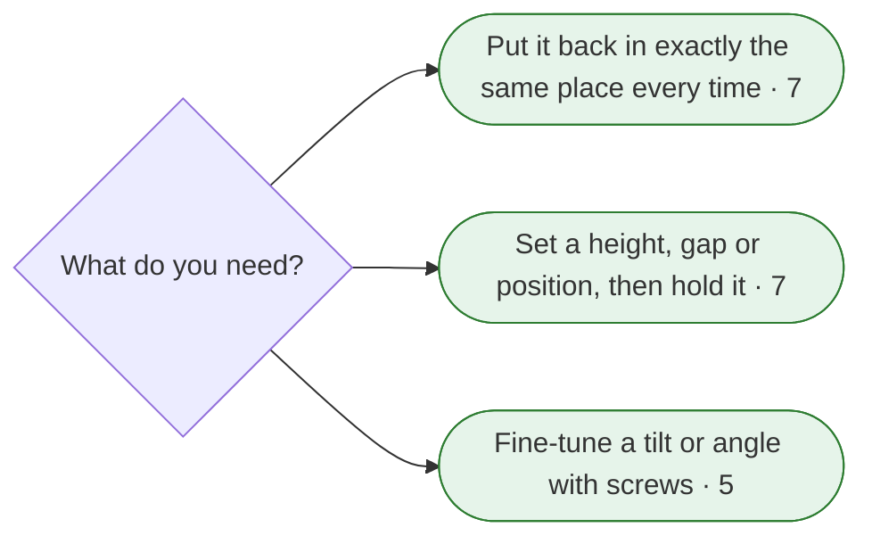
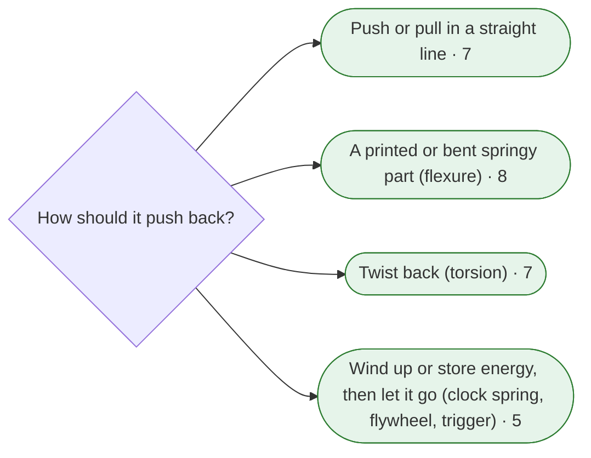
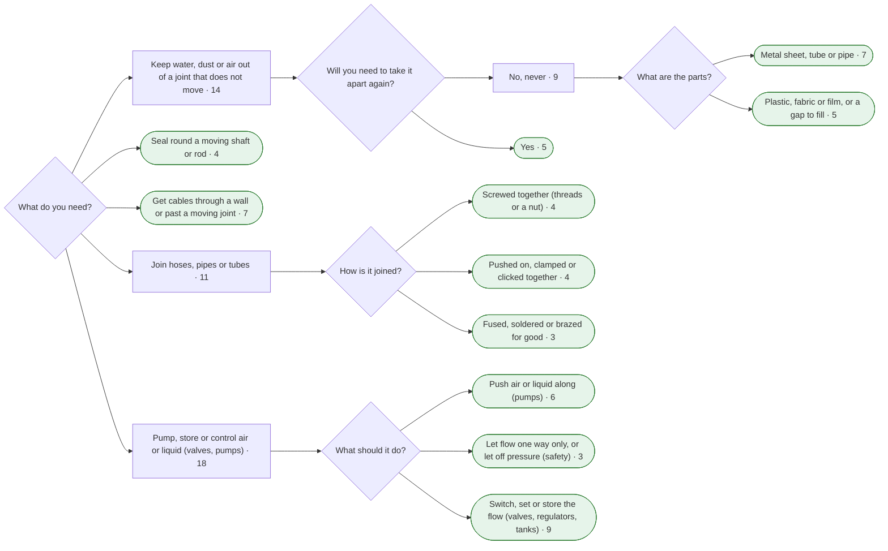
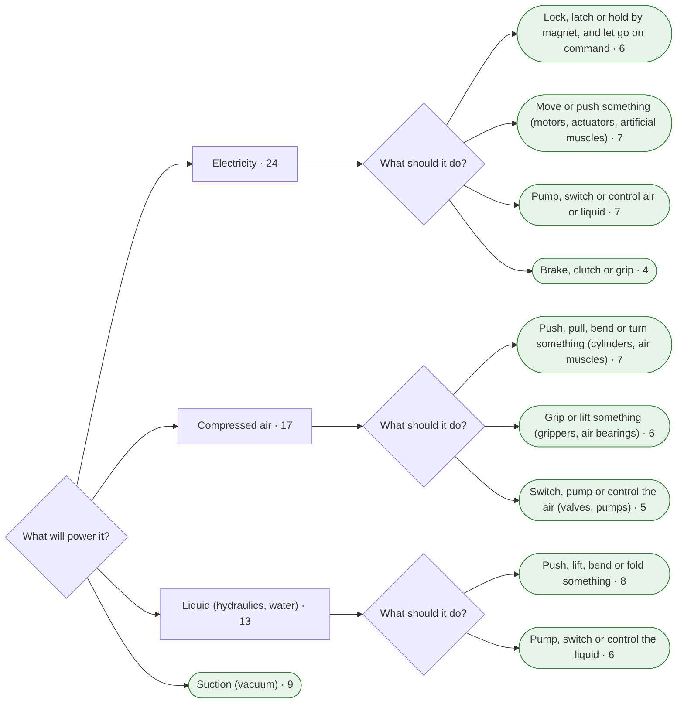

### Overview: first two questions

```mermaid
flowchart LR
  q0{"What do you need it to do?"}
  a1["Hold two things together (they stay still) · 226"]
  q0 --> a1
  q2{"What are you joining?"}
  a1 --> q2
  a3["3D-printed parts, or screws, nuts and magnets into a print · 27"]
  q2 --> a3
  class a3 more
  a4["Boards, panels or sheet (wood, plywood, acrylic, sheet metal) · 37"]
  q2 --> a4
  class a4 more
  a5["Tube, rod, pole or aluminium extrusion · 13"]
  q2 --> a5
  class a5 more
  a6["A wheel, gear or arm onto a shaft, or two shafts end to end · 23"]
  q2 --> a6
  class a6 more
  a7["Strap, cord, rope or fabric · 37"]
  q2 --> a7
  class a7 more
  a8["A lid, door or cover that opens and closes · 32"]
  q2 --> a8
  class a8 more
  a9["Something onto a wall, desk, bar, tripod, rail or grid · 24"]
  q2 --> a9
  class a9 more
  a10["Something that has to be gripped or clamped · 13"]
  q2 --> a10
  class a10 more
  a11["Melt them together (weld, braze or solder) · 11"]
  q2 --> a11
  class a11 more
  a12(["Two different kinds of part (e.g. a print onto wood, or a strap onto a tube) · 226"])
  q2 --> a12
  class a12 leaf
  a13["I just want to glue it · 19"]
  q2 --> a13
  class a13 more
  a14["Any solid parts / something else · 20"]
  q2 --> a14
  class a14 more
  a15["Connect wires or power (electrical connections) · 30"]
  q0 --> a15
  q16{"What are you connecting?"}
  a15 --> q16
  a17(["Wires to each other (a splice) · 7"])
  q16 --> a17
  class a17 leaf
  a18["A wire to a board, terminal or device · 12"]
  q16 --> a18
  class a18 more
  a19(["Batteries, docks, and parts that touch or turn (no plug) · 5"])
  q16 --> a19
  class a19 leaf
  a20(["Wires on fabric, paper or a print (sewn, taped or painted on) · 3"])
  q16 --> a20
  class a20 leaf
  a21(["Insulate, protect or route wires (sleeves, strain relief, lacing, hinges) · 5"])
  q16 --> a21
  class a21 leaf
  a22["Let something move (turn, slide, swing or bend) · 98"]
  q0 --> a22
  q23{"How should it move?"}
  a22 --> q23
  a24["Swing or rock, less than a full turn (like a lid or arm) · 21"]
  q23 --> a24
  class a24 more
  a25["Spin round and round (a wheel, roller or shaft) · 21"]
  q23 --> a25
  class a25 more
  a26["Slide in a straight line, or telescope · 18"]
  q23 --> a26
  class a26 more
  a27["Bend or flex (no hinge pin) · 15"]
  q23 --> a27
  class a27 more
  a28(["Swivel or tilt in several directions (ball or universal joint) · 6"])
  q23 --> a28
  class a28 leaf
  a29(["Follow a set path (e.g. swing out and stay level) · 7"])
  q23 --> a29
  class a29 leaf
  a30["Control a movement (one way only, clicks, slips, locks, slows) · 130"]
  q0 --> a30
  q31{"What should it do?"}
  a30 --> q31
  a32["Move one way only (stop it going back) · 31"]
  q31 --> a32
  class a32 more
  a33["Click into set positions · 20"]
  q31 --> a33
  class a33 more
  a34["Slip, click or let go if overloaded · 39"]
  q31 --> a34
  class a34 more
  a35["Stay where I leave it, and let go when I release it · 34"]
  q31 --> a35
  class a35 more
  a36["Snap past a point and stay there (over-centre) · 13"]
  q31 --> a36
  class a36 more
  a37["Slow it down, stop it, or keep its speed steady · 18"]
  q31 --> a37
  class a37 more
  a38["Change a movement (speed, force or kind of motion) · 65"]
  q0 --> a38
  q39{"What change do you need?"}
  a38 --> q39
  a40["Faster, slower or stronger turning · 21"]
  q39 --> a40
  class a40 more
  a41["Turning into straight-line motion, or back · 29"]
  q39 --> a41
  class a41 more
  a42(["Steady turning into steps, or into rocking · 6"])
  q39 --> a42
  class a42 leaf
  a43["A push or pull moved, multiplied or redirected · 9"]
  q39 --> a43
  class a43 more
  a44(["Make movement from air, liquid, suction or heat · 7"])
  q39 --> a44
  class a44 leaf
  a45["Tighten something, or take up slack · 33"]
  q0 --> a45
  q46{"What are you tightening?"}
  a45 --> q46
  a47["A strap, lace, cord or rope · 22"]
  q46 --> a47
  class a47 more
  a48(["A belt, chain or cable in a machine · 3"])
  q46 --> a48
  class a48 leaf
  a49(["Parts clamped or pulled together · 9"])
  q46 --> a49
  class a49 leaf
  a50["Line parts up exactly, or adjust and level them · 12"]
  q0 --> a50
  q51{"What do you need?"}
  a50 --> q51
  a52(["Put it back in exactly the same place every time · 7"])
  q51 --> a52
  class a52 leaf
  a53(["Set a height, gap or position, then hold it · 7"])
  q51 --> a53
  class a53 leaf
  a54(["Fine-tune a tilt or angle with screws · 5"])
  q51 --> a54
  class a54 leaf
  a55["Spring back, or store energy · 18"]
  q0 --> a55
  q56{"How should it push back?"}
  a55 --> q56
  a57(["Push or pull in a straight line · 7"])
  q56 --> a57
  class a57 leaf
  a58(["A printed or bent springy part (flexure) · 8"])
  q56 --> a58
  class a58 leaf
  a59(["Twist back (torsion) · 7"])
  q56 --> a59
  class a59 leaf
  a60(["Wind up or store energy, then let it go (clock spring, flywheel, trigger) · 5"])
  q56 --> a60
  class a60 leaf
  a61["Seal it, or pass cables, air or liquid through · 65"]
  q0 --> a61
  q62{"What do you need?"}
  a61 --> q62
  a63["Keep water, dust or air out of a joint that does not move · 14"]
  q62 --> a63
  class a63 more
  a64(["Seal round a moving shaft or rod · 4"])
  q62 --> a64
  class a64 leaf
  a65(["Get cables through a wall or past a moving joint · 7"])
  q62 --> a65
  class a65 leaf
  a66["Join hoses, pipes or tubes · 11"]
  q62 --> a66
  class a66 more
  a67["Pump, store or control air or liquid (valves, pumps) · 18"]
  q62 --> a67
  class a67 more
  a68["Hold or let go using power (electric, air or suction) · 37"]
  q0 --> a68
  q69{"What will power it?"}
  a68 --> q69
  a70["Electricity · 24"]
  q69 --> a70
  class a70 more
  a71["Compressed air · 17"]
  q69 --> a71
  class a71 more
  a72["Liquid (hydraulics, water) · 13"]
  q69 --> a72
  class a72 more
  a73(["Suction (vacuum) · 9"])
  q69 --> a73
  class a73 leaf
  classDef leaf fill:#e6f4ea,stroke:#2e7d32
  classDef more fill:#fff4e5,stroke:#b26a00
```

### Branch 1: Hold two things together (they stay still) (226 entries)

```mermaid
flowchart LR
  q74{"What are you joining?"}
  a75["3D-printed parts, or screws, nuts and magnets into a print · 27"]
  q74 --> a75
  q76{"Will you need to take it apart again?"}
  a75 --> q76
  a77(["No, never (permanent) · 9"])
  q76 --> a77
  class a77 leaf
  a78["Yes · 16"]
  q76 --> a78
  q79{"Is there a screw or bolt?"}
  a78 --> q79
  a80(["Yes · 6"])
  q79 --> a80
  class a80 leaf
  a81(["No (clips, pins, rings, magnets) · 10"])
  q79 --> a81
  class a81 leaf
  a82(["It is fabric, chain mail or a folding sheet made in the print · 3"])
  q76 --> a82
  class a82 leaf
  a83["Boards, panels or sheet (wood, plywood, acrylic, sheet metal) · 37"]
  q74 --> a83
  q84{"Will you need to take it apart again?"}
  a83 --> q84
  a85["No, never (permanent) · 18"]
  q84 --> a85
  q86{"What is the sheet made of?"}
  a85 --> q86
  a87(["Wood or plywood · 9"])
  q86 --> a87
  class a87 leaf
  a88(["Sheet metal · 8"])
  q86 --> a88
  class a88 leaf
  a89(["Plastic sheet (acrylic, or laser-cut sheet) · 6"])
  q86 --> a89
  class a89 leaf
  a90["Now and then, with a tool · 16"]
  q84 --> a90
  q91{"What is the sheet made of?"}
  a90 --> q91
  a92(["Wood or plywood · 10"])
  q91 --> a92
  class a92 leaf
  a93(["Sheet metal, plastic or laser-cut sheet · 6"])
  q91 --> a93
  class a93 leaf
  a94(["Often, by hand, without tools · 3"])
  q84 --> a94
  class a94 leaf
  a95["Tube, rod, pole or aluminium extrusion · 13"]
  q74 --> a95
  q96{"Does it carry air or liquid?"}
  a95 --> q96
  a97(["Yes (hoses, pipes and tubing) · 3"])
  q96 --> a97
  class a97 leaf
  a98(["No (frames, poles and rails) · 10"])
  q96 --> a98
  class a98 leaf
  a99["A wheel, gear or arm onto a shaft, or two shafts end to end · 23"]
  q74 --> a99
  q100{"What are you connecting?"}
  a99 --> q100
  a101["A wheel, gear, pulley or arm onto a shaft · 13"]
  q100 --> a101
  q102{"Will you 3D print the part that goes on the shaft?"}
  a101 --> q102
  a103(["Yes · 9"])
  q102 --> a103
  class a103 leaf
  a104(["No, it is metal or bought · 9"])
  q102 --> a104
  class a104 leaf
  a105["Two shafts end to end · 10"]
  q100 --> a105
  q106{"How well do the shafts line up?"}
  a105 --> q106
  a107(["Exactly in line · 3"])
  q106 --> a107
  class a107 leaf
  a108(["A little out of line (needs some give) · 4"])
  q106 --> a108
  class a108 leaf
  a109(["At an angle, or along a bent path · 3"])
  q106 --> a109
  class a109 leaf
  a110["Strap, cord, rope or fabric · 37"]
  q74 --> a110
  q111{"What do you need?"}
  a110 --> q111
  a112(["Close an opening, or attach fabric (zip, hook-and-loop, press stud, button) · 4"])
  q111 --> a112
  class a112 leaf
  a113["Tie, splice or lash it (knots, no hardware) · 10"]
  q111 --> a113
  q114{"What should the knot do?"}
  a113 --> q114
  a115(["Stop a cord pulling through, or finish its end · 3"])
  q114 --> a115
  class a115 leaf
  a116(["Tie it to a post or ring, or join two cords · 4"])
  q114 --> a116
  class a116 leaf
  a117(["Make a loop, or pull it tight and hold it · 3"])
  q114 --> a117
  class a117 leaf
  a118(["Bind or lash things together · 3"])
  q114 --> a118
  class a118 leaf
  a119(["Sew or lace it · 5"])
  q111 --> a119
  class a119 leaf
  a120["Fit a part (buckle, hook, shackle, grommet, rivet) · 16"]
  q111 --> a120
  q121{"What should the part do?"}
  a120 --> q121
  a122(["Hook, link or swivel onto something · 5"])
  q121 --> a122
  class a122 leaf
  a123(["Join or grip strap and cord ends, or hold struts with cord · 6"])
  q121 --> a123
  class a123 leaf
  a124(["Fix it to fabric or leather, or hold a fabric edge · 5"])
  q121 --> a124
  class a124 leaf
  a125["A lid, door or cover that opens and closes · 32"]
  q74 --> a125
  q126{"How should it open?"}
  a125 --> q126
  a127(["It swings open on a hinge, or stays open at an angle · 9"])
  q126 --> a127
  class a127 leaf
  a128(["Twist a lid, knob or fastener · 6"])
  q126 --> a128
  class a128 leaf
  a129["Press, pull or flip a catch or lever · 14"]
  q126 --> a129
  q130{"Should it lock, so only the right person can open it?"}
  a129 --> q130
  a131(["Yes (key, code, hidden catch or safety lock) · 4"])
  q130 --> a131
  class a131 leaf
  a132(["No, it just has to stay shut · 10"])
  q130 --> a132
  class a132 leaf
  a133(["By power (button, remote, timer) · 3"])
  q126 --> a133
  class a133 leaf
  a134["Something onto a wall, desk, bar, tripod, rail or grid · 24"]
  q74 --> a134
  q135{"What is it going onto?"}
  a134 --> q135
  a136["A wall or ceiling · 11"]
  q135 --> a136
  q137{"How should it hold?"}
  a136 --> q137
  a138(["Screws, anchors, hooks or slots · 6"])
  q137 --> a138
  class a138 leaf
  a139(["Magnet, suction cup or sticky tape (no holes) · 5"])
  q137 --> a139
  class a139 leaf
  a140(["A bar, pole, tube or the edge of a desk · 4"])
  q135 --> a140
  class a140 leaf
  a141(["A tripod, camera or light stand · 3"])
  q135 --> a141
  class a141 leaf
  a142(["A rail, extrusion or grid · 5"])
  q135 --> a142
  class a142 leaf
  a143["Something that has to be gripped or clamped · 13"]
  q74 --> a143
  q144{"Who does the gripping?"}
  a143 --> q144
  a145(["I tighten it by hand (clamp, chuck, wedge) · 8"])
  q144 --> a145
  class a145 leaf
  a146(["A robot or machine (gripper) · 7"])
  q144 --> a146
  class a146 leaf
  a147["Melt them together (weld, braze or solder) · 11"]
  q74 --> a147
  q148{"What are the parts made of?"}
  a147 --> q148
  a149(["Metal · 4"])
  q148 --> a149
  class a149 leaf
  a150(["Plastic, or plastic film and coated fabric · 7"])
  q148 --> a150
  class a150 leaf
  a151(["Two different kinds of part (e.g. a print onto wood, or a strap onto a tube) · 226"])
  q74 --> a151
  class a151 leaf
  a152["I just want to glue it · 19"]
  q74 --> a152
  q153{"What are you gluing?"}
  a152 --> q153
  a154["3D-printed plastic (PLA, PETG, ABS) or resin prints · 12"]
  q153 --> a154
  q155{"What matters most?"}
  a154 --> q155
  a156(["Strongest bond · 6"])
  q155 --> a156
  class a156 leaf
  a157(["Stays flexible, or seals too · 4"])
  q155 --> a157
  class a157 leaf
  a158(["Fills gaps, or builds up a shape · 5"])
  q155 --> a158
  class a158 leaf
  a159(["Can be undone later · 3"])
  q155 --> a159
  class a159 leaf
  a160(["Slippery plastics (polyethylene, polypropylene, silicone) · 7"])
  q153 --> a160
  class a160 leaf
  a161["Wood, paper or card · 13"]
  q153 --> a161
  q162{"What matters most?"}
  a161 --> q162
  a163(["Strongest bond · 7"])
  q162 --> a163
  class a163 leaf
  a164(["Stays flexible, or seals too · 4"])
  q162 --> a164
  class a164 leaf
  a165(["Fills gaps, or builds up a shape · 4"])
  q162 --> a165
  class a165 leaf
  a166(["Can be undone later · 3"])
  q162 --> a166
  class a166 leaf
  a167["Metal or glass · 15"]
  q153 --> a167
  q168{"What matters most?"}
  a167 --> q168
  a169(["Strongest bond · 7"])
  q168 --> a169
  class a169 leaf
  a170(["Stays flexible, or seals too · 5"])
  q168 --> a170
  class a170 leaf
  a171(["Fills gaps, or builds up a shape · 6"])
  q168 --> a171
  class a171 leaf
  a172(["Can be undone later · 5"])
  q168 --> a172
  class a172 leaf
  a173["Rubber, fabric, leather or foam · 13"]
  q153 --> a173
  q174{"What matters most?"}
  a173 --> q174
  a175(["Strongest bond · 5"])
  q174 --> a175
  class a175 leaf
  a176(["Stays flexible, or seals too · 5"])
  q174 --> a176
  class a176 leaf
  a177(["Fills gaps, or builds up a shape · 3"])
  q174 --> a177
  class a177 leaf
  a178(["Can be undone later · 4"])
  q174 --> a178
  class a178 leaf
  a179(["Two different materials (e.g. a print onto wood) · 19"])
  q153 --> a179
  class a179 leaf
  a180["Any solid parts / something else · 20"]
  q74 --> a180
  q181{"Where can you reach?"}
  a180 --> q181
  a182(["Only one side, or only the end of a tube or shaft · 9"])
  q181 --> a182
  class a182 leaf
  a183(["Both sides · 6"])
  q181 --> a183
  class a183 leaf
  a184(["It does not matter · 5"])
  q181 --> a184
  class a184 leaf
  classDef leaf fill:#e6f4ea,stroke:#2e7d32
  classDef more fill:#fff4e5,stroke:#b26a00
```

### Branch 2: Connect wires or power (electrical connections) (30 entries)

### Branch 3: Let something move (turn, slide, swing or bend) (98 entries)

### Branch 4: Control a movement (one way only, clicks, slips, locks, slows) (130 entries)

### Branch 5: Change a movement (speed, force or kind of motion) (65 entries)

### Branch 6: Tighten something, or take up slack (33 entries)

### Branch 7: Line parts up exactly, or adjust and level them (12 entries)

### Branch 8: Spring back, or store energy (18 entries)

### Branch 9: Seal it, or pass cables, air or liquid through (65 entries)

### Branch 10: Hold or let go using power (electric, air or suction) (37 entries)

