# Run 3: flow chart, glossary and format

**Date:** 2026-10-03 · **Inputs:** the 323 entries of run 2 (`research/connection-types/results/*.json`),
run 1's `research/prior-art/summary.md` and `report.md`, plus web research done in this session
(forum questions, existing selection tools, site-building tools). · **Status:** proposals for
the owner to review. Nothing gets built until they are agreed. · **Updated 2026-10-06 (R23):**
the finder was re-tested on all 409 entries after the scope was widened (R22); sections 1.2,
1.4 and 1.6 show the updated tree, and the forum check in 1.7 is still the 2026-10-03 one.

How to read this: section 1 designs the finder (the guided flow chart) and tests it against the
real data; section 2 is the glossary; section 3 recommends how to build and host the site;
section 4 lists the decisions this asks the owner to make. Every URL cited was opened in this
session. Reddit pages can't be opened from this environment (reddit.com returns 403), so Reddit
threads were read through the public Arctic Shift archive of Reddit; each one gives the
reddit.com link and the archive address actually read.

**The short version.**
- **Finder:** ask *"What do you need it to do?"* first (9 plain answers), then 1-3 questions that
  depend on that answer (*"What are you joining?"*, *"How should it move?"*, *"Is clicking OK?"* …),
  then show a shortlist with a *"tick what applies"* panel to narrow it further. Tested against
  all 323 entries: **115 answer paths, every one ends on 3-10 entries (5.9 on average), no dead
  ends, and every entry is reachable.** Re-tested on 2026-10-06 with all 409 entries: a tenth
  first answer for electrical connections and a few new questions give **140 paths, all 3-10
  entries (5.9 on average), every entry reachable** (1.4). A fourth overload answer (R25) makes
  it 141 paths, still all 3-10 entries. 25 real forum questions were run through it: 17 reach a
  good answer, 7 partly, 1 is outside the encyclopedia's scope. The test scripts are in `research/finder-test/`.
- **But** the test only passes because of some draft tags worked out from entry names. About half
  of the answers need data the entries don't have yet as fixed choices (what the parts are, what
  powers it, what happens on overload, input → output motion …), and several existing finder
  fields are free text. Turning these into short fixed lists is the first job of Phase 1.
- **Glossary:** 107 terms taken from the data, each with a one-sentence plain definition.
- **Site:** Astro with its Starlight documentation theme, Pagefind search, hosted free on GitHub
  Pages. One Markdown file per entry, with the finder attributes in its front matter, made from
  the JSON by a script. The guided finder is a small plain-JavaScript page over a generated
  `finder.json`.

---

## 1. Flow chart / finder design

### 1.1 What the data gives the finder

Run 2 gave every entry the finder fields below. To test questions against them, each field was
turned into its fixed answer options (`research/finder-test/normalise.py` takes the first option
an entry names; for example *"removable for screwed joints, permanent when glued"* counts as
removable). Counts are out of 323.

| Field | How the 323 entries spread | Good for | Problems found |
|---|---|---|---|
| `job` (15 fixed options, 2.6 per entry on average) | Main (first-listed) job: join and hold 101, let it move 36, change the kind of motion 29, hold or release using power 21, change speed or turning force 20, seal or pass through 18, lock and release by hand 17, glue 16, stop it moving back 15, store energy 11, tighten 10, click into positions 8, slip when overloaded 7, slow or steady 7, line up exactly 7 | **Question 1** | "join and hold" is listed on 172 entries (53%), often as a side job (a hinge also "joins"). Jobs are listed roughly by importance, so the test uses only each entry's first two |
| `motion` | none 105, rotate 91, multiple 43, slide 36, flex 27, rotate+slide 21 | "How should it move?", "Does it turn or slide?" | "rotate" mixes swinging (a hinge, under one turn) and spinning (a shaft). The range text separates them: 62 spin, 50 swing |
| `special_behaviour` (11 options) | quick-release 101, self-aligning 93, motion conversion 77, hand-release only 67, self-locking 58, one-way 55, tensioning 48, fail-safe or breakaway 45, indexing 42, torque-limiting 32, over-centre 24; 59 list none | The "control a movement" branch (first-listed behaviour only) | Quick-release and self-aligning are too common to narrow anything |
| `holding_principle` | shape 213, friction 152, spring 136, not a holding joint 110, glue or melting 39, powered 21, magnetic 20, suction 19, jamming 2 | "How should it hold?" (mounts) | 39 entries wrote this as a sentence instead of a list |
| `power` | passive 289, powered 32, both 2 | Question 1, answer 9; a filter | "What happens when power is lost" is free text, and many entries name all three outcomes for different versions; needs its own fixed field |
| `removability` | removable 186, tool-free quick release 84, permanent 36, semi-permanent 17 | "Will you need to take it apart again?" | 30 different openings, but the first option is reliable. Permanent and semi-permanent are merged in the question |
| `reuse_cycles` | many times 204, effectively unlimited 63, once 41, a few times 14 | Only "break once on purpose" | Overlaps with `removability`; better as information on the entry page |
| `tools_needed` | Free text: 198 different openings; 120 start with "none" | Not used | Needs a fixed list (none / hand tools / soldering iron / drill and tap / press / crimper / glue gun / power tools) before it can filter |
| `seal` | none 256, airtight or pressure 33, watertight 18, dust-resistant 10, loose 6 | The "seal" branch; a filter | Works |
| `load` | Free text (86 openings); most entries give a range ("light to heavy") | A filter only | Weak: "heavy" is mentioned by 146 entries. Needs a band per direction (pull, shear, twist) |
| `adjustable` | yes 138, no 151, partly 34 | "Do you need to adjust the length?"; a filter | Works after normalising (67 different openings) |
| `access_needed` | not applicable 104, end of a tube or shaft 90, one side only 88, both sides 41 | "Where can you reach?"; a filter | Works well |
| `processes` | 3D print (FDM) 317, off-the-shelf 300, CNC 223, resin 135, laser cut 132, woodwork 130, sheet metal 86 | **Not useful as a question** | Agents listed every method that is *possible*, so nearly every entry says FDM and off-the-shelf. Mark the *usual* method separately |
| `print_in_place` | no 213, yes 58, partly 52 | "Should it print in one piece?" | Works; a better "how will you make it?" question than `processes` |
| `maker_difficulty` | easy 199, moderate 111, hard 13 | A filter | Works |
| `input_output` | Free text, but written consistently as "input -> output; ratio; shafts" | The "change a movement" branch: input → output motion, and shaft layout (parallel 35, at an angle 32, in line 65, crossed 20) | Should be split into fixed fields |

Fields the data shows are **needed but missing** (the test uses rough stand-ins worked out from
entry names and families, in `research/finder-test/tags.py`):

| New field (proposed) | Answer options | Why |
|---|---|---|
| `connects` | 3D-printed part / boards or sheet / tube, rod or extrusion / shaft / strap, cord or fabric / lid, door or cover / wall, rail, desk or grid / something to grip / any | The "hold together" branch (166 entries) can't be split well by any existing field. It is also how makers phrase their questions ("attach X to Y") |
| `power_source` | none / electricity / compressed air / liquid / suction / heat | The "powered" branch; also a safety filter |
| `power_loss` | stays locked / lets go / keeps its last state / not applicable | Asked by the plan in PROJECT.md (`power` field), but stored as free text |
| `motion_in`, `motion_out`, `shaft_layout` | steady turning / back-and-forth turning / steps / straight push or pull / back-and-forth straight / bending / pressure / heat; parallel / at an angle / in line / crossed / far apart | The "change a movement" branch; split out of `input_output` |
| `overload_response` | slips and keeps going / clicks or pops out and resets / comes apart without damage, refit by hand (added R25) / breaks or lets go once | The "slip if overloaded" branch |
| `clicks` | clicks / silent | The "one way only" branch: ratchets click; sprag, roller and wrap-spring clutches are silent |
| `glue_traits`, `bonds_well`, `bonds_poorly` | strongest / stays flexible / fills gaps / fast / can be undone; material lists | The glue branch. The `materials` text mixes "bonds well" and "poor" lists, so the material question needs them split |
| `usual_process` | one of the `processes` options | `processes` lists everything possible |

**Update 2026-10-06 (P3, R25):** `research/finder-tags/` now gives every entry a value for each
field above, plus fixed-choice `tools`, `load_max`, `adjustable`, `removability`, `power` and
`electrical_band`. The values are proposed by a script and accepted by the owner as the working
values. Values that the script was unsure of, or that come from research text marked
[uncertain], are listed as **needs confirming** (⚑), so they can be revisited and marked on the
site (`research/needs-confirming.md`). The fields and their options are in
`research/finder-tags/fields.yaml`. `overload_response` gained a fourth option, "comes apart
without damage, refit by hand", for plugs, magnetic connectors and hook-and-loop. It is also the
fourth answer to *What should happen when it is overloaded?*

### 1.2 The questions

The finder asks **one question that everyone answers** (the job), then **one to three questions
that depend on that answer**. Answers are short, in plain words, and each has a picture or icon
in the finished site. **Each answer also gets a real-world example** (owner, 2026-10-06), next to
it or behind an (i) icon with a pop-up. Answers whose wording can mislead also get a one-line
explanation, for example *Seal it, or pass cables, air or liquid through*. Drafts for all 200
answers (22 with explanations) are in `research/finder-test/examples.yaml`, listed question by
question in `research/finder-test/answers.md` for review. The finder test checks that every
answer has one. The numbers are how many entries each answer leaves.

**Question 1. What do you need it to do?** (pick one)

| Answer | Entries | Built from |
|---|---|---|
| Hold two things together (they stay still) | 225 | `job` join and hold / glue or bond, plus the families for still joints (not the electrical family, which has its own answer) |
| Connect wires or power (electrical connections) | 30 | The electrical connections family and entries tagged with it, plus cable glands and cable carriers (added 2026-10-06) |
| Let something move (turn, slide, swing or bend) | 98 | `job` let it move, plus the hinge, sliding and compliant families |
| Control a movement (one way only, clicks, slips, locks, slows) | 123 | `job` stop it moving back / click / slip / slow, and the first `special_behaviour` |
| Change a movement (speed, force or kind of motion) | 65 | `job` change speed / change the kind of motion |
| Tighten something, or take up slack | 33 | `job` tighten and hold tension |
| Line parts up exactly, or adjust and level them | 12 | `job` line parts up exactly (main job only), plus the locating and adjusters families (widened 2026-10-06) |
| Spring back, or store energy | 18 | `job` store energy |
| Seal it, or pass cables, air or liquid through | 65 | `job` seal or pass through, plus the seals and fluid-power families |
| Hold or let go using power (electric, air or suction) | 37 | `job` hold or release using power, `power` |

The 15 `job` options are grouped into these 9 answers, so the fixed `job` list doesn't need to
change (the 2026-09-30 decision left this for run 3 to check). The fluid-power family is reached
through three answers: seal or pass air or liquid through (pumps and valves), change a movement
(cylinders, muscles), and hold or let go using power (by power source). All 27 of its entries
(the 24 new ones plus 283, 288 and 289) are reachable. The same holds for the five families added
on 2026-10-03: the 15 `job` options stay, the electrical family gets its own first answer (owner's
decision, 2026-10-03), and the others are reached through the existing answers (knots and
sewing under *strap, cord, rope or fabric*, welding under a new *melt them together* answer,
fasteners under *boards*, *wall* and *shaft*, adjusters under the widened *line up* answer).

**Question 2 and later, by branch** (the full tree, with counts, is in the charts in 1.6):

| Branch | Question 2 | Answers | Question 3 (only where needed) |
|---|---|---|---|
| Hold together | What are you joining? | 3D-printed parts, or screws, nuts and magnets into a print · Boards, panels or sheet · Tube, rod, pole or extrusion · A wheel, gear or arm onto a shaft, or two shafts · Strap, cord, rope or fabric · A lid, door or cover that opens · Something onto a wall, desk, bar, tripod, rail or grid · Something to grip or clamp · Melt them together (weld, braze or solder) · I just want to glue it · Any solid parts / something else | Printed parts: *Will you need to take it apart again?* (never / yes / it is fabric, chain mail or a folding sheet made in the print), then *Is there a screw?* · Tube: *Does it carry air or liquid?* · Boards: *Will you need to take it apart again?* (never / now and then with a tool / often by hand), then *What is the sheet made of?* · Shaft: *A part onto a shaft, or two shafts?*, then *Will you print it?* or *How well do the shafts line up?* · Strap: *Close an opening or attach fabric / tie, splice or lash it / sew or lace it / fit a part*, then for knots *What should the knot do?* (stop or finish an end / tie to a post or join two cords / make a loop or hold tension / bind or lash) and for parts *What should the part do?* (hook, link or swivel / join or grip strap ends / fix to fabric or leather) · Lid: *How should it open?* (on a hinge or stays open at an angle / twist / catch or lever / by power), then *Should it lock?* · Wall, desk, bar or tripod: *What is it going onto?* (a wall or ceiling / a bar, pole or desk edge / a tripod or stand / a rail, extrusion or grid), then for walls *How should it hold?* (screws, anchors, hooks or slots / magnet or suction / tape) · Melt: *Metal, or plastic?* · Grip: *By hand or by a robot?* · Glue: *What are you gluing?* (printed plastic / slippery plastics / wood / metal or glass / rubber, fabric or foam), then *What matters most?* (strongest / flexible / fills gaps / can be undone) · Any: *Where can you reach?* (one side / both sides / doesn't matter) |
| Connect wires or power | What are you connecting? | Wires to each other (a splice) · A wire to a board, terminal or device · Batteries, docks and parts that touch or turn · Wires on fabric, paper or a print · Insulate, protect or route wires | Board, terminal or device: *Will you unplug it often?* |
| Let it move | How should it move? | Swing or rock, under a full turn · Spin round and round · Slide or telescope · Bend or flex · Swivel or tilt (ball or universal joint) · Follow a set path (e.g. swing out and stay level) | Swing: *Print in one piece?*, then *Should it stay where you put it?* · Spin: *A wheel on an axle, or a shaft driving a shaft?*, then *Just pass the turning on / one way only / change speed* · Slide: *Telescoping tube / carriage on a rail / pushed by a screw or crank* · Bend: *Hinge / straight-line or spring / grip or snap* |
| Control a movement | What should it do? | Move one way only · Click into set positions · Slip, click or let go if overloaded · Stay where I leave it until I release it · Snap past a point and stay (over-centre) · Slow it, stop it or keep its speed steady | *Does it turn or slide?*, then for turning: *Is clicking OK?* (ratchets) or *must it be silent?* (sprag, roller, wrap-spring), *Hold a position I set / step forward*, *Lock so only a person can open it / hold a load where it stops* · Overload: *Slip and keep going / pop out and reset / pull apart and refit by hand / break once* · Over-centre: *Clamp shut / flip between two positions* · Slow: *Brake / damper / steady speed* |
| Change a movement | What change do you need? | Faster, slower or stronger turning · Turning into straight-line motion, or back · Steady turning into steps or rocking · A push or pull moved, multiplied or redirected · Movement from air, liquid, suction or heat | Gears: *How are the shafts arranged?* (side by side / at an angle / in line / far apart) · Straight line: *Precise push (screws) / back and forth (cranks, cams) / long travel (rack, belt, chain, rope)* · Push or pull: *Levers and linkages / cables, pulleys or liquid* |
| Tighten | What are you tightening? | Strap, lace, cord or rope · Belt, chain or cable in a machine · Parts clamped together | Strap: *Click, wind or screw it tighter / grip by friction / pulls back by itself* |
| Line up or adjust | What do you need? | Put it back in exactly the same place every time · Set a height, gap or position, then hold it · Fine-tune a tilt or angle with screws | |
| Spring back | How should it push back? | Straight push or pull · A printed or bent springy part · Twist back or wind up | |
| Seal or pass through | What do you need? | Keep water, dust or air out of a still joint · Seal round a moving shaft · Get cables through a wall or past a moving joint · Join hoses or pipes · Pump, store or control air or liquid | Still joint: *Will it come apart?*, then if never *Metal, or plastic, fabric or a gap?* · Hoses and pipes: *Screwed together / pushed on, clamped or clicked / fused, soldered or brazed?* · Pumps and valves: *Push it along (pumps) / one way or safety valves / switch, set or store (valves, regulators, tanks)* |
| Powered | What will power it? | Electricity · Compressed air · Liquid · Suction | Electricity: *Lock or latch and let go on command / brake, engage or move something* |

### 1.3 Question order, and how each answer narrows the list

1. **The job comes first.** Run 1 found that beginners know what they need, not what it is
   called, and every collection that sorts by purpose (Artobolevsky, Thang, RoyMech) is the
   best fit (`research/prior-art/summary.md` 3.1). The owner's own first question, *"Does it
   move?"*, is built into the first two answers (hold still vs let it move) and comes back as
   *"How should it move?"* and *"Does it turn or slide?"*.
2. **The second question is always the one that splits that branch best in plain words**, chosen
   by testing every candidate field on the data (`research/finder-test/` has the script). Generic
   questions (load, adjustable, seal) split poorly at this point, because most entries span
   ranges like "light to heavy". Questions specific to a branch (*Is clicking OK?*, *What should
   happen when it's overloaded?*, *How are the shafts arranged?*) split much better.
3. **Questions about making and taking apart come third**, only where they still split the list
   (printed parts, boards, still seals).
4. **Then the shortlist**, with the *tick what applies* panel (1.5) for anything else.

How the list narrows on a typical path:
323 entries → Question 1 (7-166 left) → Question 2 (4-31 left) → Question 3 (3-10 left).
Paths take 1 answer (1 path), 2 answers (16), 3 answers (55) or 4 answers (43).
With all 409 entries (2026-10-06): Question 1 leaves 12-225, and paths take 2 answers (21
paths), 3 (64) or 4 (55).

### 1.4 Testing it against the data

`research/finder-test/tree.py` holds the questions as rules over the data and lists every
possible path. `research/finder-test/paths.md` lists every path with the entries it ends on.

| | First draft (job → one more question) | Final draft (this document) |
|---|---|---|
| Answer paths | 66 | 115 |
| Paths ending on 3-10 entries | 31 | **115** |
| Paths ending on more than 10 (too many) | 32 (largest 27: *any solid parts*, *turning into straight-line motion*) | 0 |
| Paths ending on fewer than 3 | 3 | 0 |
| Dead ends (0 entries) | 0 | 0 |
| Entries no path reaches | 1 (*Mechanical interlock*) | 0 |

Shortlist sizes in the final draft: 3 entries (9 paths), 4 (17), 5 (23), 6 (28), 7 (16), 8 (12),
9 (4), 10 (6). 100 entries are on exactly one path; 13 are on five or more, mostly glues that
suit many materials (hot-melt glue is on 13 paths). The tree was changed once more after the
forum test (1.7).

How the too-big paths of the first draft were fixed:

| Too-big path (first draft) | Size | Question added |
|---|---|---|
| Hold together → any solid parts | 27 | *Where can you reach?* (`access_needed`) |
| Change → turning into straight-line motion | 27 | *What kind of straight-line motion?* (screws / cranks and cams / rack, belt, chain or rope) |
| Hold together → glue → each material | 14-20 | *What matters most?* (strongest / flexible / fills gaps / can be undone) |
| Hold together → shaft → with a tool | 18 | *A part onto a shaft, or two shafts?*, then *Will you print it?* or *How well do the shafts line up?* |
| Control → slip if overloaded | 18 | *What should happen when it's overloaded?*, then *Will you print it?* |
| Move → slide | 18 | *What kind of slide?* |
| Control → one way only → turns | 17 | *Is clicking OK?* |
| Control → stay where I leave it → turns | 17 | *Lock so only a person can open it, or hold a load where it stops?* |
| Control → slow it or stop it | 17 | *Brake / damper / steady speed?* |
| Hold together → wall, rail or grid | 17 | *How should it hold?* |
| Hold together → lid → by hand | 16 | *How should it open?*, then *Should it lock?* |
| Hold together → boards or sheet → permanent | 16 | *What is the sheet made of?* |
| (16 more paths of 11-18) | | a branch-specific question each, listed in `tree.py` |

**Limits of the test, to fix before the finder is built:**
- **83 of the 153 answers use draft tags worked out from entry names** (for example "anything
  with *hinge* in its name opens on a hinge"). They are good enough to show that the question
  set works, but the real finder needs these as fields in each entry (the new fields in 1.1),
  set by a script and then checked by hand.
- **Some shortlists include loosely related entries**, because the `job` field is generous. For
  example *Print-in-place hinge* comes up under *Hold together → 3D-printed parts → permanent*,
  and *Syringe hydraulics* under *gears with shafts in line*. Hand-checking the new tags will
  remove most of these.
- **The glue material question relies on splitting each glue's `materials` text at words like
  "poor"**. The *slippery plastics* shortlist in particular needs checking against the sources.
- Within a shortlist, entries whose *main* job matches should be shown first, with the rest
  under *"also does this"*.

**Re-test with all 409 entries (2026-10-06, R23).** Run on the 2026-10-03 tree, the 86 entries
added with the wider scope left 11 paths with more than 10 entries (the largest, *any solid
parts → one side only*, had 38) and 2 entries no path reached (*Castor*, *Tripod and stand screw
mount*). These changes fixed it:

| Change | Why |
|---|---|
| New first answer *Connect wires or power*, then *What are you connecting?* and, for boards and devices, *Will you unplug it often?* | The 22 electrical entries filled *any solid parts* and have their own questions (owner's choice of a finder answer over a new `job` option) |
| *Hold together*: new answer *Melt them together (weld, braze or solder)*, then *Metal, or plastic?* | The welding family and solvent welding and heat staking; they had landed in *any solid parts* |
| *Strap, cord, rope or fabric*: *tie, splice or lash it / sew or lace it / fit a part*, each with a follow-up | The knots family made *join strap ends* 23 entries long |
| *Something onto a wall, desk, bar, tripod, rail or grid*, then *What is it going onto?* | Tripod and bar mounts, wall plugs, hollow-wall anchors and eye bolts (the 2026-10-03 mounting search proposed this question) |
| *Line parts up exactly, or adjust and level them*, then *same place every time / set a height or gap / fine-tune a tilt* | The new adjusters family |
| *Tube*: *Does it carry air or liquid?*; *Join hoses or pipes*: *screwed / pushed on or clamped / fused*; *still joint, never apart*: *metal, or plastic and fabric?* | Pipe threads, flare fittings and heat-fused pipe |
| Printed parts: a third answer, *fabric, chain mail or a folding sheet made in the print* | Printed chain mail and printing onto fabric |
| Castors and ball casters reach *Spin round and round → a wheel on an axle*; a few families are left out of answers that reach them elsewhere (knots, adjusters and fasteners under *stay where I leave it*; adjusters under *tighten → parts clamped*) | The two unreached entries, and the remaining too-big paths |

Result: **140 paths, all ending on 3-10 entries (5.9 on average), no dead ends, every one of
the 409 entries reachable.** Shortlist sizes: 3 entries (15 paths), 4 (26), 5 (23), 6 (26), 7
(19), 8 (16), 9 (9), 10 (6). The tree now has 200 answers. The draft tags in `tags.py` gained a
few name patterns for the new entries (wood screws, nails, staples and brackets count as board
fixings; wall plugs, anchors, eye bolts and spring clips as mounts), so the limits above apply
even more: these are the fields Phase 1 should set by hand. The 25 forum questions in 1.7 were
not re-run; several of their gaps (welding prints, hose clamps, screw-in inserts, roll pins,
sewing a part on, edge trim, a cable through a hinge, an expanding gripper) are entries now.

**Update 2026-10-06 (R25):** the overload question now uses the `overload_response` finder tag
(`research/finder-tags/`) and has a fourth answer, *Pull apart without damage, then refit it by
hand*: the magnet joint, hook-and-loop, quick couplers, the magnetic connector and the plain plug
and socket. Result: **141 paths, all 3-10 entries (5.9 on average), every entry reachable, 201
answers.** Shortlist sizes: 3 (14 paths), 4 (26), 5 (24), 6 (25), 7 (19), 8 (16), 9 (9), 10 (8).
Iron-on fusible web had been reached only through a name match on "fusible". It now sits with the
flexible glues. This is the first answer that uses the new tags, and the other answers move over
when the finder is built (Phase 2). `paths.md` marks with ⚑ each entry that is on a path because of
a tag value that still needs confirming. Two small changes on 2026-10-06 (R26, after the forum re-check in 1.7) keep it at 141 paths, all 3-10 entries.

### 1.5 Strict decision tree, or "tick what applies"?

**A strict tree (one answer per question) works best for the first two or three questions**,
where the answers really are either-or and a beginner can answer without knowing any terms: the
job, how it moves, what the parts are, how the shafts are arranged, what should happen when it's
overloaded, clicking or silent. Here a tree keeps people from facing 15 filters at once, which
is what makes industrial selectors hard to use.

**Tick boxes work better for everything that is a wish or a limit rather than a choice of
type**, because several can apply at once and none of them is essential: *prints in one
piece*, *easy to make*, *no power needed*, *comes apart by hand*, *must seal*, *takes heavy
loads*, *adjustable*, *I can only reach one side*, *the tools I have*, and for glue, *both
materials*. They also serve people who skip the questions and want to browse.

The data shows why the tick-box panel **must show counts and grey out options with no
results**: tried on all 115 shortlists, some boxes would empty most of them.

| Tick box (on each of the 115 shortlists) | Narrows it | Changes nothing | Empties it |
|---|---|---|---|
| Takes heavy loads | 94 | 8 | 13 |
| Easy to make or fit | 93 | 21 | 1 |
| Adjustable after fitting | 86 | 12 | 17 |
| Prints in one piece | 76 | 5 | 34 |
| Works from one side only | 69 | 4 | 42 |
| Seals (water, dust or air) | 67 | 7 | 41 |
| Comes apart by hand | 37 | 11 | 67 |
| No power needed | 23 | 88 | 4 |
| Can buy it ready-made | 28 | 87 | 0 |

So: always show the number next to each box, disable boxes that would give zero, and drop
*Can buy it ready-made* (it almost never changes anything). Two more rules from the test: give
every question an *"I'm not sure"* answer that keeps all its options, and a *Back* button,
because some answers are hard to call (is a lid "held together" or "moving"?).

**Recommended form:** a short guided tree (2-4 questions) that ends on a results page; the
results page shows the shortlist as cards *and* the tick-box panel with counts; a search box
(names and aliases) is always on screen for people who already know a word.

### 1.6 Draft flow chart

The charts below are generated from the tested tree (`research/finder-test/gen_docs.py`), so
they match the test exactly (regenerated 2026-10-06 for all 409 entries, and again for the
fourth overload answer, R25). The number after each answer is how many entries it leaves. Green
rounded boxes end on a shortlist; orange boxes lead to another question (shown in the branch
charts). Each shortlist's entries are listed in `research/finder-test/paths.md`.

#### Overview: first two questions

```mermaid
flowchart LR
  q0{"What do you need it to do?"}
  a1["Hold two things together (they stay still) · 226"]
  q0 --> a1
  q2{"What are you joining?"}
  a1 --> q2
  a3["3D-printed parts, or screws, nuts and magnets into a print · 28"]
  q2 --> a3
  class a3 more
  a4["Boards, panels or sheet (wood, plywood, acrylic, sheet metal) · 40"]
  q2 --> a4
  class a4 more
  a5["Tube, rod, pole or aluminium extrusion · 12"]
  q2 --> a5
  class a5 more
  a6["A wheel, gear or arm onto a shaft, or two shafts end to end · 26"]
  q2 --> a6
  class a6 more
  a7["Strap, cord, rope or fabric · 32"]
  q2 --> a7
  class a7 more
  a8["A lid, door or cover that opens and closes · 30"]
  q2 --> a8
  class a8 more
  a9["Something onto a wall, desk, bar, tripod, rail or grid · 26"]
  q2 --> a9
  class a9 more
  a10["Something that has to be gripped or clamped · 12"]
  q2 --> a10
  class a10 more
  a11["Melt them together (weld, braze or solder) · 11"]
  q2 --> a11
  class a11 more
  a12["I just want to glue it · 19"]
  q2 --> a12
  class a12 more
  a13["Any solid parts / something else · 18"]
  q2 --> a13
  class a13 more
  a14["Connect wires or power (electrical connections) · 30"]
  q0 --> a14
  q15{"What are you connecting?"}
  a14 --> q15
  a16(["Wires to each other (a splice) · 6"])
  q15 --> a16
  class a16 leaf
  a17["A wire to a board, terminal or device · 10"]
  q15 --> a17
  class a17 more
  a18(["Batteries, docks, and parts that touch or turn (no plug) · 5"])
  q15 --> a18
  class a18 leaf
  a19(["Wires on fabric, paper or a print (sewn, taped or painted on) · 3"])
  q15 --> a19
  class a19 leaf
  a20(["Insulate, protect or route wires (sleeves, strain relief, lacing, hinges) · 5"])
  q15 --> a20
  class a20 leaf
  a21["Let something move (turn, slide, swing or bend) · 98"]
  q0 --> a21
  q22{"How should it move?"}
  a21 --> q22
  a23["Swing or rock, less than a full turn (like a lid or arm) · 17"]
  q22 --> a23
  class a23 more
  a24["Spin round and round (a wheel, roller or shaft) · 23"]
  q22 --> a24
  class a24 more
  a25["Slide in a straight line, or telescope · 18"]
  q22 --> a25
  class a25 more
  a26["Bend or flex (no hinge pin) · 15"]
  q22 --> a26
  class a26 more
  a27(["Swivel or tilt in several directions (ball or universal joint) · 7"])
  q22 --> a27
  class a27 leaf
  a28(["Follow a set path (e.g. swing out and stay level) · 8"])
  q22 --> a28
  class a28 leaf
  a29["Control a movement (one way only, clicks, slips, locks, slows) · 133"]
  q0 --> a29
  q30{"What should it do?"}
  a29 --> q30
  a31["Move one way only (stop it going back) · 31"]
  q30 --> a31
  class a31 more
  a32["Click into set positions · 20"]
  q30 --> a32
  class a32 more
  a33["Slip, click or let go if overloaded · 40"]
  q30 --> a33
  class a33 more
  a34["Stay where I leave it, and let go when I release it · 34"]
  q30 --> a34
  class a34 more
  a35["Snap past a point and stay there (over-centre) · 13"]
  q30 --> a35
  class a35 more
  a36["Slow it down, stop it, or keep its speed steady · 18"]
  q30 --> a36
  class a36 more
  a37["Change a movement (speed, force or kind of motion) · 65"]
  q0 --> a37
  q38{"What change do you need?"}
  a37 --> q38
  a39["Faster, slower or stronger turning · 21"]
  q38 --> a39
  class a39 more
  a40["Turning into straight-line motion, or back · 27"]
  q38 --> a40
  class a40 more
  a41(["Steady turning into steps, or into rocking · 7"])
  q38 --> a41
  class a41 leaf
  a42["A push or pull moved, multiplied or redirected · 14"]
  q38 --> a42
  class a42 more
  a43(["Make movement from air, liquid, suction or heat · 8"])
  q38 --> a43
  class a43 leaf
  a44["Tighten something, or take up slack · 33"]
  q0 --> a44
  q45{"What are you tightening?"}
  a44 --> q45
  a46["A strap, lace, cord or rope · 21"]
  q45 --> a46
  class a46 more
  a47(["A belt, chain or cable in a machine · 6"])
  q45 --> a47
  class a47 leaf
  a48(["Parts clamped or pulled together · 10"])
  q45 --> a48
  class a48 leaf
  a49["Line parts up exactly, or adjust and level them · 12"]
  q0 --> a49
  q50{"What do you need?"}
  a49 --> q50
  a51(["Put it back in exactly the same place every time · 7"])
  q50 --> a51
  class a51 leaf
  a52(["Set a height, gap or position, then hold it · 5"])
  q50 --> a52
  class a52 leaf
  a53(["Fine-tune a tilt or angle with screws · 4"])
  q50 --> a53
  class a53 leaf
  a54["Spring back, or store energy · 18"]
  q0 --> a54
  q55{"How should it push back?"}
  a54 --> q55
  a56(["Push or pull in a straight line · 7"])
  q55 --> a56
  class a56 leaf
  a57(["A printed or bent springy part (flexure) · 8"])
  q55 --> a57
  class a57 leaf
  a58(["Twist back (torsion), or wind up · 8"])
  q55 --> a58
  class a58 leaf
  a59["Seal it, or pass cables, air or liquid through · 65"]
  q0 --> a59
  q60{"What do you need?"}
  a59 --> q60
  a61["Keep water, dust or air out of a joint that does not move · 16"]
  q60 --> a61
  class a61 more
  a62(["Seal round a moving shaft or rod · 4"])
  q60 --> a62
  class a62 leaf
  a63(["Get cables through a wall or past a moving joint · 8"])
  q60 --> a63
  class a63 leaf
  a64["Join hoses, pipes or tubes · 11"]
  q60 --> a64
  class a64 more
  a65["Pump, store or control air or liquid (valves, pumps) · 18"]
  q60 --> a65
  class a65 more
  a66["Hold or let go using power (electric, air or suction) · 37"]
  q0 --> a66
  q67{"What will power it?"}
  a66 --> q67
  a68["Electricity · 11"]
  q67 --> a68
  class a68 more
  a69(["Compressed air · 8"])
  q67 --> a69
  class a69 leaf
  a70(["Liquid (hydraulics, water) · 6"])
  q67 --> a70
  class a70 leaf
  a71(["Suction (vacuum) · 6"])
  q67 --> a71
  class a71 leaf
  classDef leaf fill:#e6f4ea,stroke:#2e7d32
  classDef more fill:#fff4e5,stroke:#b26a00
```

#### Branch 1: Hold two things together (they stay still) (226 entries)

```mermaid
flowchart LR
  q72{"What are you joining?"}
  a73["3D-printed parts, or screws, nuts and magnets into a print · 28"]
  q72 --> a73
  q74{"Will you need to take it apart again?"}
  a73 --> q74
  a75(["No, never (permanent) · 10"])
  q74 --> a75
  class a75 leaf
  a76["Yes · 16"]
  q74 --> a76
  q77{"Is there a screw or bolt?"}
  a76 --> q77
  a78(["Yes · 7"])
  q77 --> a78
  class a78 leaf
  a79(["No (clips, pins, rings, magnets) · 9"])
  q77 --> a79
  class a79 leaf
  a80(["It is fabric, chain mail or a folding sheet made in the print · 3"])
  q74 --> a80
  class a80 leaf
  a81["Boards, panels or sheet (wood, plywood, acrylic, sheet metal) · 40"]
  q72 --> a81
  q82{"Will you need to take it apart again?"}
  a81 --> q82
  a83["No, never (permanent) · 18"]
  q82 --> a83
  q84{"What is the sheet made of?"}
  a83 --> q84
  a85(["Wood or plywood · 8"])
  q84 --> a85
  class a85 leaf
  a86(["Sheet metal or plastic sheet · 10"])
  q84 --> a86
  class a86 leaf
  a87["Now and then, with a tool · 18"]
  q82 --> a87
  q88{"What is the sheet made of?"}
  a87 --> q88
  a89(["Wood or plywood · 9"])
  q88 --> a89
  class a89 leaf
  a90(["Sheet metal, plastic or laser-cut sheet · 9"])
  q88 --> a90
  class a90 leaf
  a91(["Often, by hand, without tools · 4"])
  q82 --> a91
  class a91 leaf
  a92["Tube, rod, pole or aluminium extrusion · 12"]
  q72 --> a92
  q93{"Does it carry air or liquid?"}
  a92 --> q93
  a94(["Yes (hoses, pipes and tubing) · 4"])
  q93 --> a94
  class a94 leaf
  a95(["No (frames, poles and rails) · 8"])
  q93 --> a95
  class a95 leaf
  a96["A wheel, gear or arm onto a shaft, or two shafts end to end · 26"]
  q72 --> a96
  q97{"What are you connecting?"}
  a96 --> q97
  a98["A wheel, gear, pulley or arm onto a shaft · 15"]
  q97 --> a98
  q99{"Will you 3D print the part that goes on the shaft?"}
  a98 --> q99
  a100(["Yes · 6"])
  q99 --> a100
  class a100 leaf
  a101(["No, it is metal or bought · 9"])
  q99 --> a101
  class a101 leaf
  a102["Two shafts end to end · 12"]
  q97 --> a102
  q103{"How well do the shafts line up?"}
  a102 --> q103
  a104(["Exactly in line · 5"])
  q103 --> a104
  class a104 leaf
  a105(["A little out of line (needs some give) · 4"])
  q103 --> a105
  class a105 leaf
  a106(["At an angle, or along a bent path · 3"])
  q103 --> a106
  class a106 leaf
  a107["Strap, cord, rope or fabric · 32"]
  q72 --> a107
  q108{"What do you need?"}
  a107 --> q108
  a109(["Close an opening, or attach fabric (zip, hook-and-loop, press stud, button) · 4"])
  q108 --> a109
  class a109 leaf
  a110["Tie, splice or lash it (knots, no hardware) · 10"]
  q108 --> a110
  q111{"What should the knot do?"}
  a110 --> q111
  a112(["Stop a cord pulling through, or finish its end · 3"])
  q111 --> a112
  class a112 leaf
  a113(["Tie it to a post or ring, or join two cords · 3"])
  q111 --> a113
  class a113 leaf
  a114(["Make a loop, or pull it tight and hold it · 4"])
  q111 --> a114
  class a114 leaf
  a115(["Bind or lash things together · 3"])
  q111 --> a115
  class a115 leaf
  a116(["Sew or lace it · 4"])
  q108 --> a116
  class a116 leaf
  a117["Fit a part (buckle, hook, shackle, grommet, rivet) · 14"]
  q108 --> a117
  q118{"What should the part do?"}
  a117 --> q118
  a119(["Hook, link or swivel onto something · 5"])
  q118 --> a119
  class a119 leaf
  a120(["Join or grip strap and cord ends, or hold struts with cord · 5"])
  q118 --> a120
  class a120 leaf
  a121(["Fix it to fabric or leather, or hold a fabric edge · 4"])
  q118 --> a121
  class a121 leaf
  a122["A lid, door or cover that opens and closes · 30"]
  q72 --> a122
  q123{"How should it open?"}
  a122 --> q123
  a124(["It swings open on a hinge, or stays open at an angle · 7"])
  q123 --> a124
  class a124 leaf
  a125(["Twist a lid, knob or fastener · 6"])
  q123 --> a125
  class a125 leaf
  a126["Press, pull or flip a catch or lever · 14"]
  q123 --> a126
  q127{"Should it lock, so only the right person can open it?"}
  a126 --> q127
  a128(["Yes (key, code, hidden catch or safety lock) · 5"])
  q127 --> a128
  class a128 leaf
  a129(["No, it just has to stay shut · 9"])
  q127 --> a129
  class a129 leaf
  a130(["By power (button, remote, timer) · 3"])
  q123 --> a130
  class a130 leaf
  a131["Something onto a wall, desk, bar, tripod, rail or grid · 26"]
  q72 --> a131
  q132{"What is it going onto?"}
  a131 --> q132
  a133["A wall or ceiling · 15"]
  q132 --> a133
  q134{"How should it hold?"}
  a133 --> q134
  a135(["Screws, anchors, hooks or slots · 7"])
  q134 --> a135
  class a135 leaf
  a136(["Magnet or suction · 5"])
  q134 --> a136
  class a136 leaf
  a137(["Sticky tape or pads · 3"])
  q134 --> a137
  class a137 leaf
  a138(["A bar, pole, tube or the edge of a desk · 4"])
  q132 --> a138
  class a138 leaf
  a139(["A tripod, camera or light stand · 3"])
  q132 --> a139
  class a139 leaf
  a140(["A rail, extrusion or grid · 6"])
  q132 --> a140
  class a140 leaf
  a141["Something that has to be gripped or clamped · 12"]
  q72 --> a141
  q142{"Who does the gripping?"}
  a141 --> q142
  a143(["I tighten it by hand (clamp, chuck, wedge) · 6"])
  q142 --> a143
  class a143 leaf
  a144(["A robot or machine (gripper) · 6"])
  q142 --> a144
  class a144 leaf
  a145["Melt them together (weld, braze or solder) · 11"]
  q72 --> a145
  q146{"What are the parts made of?"}
  a145 --> q146
  a147(["Metal · 4"])
  q146 --> a147
  class a147 leaf
  a148(["Plastic, or plastic film and coated fabric · 7"])
  q146 --> a148
  class a148 leaf
  a149["I just want to glue it · 19"]
  q72 --> a149
  q150{"What are you gluing?"}
  a149 --> q150
  a151["3D-printed plastic (PLA, PETG, ABS) or resin prints · 15"]
  q150 --> a151
  q152{"What matters most?"}
  a151 --> q152
  a153(["Strongest bond · 8"])
  q152 --> a153
  class a153 leaf
  a154(["Stays flexible, or seals too · 5"])
  q152 --> a154
  class a154 leaf
  a155(["Fills gaps, or builds up a shape · 6"])
  q152 --> a155
  class a155 leaf
  a156(["Can be undone later · 4"])
  q152 --> a156
  class a156 leaf
  a157(["Slippery plastics (polyethylene, polypropylene, silicone) · 6"])
  q150 --> a157
  class a157 leaf
  a158["Wood, paper or card · 13"]
  q150 --> a158
  q159{"What matters most?"}
  a158 --> q159
  a160(["Strongest bond · 7"])
  q159 --> a160
  class a160 leaf
  a161(["Stays flexible, or seals too · 4"])
  q159 --> a161
  class a161 leaf
  a162(["Fills gaps, or builds up a shape · 4"])
  q159 --> a162
  class a162 leaf
  a163(["Can be undone later · 3"])
  q159 --> a163
  class a163 leaf
  a164["Metal or glass · 15"]
  q150 --> a164
  q165{"What matters most?"}
  a164 --> q165
  a166(["Strongest bond · 7"])
  q165 --> a166
  class a166 leaf
  a167(["Stays flexible, or seals too · 5"])
  q165 --> a167
  class a167 leaf
  a168(["Fills gaps, or builds up a shape · 6"])
  q165 --> a168
  class a168 leaf
  a169(["Can be undone later · 5"])
  q165 --> a169
  class a169 leaf
  a170["Rubber, fabric, leather or foam · 13"]
  q150 --> a170
  q171{"What matters most?"}
  a170 --> q171
  a172(["Strongest bond · 5"])
  q171 --> a172
  class a172 leaf
  a173(["Stays flexible, or seals too · 5"])
  q171 --> a173
  class a173 leaf
  a174(["Fills gaps, or builds up a shape · 3"])
  q171 --> a174
  class a174 leaf
  a175(["Can be undone later · 4"])
  q171 --> a175
  class a175 leaf
  a176["Any solid parts / something else · 18"]
  q72 --> a176
  q177{"Where can you reach?"}
  a176 --> q177
  a178(["Only one side, or only the end of a tube or shaft · 9"])
  q177 --> a178
  class a178 leaf
  a179(["Both sides · 4"])
  q177 --> a179
  class a179 leaf
  a180(["It does not matter · 5"])
  q177 --> a180
  class a180 leaf
  classDef leaf fill:#e6f4ea,stroke:#2e7d32
  classDef more fill:#fff4e5,stroke:#b26a00
```

#### Branch 2: Connect wires or power (electrical connections) (30 entries)

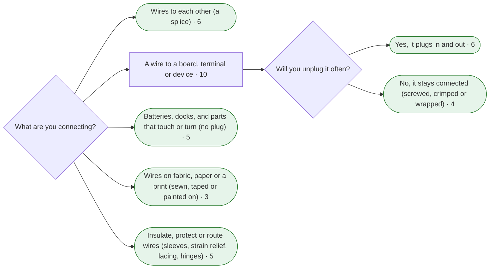

#### Branch 3: Let something move (turn, slide, swing or bend) (98 entries)

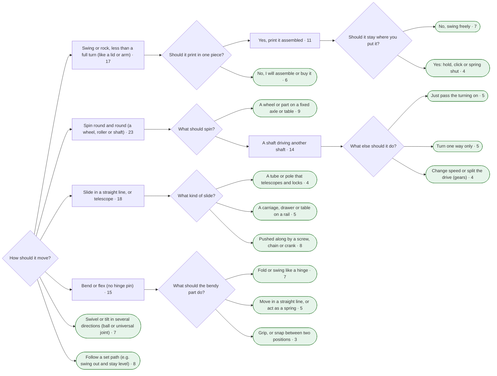

#### Branch 4: Control a movement (one way only, clicks, slips, locks, slows) (133 entries)

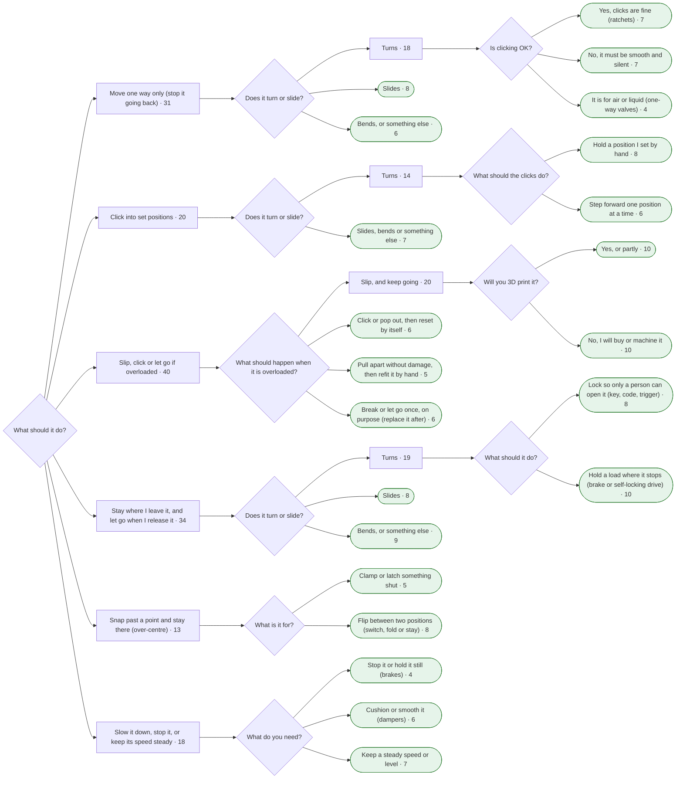

#### Branch 5: Change a movement (speed, force or kind of motion) (65 entries)

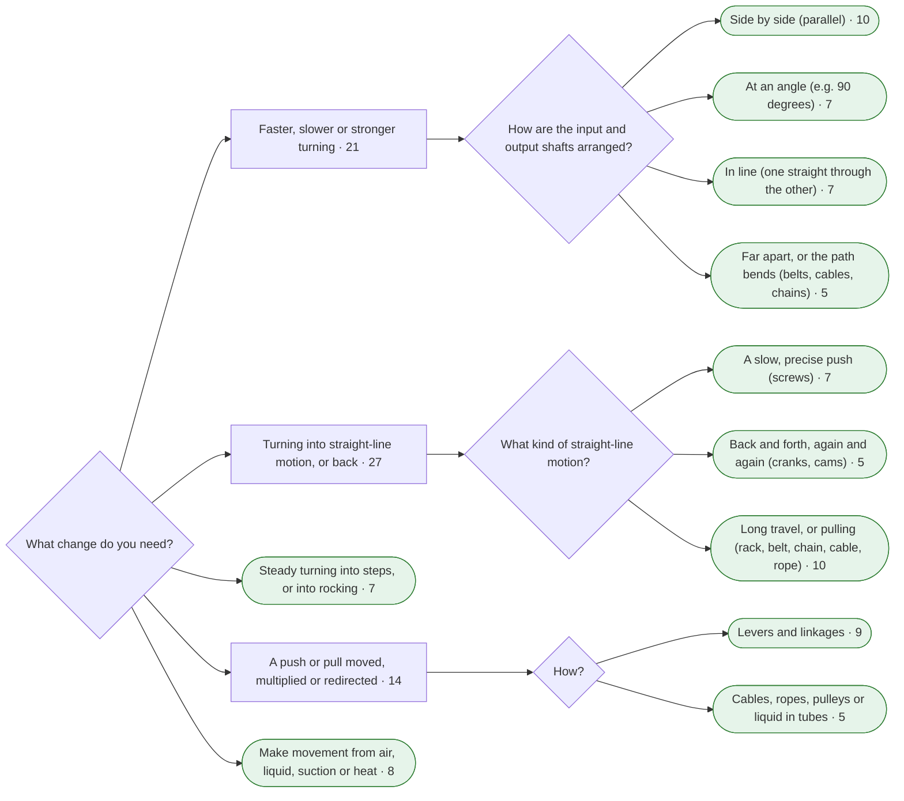

#### Branch 6: Tighten something, or take up slack (33 entries)

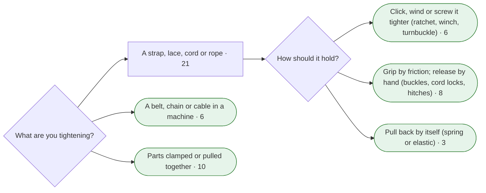

#### Branch 7: Line parts up exactly, or adjust and level them (12 entries)

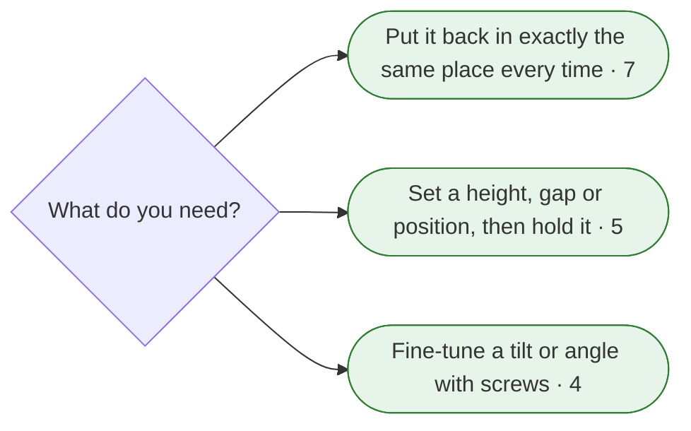

#### Branch 8: Spring back, or store energy (18 entries)

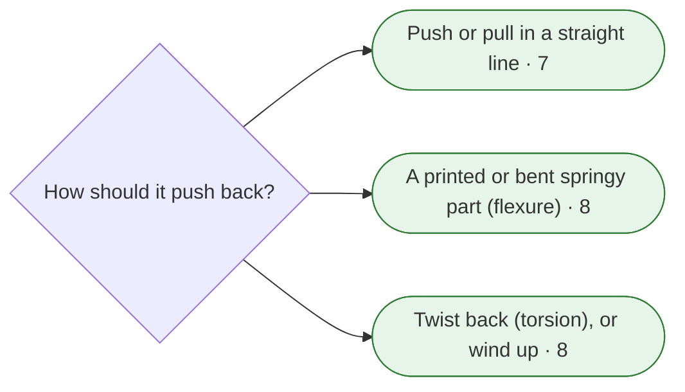

#### Branch 9: Seal it, or pass cables, air or liquid through (65 entries)

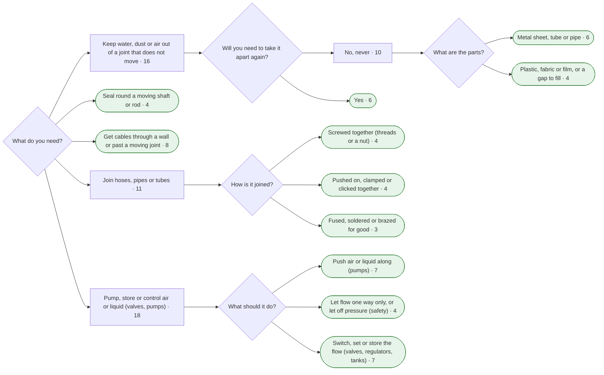

#### Branch 10: Hold or let go using power (electric, air or suction) (37 entries)

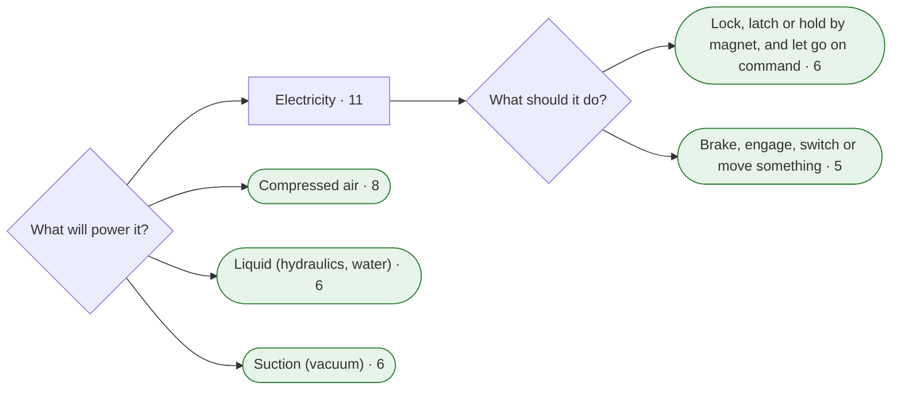

### 1.7 Real maker questions: would the flow chart help?

25 real questions were collected from r/AskEngineers, r/3Dprinting, r/robotics,
r/functionalprint, r/MechanicalEngineering and Hackaday: "what is this called?", "how do I
attach X to Y?" and "how do I make it lock / slip / seal?". Reddit was read through the Arctic
Shift archive (reddit.com is blocked here), so each Reddit row gives the reddit.com link plus the
two archive addresses actually opened. No usernames are recorded. Each question was then run
through the tested tree (`research/finder-test/tree.py`), choosing the answers the asker would
most likely pick. The number in brackets is the shortlist size.

**Result: 17 of 25 reach a good answer, 7 partly, 1 is outside the encyclopedia's scope.**
Before this check six questions went wrong (3, 8, 13, 14, 15 and 19); the tree was changed to fix
them: a *Follow a set path* answer for linkages, the cam lever counted as a tube clamp, lid stays
under lids, one *take it apart: yes* answer for printed parts (releasable snap fits are stored as
"removable with a tool", so *often, by hand* missed them), and a better strap and fabric question.

| # | Source | Question (in our words) | What commenters named | Path through the finder | Result |
|---|---|---|---|---|---|
| 1 | r/AskEngineers, 2025: [reddit](https://www.reddit.com/r/AskEngineers/comments/1k595kn/what_is_this_locking_mechanism_called/) (read via the archive: [post](https://arctic-shift.photon-reddit.com/api/posts/ids?ids=1k595kn), [comments](https://arctic-shift.photon-reddit.com/api/comments/tree?link_id=t3_1k595kn&limit=200)) | Two toothed discs that can't turn while meshed; lift, turn and drop to lock at a new angle | "spline" first, then "Hirth joint" (asker confirmed) | Control a movement → Click into set positions → Turns → Hold a position I set by hand (8) | **Good**: 34 Hirth joint |
| 2 | r/AskEngineers, 2022: [reddit](https://www.reddit.com/r/AskEngineers/comments/v5pxk5/does_anyone_know_what_this_mechanism_is_called/) (read via the archive: [post](https://arctic-shift.photon-reddit.com/api/posts/ids?ids=v5pxk5), [comments](https://arctic-shift.photon-reddit.com/api/comments/tree?link_id=t3_v5pxk5&limit=200)) | A cup holder that clicks out when pressed and stays in when pressed again | "push-push latch" (confirmed) | Hold together → A lid, door or cover → Press, pull or flip a catch → No, it just has to stay shut (9) | **Good**: 24 Push-push latch |
| 3 | r/AskEngineers, 2025: [reddit](https://www.reddit.com/r/AskEngineers/comments/1n8g8ff/what_is_the_name_of_this_mechanism/) (read via the archive: [post](https://arctic-shift.photon-reddit.com/api/posts/ids?ids=1n8g8ff), [comments](https://arctic-shift.photon-reddit.com/api/comments/tree?link_id=t3_1n8g8ff&limit=200)) | A spare for a notched strut that props a chair back at several angles | "linear ratchet and pawl", "ratchet stays" (confirmed) | Hold together → A lid, door or cover → On a hinge, or stays open at an angle (6) | **Partly** (after a fix): 185 Lid and flap stays; the strut itself is 8 Linear ratchet, which sits on *Control → Move one way only → Slides* |
| 4 | r/AskEngineers, 2024: [reddit](https://www.reddit.com/r/AskEngineers/comments/1bj20m0/looking_for_name_of_mechanical_part_that/) (read via the archive: [post](https://arctic-shift.photon-reddit.com/api/posts/ids?ids=1bj20m0), [comments](https://arctic-shift.photon-reddit.com/api/comments/tree?link_id=t3_1bj20m0&limit=200)) | A motor must turn a fishing reel both ways, but turning the reel by hand must never turn the motor | one-way clutch, sprag, freewheel, centrifugal clutch; "no passive part can do it" (no answer confirmed) | Control a movement → Move one way only → Turns → No, it must be smooth and silent (6) | **Good**: 15 Bidirectional anti-back-drive clutch, the exact answer, which nobody in the thread named. It sits next to the sprag and roller clutches commenters suggested, so the card must make the difference clear |
| 5 | r/robotics, 2025: [reddit](https://www.reddit.com/r/robotics/comments/1j9poiv/how_to_mechanically_lock_the_shaft_from_rotating/) (read via the archive: [post](https://arctic-shift.photon-reddit.com/api/posts/ids?ids=1j9poiv), [comments](https://arctic-shift.photon-reddit.com/api/comments/tree?link_id=t3_1j9poiv&limit=200)) | Stop a small gearmotor shaft from turning (really: stall it for a measurement) | worm drive, brakes, one-way bearing, a pin, "Vise-Grip" | Control a movement → Slow it, stop it… → Stop it or hold it still (4) | **Good**: 108 Electromagnetic brake, 211 Friction brake; 16 Worm drive is on *Stay where I leave it → Turns → Hold a load* |
| 6 | r/robotics, 2025: [reddit](https://www.reddit.com/r/robotics/comments/1i7c9jh/magnetic_coupling_for_m5_or_m8_shaft/) (read via the archive: [post](https://arctic-shift.photon-reddit.com/api/posts/ids?ids=1i7c9jh), [comments](https://arctic-shift.photon-reddit.com/api/comments/tree?link_id=t3_1i7c9jh&limit=200)) | A belt pulley that slips as soon as anything resists; searched for a "magnetic coupling" | "friction clutches", shear pins, torque limiters | Control a movement → Slip, click or let go if overloaded → Slip, and keep going → No, I will buy it (6) | **Good**: 4 Friction slip clutch; 143 Magnetic coupling is on the "print it" side |
| 7 | r/AskEngineers, 2023: [reddit](https://www.reddit.com/r/AskEngineers/comments/14tbvpj/what_is_this_mechanism_called/) (read via the archive: [post](https://arctic-shift.photon-reddit.com/api/posts/ids?ids=14tbvpj), [comments](https://arctic-shift.photon-reddit.com/api/comments/tree?link_id=t3_14tbvpj&limit=200)) | A motor and screw compress a spring plunger, then let it fire, again and again | airsoft gearbox (part-toothed gear on a rack), ball-pen mechanism (confirmed) | Spring back, or store energy → Push or pull in a straight line (6) | **Partly**: 26 Sear and trigger; the real answer combines 36 Intermittent gear, 88 Rack and pinion and 268 Coil spring, which sit on other paths |
| 8 | r/AskEngineers, 2022: [reddit](https://www.reddit.com/r/AskEngineers/comments/vpsygk/what_is_this_openingclosing_mechanism_called/) (read via the archive: [post](https://arctic-shift.photon-reddit.com/api/posts/ids?ids=vpsygk), [comments](https://arctic-shift.photon-reddit.com/api/comments/tree?link_id=t3_vpsygk&limit=200)) | A window sash that swings out and up while staying level | "four-bar", "parallelogram linkage" (confirmed) | Let something move → Follow a set path (8) | **Good** (after a fix): 87 Four-bar linkage |
| 9 | r/AskEngineers, 2022: [reddit](https://www.reddit.com/r/AskEngineers/comments/xek5ke/what_is_this_expanding_mechanism_called/) (read via the archive: [post](https://arctic-shift.photon-reddit.com/api/posts/ids?ids=xek5ke), [comments](https://arctic-shift.photon-reddit.com/api/comments/tree?link_id=t3_xek5ke&limit=200)) | A screw that pushes hinged arms outwards to grip inside a hole, for a robot contest | "Sarrus linkage" (confirmed), jack screw, wall anchor | Hold together → Something to grip or clamp → A robot or machine (5) | **Partly**: the Sarrus linkage is inside 197 Straight-line linkages (*Let something move → Follow a set path*), but the gripper shortlist has no expanding gripper. Gap |
| 10 | r/3Dprinting, 2025: [reddit](https://www.reddit.com/r/3Dprinting/comments/1ja1gm2/how_do_design_a_hinge_to_hold_and_route_this_lcd/) (read via the archive: [post](https://arctic-shift.photon-reddit.com/api/posts/ids?ids=1ja1gm2), [comments](https://arctic-shift.photon-reddit.com/api/comments/tree?link_id=t3_1ja1gm2&limit=200)) | A flip-up screen hinge that hides the ribbon cable | no name; "use a cable loop" (Game Boy SP) | Hold together → A lid, door or cover → On a hinge… (6) | **Partly**: 263 Knuckle hinge; nothing on carrying a cable through a hinge. Gap |
| 11 | r/MechanicalEngineering, 2026: [reddit](https://www.reddit.com/r/MechanicalEngineering/comments/1vkosn6/whats_the_mechanism_used_in_a_3_stage_telescopic/) (read via the archive: [post](https://arctic-shift.photon-reddit.com/api/posts/ids?ids=1vkosn6), [comments](https://arctic-shift.photon-reddit.com/api/comments/tree?link_id=t3_1vkosn6&limit=200)) | How a push button unlocks a multi-stage telescoping arm | spring pins popping into holes, ball detent | Let something move → Slide or telescope → A tube or pole that telescopes and locks (4) | **Good**: 72 Spring button lock |
| 12 | r/functionalprint, 2023: [reddit](https://www.reddit.com/r/functionalprint/comments/11fcfwk/does_anyone_know_what_this_dowelpeg_thing_is/) (read via the archive: [post](https://arctic-shift.photon-reddit.com/api/posts/ids?ids=11fcfwk), [comments](https://arctic-shift.photon-reddit.com/api/comments/tree?link_id=t3_11fcfwk&limit=200)) | A peg with a cross slot and a flared tip that squeezes into a hole | "collet" (confirmed), Lego Technic pin, "annular snap fit" | Hold together → 3D-printed parts → Yes [comes apart] → No screw (8) | **Good**: 47 Snap pin, 45 Annular snap fit. "Collet" is a near-miss word for search |
| 13 | r/functionalprint, 2019: [reddit](https://www.reddit.com/r/functionalprint/comments/ak4isk/whats_the_name_of_this_kind_of_system_to_clamp/) (read via the archive: [post](https://arctic-shift.photon-reddit.com/api/posts/ids?ids=ak4isk), [comments](https://arctic-shift.photon-reddit.com/api/comments/tree?link_id=t3_ak4isk&limit=200)) | A flip-lever clamp holding a bike light on a bar | "cam clamp", "camlock" (confirmed) | Hold together → Tube, rod, pole or extrusion (9) | **Good** (after a fix): 22 Eccentric cam lever |
| 14 | r/3Dprinting, 2026: [reddit](https://www.reddit.com/r/3Dprinting/comments/1w03ozo/need_help_figuring_out_a_locking_mechanism_for_a/) (read via the archive: [post](https://arctic-shift.photon-reddit.com/api/posts/ids?ids=1w03ozo), [comments](https://arctic-shift.photon-reddit.com/api/comments/tree?link_id=t3_1w03ozo&limit=200)) | Two printed blocks on a dovetail must lock, but come apart for blade changes; magnets were too weak | a pin across the dovetail, 45° snap joints | Hold together → 3D-printed parts → Yes → No screw (8) | **Good** (after a fix): 44 Cantilever snap fit, 47 Snap pin |
| 15 | r/3Dprinting, 2025: [reddit](https://www.reddit.com/r/3Dprinting/comments/1lag0u9/gravity_is_a_bitch_any_ideas_how_to_snap_lock_or/) (read via the archive: [post](https://arctic-shift.photon-reddit.com/api/posts/ids?ids=1lag0u9), [comments](https://arctic-shift.photon-reddit.com/api/comments/tree?link_id=t3_1lag0u9&limit=200)) | Slide-together printed racks fall apart when picked up | "crush ribs!" (liked), squeeze-in pins, glue | Hold together → 3D-printed parts → Yes → No screw (8) | **Partly** (after a fix): 47 Snap pin, 44 Cantilever snap fit; 59 Crush ribs is stored as semi-permanent, so it shows under *No, never* |
| 16 | r/3Dprinting, 2025: [reddit](https://www.reddit.com/r/3Dprinting/comments/1ijf4iv/changing_designs_for_heat_set_inserts_or_gluein/) (read via the archive: [post](https://arctic-shift.photon-reddit.com/api/posts/ids?ids=1ijf4iv), [comments](https://arctic-shift.photon-reddit.com/api/comments/tree?link_id=t3_1ijf4iv&limit=200)) | Printed posts snap when screwing a Raspberry Pi on | heat-set inserts, glued nuts, self-tapping into an undersized hole, fillets | Hold together → 3D-printed parts → Yes → Yes, a screw (6) | **Good**: 56 Heat-set insert, 57 Captive nut pocket, 258 Self-tapping screw |
| 17 | r/3Dprinting, 2024: [reddit](https://www.reddit.com/r/3Dprinting/comments/1g3w18n/how_to_best_connect_a_servo_motor_to_a_3d_printed/) (read via the archive: [post](https://arctic-shift.photon-reddit.com/api/posts/ids?ids=1g3w18n), [comments](https://arctic-shift.photon-reddit.com/api/comments/tree?link_id=t3_1g3w18n&limit=200)) | Printed legs strip on servo splines when they bump things | "buy a metal horn" (confirmed) | Hold together → Shaft → A part onto a shaft → Yes, printed (6) | **Good**: 82 Servo horn and spline hub; the same list offers 5 Torque-limiting gear for the bumps |
| 18 | r/robotics, 2025: [reddit](https://www.reddit.com/r/robotics/comments/1kcikdx/can_i_weld_a_flange_to_my_dc_motor_shaft/) (read via the archive: [post](https://arctic-shift.photon-reddit.com/api/posts/ids?ids=1kcikdx), [comments](https://arctic-shift.photon-reddit.com/api/comments/tree?link_id=t3_1kcikdx&limit=200)) | A set-screw flange keeps working loose on a gearmotor shaft; weld it? | D-flat, key, retaining compound, roll pin, clamp collar; the asker welded it | Hold together → Shaft → A part onto a shaft → No, metal or bought (6) | **Good**: 266 Shaft-to-hub joints. Gaps: welding or brazing, roll pins |
| 19 | r/3Dprinting, 2024: [reddit](https://www.reddit.com/r/3Dprinting/comments/1e63nnr/how_do_you_sewconnect_cloth_to_a_print_im_making/) (read via the archive: [post](https://arctic-shift.photon-reddit.com/api/posts/ids?ids=1e63nnr), [comments](https://arctic-shift.photon-reddit.com/api/comments/tree?link_id=t3_1e63nnr&limit=200)) | Attach cloth to a printed mask | hot glue, sewing through holes, adhesive-backed Velcro, E6000 | Hold together → Strap, cord, rope or fabric → Close an opening, or attach fabric (4) | **Good** (after a fix): 157 Hook-and-loop fastener; glues via *I just want to glue it → Rubber, fabric…*. Gap: sewing a part on |
| 20 | r/3Dprinting, 2025: [reddit](https://www.reddit.com/r/3Dprinting/comments/1il1plg/best_way_to_attach_tpu_reinforcement_for_laundry/) (read via the archive: [post](https://arctic-shift.photon-reddit.com/api/posts/ids?ids=1il1plg), [comments](https://arctic-shift.photon-reddit.com/api/comments/tree?link_id=t3_1il1plg&limit=200)) | Fix a TPU reinforcement to a floppy polypropylene laundry basket | "make a U channel… no glue needed", "grommet" | Hold together → I just want to glue it → Slippery plastics (6) | **Partly**: 226 adhesives for low-surface-energy plastics (what was asked); the better answer, a push-on U-channel, has no entry. Gap |
| 21 | r/3Dprinting, 2024: [reddit](https://www.reddit.com/r/3Dprinting/comments/1g4byc1/i_need_to_connect_these_parts_together_being/) (read via the archive: [post](https://arctic-shift.photon-reddit.com/api/posts/ids?ids=1g4byc1), [comments](https://arctic-shift.photon-reddit.com/api/comments/tree?link_id=t3_1g4byc1&limit=200)) | Join PETG parts of a plant-watering reservoir so they hold water | melt them together with a soldering iron, then seal; silicone alone may not do | Seal it… → Keep water out of a still joint → No, never (6) | **Good**: 227 Silicone sealants, 232 Epoxy putty. Gap: welding prints together |
| 22 | r/3Dprinting, 2025: [reddit](https://www.reddit.com/r/3Dprinting/comments/1o4t0ng/best_way_to_attach_2_prints_woodworking_dust/) (read via the archive: [post](https://arctic-shift.photon-reddit.com/api/posts/ids?ids=1o4t0ng), [comments](https://arctic-shift.photon-reddit.com/api/comments/tree?link_id=t3_1o4t0ng&limit=200)) | A dust-hood joint that is nearly airtight but comes off for blade changes | gasket and flanges, "hose clamp" (chosen) | Seal it… → Keep water out of a still joint → Yes (5) | **Good**: 131 Gasket. Gap: the worm-drive hose clamp the asker chose |
| 23 | Hackaday, 2022: [hackaday](https://hackaday.com/2022/04/20/gaskets-can-they-be-3d-printed/) | Can awkward engine gaskets be printed in TPU? | tap out paper gaskets, RTV silicone, cut gasket sheet, TPU that lasted a year | Seal it… → Keep water out of a still joint → Yes (5) | **Good**: 131 Gasket |
| 24 | Hackaday, 2022: [hackaday](https://hackaday.com/2022/11/01/the-best-threaded-holes-for-resin-parts/) | How to get threads into resin prints, where heat-set inserts don't work | printed threads best; Helicoil, rivet nuts, captive nuts | Hold together → 3D-printed parts → Yes → Yes, a screw (6) | **Partly**: 58 Printed thread, 179 Press-fit inserts, 57 Captive nut, but 56 Heat-set insert is listed too and fails in resin. Gap: screw-in inserts (Helicoil type) |
| 25 | Hackaday, 2023: [hackaday](https://hackaday.com/2023/12/18/ask-hackaday-what-do-you-do-when-you-cant-solder/) | Joining wires when you can't solder | crimps, lever connectors, solder-seal splices, screw terminals | none | **No**: electrical connections are outside the 323 entries |

**What the questions teach the finder design:**
- **People describe a part by its shape, by what it does, or by where they saw it**, rarely by
  name: "two discs with zig-zag teeth", "transfers rotation one way", "like old car cup holders",
  "like a drywall anchor". Add a second way in, *"Where have you seen something like it?"*, as a
  search over each entry's `everyday_examples` (every entry already has 2-4).
- **They often grab a nearby wrong word**: "collet" for a snap pin, "magnetic coupling" for a slip
  clutch, "spline" for a Hirth joint, "weld" for a shaft-to-hub joint. Search needs these near
  misses, and trade names commenters used (Velcro, Loctite 638, JB Weld, E6000, Helicoil, Lego
  Technic pin), as aliases.
- **Many questions hide the real need** (question 4 asked for "one way" but needed "blocks
  back-driving both ways"; question 5 asked to lock a shaft but only needed it stalled for a test).
  Two branch questions would catch these: *"What should happen when the other side tries to move
  it?"* (one-way branch) and *"When must it hold: with power on, power off, or only while you
  test?"* (brakes and powered branch).
- **"What went wrong with your first try?"** is a strong clue: posts snapped, splines stripped, a
  set screw worked loose, magnets too weak, it creeps under load. A *"Fix a joint that failed"*
  way in can use each entry's `common_failures`.
- **Materials decide many answers** (resin vs meltable plastic for inserts, polypropylene for
  glue). Ask them where they matter: both materials for glue, and *"Does your plastic melt with a
  soldering iron?"* before heat-set inserts (the same question PEM and E-Z LOK ask, 1.8).
- **Compound mechanisms** (question 7: part-toothed gear + rack + spring) need "works together
  with" links between entries, since no single entry is the answer.
- **The finder needs a "not covered here" ending**, for example for electrical wire joints.
- **Gaps found** (candidates for `/research-add-items`, the owner decides): welding 3D prints
  together (soldering iron, 3D pen, friction welding); metal welding, brazing and soldering as
  joint types; the worm-drive hose clamp; screw-in threaded inserts (wire thread inserts,
  external-thread inserts); roll pins and cross-pinning; sewing or lacing a part on; push-on edge
  trim and U-channel grommets; carrying a cable through a hinge; an expanding internal gripper or
  mandrel. Electrical wire joints are out of scope unless the owner wants them.

#### Re-check on the current tree (2026-10-06, R26)

The 25 questions were run again through the current tree, with the same answers as above where
those answers still exist. A script (in the session's scratch space) checked whether the entries
each asker needed are on the shortlist. **Result: 21 of 25 reach a good answer and 4 partly; none is
out of scope.** Eight did better than before, mostly because the gap types found on 2026-10-03
became entries in R22. Two of those needed a small change to the tree today, made by Claude
while the owner was away (decision D26 in `PROJECT.md`):
- *Cable through a hinge* now also counts as holding two things together, so it sits on the hinge
  answer as well as the electrical and seal answers;
- inserts count as "comes apart" under *3D-printed parts*, so *Screw-in threaded insert* and
  *Press-fit and expanding inserts* sit on *Yes → Yes, a screw*. The insert stays put, but the screw
  comes out.

The four answers that remain *Partly* would need a change of question rather than of data, and are
left as they are.

| # | Path now (shortlist size) | Result | Change since 2026-10-03 |
|---|---|---|---|
| 1 | Control a movement (one way only, clicks, slips, locks, slows) → Click into set positions → Turns → Hold a position I set by hand (8) | **Good**: 34 Hirth joint | as before |
| 2 | Hold two things together (they stay still) → A lid, door or cover that opens and closes → Press, pull or flip a catch or lever → No, it just has to stay shut (9) | **Good**: 24 Push-push latch | as before |
| 3 | Hold two things together (they stay still) → A lid, door or cover that opens and closes → It swings open on a hinge, or stays open at an angle (7) | **Partly**: 185 Lid and flap stays | as before: the strut itself (8 Linear ratchet) is on *Control → Move one way only → Slides* |
| 4 | Control a movement (one way only, clicks, slips, locks, slows) → Move one way only (stop it going back) → Turns → No, it must be smooth and silent (7) | **Good**: 15 Bidirectional anti-back-drive clutch | as before |
| 5 | Control a movement (one way only, clicks, slips, locks, slows) → Slow it down, stop it, or keep its speed steady → Stop it or hold it still (brakes) (4) | **Good**: 108 Electromagnetic brake, 211 Friction brake | as before |
| 6 | Control a movement (one way only, clicks, slips, locks, slows) → Slip, click or let go if overloaded → Slip, and keep going → No, I will buy or machine it (10) | **Good**: 4 Friction slip clutch | as before; 143 Magnetic coupling is on the *Yes, or partly* side |
| 7 | Spring back, or store energy → Push or pull in a straight line (7) | **Partly**: 26 Sear and trigger | as before: 36 Intermittent gear, 88 Rack and pinion and 268 Coil spring sit on other paths |
| 8 | Let something move (turn, slide, swing or bend) → Follow a set path (e.g. swing out and stay level) (8) | **Good**: 87 Four-bar linkage | as before |
| 9 | Hold two things together (they stay still) → Something that has to be gripped or clamped → A robot or machine (gripper) (6) | **Good**: 339 Expanding internal grip | **better**: 339 Expanding internal grip (added in R22) is on the gripper list |
| 10 | Hold two things together (they stay still) → A lid, door or cover that opens and closes → It swings open on a hinge, or stays open at an angle (7) | **Good**: 263 Knuckle hinge, 338 Cable through a hinge | **better (fixed today)**: 338 Cable through a hinge now also sits on the hinge answer |
| 11 | Let something move (turn, slide, swing or bend) → Slide in a straight line, or telescope → A tube or pole that telescopes and locks (4) | **Good**: 72 Spring button lock | as before |
| 12 | Hold two things together (they stay still) → 3D-printed parts, or screws, nuts and magnets into a print → Yes → No (clips, pins, rings, magnets) (9) | **Good**: 47 Snap pin, 45 Annular snap fit | as before |
| 13 | Hold two things together (they stay still) → Tube, rod, pole or aluminium extrusion → No (frames, poles and rails) (8) | **Good**: 22 Eccentric cam lever | as before |
| 14 | Hold two things together (they stay still) → 3D-printed parts, or screws, nuts and magnets into a print → Yes → No (clips, pins, rings, magnets) (9) | **Good**: 44 Cantilever snap fit, 47 Snap pin | as before |
| 15 | Hold two things together (they stay still) → 3D-printed parts, or screws, nuts and magnets into a print → Yes → No (clips, pins, rings, magnets) (9) | **Partly**: 47 Snap pin, 44 Cantilever snap fit | as before: 59 Crush ribs is stored as semi-permanent, so it shows under *No, never* |
| 16 | Hold two things together (they stay still) → 3D-printed parts, or screws, nuts and magnets into a print → Yes → Yes (7) | **Good**: 56 Heat-set threaded insert, 57 Captive nut pocket, 258 Self-tapping screw into plastic | as before |
| 17 | Hold two things together (they stay still) → A wheel, gear or arm onto a shaft, or two shafts end to end → A wheel, gear, pulley or arm onto a shaft → Yes (6) | **Good**: 82 Servo horn and spline hub, 5 Torque-limiting gear with flexing spring arms | as before |
| 18 | Hold two things together (they stay still) → A wheel, gear or arm onto a shaft, or two shafts end to end → A wheel, gear, pulley or arm onto a shaft → No, it is metal or bought (9) | **Good**: 266 Shaft-to-hub joints and rigid couplings, 365 Drive-in fixing pins | **better**: 365 Drive-in fixing pins (roll pins, R22) is on the list |
| 19 | Hold two things together (they stay still) → Strap, cord, rope or fabric → Close an opening, or attach fabric (zip, hook-and-loop, press stud, button) (4) | **Good**: 157 Hook-and-loop fastener | **better**: 333 Sew-on part (R22) is on the neighbouring *Sew or lace it* answer |
| 20 | Hold two things together (they stay still) → I just want to glue it → Slippery plastics (polyethylene, polypropylene, silicone) (6) | **Partly**: 226 Structural acrylic and low-surface-energy plastic adhesives | as before: the better answer, 368 Push-on edge trim (R22), is under *3D-printed parts → Yes → No*, not on the glue path the asker chose |
| 21 | Seal it, or pass cables, air or liquid through → Keep water, dust or air out of a joint that does not move → No, never → Plastic, fabric or film, or a gap to fill (4) | **Good**: 227 Silicone and MS-polymer adhesive sealants, 232 Epoxy putty | **better**: 342 Melted plastic weld (R22) is under *Hold together → Melt them together → Plastic* |
| 22 | Seal it, or pass cables, air or liquid through → Keep water, dust or air out of a joint that does not move → Yes (6) | **Good**: 131 Gasket | **better**: the hose clamp the asker chose, 364 Hose clamp (R22), is under *Seal it → Join hoses, pipes or tubes → Pushed on, clamped* |
| 23 | Seal it, or pass cables, air or liquid through → Keep water, dust or air out of a joint that does not move → Yes (6) | **Good**: 131 Gasket | as before |
| 24 | Hold two things together (they stay still) → 3D-printed parts, or screws, nuts and magnets into a print → Yes → Yes (7) | **Good**: 58 Printed screw thread, 179 Press-fit and expanding inserts, 57 Captive nut pocket, 332 Screw-in threaded insert | **better (fixed today)**: 332 Screw-in threaded insert now also sits under *Yes → Yes, a screw* |
| 25 | Connect wires or power (electrical connections) → Wires to each other (a splice) (6) | **Good**: 348 Crimped butt splice, 349 Spring-clamp wire connector, 358 Twist-on wire connector | **better**: the electrical answer (R22) gives 348 Crimped butt splice, 349 Spring-clamp wire connector and 358 Twist-on wire connector |

### 1.8 Existing selection charts and decision tools: what to borrow

Run 1 found that no existing finder chooses between mechanical connection types for beginners;
the real selectors are for glue, for mechanisms by motion, for industrial joining and for single
part families (`research/prior-art/summary.md` section 5). This run opened 20 of them (and 10
more pages briefly) to see exactly what they ask and how they show results.

| Tool | What it asks, and how it shows results | Borrow | Avoid | Opened |
|---|---|---|---|---|
| thisTOthat (glue) | Two drop-downs, "Attach (this)" and "to (that)", the same 11 materials in each. Answers 1-3 glues, each with a condition or trade-off: "if you have gaps to fill", "For the strongest bond … / For a faster less toxic alternative …", "If it's OK for the glue to show …", plus "Never use …" warnings and "try a small test" | Two-material question for glue; **each pick labelled with its condition or trade-off**; warnings next to picks | Brand names instead of glue types; one "Plastic" choice for every plastic | https://thistothat.com/ , https://thistothat.com/cgi-bin/glue.cgi?this=Plastic&that=Metal , https://thistothat.com/cgi-bin/glue.cgi?this=Styrofoam&that=Plastic |
| 3M structural adhesive selection guide (PDF) | Step 1 "Select Most Difficult Substrate", Step 2 "Determine Key Attribute", Step 3 product family; a box ranks load directions (shear best, peel and cleavage worst) | **Ask for the hardest material first**; then "the one thing that matters most"; a peel vs shear picture | Product codes; industrial cure and dispensing questions | https://multimedia.3m.com/mws/media/328280O/product-selection-guide.pdf |
| Loctite *Design Guide for Bonding Plastics* (PDF) | Organised by plastic (30, with recycling codes and trade names); glue family × plastic matrix; warnings such as "ABS can be stress cracked by uncured cyanoacrylate adhesives" | Help people identify their plastic; "the glue was stronger than the part" as a plain top grade; put "can crack it" warnings on result cards | 100 pages of psi tables | https://dm.henkel-dam.com/is/content/henkel/Design-Guide-Bonding-Plastics |
| Woodcraft wood-glue guide | No questions: a chart of 10 glues (pot life, open time, clamp time, colour when dry, clean-up, water resistance) and six situations, each with an **"Avoid:"** and a **"Try:"** line | Avoid / Try pairs for real situations (cold shed, outdoors, gappy joint); practical columns such as clamp time and clean-up | Product names and prices | https://www.woodcraft.com/blogs/sanding-finishing/complete-guide-to-woodworking-glues |
| Prusa, *The Great Guide to Gluing and Assembling 3D Prints* | Rules of thumb, then three glue families with "Which … to choose?" and "Warnings, tips, and fun facts"; points people who want to take it apart again to screws, magnets and embedded nuts | **Cross-links out of the glue branch** ("might you want it apart again?"); notes per filament | Length | https://blog.prusa3d.com/the-great-guide-to-gluing-and-assembling-3d-prints_44908/ |
| PEM Product Finder (fasteners for sheet) | No questions; starts from 14,524 results with 14 filters, **each option showing a count** ("Self-Clinching [281]") | Counts beside every answer; grid or table view of results | Thousands of results and 14 filters at once; part-family codes; CAD behind a login | https://www.pemnet.com/products/product-finder/ |
| Southco latch catalogue | Type tiles named by the hand action (push to close, push to open, pull to open, slide to open), then about 70 filters, including "Access Restriction" (none, locking, key, electronic …) | **Name latch types by the hand action**; "Who may open it?" as a plain question | 60+ filters; part codes | https://southco.com/en_any_int/latches/push-to-close-latches (read with WebFetch; scripted access is blocked) |
| MW Components insert chart (PDF), PEM and E-Z LOK insert guides | Insert series × 4 fitting methods, with a **4-level legend**: "Primary installation method" / "can also be used" / "caution" / "not recommended"; first ask whether the plastic re-melts | A word-based suitability scale instead of yes/no; *"Does your plastic melt with a soldering iron?"* before recommending heat-set inserts | Series codes; ultrasonic machines | https://info.mwcomponents.com/hubfs/PDFs/MW-COMPONENTS/MWC-Product-Resources-and-Technical-Data-PDFs/Threaded-Insert-Installation-Methods-and-QRG-Chart.pdf , https://www.pemnet.com/products/engineering-guides/four-ways-to-tackle-threaded-inserts-for-plastics/ , https://www.ezlok.com/guide-to-choosing-the-right-threaded-insert-for-plastic |
| Formlabs, threads in 3D prints | Options grouped by **what the screw bites into** (metal insert, the plastic itself, printed thread), each with pros and cons; one test part shows every method | Group the "screw into a print" shortlist the same way; a printable test piece per branch | SLA and SLS focus; sales prompts | https://formlabs.com/blog/adding-screw-threads-3d-printed-parts/ |
| University of Melbourne workshop, *Joining* | A joint table: **Joint / Use (everyday example) / Time / Skill level** | "Time to make" and "skill level" columns on shortlists | Times assume their machines | https://ms-kb.msd.unimelb.edu.au/machine-workshop/making/step-by-step/joining |
| TWI FAQ, clinching vs riveting vs spot welding | A factor × method matrix rated in words (Low / Medium / High; "Possible"), including appearance, cost per joint and workplace mess | Word ratings, and rows a beginner cares about (looks, cost, mess) | Industrial jargon | https://www.twi-global.com/technical-knowledge/faqs/faq-how-do-clinching-and-self-piercing-riveting-compare-with-spot-welding-for-sheet-materials |
| DMG-Lib mechanism search | Facets for function (including *locking* and *adjustable*), input movement, output movement, degrees of freedom, shaft position, kind of parts; "Show all fields" for more; live result count; a **"Hide controls without hits"** tick box | Live counts; hide answers that give nothing; input → output with the same list on both sides; extra questions behind "show more" | Academic words ("follower", "frame motion") | https://www.dmg-lib.org/dmglib/main/portal.jsp?mainNaviState=search.mech , https://www.dmg-lib.org/dmglib/main/portal.jsp?mainNaviState=search.mecsrchia |
| MechSimulator bearing selection | Everyday presets ("Conveyor Idler (Misaligned)") fill in the answers; advanced settings folded away; the best fit is marked "Best Match" and other types are listed under **"Not Suitable" with the reason** | **"Not suitable because …" list** under every shortlist; presets from everyday examples; an input → output → typical use table for motion converters | Numbers up front | https://mechsimulator.com/tools/bearing-selection/ , https://mechsimulator.com/mechanisms/ |
| HUANGYAN920 Mechanism Library (MIT) | One search box matching names, categories and synonyms; 11 category tabs; cards with live animations and sliders; **share link** for a result | Synonym search; result cards with 3-4 fixed facts; a shareable link | Sales push; dark styling | https://huangyan920.github.io/Mechanical/ |
| Thang's *2100 Animated Mechanical Mechanisms* index | Contents in two levels: what goes in and what comes out (e.g. "Converting continuous rotation into interrupted rotation"), then what it is made of; part 3 by job (indexing, toggle linkages, snap motions, safety clutches); text names parts by colour | Job or motion first, then "what kind of parts"; colour-coded parts named in the text | Thousands of near-identical variants with no filters | https://wiki.dtonline.org/index.php/2100_Animated_Mechanical_Mechanisms |
| KHK gear selection | "A designer first needs to review the layout of the two shafts": parallel, intersecting or skewed; efficiency per gear type (spur 98.0-99.5%, worm 30.0-90.0%) and a cheap → expensive order | **First gear question by shaft layout, with pictures** (used in 1.2); efficiency in plain words | Module and tooth filters up front | https://khkgears.net/new/gear_knowledge/the-first-step-of-mechanism-design-using-gears/know-about-gear-types-and-relations-between-the-two-shafts.html |
| Lovejoy and Martin coupling guides | Lovejoy profiles the job first, including **misalignment (angular vs parallel offset)**, then splits metal (stiff) from rubbery (forgiving); Martin rates 6 types in words | "Stiff and precise" vs "rubbery and forgiving"; a misalignment picture (used in 1.2) | Brand names as type names | https://www.lovejoy-inc.com/resources/technical-articles/sorting-out-flexible-couplings/ , https://martinsprocket.com/docs//brochures/power%20transmission/6_couplings/martintip%20-%20coupling%20selection%20guide.pdf |
| Parker O-Ring Selector (described from Parker's page and a trade-press walkthrough; the app itself returned 403) | Starts with service conditions because they affect later answers; asks whether the seal is **static or dynamic**; rates results "recommended, with caution, or in need of critical review" and says to test | A three-level traffic-light verdict; *"Does it move while sealing?"* (used in the seal branch) | Rubber chemistry names | https://discover.parker.com/ORingSelector_en , https://www.fluidpowerworld.com/o-ring-selection-made-easy/ |

Also opened briefly: Permabond's five steps, ending in "Test!"
(https://permabond.com/adhesive-selection-5-steps-to-choosing-the-best-adhesive-for-your-situation/);
507movements.com's index, which marks movements that have an animation
(https://507movements.com/toc.html); Mecapedia's "random page" and "pages with animations"
lists (http://www.mecapedia.uji.es/indices.htm); FACT's first step, "What degrees of freedom are
needed?" (https://en.wikipedia.org/wiki/Freedom_and_constraint_topologies); BYU's printable
demo models (https://compliantmechanisms.byu.edu/maker-resources). Could not be opened from this
environment, so not used: MISUMI and Fastenal (403), Ruland (bot check), McMaster-Carr (needs
JavaScript), KMODDL's collection (403), Granta EduPack and Swift & Booker (paid).

**The ten ideas to borrow, and where they go in our finder:**

| # | Idea | Source | Where it goes |
|---|---|---|---|
| 1 | Under the shortlist, list what was ruled out and why ("Not suitable: can't take a sideways load") | MechSimulator; igus | Results page |
| 2 | A three-level verdict in words (good fit / works with care / not recommended) instead of a score | Parker; MW Components | Result cards, glue × material |
| 3 | Label each pick with its condition or trade-off ("strongest", "faster and less toxic", "if it's OK for it to show") | thisTOthat | Result cards |
| 4 | Live counts; grey out answers that would leave nothing | DMG-Lib; PEM; Southco | Every question and the tick-box panel (1.5) |
| 5 | Ask the hardest limit first ("the hardest material to glue", "how the shafts sit", "does your plastic melt?") | 3M; KHK; PEM and E-Z LOK | Glue, gear and insert questions (1.2) |
| 6 | Situation cards with *Avoid* / *Try* lines (cold, wet, gappy, always under load) | Woodcraft | Entry pages and glue results |
| 7 | "Time to make" and "skill level" on every shortlist, with an everyday example | University of Melbourne | Result cards (from `maker_difficulty` and `everyday_examples`) |
| 8 | Everyday presets that fill in the answers ("phone stand hinge", "battery door"); expert questions folded away | MechSimulator; DMG-Lib | Finder start page |
| 9 | Hard warnings on result cards ("superglue can crack ABS", "PVA fails in a cold shed") | Loctite; thisTOthat; Woodcraft | Result cards (from `safety_notes` and `environment_limits`) |
| 10 | Change one answer on the results page without starting again, and share a link to the result | igus; HUANGYAN920 | Results page (answers kept in the page address) |

---

## 2. Glossary

> **Moved 2026-10-06 (R26):** the glossary now lives in `content/glossary.yaml`, which is its
> source from now on. `tools/make_entries.py` writes `content/glossary.md` from it and links the
> first use of each term on every entry page (P9). The table below is the 2026-10-03 original.

Every term below appears in the run 2 data. The number in brackets is how many of the 323
entries use it (word-boundary search over all field values, 2026-10-03), so the most-used terms
are the ones a reader is most likely to meet. Each definition is one plain sentence; the
encyclopedia can link the first use of a term on every entry page to this list.

### 2.1 How parts move

| Term (other names) | Plain definition | Entries |
|---|---|---|
| **Degrees of freedom** (DOF) | The number of separate ways a part can still move: slide along, across or up and down, and turn about each of those three directions, so 6 at most and 0 for a fixed joint. | a field on all 323 |
| **Misalignment** (offset, angular misalignment) | When two shafts or parts don't line up exactly: shifted sideways, tilted at an angle, or too far apart along their length. | 163 |
| **Play** (looseness; end float or end play along a shaft) | Unwanted wobble or free movement in a joint. | 187 |
| **Backlash** | The small free movement between parts such as gear teeth when the direction changes, felt as a dead zone before the output moves. | 87 |
| **Back-driving** (back-drivable) | When the output can push the input backwards, for example a hanging load turning a motor round; a non-back-drivable drive holds the load when the motor stops. | 166 |
| **Self-locking** | Holding its position under load with no brake, because friction is too high for the load to drive it back, as in most worm drives and fine lead screws. | 101 |
| **Axial / radial** | Axial means along a shaft's length; radial means outwards from its centre line. | 94 |
| **Thrust load** (axial load) | A push along the length of a shaft, which needs a bearing made to take it. | 39 |
| **Coaxial** (in line) | Sharing the same centre line, like the input and output shafts of a planetary gearbox. | 104 |
| **Reciprocating** | Moving back and forth in a straight line, again and again, like a piston. | 10 |
| **Oscillating** (rocking) | Swinging back and forth through part of a turn, like a windscreen wiper. | 15 |
| **Intermittent motion** (indexing, stepping) | Moving in steps with a pause between each, like a clock's second hand. | 24 |
| **Stroke** | How far a sliding part travels from one end of its movement to the other. | 62 |
| **Dead point** (dead centre) | The position where a crank or linkage lines up straight, so pushing on it does nothing and it can stall there. | 17 |
| **Over-centre** (toggle) | Pushed just past its dead point, so the load now presses it further shut against a stop and it stays locked. | 44 |
| **Bistable** | Having two resting positions and snapping between them, like a light switch or a hair clip. | 21 |
| **Detent** | A spring-loaded ball, bump or arm that drops into notches so a part clicks into set positions and stays there. | 72 |
| **Ratchet** | A toothed wheel or strip with a catch that lets it move one way, clicking, and stops it going back. | 74 |
| **Pawl** | The hinged catch that drops into a ratchet's teeth. | 44 |
| **Freewheel** (overrunning clutch, one-way clutch) | A clutch that drives in one direction and spins freely in the other, like a bicycle hub when you stop pedalling. | 21 |
| **Sprag** | One of the small tilted wedges in a sprag clutch that jam between two rings when turned one way. | 14 |

### 2.2 Force, speed and gearing

| Term (other names) | Plain definition | Entries |
|---|---|---|
| **Torque** (turning force, moment) | How hard something is twisted: the force times its distance from the centre, measured in newton-metres. | 141 |
| **Lever arm** (moment arm) | The distance from a pivot to where a force acts; a longer arm gives more turning effect. | 15 |
| **Mechanical advantage** | How many times a lever, pulley or gear multiplies your force; you always pay by moving further. | 11 |
| **Gear ratio** (reduction) | How many turns the input makes for each turn of the output; a reduction slows the output and multiplies its turning force. | 94 |
| **Efficiency** | The share of the input effort that comes out as useful output; the rest is lost as heat in friction. | 138 |
| **Lead** (of a screw) | How far a nut moves along a screw in one full turn. | 95 |
| **Pitch** | The distance between neighbouring threads or teeth. | 51 |
| **Module** (of a gear) | A metric size for gear teeth (the pitch-circle diameter divided by the number of teeth); two gears must have the same module to mesh. | 49 |
| **Idler** | A wheel or pulley that guides or tightens a belt or chain but doesn't drive anything. | 14 |
| **Cam and follower** | A shaped disc or drum (the cam) that pushes a rod or lever (the follower) through a planned movement as it turns. | 19 |
| **Crank** | An arm on a shaft that turns rotation into a push and pull, or the other way round. | 60 |
| **Linkage** (four-bar linkage) | Stiff bars joined by pivots that turn one movement into another; four bars in a loop is the simplest useful one. | 69 |
| **Actuator** | The part that makes the movement in a powered system, such as a motor, solenoid, air cylinder or muscle wire. | 74 |
| **Solenoid** | A coil of wire that pulls an iron plunger in when electricity flows through it. | 39 |
| **Fail-safe / fail-secure** | What a powered lock does when the power goes off: fail-safe lets go (so people can get out), fail-secure stays locked. | 55 |

### 2.3 Springs, bending and damping

| Term (other names) | Plain definition | Entries |
|---|---|---|
| **Stiffness** (spring rate) | How much force it takes to bend or stretch something by a given amount. | 186 |
| **Preload** | Force built into a joint on purpose before use (by tightening, a spring or a tight fit) to remove play or keep parts pressed together. | 54 |
| **Flexure** (flexure hinge, flexure bearing) | A thin, springy section of a part that bends to act as a hinge or slide, instead of pins or bearings. | 72 |
| **Compliant mechanism** | A mechanism that gets its movement from parts bending, not from hinges and sliding joints. | 86 |
| **Living hinge** | A thin strip of plastic joining two thicker parts that bends as a hinge, like the lid of a ketchup bottle. | 24 |
| **Cantilever** | A beam fixed at one end and free at the other, like a diving board; the springy arm of most snap fits. | 38 |
| **Deflection** | How far a part bends or moves under a load. | 43 |
| **Torsion** | Twisting; a torsion spring or torsion bar works by being twisted. | 44 |
| **Damping** (damper, dashpot) | Soaking up movement energy, usually as heat, so a motion slows down or stops bouncing. | 79 |
| **Hysteresis** | Behaving differently going one way than coming back, for example a spring giving back less force than it took. | 22 |
| **Stick-slip** | Jerky motion where parts stick, then jump, then stick again, because friction at rest is higher than friction while sliding. | 6 |

### 2.4 Fits, holding and locating

| Term (other names) | Plain definition | Entries |
|---|---|---|
| **Clearance** | A deliberate gap between two parts so they can move or fit together; in 3D printing, the gap left between print-in-place parts. | 183 |
| **Tolerance** | How far a real size may differ from the drawing and the part still work. | 116 |
| **Interference fit** (press fit) | A peg slightly bigger than its hole, pressed in so the parts grip by squeezing each other. | 79 |
| **Form-fit / force-fit / material bond** (*Formschluss, Kraftschluss, Stoffschluss*) | The three ways a joint can hold: by shape (the parts interlock), by friction from a clamping force, or by joining the materials themselves (glue, solvent, melting). | 267 |
| **Holding force** (pull-off force) | How hard you must pull before a magnet, suction cup or clip lets go. | 49 |
| **Set screw** (grub screw) | A headless screw through a hub that presses on a shaft so the hub can't slip. | 55 |
| **Spline** | Matching ridges on a shaft and inside a hub, so they turn together but the hub can still slide along. | 39 |
| **Taper** (taper fit) | A gently cone-shaped shaft and hole that wedge tightly together when pushed home. | 71 |
| **Collet** | A slotted sleeve that squeezes evenly round a shaft or tool when it is tightened. | 20 |
| **Circlip** (retaining ring, E-clip) | A springy split ring that clips into a groove to stop a part sliding off a shaft or out of a hole. | 40 |
| **Heat-set insert** | A brass sleeve with a thread inside, melted into a 3D-printed hole with a soldering iron to give strong, reusable metal threads. | 63 |
| **Captive nut** (nut trap) | A pocket shaped to hold a nut so it can't turn while the screw is tightened. | 35 |
| **Boss** | A raised round post on a moulded or printed part that takes a screw, insert or pin. | 17 |
| **Pilot hole** | A small starter hole that guides a screw. | 8 |
| **Counterbore / countersink** | A flat-bottomed or cone-shaped widening at the top of a hole so a screw head sits flush. | 10 |
| **Threadlocker** (anaerobic adhesive) | A liquid put on threads that hardens once the nut is tight and air is shut out, so the nut can't shake loose. | 28 |
| **Chamfer / fillet** | A sloped edge / a rounded corner; both make parts easier to fit together and spread out stress. | 82 |
| **Undercut** | A hook or hollow that catches behind a mating part, like the lip of a snap fit. | 26 |
| **Return angle** (retention angle) | The slope on the back of a snap-fit hook: steep holds for good, shallow lets it pull apart again. | 5 |
| **Keying** (poka-yoke, mistake-proofing) | Shaping parts so they only fit together the right way round. | 47 |
| **Kinematic coupling** | A mount where three balls sit in three V-shaped grooves (or similar), so a part drops back into exactly the same place every time. | 15 |
| **Exact constraint** | Holding a part with exactly one contact for each movement you want to stop, so it sits in one definite place without being forced. | 4 |
| **Over-constraint** | Stopping the same movement twice (for example two tight pins), so parts fight each other and bind unless made very precisely. | 8 |
| **Elastic averaging** | Using many slightly springy locating features at once, so small errors average out and the parts line up well. | 6 |
| **Repeatability / accuracy** | Repeatability is going back to the same place every time; accuracy is that place being where you meant it to be. | 96 |

### 2.5 Materials, wear and failure

| Term (other names) | Plain definition | Entries |
|---|---|---|
| **Creep** | Slow, permanent stretching or sagging of a part under a steady load, much worse in plastics and when warm. | 222 |
| **Stress relaxation** | The slow loss of clamping or spring force in a part held stretched or squeezed, for example a press fit loosening over months. | 20 |
| **Fatigue** | Cracking after many repeated loads, each too small to break the part on its own. | 69 |
| **Brittle / ductile** | Brittle materials snap with little warning; ductile ones bend and stretch first. | 105 |
| **Yield** (yield point) | The load at which a material stops springing back and stays bent. | 25 |
| **Stress concentration** (stress raiser, notch) | A sharp corner, hole or groove where force crowds together, so cracks start there. | 87 |
| **Wear** | Material slowly rubbed away where parts slide or roll on each other. | 265 |
| **Galling / fretting** | Galling is sliding metal surfaces tearing and sticking together (common with stainless threads); fretting is wear from tiny repeated rubbing. | 12 |
| **Lubrication** | Grease, oil or a slippery material between moving parts to cut friction and wear. | 164 |
| **Shore hardness** (durometer) | A scale for how soft or hard rubber and flexible plastics are, such as "95A" for a typical TPU filament. | 23 |

### 2.6 3D printing, cutting and wood

| Term (other names) | Plain definition | Entries |
|---|---|---|
| **Layer lines** (anisotropy, layer adhesion) | A print is weaker across its layers than along them, so the way you lay the part on the bed decides where it is strong. | 92 |
| **Perimeters** (walls, shells) | The solid outer layers of a print; more walls usually add more strength than more infill. | 209 |
| **Infill** | The pattern that fills the inside of a print; it affects strength, weight and print time. | 154 |
| **Print-in-place** | Printing moving parts already assembled, with small gaps between them, so they work straight off the printer. | 121 |
| **Elephant's foot** | The first layers squashing out wider than the rest, which can fuse print-in-place parts or spoil a fit. | 39 |
| **Overhang / bridging** | An overhang is printing outwards over empty space at an angle; bridging is printing straight across a gap between two supports. | 38 / 54 |
| **Support material** (supports) | Temporary structure printed under overhangs and removed afterwards. | 164 |
| **Warping / shrinkage** | Parts curling or shrinking as hot plastic cools, which changes sizes and fits. | 90 |
| **Kerf** | The width of material a saw blade or laser beam removes, which tight joints must allow for. | 15 |
| **End grain** | The cut end of a piece of wood, showing the ends of its fibres; glue and screws hold badly in it. | 9 |

### 2.7 Glues

| Term (other names) | Plain definition | Entries |
|---|---|---|
| **Cure** (curing) | The chemical hardening of a glue, sealant or resin. | 30 |
| **Pot life / working time** | How long a mixed glue stays usable before it starts to set. | 10 |
| **Open time** | How long you have to put the parts together after spreading the glue. | 3 |
| **Surface energy** (low-surface-energy plastics) | How easily a liquid wets a surface; slippery plastics such as polyethylene (PE), polypropylene (PP) and PTFE have low surface energy, so most glues won't stick to them. | 4 |
| **Primer** | A thin first coat that helps the glue grip. | 14 |
| **Peel vs shear** (lap shear) | Glue joints are strong when the parts slide past each other (shear) and weak when one is peeled off the other, so design joints to load the glue in shear. | 48 |
| **Gap filling** | Whether a glue can fill and bridge a gap between badly fitting parts (epoxy can; superglue mostly can't). | 17 |

### 2.8 Seals, air and liquid

| Term (other names) | Plain definition | Entries |
|---|---|---|
| **O-ring** | A rubber ring sitting in a groove that seals when squeezed between two parts. | 51 |
| **Gland** | The groove or housing an O-ring sits in; also a fitting that seals round a cable passing through a wall (cable gland). | 14 |
| **IP rating** (ingress protection) | A two-digit code for how well a case keeps out dust (first digit) and water (second digit), for example IP67. | 13 |
| **Pressure** (psi, bar, kPa) | Force spread over an area; 1 bar is roughly normal air pressure, about 14.5 psi or 100 kPa. | 178 |
| **Check valve** (one-way valve) | A valve that lets air or liquid flow one way only. | 22 |
| **Regulator** (pressure regulator) | A valve that turns a high, changing pressure into a lower, steady one. | 25 |
| **Water hammer** | A pressure shock when flowing water is stopped suddenly, which can bang pipes and burst fittings. | 10 |
| **Venturi** | A narrowing in a pipe where the flow speeds up and the pressure drops, used to make suction from compressed air. | 8 |

That is 107 terms. Terms used by only a handful of entries (exact constraint, open time,
surface energy) are kept because they name ideas a beginner will meet in the entries that do
use them.

---

## 3. Format and tech recommendation

### 3.1 The options compared

Facts checked on the tools' own pages on 2026-10-03 (versions from the npm and PyPI registries).

| | Reads our JSON without converting it | Interactive finder | Search | Mermaid | What the owner installs | State of the project |
|---|---|---|---|---|---|---|
| **Astro + Starlight** | Yes: the `glob()` loader reads JSON, YAML or Markdown files, and `getStaticPaths()` makes one page per entry ([content collections](https://docs.astro.build/en/guides/content-collections/), [loader reference](https://docs.astro.build/en/reference/content-loader-reference/)) | Plain `<script>` tags, or "islands" (small interactive parts of an otherwise static page) in any framework ([islands](https://docs.astro.build/en/concepts/islands/)) | Pagefind built into Starlight ([site search](https://starlight.astro.build/guides/site-search/)) | Add-on | Node.js 22.12 or newer ([install](https://docs.astro.build/en/install-and-setup/)) | Active, MIT licence; Astro 7.3.5, Starlight still 0.42.5 ([npm](https://registry.npmjs.org/@astrojs/starlight)); the Astro company joined Cloudflare in January 2026 and Astro stays MIT ([blog](https://astro.build/blog/joining-cloudflare/)) |
| **Eleventy** | Yes: global data files plus pagination make one page per item ([pages from data](https://www.11ty.dev/docs/pages-from-data/)) | Plain JS, or its `<is-land>` component ([is-land](https://www.11ty.dev/docs/plugins/is-land/)) | Add Pagefind | Add-on | Node.js 18 or newer ([11ty.dev](https://www.11ty.dev/)) | Active; being renamed "Build Awesome" from version 4 ([blog](https://www.11ty.dev/blog/build-awesome/)) |
| **Material for MkDocs / Zensical** | No: MkDocs builds from Markdown, and Zensical "does not currently support gen-files", so a script must write the .md files first ([Zensical plugins](https://zensical.org/docs/compatibility/mkdocs/plugins/)) | Extra JS files only | lunr (Material) | Built in ([diagrams](https://squidfunk.github.io/mkdocs-material/reference/diagrams/)) | Python | Material is in maintenance mode: critical fixes "for 12 month at least, no new features" from November 2025 ([announcement](https://squidfunk.github.io/mkdocs-material/blog/2025/11/11/insiders-now-free-for-everyone/)); MkDocs 1.x is unmaintained and MkDocs 2.0 "is incompatible with Material for MkDocs" ([post](https://squidfunk.github.io/mkdocs-material/blog/2026/02/18/mkdocs-2.0/)); Zensical is at 0.0.67 ([PyPI](https://pypi.org/pypi/zensical/json)) |
| **Docusaurus** | Only with a custom plugin ([lifecycle APIs](https://docusaurus.io/docs/api/plugin-methods/lifecycle-apis)) | React and MDX | Algolia first; local search by community plugins ([search](https://docusaurus.io/docs/search)) | Theme package | Node.js 20 or newer | Active |
| **Hugo** | Yes, through content adapters ([content adapters](https://gohugo.io/content-management/content-adapters/)) | Plain JS bundled with esbuild ([js.Build](https://gohugo.io/functions/js/build/)) | Add Pagefind | Write a render hook ([diagrams](https://gohugo.io/content-management/diagrams/)) | One program | Active and the fastest; templates are written in Go's template language, which is harder for hobbyists |
| **Plain Markdown on GitHub** | No (Markdown only) | **None**: GitHub removes `script` tags from rendered Markdown ([github/markup](https://raw.githubusercontent.com/github/markup/master/README.md)) | GitHub's code search only | Rendered in Markdown files ([creating diagrams](https://docs.github.com/en/get-started/writing-on-github/working-with-advanced-formatting/creating-diagrams)) | Nothing | Free and permanent, but no finder, site search or animations |

**Free hosting.** GitHub Pages: sites up to 1 GB, a soft limit of 100 GB of traffic a month, and
deploys time out after 10 minutes; not for a commercial business
([limits](https://docs.github.com/en/pages/getting-started-with-github-pages/github-pages-limits)).
Cloudflare: "requests to static assets are free and unlimited"
([pricing](https://developers.cloudflare.com/pages/functions/pricing/)), a good fallback.
Netlify: new accounts since September 2025 get 300 credits a month, a production deploy costs 15,
and when the limit is reached every project on the account is paused
([changelog](https://www.netlify.com/changelog/netlify-pricing-update-introducing-credit-based-plans/),
[pricing](https://www.netlify.com/pricing/)); too tight for a project that merges often.

### 3.2 Data model: one file per entry

**Yes, the JSON results convert directly.** A script (about 150 lines) can turn each of the 323
JSON files into one page file. Two ways to store entries were considered:

- **Keep the JSON as the source.** Astro reads it as it is. But hobbyist contributors would have
  to edit long prose inside JSON strings (escaped quotes, no line breaks), and GitHub shows JSON
  as code, not as a page.
- **One Markdown file per entry, with front matter (a YAML block at the top) for everything the
  finder and the layout need, and the prose as fixed headings below.** Contributors edit plain
  text, GitHub shows each entry as a readable page (with Mermaid), and Astro checks the front
  matter against a schema at build time, so a broken field fails the build, not the live site.

**Recommendation: Markdown with front matter for the site**, made once from the JSON by a
script. The run 2 JSON stays in `research/` as the research record (with its `[uncertain]`
markers and full source lists); any new research (`expand-a-family.md`) goes through the same
script. Sketch of one entry, using *Sprag clutch* (finder values from the run 2 data, new fields
filled in by hand):

```yaml
---
title: Sprag clutch
plain_name: A silent one-way ring that lets two rings slide past each other one way and jams them the other way
aliases: [sprag freewheel, sprag one-way clutch, cam clutch, one-way clutch]
family: one-way & ratchet
other_families: [clutches & couplings, self-locking & anti-back-drive, motion conversion]
finder:                       # fixed choices only; these drive the finder and the filters
  job: [stop it moving back, let it move]
  motion: rotate
  special_behaviour: [one-way, self-locking]
  holding_principle: [friction or clamping]
  power_source: none          # new
  removability: removable
  seal: none
  load: heavy                 # one band; detail stays in the text
  adjustable: no
  access_needed: end of a tube or shaft
  print_in_place: no
  maker_difficulty: hard
  usual_process: off-the-shelf part   # new
  clicks: silent              # new
needs_confirming:             # added R25: shown with ⚑ and a "suggest a correction" link
  clicks: {kind: best guess, reason: the text uses both clicking and silent words}
media:
  - file: sprag-clutch.png    # copied into the repo, not hotlinked
    title: Sprag clutch.png
    author: Mikepj1967
    source: Wikimedia Commons
    license: CC BY-SA 4.0
links: [...]                  # {url, title, shows, license}, as in run 2
sources: [...]
---
## How it works
…
## When to use it
…
```

What the conversion script does: copies identity and media fields across; turns each finder
field into its fixed choices (as `research/finder-test/normalise.py` already does) and keeps the
explanation text for the page; ~~drops sentences marked `[uncertain]` from the page (as the run 2
report does) but keeps them in the JSON~~ **(changed 2026-10-06, R25)** keeps sentences marked
`[uncertain]` on the page, shown as *needs confirming* (⚑) with a "suggest a correction" link,
and copies the entry's `needs_confirming` tags and its open points from `review-notes.md` into
the front matter; writes the long fields (how it works, when to use, when
not to use, making tips, rules of thumb, common failures, safety notes, related) as headings.

### 3.3 Building the interactive finder

- At build time, write two small files: **`finder.json`** (for each entry: its address, name,
  plain name, family and the fixed finder values; an estimated 100 KB or so for 323 entries; since
  R25 also which of those values need confirming, so a shortlist card can show ⚑ when an entry is
  there because of one) and
  **`finder-tree.json`** (the questions, answers and rules, exported from the tested tree in
  `research/finder-test/tree.py`).
- **The guided finder is one page with a small plain-JavaScript script (no framework)** that walks
  the tree, shows the shortlist as cards, and shows the tick-box panel with live counts (1.5).
  The answers live in the page address, so the browser's Back button works and a result can be
  shared (idea 10 in 1.8).
- **Run the path test on every pull request** (a GitHub Action running the same check as
  `research/finder-test/tree.py`): fail if any path ends on no entries or too many, or if an entry
  becomes unreachable. This keeps "no dead ends" true as entries are added.
- **Text search** (names, aliases, everything else) comes from Pagefind, already built into
  Starlight. Pagefind can also filter: each page gets `data-pagefind-filter` attributes, its
  JavaScript interface returns counts per value, and a ready-made `<pagefind-filter-pane>` shows
  a whole filter panel ([filtering](https://pagefind.app/docs/filtering/),
  [JS filtering](https://pagefind.app/docs/js-api-filtering/),
  [filter pane](https://pagefind.app/docs/components/filter-pane/)). That pane could be a quick
  first version of the tick-box panel before the guided questions exist.
- If the filtering grows more complex later, ItemsJS is a small faceted-search library made for
  this job (Apache-2.0,
  [README](https://raw.githubusercontent.com/itemsapi/itemsjs/master/README.md)).
- The overview flow chart can also be a clickable Mermaid chart (each answer links to its
  results); Mermaid only allows click links when its `securityLevel` is not `strict`
  ([flowchart syntax](https://mermaid.js.org/syntax/flowchart.html)).

### 3.4 Diagrams and animations (Phase 4)

Every run 2 entry already has a one-sentence `diagram_idea`, so there is a ready-made brief for
each picture.

| Option | Licence | Best for | Effort | Use it? |
|---|---|---|---|---|
| **SVG drawn for each entry, animated with CSS or SMIL** (SVG's own animation tags: rotate, move along a path) | Ours (CC BY-SA) | Most entries: a clear, colour-coded drawing, with a simple loop for moving parts; respect the reader's "reduce motion" setting ([SMIL](https://developer.mozilla.org/en-US/docs/Web/SVG/Guides/SVG_animation_with_SMIL), [prefers-reduced-motion](https://developer.mozilla.org/en-US/docs/Web/CSS/Reference/At-rules/@media/prefers-reduced-motion)) | Low to medium | **Yes, the default** |
| **Mermaid** | MIT | The finder chart, family maps, "which one?" comparisons | Low | Yes |
| **OpenSCAD** renders | Program GPL; our models are ours | Parametric 3D pictures: `--animate N` writes N frames and `$t` runs from 0 to 1, turned into a video ([command line](https://en.wikibooks.org/wiki/OpenSCAD_User_Manual/Using_OpenSCAD_in_a_command_line_environment), [$t](https://en.wikibooks.org/wiki/OpenSCAD_User_Manual/Other_Language_Features)); also makes the models printable, and BOSL2 (BSD-2) already models many entries | Medium (writing code) | Yes, for 3D entries |
| **Video loops (WebM/MP4) instead of GIF** | n/a | Any animation made as frames: in web.dev's example a 3.7 MB GIF became a 551 KB MP4 or a 341 KB WebM; use `<video autoplay loop muted playsinline>` ([web.dev](https://web.dev/articles/replace-gifs-with-videos)) | Low (one ffmpeg command) | Yes, for all frame-based animation |
| **`<model-viewer>`** | Apache 2.0 | A turnable 3D model (glTF) in one HTML tag, with built-in animation ([modelviewer.dev](https://modelviewer.dev/)) | Low once a model exists | Later, where 3D really helps (gimbals, CV joints) |
| **three.js** | MIT | Full custom 3D scenes | High | No, not needed |
| **Linkage simulators** (PMKS+, MotionGen, Rector's Linkage) | PMKS+ "free and open source" ([pmksplus.com](https://pmksplus.com/)); MotionGen free, licence not stated ([MotionGen](https://www.stonybrook.edu/commcms/motiongen/what)); Linkage free, closed source ([Linkage](https://blog.rectorsquid.com/linkage-mechanism-designer-and-simulator/)) | "Try it yourself" links for linkage entries (PMKS+ shares linkages by URL); Linkage can record a video for our own page | Low (link) | Link out; don't embed |
| **Lottie** | MIT player | After Effects animations exported to JSON | High (needs After Effects) | No |
| **Existing free media** | Per file | Wikimedia Commons animations (copy, convert to WebM); public-domain engravings from *507 Mechanical Movements* and Hiscox (run 1); HUANGYAN920 SVG exports (MIT) | Low | Yes, with credit |

### 3.5 Image licensing: link or embed?

The project's own content is CC BY-SA (decided 2026-09-26). Rules, from the Creative Commons
FAQ ([FAQ](https://creativecommons.org/faq/),
[compatible licences](https://creativecommons.org/compatible-licenses/)), Wikimedia Commons'
reuse pages ([reusing](https://commons.wikimedia.org/wiki/Commons:Reusing_content_outside_Wikimedia),
[technical](https://commons.wikimedia.org/wiki/Commons:Reusing_content_outside_Wikimedia/technical))
and run 1's licence table (`research/prior-art/summary.md` section 4):

| Source licence | Embed (show it on our page)? | Change it (crop, label, redraw)? | Examples |
|---|---|---|---|
| Public domain, CC0 | Yes | Yes | NASA images on Commons, *507 Mechanical Movements*, Hiscox, US Navy *Basic Machines* scans |
| CC BY | Yes, with credit | Yes, with credit; say what changed | MechVerse clips |
| CC BY-SA (any version) | Yes, with credit | Yes; the changed version must be CC BY-SA (or a licence CC lists as compatible) | Most Wikipedia and Commons diagrams, WikiHouse, Obrary hinge swatches |
| CC BY-ND | Yes, unchanged only | No (not even cropped) | |
| Anything NonCommercial (BY-NC, BY-NC-SA, BY-NC-ND) | **No: link only.** The CC FAQ's table says NC works can't go into a collection licensed for commercial reuse, which CC BY-SA allows | No | Game Manual 0, DT Online, Gros's *50 Digital Wood Joints*, Wolfram demonstrations |
| All rights reserved, or no licence stated | **No: link only** | No | Thang's videos (link or use YouTube's own player), DMG-Lib, manufacturers' guides, Printables models without a CC licence |
| Code under MIT, BSD or GPL | Images we generate with the tool are ours | — | BOSL2, HUANGYAN920, PMKS+, Boxes.py drawings |

How to embed:
- **Copy the file into the repository; don't hotlink it.** Commons says hotlinking is "allowed …
  but is not generally recommended" because the file can be changed, vandalised, renamed or
  deleted. When a script downloads from Commons, follow its robot policy (at most 2 downloads at
  a time; use thumbnails) ([robot policy](https://wikitech.wikimedia.org/wiki/Robot_policy)).
- **Store title, author, source and licence ("TASL") with every image** in the entry's front
  matter, and print a credit line under it
  ([CC attribution practice](https://wiki.creativecommons.org/wiki/Recommended_practices_for_attribution)).
  Credit the original author, who isn't always the uploader.
- **Facts are free; pictures and wording are not.** Numbers, names and design rules from any
  source can be restated in our own words with a citation (run 1).

### 3.6 Recommendation

**Build the site with Astro and its Starlight documentation theme, use Pagefind for search,
and host it free on GitHub Pages** with Astro's official deploy action
([deploy guide](https://docs.astro.build/en/guides/deploy/github/)).

Why:
1. **It fits the data.** Astro reads one file per entry directly and checks each one against a
   schema at build time, so the 323 entries become pages with no custom plugin. Of the five
   generators, only Astro, Eleventy and Hugo make pages from data without a workaround, and
   Astro's schema check comes as part of its documented content-collection setup.
2. **Starlight gives most of the site for free:** navigation, Pagefind search, dark mode,
   translations if they're wanted later, and accessible page layouts. The family index pages and
   the finder are ordinary Astro pages inside it.
3. **The finder needs no framework.** A plain script over `finder.json` is enough for 323
   entries, and the same tree file is tested in CI.
4. **The Markdown entries also read well on GitHub**, so plain Markdown on GitHub comes free as a
   fallback, but it can't host the finder, search or animations on its own.
5. **Free and simple hosting:** GitHub Pages is already where the repo lives; Cloudflare is the
   fallback if traffic ever passes 100 GB a month.

Why not the others: Eleventy is a close second (simpler, Node 18+), but it is mid-rename and
search would have to be added; Hugo's Go templates are hard for hobbyists; Material for
MkDocs is in maintenance mode and its successor Zensical is too new (0.0.x) and can't generate
pages from data yet; Docusaurus needs a custom plugin and is React-heavy.

Risks, and how to handle them:
- **Tool churn for a non-developer owner.** Astro is at major version 7 and Starlight is still
  before 1.0. Pin versions with a lockfile and upgrade on purpose (Dependabot pull requests),
  never automatically. Keeping content in plain Markdown and the finder in plain JSON means the
  site layer could be swapped (for example to Eleventy) without touching the content.
- **The data, not the tools.** The finder only works once the finder fields are fixed choices
  (1.1). That clean-up should come before any site work.

---

## 4. Decisions proposed for the owner

**Owner's review (2026-10-06, R24):** all nine proposals are accepted, with three notes:
1. **Every answer gets a real-world example.** It sits next to the answer, or behind a small (i)
   icon with a pop-up where space is short. This applies to every question where the mechanism
   or family may not be clear. Examples: the answers to *Change a movement → What change do you
   need?* (turning into straight-line motion, steady turning into steps …), and *Seal it, or pass
   cables, air or liquid through*, where "pass through" looks like the opposite of "seal" at
   first. These answers also get a one-line explanation.
2. **The site's code is MIT-licensed.** Content stays CC BY-SA.
3. **The owner checks the finder tags in a careful review session.** The site launches as a
   **Beta** that asks users to report missing mechanisms, errors and problems, and it is meant to
   become a community project.

**Follow-up (2026-10-06, R25):** many of the tags the script was unsure of are hard to settle
without knowing every mechanism, so the owner accepted the script's values as the working values
for now. Everything not yet confirmed is marked **needs confirming** (⚑) wherever it appears, and
the site will show the same mark with a link to suggest a correction, wiki-style
(`research/needs-confirming.md`). The fourth overload answer (*pull apart without damage, then
refit it by hand*) is kept.

P1 now has 10 first answers, because electrical connections got its own answer in the
2026-10-06 re-test (1.4).

| # | Proposal | Section |
|---|---|---|
| P1 | **Finder shape:** ask the job first (9 plain answers), then 1-3 questions that depend on it, then a shortlist with a tick-box panel that shows counts and greys out empty options. Every question has "I'm not sure" and Back; a search box is always on screen | 1.2-1.5 |
| P2 | **Keep the 15 fixed `job` options** (the open point from 2026-09-30). Question 1 groups them into 9 answers, and the fluid-power family is fully reachable without a new option | 1.2 |
| P3 | **First Phase 1 task: make the finder fields fixed choices.** Normalise the free-text ones (`load`, `tools_needed`, `adjustable`, `removability`, `power`) and add `connects`, `power_source`, `power_loss`, `motion_in`/`motion_out`/`shaft_layout`, `overload_response`, `clicks`, glue traits and materials, and `usual_process`. A script fills them in, then they are checked by hand, family by family | 1.1, 1.4 |
| P4 | **Site:** Astro + Starlight + Pagefind, hosted on GitHub Pages | 3.6 |
| P5 | **Content format:** one Markdown file per entry, front matter for the finder and media, prose under fixed headings; made from the run 2 JSON by a script; the JSON stays as the research record | 3.2 |
| P6 | **Finder build:** a plain-JavaScript page over generated `finder.json` and `finder-tree.json`, with the path test run in CI on every pull request | 3.3 |
| P7 | **Images:** copy (don't hotlink) public-domain, CC0, CC BY and CC BY-SA images with title, author, source and licence; CC BY-ND only unchanged; NonCommercial and all-rights-reserved material is linked, never embedded | 3.5 |
| P8 | **Diagrams:** SVG drawn per entry (animated with CSS or SMIL) as the default, Mermaid for charts, OpenSCAD for 3D, video loops instead of GIFs, link out to linkage simulators; no Lottie or three.js | 3.4 |
| P9 | **Glossary:** publish the 107 terms as a page and link each term's first use on every entry page | 2 |

Open questions this raised, both answered on 2026-10-06:
- **Licence for the site's code** (scripts, finder, layouts): MIT.
- **Who checks the new finder tags?** The owner, in a careful review session, after a script has
  proposed them (now about 409 × 10 values). *Changed the same day (R25):* the script's values are
  the working values, unconfirmed ones are marked *needs confirming* (⚑), and readers of the Beta
  site help confirm them.
